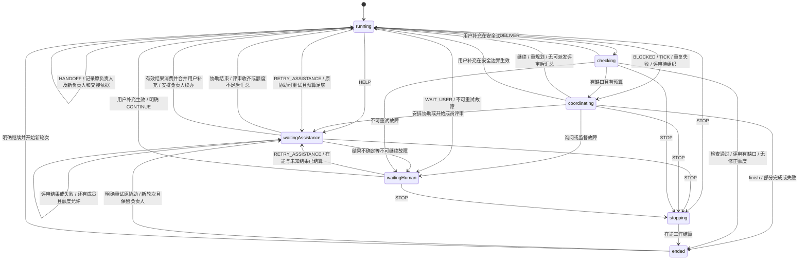

# squad

squad 是一个群聊协作工作台，依据中文 Gherkin 规格以 TypeScript/XState 实现。核心负责任务、协助、监督、黑板、预算与人类控制；外部模型和工具通过 WorkAdapter 接入。

当前交付包含 React/Base UI 群聊网页、本地 HTTP 宿主、可执行状态机、真实 SQLite 事务存储、操作驱动器、OpenAI 兼容模型适配器、回归测试和 Gherkin 的 Cucumber 步骤绑定。通用自然语言意图提取和 Pi Durable 适配器尚未实现。模型协议使用受控 HTTP 验证；真实供应商效果另行评估。

## 运行

需要 Node.js 22.18+（22.x）或 24.11+，以满足 Agents SDK 的依赖要求。本次在 Node.js 24.19 上验证。XState 固定为 v5，依赖版本和完整性由 package-lock.json 记录。

```sh
npm ci
npm run check
npm run demo
```

check 执行前后端及 Gherkin 步骤的严格 TypeScript 检查、回归测试、全部可自动验收的 Gherkin 场景，并生成 reports/spec-coverage.md。新增场景默认执行，漏绑定会失败；明确待验收项需在 features/acceptance-gaps.json 逐项登记。demo 使用受控模型替身演示 A 求助 B、保存回传、A 继续、检查交付与结束，不消耗真实模型费用。

## 群聊网页

```sh
npm run dev
```

打开 http://127.0.0.1:5173 。开发命令同时启动 Vite 和本地 API，按 Ctrl+C 一起退出。模型使用现有 `.env` 配置，密钥仅由服务端读取。未配置模型时网页仍能打开，并提示配置方式。

- 左侧新建、切换群聊；每个群的消息和执行记录保存在 `team.sqlite`，刷新或重启后仍可查看。
- 在输入框键入 `@`，或点击「点名成员」选择负责人，支持方向键与 Enter 补全。直接发送时由默认成员负责。普通消息中的引用不会自动触发成员调度。
- Enter 发送，Shift+Enter 换行。执行期间可以补充当前工作；成员等待回复时，发送内容作为用户决定处理。
- 群聊消息支持 Markdown：标题、粗体、列表、引用、链接、图片、代码块、表格和任务清单；普通换行保留。正文中的成员点名仍可点击查看过程，代码和链接内容按原样显示。
- 点击成员列表、群聊头像或「查看执行过程」，在右侧查看该成员的执行请求、协助、模型输出、技能搜索、错误和取消记录。原始输出默认折叠；空闲成员显示空状态。
- 点击底部任务状态查看目标、额度、调度记录和已有产物；「停止」会取消正在等待的模型请求，已停止任务可明确继续。连接中断时暂停发送并显示重连提示。
- 同一群的新任务会带上有来源标识的历史发言、方案与产物。已结束的任务保持结束；历史文件作为参考材料，不会直接冒充本轮交付。既有的等待任务在收到下一条用户消息时，也会补齐群历史。
- 直接说「大家都提提意见」「其他人评审一下方案」会启动成员评审：促进者先根据群里已有方案形成评审问题，再依次收集其他成员的意见，由负责人汇总共识、分歧与改进项。执行中的单独点名评审限定于选中的成员；简单请求仍由负责人直接处理。引用、代码和 Bot 发言不会触发全员调度。
- 评审队列与结果一同持久化；重启后接续剩余成员。停止会取消本轮队列，明确继续才开始新轮次；评审失败或额度不足会如实记录缺口，并以部分完成交付。普通额度会为最终汇总保留一次请求。

界面基于 `@base-ui/react` 的 Button、Popover、Tabs、Collapsible、Tooltip 和 Scroll Area，采用独立 CSS，兼容手机布局。详情展示可观察的执行记录，不包含模型隐藏推理。成员从 `team.config.ts` 加载，新增成员无需修改前端。

本地生产运行：

```sh
npm run build
npm start
```

打开 http://127.0.0.1:4318 。`WEB_PORT` 可修改 API/生产服务端口（默认 `4318`），`WEB_DATABASE` 可指定独立数据库路径（默认 `team.sqlite`）。开发代理跟随 `WEB_PORT`。服务仅监听本机回环地址，适合本地使用。

## 代码位置

默认配置包含 5 个群成员：方案师 `A`、核查员 `B`、`builder-1`、`builder-2`、`builder-3`。三个 Builder 均负责实现、修改与验证，默认继承主模型；所有成员默认支持技能搜索、网页搜索和网页抓取。角色说明和工具权限在 `team.config.ts` 中调整，模型分配在 `.env` 中调整。后台促进者独立运行，不计入这 5 个成员。所有成员共用任务预算，协作仍按当前状态机顺序调度。

| 文件 | 职责 |
| --- | --- |
| src/task.machine.ts | XState 状态、守卫、上下文更新与待执行操作 |
| src/engine.ts | 群路由、命令去重、原子提交、派发领取、期限检查与恢复 |
| src/store.ts | SQLite 与内存适配器，状态、消息、操作意图及回执一起保存 |
| src/runner.ts | 提交后执行外部操作，将结果转为受校验事件 |
| src/model-adapter.ts | 第三方模型 HTTP 调用、结构化输出与技能搜索循环 |
| src/web-tools.ts | Cloudflare Agents SDK 网页搜索、抓取、Markdown 转换与分页 |
| src/model-config.ts | 模型分配、固定执行配置与恢复兼容检查 |
| src/model-env.ts | 自动加载 .env、模型默认值与成员覆盖项 |
| src/web/ | 群聊 HTTP 接口、执行宿主、持久执行日志和前后端契约 |
| web/ | React/Base UI 群聊、点名补全和成员执行详情 |
| scripts/dev.mjs、scripts/web.ts | 本地开发和生产服务入口 |
| .env.example | 模型服务、密钥和各 Bot 模型的配置示例 |
| src/types.ts | 任务、消息、协助、黑板、预算、事件与配置契约 |
| team.config.ts | 示例角色、工具权限与有限额度 |
| features/ | 原始中文 Gherkin 基线，未修改需求以迁就实现 |
| tests/ | 状态回归、故障恢复、Gherkin 步骤绑定与验收门禁 |
| scripts/spec-coverage.ts | 区分回归关联、原场景直接通过和待绑定范围 |

## 状态模型



coordinating 与 stopping 是内部控制状态。结束结果单独记录 complete、partial、failed 或 stopped，方便界面区分成功、缺口和取消。用户补充必须等在途工作结算后才应用；若仍有评审，则重新进入 coordinating 组织本轮评审。普通额度耗尽通过 EXHAUSTED 结束，恢复时配置不兼容或外部结果不确定则进入 waitingHuman；安全恢复保留当前任务状态并接续操作。

不能只核对这张顶层图：评审队列的状态保存在上下文中，外部调用和网页交互也各有边界。对应的[细化状态图](docs/state-diagrams.md)包含协助重试与交接、成员评审、操作领取与回传、默认网页工具、群历史与消息路由，以及网页展示流程。网页工具沿用当前 owner / assistance / facilitator 意图和 CONSUME 预算事件，不新增顶层任务状态；开关、期限和版本由状态机守卫检查。新增、删除或调整功能时，必须按照 [AGENTS.md](AGENTS.md) **先写 Gherkin 场景，再更新状态图与 XState，最后完成具体实现**。

协助重试与交接（BT_H10–BT_H20、BT_U16）：`RETRY_ASSISTANCE` 显式指定原任务和原协助，保留目标与负责人，用新的请求 ID 和 `retryOf` 关联原尝试。直接用户输入的“B 重试”或“@B 重试”仅在当前任务（无活动任务时为最近任务）中唯一匹配时生效；歧义返回提示并由用户选择协助入口，不创建新任务。已保存且仍有效的结果直接消费。普通协助交接在同一转换中消费结果、应用补充并安排一次负责人续办；成员评审有补充时仍按原规则重新组织。停止后的重试必须由用户明确发起并开启新轮次，历史目标版本、在途或未知结果、撤销的权限与执行预算均须校验。重试不重置消耗，并为 B 的执行和 A 的续办保留至少两次普通请求。

品牌展示（BT_U14）沿用[网页交互](docs/state-diagrams.md#网页交互)中的连接、消息与详情状态。侧栏、欢迎区与浏览器图标共享随应用提供的 SVG，仅更新静态展示，不产生业务事件，无需改动 XState。

消息正文在各布局下的 14px 基础字号（BT_U15）沿用相同网页状态。环境重载（BT_W11–BT_W14）位于已领取、已计费的网页工具请求内：每次调用前重读 `.env` 并固定本次配置，文件失败沿用 WORK_FAILED，停止和恢复沿用现有转移；不新增 XState 状态或调度入口。

## 接入接口

默认向负责人、协助成员和后台促进者提供 `find skills` 技能搜索，配置入口为 `team.config.ts` 的 `skillSearch.enabled`，省略时也默认开启。适配器从工作输入的 `capabilities.findSkills` 发现能力，通过 `await scope.findSkills('react testing')` 搜索，返回技能名称、来源、安装量及链接。每次搜索额外消耗一次普通额度，并沿用当前任务的轮次、停止和取消控制。搜索失败会报错，不会伪装成零结果；找到技能后是否采用由任务上下文决定。

查询直接使用 Vercel Skills CLI 相同的 `https://skills.sh/api/search` 接口；当前实现提供搜索，不执行安装。内置模型适配器已通过结构化动作协议开放 `findSkills`，兼容不提供原生函数调用的服务。可在构造 `WorkRunner` 时通过第四参数注入搜索传输，供离线验证使用。

## 默认网页工具

`A`、`B` 和三个 Builder，以及后台促进者，默认都可使用 `web_search` / `web_fetch`。使用官方 `agents@0.30.0` 的 `agents/websearch`、`agents/webfetch` 接口，在现有 Node.js 宿主运行，无需部署 Worker，兼容各 Bot 独立配置的模型服务。完成检查不开放搜索，仍使用独立 checks 额度。

在 `.env` 填写同一组凭据：

```dotenv
CLOUDFLARE_ACCOUNT_ID=你的32位账号ID
CLOUDFLARE_API_TOKEN=你的API令牌
# 可选：省略时使用 default 网关和平台默认搜索提供商
# CLOUDFLARE_AI_GATEWAY_ID=default
# CLOUDFLARE_WEB_SEARCH_PROVIDER=ceramic
# CLOUDFLARE_WEB_SEARCH_BYOK_ALIAS=default
# SQUAD_WEB_TOOLS_ENABLED=false
```

搜索令牌需要目标账号的 **Workers AI: Read** 和 **AI Gateway: Read** 权限，网关需有搜索额度或已存储的提供商密钥。提供商支持 `ceramic`、`exa`、`linkup`。未填写凭据仍能启动和聊天；实际搜索或文档转换时会明确提示缺少配置。凭据仅从宿主环境读取，不进入持久任务配置或模型上下文。

每次 `web_search` / `web_fetch` 调用前会重载 `.env`：修改账号、令牌、网关、搜索提供商或 BYOK 别名后，下一次调用自动生效，无需重启或发送信号。删除、清空文件中的凭据或删除文件后，不会继续使用之前从文件加载的令牌；其他文件读取错误会明确报错。在途调用固定使用开始时的配置，避免抓取与转换使用不同账号。

启动时已设置的进程环境变量优先于文件；显式注入 `CloudflareWebToolsOptions.env` 时由注入方管理配置，不读取文件。模型服务地址、模型名称、成员分配与 `SQUAD_WEB_TOOLS_ENABLED` 仍属于启动配置，修改后需要重启。

- `web_search` 返回标题、来源 URL 与摘要，最多 5 条，每条摘要最多 600 字符。
- `web_fetch` 优先请求 Markdown，HTML/PDF 等文档经 Workers AI REST API 转换；Markdown、JSON、纯文本和 `raw` 文本读取无需 Cloudflare 凭据。每页最多 20,000 字符，按返回的 `nextOffset` 续读。
- 每次搜索或抓取各消耗 1 次 ordinary 额度，后续模型调用另计。默认单次工具超时 30 秒，抓取上限 5 MB、最多 5 次重定向；评审汇总保留额度、停止与版本隔离同样有效。
- 抓取沿用 SDK 的公共 URL 策略，拒绝私网 IP、localhost、URL 凭据、非 HTTP(S) 地址和不安全重定向。SDK 不通过 DNS 校验公共域名最终解析到的 IP；如部署在有敏感内网访问权的环境，应限制出口或通过 `CloudflareWebToolsOptions.allowedHosts` 限定站点。
- 工具返回资料不能授予任务调度权限，模型收到来源和不可信正文标记。群聊成员执行详情显示联网开始、结果与失败。不会绕过登录、执行页面 JavaScript 或操控浏览器。
- 恢复未完成的只读工作可能再次搜索、抓取或转换并产生费用，仍累计原有预算；已结算工作不重放，暂无跨调用页面缓存。

自定义适配器可调用 `scope.webSearch({ query }, signal)` 和 `scope.webFetch({ url, offset }, signal)`。两者返回 `{ output, text }`，其中 `output` 保留结构化来源和元数据，`text` 是 SDK 为模型整理的有界内容。内置模型适配器使用结构化 JSON 动作循环，无需供应商原生函数调用。`WorkRunner` 第五参数可以注入工具宿主用于验证；仅传输被替换，验收仍执行真实 SDK。

官方接口依据：[网页搜索](https://developers.cloudflare.com/agents/tools/web-search/)、[网页抓取](https://developers.cloudflare.com/agents/tools/web-fetch/)、[Markdown 转换 REST API](https://developers.cloudflare.com/workers-ai/features/markdown-conversion/usage/rest-api/)。自动化验证使用受控 HTTP 响应，不代表真实账号的权限、余额和服务可用性已验证。

## 第三方模型配置

模型服务统一在项目根目录的 `.env` 中配置，启动时自动读取，无需修改 TypeScript。先复制示例文件：

```sh
cp .env.example .env
```

填写默认服务，以及需要单独指定模型的成员：

```dotenv
# 默认连接，所有未覆盖的字段使用这一组值。
MODEL_BASE_URL=https://your-provider.example/v1
MODEL_NAME=YOUR_DEFAULT_MODEL
MODEL_API_KEY=your-key
MODEL_JSON_MODE=true

# 5 个 Bot 可以各用不同模型。
A_MODEL_NAME=YOUR_PLANNER_MODEL
B_MODEL_NAME=YOUR_REVIEW_MODEL
BUILDER_1_MODEL_NAME=YOUR_BUILDER_1_MODEL
BUILDER_2_MODEL_NAME=YOUR_BUILDER_2_MODEL
BUILDER_3_MODEL_NAME=YOUR_BUILDER_3_MODEL

# Builder 3 使用另一家服务时，还需填写其地址及独立密钥。
BUILDER_3_MODEL_BASE_URL=https://another-provider.example/v1
BUILDER_3_MODEL_API_KEY=another-key

# 促进者和完成检查也可单独选择模型。
FACILITATOR_MODEL_NAME=YOUR_FACILITATOR_MODEL
CHECK_MODEL_NAME=YOUR_CHECK_MODEL
```

地址和模型 ID 均为占位示例，需替换为供应商实际值。`baseUrl` 对应的变量是 API 根地址，例如以 `/v1` 或 `/compatible-mode/v1` 结尾；适配器会拼接 `/chat/completions`。支持 OpenAI 兼容的 Chat Completions 服务，原生 Anthropic、Gemini 协议需另接适配器，或通过兼容网关访问。

默认前缀为 `MODEL`；成员前缀为 `A_MODEL`、`B_MODEL`、`BUILDER_1_MODEL`、`BUILDER_2_MODEL`、`BUILDER_3_MODEL`，后台前缀为 `FACILITATOR_MODEL`、`CHECK_MODEL`。每组都支持以下后缀：

| 后缀 | 示例 | 含义 |
| --- | --- | --- |
| `BASE_URL` | `A_MODEL_BASE_URL` | API 根地址 |
| `NAME` | `A_MODEL_NAME` | 真实模型 ID |
| `API_KEY` | `A_MODEL_API_KEY` | 该角色使用的密钥 |
| `NO_AUTH` | `MODEL_NO_AUTH=true` | 明确使用无鉴权服务 |
| `JSON_MODE` | `B_MODEL_JSON_MODE=false` | 是否发送 JSON 输出格式参数 |
| `TEMPERATURE` | `MODEL_TEMPERATURE=0.2` | 温度 |
| `MAX_TOKENS` | `MODEL_MAX_TOKENS=8192` | 单次输出 Token 上限 |
| `EXTRA_BODY` | `MODEL_EXTRA_BODY={"enable_thinking":false}` | 供应商扩展 JSON 参数 |

空白的成员配置继承默认值；完成检查未单独配置时，继承促进者的模型选择。同一地址可以共用默认密钥，修改为另一地址后必须设置对应角色的密钥，或明确设置该角色的 `NO_AUTH=true`，不会把默认服务的密钥转发到新地址。布尔项使用 `true` 或 `false`。

已有进程环境变量优先于 `.env`。修改文件后重启生效，不会热切换正在执行的任务。`.env` 和 `.env.*` 已被 Git 忽略，仓库仅提交 `.env.example`；任务快照仅保留密钥变量名，不保存密钥值。完全不配置模型时，离线测试和受控演示仍可运行。

配置完成后运行真实模型：

```sh
npm run model:run -- "为这个目标给出方案，必要时向核查员求助"
```

此命令每次新建一个演示群，将任务保存在 `team.sqlite`，支持 Ctrl+C 停止。缺少必需密钥时不会发送请求。它使用默认 Bot；网页使用相同模型配置与执行内核。宿主接入方式如下：

```typescript
const runner = new WorkRunner(engine, new OpenAICompatibleAdapter(config));
await runner.runOne(roomId, taskId);
```

首次模型请求使用领取工作时预留的额度；技能搜索和后续模型请求分别再扣一次额度。HTTP 408、429、5xx 和网络故障使用任务级有限重试；鉴权失败、格式错误和截断回答进入等待人类，不自动切换服务。操作超时覆盖模型及技能搜索循环。模型和服务配置固定在任务操作上，恢复时发现服务或路由变化会暂停，避免静默换模型重放。

模型适配器支持文本交付、求助、促进者决策、完成检查和技能搜索。现有 `read`、`writeArtifact` 等通用工具由额外的 `WorkAdapter` 接入，不能把模型声称生成了文件当作已持久化的产物。

使用 OpenCode Go 时，适配器自动发送 `x-opencode-session` 和 `User-Agent: squad-bots/0.1.0`。网页以群聊作为稳定会话，CLI 以任务作为会话；协助、检查、重试及重启保持同一会话标识，无需在 `.env` 中额外填写请求头。缺少该标识时，OpenCode 会返回 HTTP 400 / `MissingSessionID`。HTTP 错误仅保存短错误代码和参数名，不持久化供应商的原始响应或回显内容。

```typescript
const engine = new TeamEngine(new SqliteStore('team.sqlite'), config);
const start = engine.submit('room1', {
  id: 'stable-user-request-id',
  text: '@A 形成方案并核实来源',
  mentions: ['A'],
  goal: {
    text: '形成方案',
    constraints: ['关键结论必须引用来源'],
    criteria: ['覆盖方案与恢复边界'],
    requiredArtifacts: 1,
  },
});
```

mentions 是编辑器实际点名得到的成员身份；不要从引用资料、工具文本或 Bot 普通发言中构造调度请求。群评审识别只读取直接用户提交，支持常见的中文/英文集体评审表达及实际点名评审；它不是通用的自然语言意图提取器。goal 和 intent 由上游界面或意图提取模块提供。send 是可信后端事件接口，不应直接向未经校验的客户端或模型开放。

宿主通过 WorkRunner 领取已提交的操作，并调用 WorkAdapter.execute。适配器必须保留 intent.id 作为稳定逻辑身份，将模型输出校验为 WorkOutput，并遵守 AbortSignal。涉及外部写入时，还要提供幂等操作或结果核对。

领取操作预占首次执行额度。一个适配器内部若继续执行多轮模型或工具请求，必须在每个额外请求之前调用第三参数 scope.authorizeAdditionalRequest，并为该请求提供稳定身份；拒绝时禁止发出请求。该钩子也检查轮次和目标版本。真实 Pi Durable 适配器需把钩子接到每次实际调用之前，不能把一整段无限运行只计为一次操作。

宿主启动后调用 recover；运行时依据 nextWake 安排 tick。状态机本身不启动隐藏轮询线程。真实 Pi Durable 接入时，需将这些宿主动作对应到锁定版本的持久执行和唤醒接口。

## 可靠性机制

- XState 使用纯状态转换。状态机动作只更新可序列化状态和操作意图，不直接发送模型请求。
- SQLite 同一事务保存任务快照、群消息、黑板、待执行操作与请求回执。提交失败后，当前引擎停止新增执行，需重新打开。
- 派发前领取操作，再次检查状态、权限、目标版本、执行轮次与预算。停止后只能派发取消请求。
- 协助结果先通过 RECORD_RESULT 保存，再由 HELP_RESULT 原子消费并推进父任务；重启可补回传，重复消费无效。
- 目标修改、用户决定、停止及新轮次会使旧判断失效。迟到结果只留历史，不发布为新结论。
- 所有成员共享主任务额度；检查额度单独预留。重试不重置预算，继续增额需要明确输入。
- 不确定的外部操作进入等待并要求 RECONCILE；不会直接重放。

当前恢复实现对安全的未完成操作保留逻辑身份并允许重新请求，不承诺模型提供方只接收到一次物理请求。SQLite 测试针对进程退出与事务恢复，不构成硬件断电或外部工具恰好执行一次的保证。

## 验证范围

测试跨越 TeamEngine 的同一接口，覆盖主动求助、被动监督、停止传播、版本隔离、黑板冲突、预算和完成检查。SQLite 恢复测试会实际启动子进程，在命名检查点退出，再重新打开数据库。

Gherkin 已直接覆盖消息路由、协助、监督、黑板、人类控制、额度、交付、群历史、成员评审、模型传输和 Markdown 渲染。全部未登记为待验收的场景及例子必须直接通过；回归关联不能代替直接执行。覆盖报告同时检查唯一场景编号、排除登记与执行遗漏，场景说明见 features/README.md。

尚待验收的要求保持原文并逐项记录原因：features/06_durability.feature 要求真实 Pi Durable 接入；BT_U01、U02、U03、U09 仍需完整浏览器交互验收；BT_F06 仍需费用及未知费用展示。当前 SQLite 故障回归、评审恢复与 Markdown 服务端渲染测试不冒充这些验收。

后续集成工作集中在 Pi Durable 的 WorkAdapter 与宿主唤醒、真实供应商联调与通用工具接入、自然语言目标/意图提取。网页已提供已有产物的下载入口；文件是否实际生成仍取决于 WorkAdapter，不能把模型声称的文件当作产物。核心状态与 Gherkin 基线可继续复用。

## 设计依据

- https://stately.ai/docs/pure-transitions
- https://stately.ai/docs/persistence
- https://stately.ai/docs/typescript
- https://api-docs.deepseek.com/api/create-chat-completion/
- https://help.aliyun.com/en/model-studio/qwen-api-via-openai-chat-completions

本地依赖及类型声明以 package-lock.json 固定的 XState v5 为准；文档站点可能同时包含 v6 alpha 内容。
