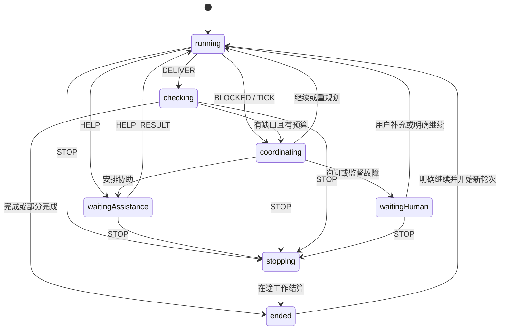

# Bot Team v0.4 — XState 执行内核

这是依据中文 Gherkin 规格开始实现的 TypeScript/XState 项目。核心负责任务、协助、监督、黑板、预算与人类控制；外部模型和工具通过 WorkAdapter 接入。

当前交付包含可执行状态机、真实 SQLite 事务存储、内存测试适配器、操作驱动器、回归测试和部分原 Gherkin 的 Cucumber 步骤绑定。网页、自然语言意图提取、真实模型和 Pi Durable 适配器尚未实现，不能把本项目称为完整应用。

## 运行

需要 Node.js 22.13 或更高版本。本次在 Node.js 24 上验证。XState 固定为 v5，依赖版本和完整性由 package-lock.json 记录。

```sh
npm ci
npm run check
npm run demo
```

check 执行严格 TypeScript 编译、回归测试、已绑定的原 Gherkin 场景，并生成 reports/spec-coverage.md。demo 使用受控模型替身演示 A 求助 B、保存回传、A 继续、检查交付与结束，不消耗真实模型费用。

## 代码位置

| 文件 | 职责 |
| --- | --- |
| src/task.machine.ts | XState 状态、守卫、上下文更新与待执行操作 |
| src/engine.ts | 群路由、命令去重、原子提交、派发领取、期限检查与恢复 |
| src/store.ts | SQLite 与内存适配器，状态、消息、操作意图及回执一起保存 |
| src/runner.ts | 提交后执行外部操作，将结果转为受校验事件 |
| src/types.ts | 任务、消息、协助、黑板、预算、事件与配置契约 |
| team.config.ts | 示例角色、工具权限与有限额度 |
| features/ | 原始中文 Gherkin 基线，未修改需求以迁就实现 |
| tests/ | 状态回归、故障恢复、原 Gherkin 步骤绑定 |
| scripts/spec-coverage.ts | 区分回归关联、原场景直接通过和待绑定范围 |

## 状态模型



coordinating 与 stopping 是内部控制状态。结束结果单独记录 complete、partial、failed 或 stopped，方便界面区分成功、缺口和取消。

## 接入接口

```typescript
const engine = new TeamEngine(new SqliteStore('team.sqlite'), config);
const start = engine.submit('room1', {
  id: 'stable-user-request-id',
  text: '@A 形成方案并核实来源',
  mentions: ['A'],
  goal: {
    text: '形成方案',
    constraints: ['关键结论必须引用来源'],
    criteria: ['覆盖方案与恢复边界'],
    requiredArtifacts: 1,
  },
});
```

mentions 是编辑器实际点名得到的成员身份；不要从引用资料、工具文本或 Bot 普通发言中构造调度请求。goal 和 intent 由上游界面或意图提取模块提供。send 是可信后端事件接口，不应直接向未经校验的客户端或模型开放。

宿主通过 WorkRunner 领取已提交的操作，并调用 WorkAdapter.execute。适配器必须保留 intent.id 作为稳定逻辑身份，将模型输出校验为 WorkOutput，并遵守 AbortSignal。涉及外部写入时，还要提供幂等操作或结果核对。

领取操作预占首次执行额度。一个适配器内部若继续执行多轮模型或工具请求，必须在每个额外请求之前调用第三参数 scope.authorizeAdditionalRequest，并为该请求提供稳定身份；拒绝时禁止发出请求。该钩子也检查轮次和目标版本。真实 Pi Durable 适配器需把钩子接到每次实际调用之前，不能把一整段无限运行只计为一次操作。

宿主启动后调用 recover；运行时依据 nextWake 安排 tick。状态机本身不启动隐藏轮询线程。真实 Pi Durable 接入时，需将这些宿主动作对应到锁定版本的持久执行和唤醒接口。

## 可靠性机制

- XState 使用纯状态转换。状态机动作只更新可序列化状态和操作意图，不直接发送模型请求。
- SQLite 同一事务保存任务快照、群消息、黑板、待执行操作与请求回执。提交失败后，当前引擎停止新增执行，需重新打开。
- 派发前领取操作，再次检查状态、权限、目标版本、执行轮次与预算。停止后只能派发取消请求。
- 协助结果先通过 RECORD_RESULT 保存，再由 HELP_RESULT 原子消费并推进父任务；重启可补回传，重复消费无效。
- 目标修改、用户决定、停止及新轮次会使旧判断失效。迟到结果只留历史，不发布为新结论。
- 所有成员共享主任务额度；检查额度单独预留。重试不重置预算，继续增额需要明确输入。
- 不确定的外部操作进入等待并要求 RECONCILE；不会直接重放。

当前恢复实现对安全的未完成操作保留逻辑身份并允许重新请求，不承诺模型提供方只接收到一次物理请求。SQLite 测试针对进程退出与事务恢复，不构成硬件断电或外部工具恰好执行一次的保证。

## 验证范围

测试跨越 TeamEngine 的同一接口，覆盖主动求助、被动监督、停止传播、版本隔离、黑板冲突、预算和完成检查。SQLite 恢复测试会实际启动子进程，在命名检查点退出，再重新打开数据库。

部分原 Gherkin 已直接绑定并运行。其余场景在覆盖报告中保持待绑定；关联某个场景编号的回归断言，不自动代表原场景的所有例子与界面要求都已验收。尤其是 features/06_durability.feature 的 Pi Durable 背景仍需真实适配器接入后才可按原文验收。

后续集成工作集中在三个位置：Pi Durable 的 WorkAdapter 与宿主唤醒、自然语言目标/意图提取、网页与下载入口。核心状态与 Gherkin 基线可继续复用。

## 设计依据

- https://stately.ai/docs/pure-transitions
- https://stately.ai/docs/persistence
- https://stately.ai/docs/typescript

本地依赖及类型声明以 package-lock.json 固定的 XState v5 为准；文档站点可能同时包含 v6 alpha 内容。
