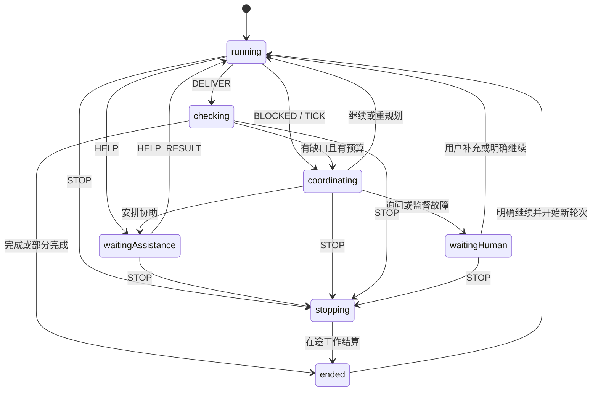

# Bot Team v0.4 — XState 执行内核

这是依据中文 Gherkin 规格开始实现的 TypeScript/XState 项目。核心负责任务、协助、监督、黑板、预算与人类控制；外部模型和工具通过 WorkAdapter 接入。

当前交付包含可执行状态机、真实 SQLite 事务存储、内存测试适配器、操作驱动器、OpenAI 兼容模型服务适配器、回归测试和部分原 Gherkin 的 Cucumber 步骤绑定。网页、自然语言意图提取和 Pi Durable 适配器尚未实现，不能把本项目称为完整应用。模型调用已通过本地 HTTP 服务验证，尚未使用真实供应商密钥联调。

## 运行

需要 Node.js 22.13 或更高版本。本次在 Node.js 24 上验证。XState 固定为 v5，依赖版本和完整性由 package-lock.json 记录。

```sh
npm ci
npm run check
npm run demo
```

check 执行严格 TypeScript 编译、回归测试、已绑定的原 Gherkin 场景，并生成 reports/spec-coverage.md。demo 使用受控模型替身演示 A 求助 B、保存回传、A 继续、检查交付与结束，不消耗真实模型费用。

## 代码位置

默认配置包含 5 个群成员：方案师 `A`、核查员 `B`、`builder-1`、`builder-2`、`builder-3`。三个 Builder 均负责实现、修改与验证，默认继承主模型并支持技能搜索；角色说明和工具权限在 `team.config.ts` 中调整，模型分配在 `.env` 中调整。后台促进者独立运行，不计入这 5 个成员。所有成员共用任务预算，协作仍按当前状态机顺序调度。

| 文件 | 职责 |
| --- | --- |
| src/task.machine.ts | XState 状态、守卫、上下文更新与待执行操作 |
| src/engine.ts | 群路由、命令去重、原子提交、派发领取、期限检查与恢复 |
| src/store.ts | SQLite 与内存适配器，状态、消息、操作意图及回执一起保存 |
| src/runner.ts | 提交后执行外部操作，将结果转为受校验事件 |
| src/model-adapter.ts | 第三方模型 HTTP 调用、结构化输出与技能搜索循环 |
| src/model-config.ts | 模型分配、固定执行配置与恢复兼容检查 |
| src/model-env.ts | 自动加载 .env、模型默认值与成员覆盖项 |
| .env.example | 模型服务、密钥和各 Bot 模型的配置示例 |
| src/types.ts | 任务、消息、协助、黑板、预算、事件与配置契约 |
| team.config.ts | 示例角色、工具权限与有限额度 |
| features/ | 原始中文 Gherkin 基线，未修改需求以迁就实现 |
| tests/ | 状态回归、故障恢复、原 Gherkin 步骤绑定 |
| scripts/spec-coverage.ts | 区分回归关联、原场景直接通过和待绑定范围 |

## 状态模型



coordinating 与 stopping 是内部控制状态。结束结果单独记录 complete、partial、failed 或 stopped，方便界面区分成功、缺口和取消。

## 接入接口

默认向负责人、协助成员和后台促进者提供 `find skills` 技能搜索，配置入口为 `team.config.ts` 的 `skillSearch.enabled`，省略时也默认开启。适配器从工作输入的 `capabilities.findSkills` 发现能力，通过 `await scope.findSkills('react testing')` 搜索，返回技能名称、来源、安装量及链接。每次搜索额外消耗一次普通额度，并沿用当前任务的轮次、停止和取消控制。搜索失败会报错，不会伪装成零结果；找到技能后是否采用由任务上下文决定。

查询直接使用 Vercel Skills CLI 相同的 `https://skills.sh/api/search` 接口；当前实现提供搜索，不执行安装。内置模型适配器已通过结构化动作协议开放 `findSkills`，兼容不提供原生函数调用的服务。可在构造 `WorkRunner` 时通过第四参数注入搜索传输，供离线验证使用。

## 第三方模型配置

模型服务统一在项目根目录的 `.env` 中配置，启动时自动读取，无需修改 TypeScript。先复制示例文件：

```sh
cp .env.example .env
```

填写默认服务，以及需要单独指定模型的成员：

```dotenv
# 默认连接，所有未覆盖的字段使用这一组值。
MODEL_BASE_URL=https://your-provider.example/v1
MODEL_NAME=YOUR_DEFAULT_MODEL
MODEL_API_KEY=your-key
MODEL_JSON_MODE=true

# 5 个 Bot 可以各用不同模型。
A_MODEL_NAME=YOUR_PLANNER_MODEL
B_MODEL_NAME=YOUR_REVIEW_MODEL
BUILDER_1_MODEL_NAME=YOUR_BUILDER_1_MODEL
BUILDER_2_MODEL_NAME=YOUR_BUILDER_2_MODEL
BUILDER_3_MODEL_NAME=YOUR_BUILDER_3_MODEL

# Builder 3 使用另一家服务时，还需填写其地址及独立密钥。
BUILDER_3_MODEL_BASE_URL=https://another-provider.example/v1
BUILDER_3_MODEL_API_KEY=another-key

# 促进者和完成检查也可单独选择模型。
FACILITATOR_MODEL_NAME=YOUR_FACILITATOR_MODEL
CHECK_MODEL_NAME=YOUR_CHECK_MODEL
```

地址和模型 ID 均为占位示例，需替换为供应商实际值。`baseUrl` 对应的变量是 API 根地址，例如以 `/v1` 或 `/compatible-mode/v1` 结尾；适配器会拼接 `/chat/completions`。支持 OpenAI 兼容的 Chat Completions 服务，原生 Anthropic、Gemini 协议需另接适配器，或通过兼容网关访问。

默认前缀为 `MODEL`；成员前缀为 `A_MODEL`、`B_MODEL`、`BUILDER_1_MODEL`、`BUILDER_2_MODEL`、`BUILDER_3_MODEL`，后台前缀为 `FACILITATOR_MODEL`、`CHECK_MODEL`。每组都支持以下后缀：

| 后缀 | 示例 | 含义 |
| --- | --- | --- |
| `BASE_URL` | `A_MODEL_BASE_URL` | API 根地址 |
| `NAME` | `A_MODEL_NAME` | 真实模型 ID |
| `API_KEY` | `A_MODEL_API_KEY` | 该角色使用的密钥 |
| `NO_AUTH` | `MODEL_NO_AUTH=true` | 明确使用无鉴权服务 |
| `JSON_MODE` | `B_MODEL_JSON_MODE=false` | 是否发送 JSON 输出格式参数 |
| `TEMPERATURE` | `MODEL_TEMPERATURE=0.2` | 温度 |
| `MAX_TOKENS` | `MODEL_MAX_TOKENS=8192` | 单次输出 Token 上限 |
| `EXTRA_BODY` | `MODEL_EXTRA_BODY={"enable_thinking":false}` | 供应商扩展 JSON 参数 |

空白的成员配置继承默认值；完成检查未单独配置时，继承促进者的模型选择。同一地址可以共用默认密钥，修改为另一地址后必须设置对应角色的密钥，或明确设置该角色的 `NO_AUTH=true`，不会把默认服务的密钥转发到新地址。布尔项使用 `true` 或 `false`。

已有进程环境变量优先于 `.env`。修改文件后重启生效，不会热切换正在执行的任务。`.env` 和 `.env.*` 已被 Git 忽略，仓库仅提交 `.env.example`；任务快照仅保留密钥变量名，不保存密钥值。完全不配置模型时，离线测试和受控演示仍可运行。

配置完成后运行真实模型：

```sh
npm run model:run -- "为这个目标给出方案，必要时向核查员求助"
```

此命令每次新建一个演示群，将任务保存在 `team.sqlite`，支持 Ctrl+C 停止。缺少必需密钥时不会发送请求。它使用默认 Bot；群聊界面仍需后续接入。宿主接入方式如下：

```typescript
const runner = new WorkRunner(engine, new OpenAICompatibleAdapter(config));
await runner.runOne(roomId, taskId);
```

首次模型请求使用领取工作时预留的额度；技能搜索和后续模型请求分别再扣一次额度。HTTP 408、429、5xx 和网络故障使用任务级有限重试；鉴权失败、格式错误和截断回答进入等待人类，不自动切换服务。操作超时覆盖模型及技能搜索循环。模型和服务配置固定在任务操作上，恢复时发现服务或路由变化会暂停，避免静默换模型重放。

模型适配器支持文本交付、求助、促进者决策、完成检查和技能搜索。现有 `read`、`writeArtifact` 等通用工具由额外的 `WorkAdapter` 接入，不能把模型声称生成了文件当作已持久化的产物。

```typescript
const engine = new TeamEngine(new SqliteStore('team.sqlite'), config);
const start = engine.submit('room1', {
  id: 'stable-user-request-id',
  text: '@A 形成方案并核实来源',
  mentions: ['A'],
  goal: {
    text: '形成方案',
    constraints: ['关键结论必须引用来源'],
    criteria: ['覆盖方案与恢复边界'],
    requiredArtifacts: 1,
  },
});
```

mentions 是编辑器实际点名得到的成员身份；不要从引用资料、工具文本或 Bot 普通发言中构造调度请求。goal 和 intent 由上游界面或意图提取模块提供。send 是可信后端事件接口，不应直接向未经校验的客户端或模型开放。

宿主通过 WorkRunner 领取已提交的操作，并调用 WorkAdapter.execute。适配器必须保留 intent.id 作为稳定逻辑身份，将模型输出校验为 WorkOutput，并遵守 AbortSignal。涉及外部写入时，还要提供幂等操作或结果核对。

领取操作预占首次执行额度。一个适配器内部若继续执行多轮模型或工具请求，必须在每个额外请求之前调用第三参数 scope.authorizeAdditionalRequest，并为该请求提供稳定身份；拒绝时禁止发出请求。该钩子也检查轮次和目标版本。真实 Pi Durable 适配器需把钩子接到每次实际调用之前，不能把一整段无限运行只计为一次操作。

宿主启动后调用 recover；运行时依据 nextWake 安排 tick。状态机本身不启动隐藏轮询线程。真实 Pi Durable 接入时，需将这些宿主动作对应到锁定版本的持久执行和唤醒接口。

## 可靠性机制

- XState 使用纯状态转换。状态机动作只更新可序列化状态和操作意图，不直接发送模型请求。
- SQLite 同一事务保存任务快照、群消息、黑板、待执行操作与请求回执。提交失败后，当前引擎停止新增执行，需重新打开。
- 派发前领取操作，再次检查状态、权限、目标版本、执行轮次与预算。停止后只能派发取消请求。
- 协助结果先通过 RECORD_RESULT 保存，再由 HELP_RESULT 原子消费并推进父任务；重启可补回传，重复消费无效。
- 目标修改、用户决定、停止及新轮次会使旧判断失效。迟到结果只留历史，不发布为新结论。
- 所有成员共享主任务额度；检查额度单独预留。重试不重置预算，继续增额需要明确输入。
- 不确定的外部操作进入等待并要求 RECONCILE；不会直接重放。

当前恢复实现对安全的未完成操作保留逻辑身份并允许重新请求，不承诺模型提供方只接收到一次物理请求。SQLite 测试针对进程退出与事务恢复，不构成硬件断电或外部工具恰好执行一次的保证。

## 验证范围

测试跨越 TeamEngine 的同一接口，覆盖主动求助、被动监督、停止传播、版本隔离、黑板冲突、预算和完成检查。SQLite 恢复测试会实际启动子进程，在命名检查点退出，再重新打开数据库。

部分原 Gherkin 已直接绑定并运行。其余场景在覆盖报告中保持待绑定；关联某个场景编号的回归断言，不自动代表原场景的所有例子与界面要求都已验收。尤其是 features/06_durability.feature 的 Pi Durable 背景仍需真实适配器接入后才可按原文验收。

后续集成工作集中在 Pi Durable 的 WorkAdapter 与宿主唤醒、真实供应商联调与通用工具接入、自然语言目标/意图提取、网页与下载入口。核心状态与 Gherkin 基线可继续复用。

## 设计依据

- https://stately.ai/docs/pure-transitions
- https://stately.ai/docs/persistence
- https://stately.ai/docs/typescript
- https://api-docs.deepseek.com/api/create-chat-completion/
- https://help.aliyun.com/en/model-studio/qwen-api-via-openai-chat-completions

本地依赖及类型声明以 package-lock.json 固定的 XState v5 为准；文档站点可能同时包含 v6 alpha 内容。
