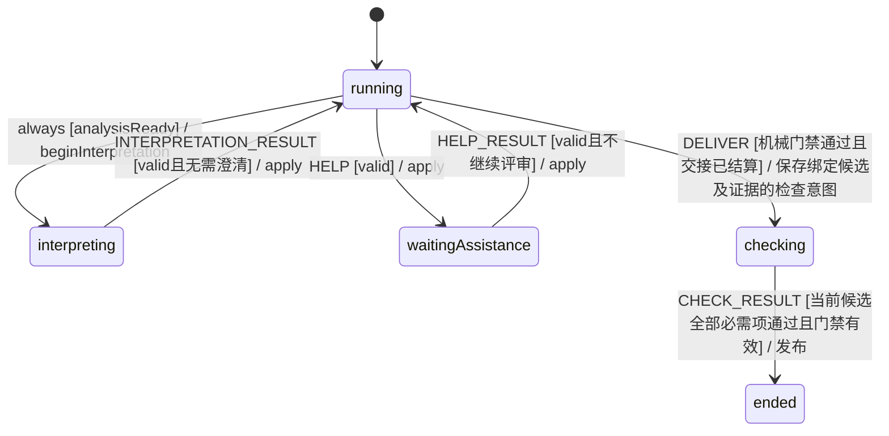
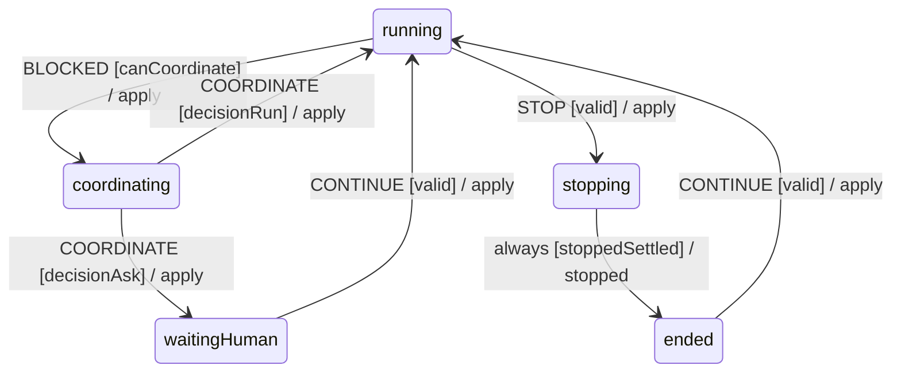

# squad

squad 是一个群聊协作工作台，依据中文 Gherkin 规格以 TypeScript/XState 实现。核心负责任务、协助、监督、黑板、预算与人类控制；外部模型和工具通过 WorkAdapter 接入。

当前交付包含 React/Base UI 群聊网页、本地 HTTP 宿主、可执行状态机、真实 SQLite 事务存储、操作驱动器、OpenAI 兼容模型适配器、输入意图解析、回归测试和 Gherkin 的 Cucumber 步骤绑定。Pi Durable 适配器尚未实现。模型协议使用受控 HTTP 验证；真实供应商效果另行评估。

## 运行

需要 Node.js 22.18+（22.x）或 24.11+，以满足 Agents SDK 的依赖要求。本轮使用 Node.js 24.22.1。XState 固定为 v5，依赖版本和完整性由 package-lock.json 记录。完整检查还需要 Python 3、Playwright、Chromium 和可显示中文的字体，安装方式见[浏览器验收技能](.agents/skills/verify-squad/SKILL.md#launch)；CI 已固定准备这些依赖。

```sh
npm ci
npm run check
npm run demo
```

check 执行前后端、全部测试及夹具的严格 TypeScript 检查、回归测试、全部可自动验收的 Gherkin 场景，并生成 reports/spec-coverage.md。新增场景默认执行，漏绑定会失败；明确待验收项需在 features/acceptance-gaps.json 逐项登记。demo 使用受控模型替身演示 A 求助 B、保存回传、A 继续、检查交付与结束，不消耗真实模型费用。

产品行为以可执行中文 Gherkin 为唯一验收契约。`npm run test:unit` 只运行符合准入的补充验证；完整检查仍执行全部适用层次。分层、独立模型验证命令和本次清理记录见 [测试说明](tests/README.md)。

`npm run simulate:discussion` 批量运行后台讨论的真实 XState 转换，包括全部144种合法结果返回顺序与生命周期边界，输出逐步 JSON 轨迹和 Markdown 汇总到 `reports/`，任何断言失败都会返回非零退出码。[已运行的仿真结果与修正](docs/discussion-simulation.md)说明覆盖范围、实际轨迹和保证边界；脚本不调用真实模型或工具。

## 群聊网页

```sh
npm run dev
```

打开 http://127.0.0.1:5173 。开发命令同时启动 Vite 和本地 API，按 Ctrl+C 一起退出。模型使用现有 `.env` 配置，密钥仅由服务端读取。未配置模型时网页仍能打开，并提示配置方式。

- 左侧新建、切换群聊；每个群的消息和执行记录保存在 `team.sqlite`，刷新或重启后仍可查看。
- 在输入框键入 `@`，或点击「点名成员」选择负责人，支持方向键与 Enter 补全。直接发送时由默认成员负责。普通消息中的引用不会自动触发成员调度。
- Enter 发送，Shift+Enter 换行。执行期间可以补充当前工作；成员等待回复时，发送内容作为用户决定处理。
- 群聊消息支持 Markdown：标题、粗体、列表、引用、链接、图片、代码块、表格和任务清单；普通换行保留。正文中的成员点名仍可点击查看过程，代码和链接内容按原样显示。
- 已成功交付的 Markdown 可从预览中点「引用到新任务」，也可直接说「修改 a.md，补充部署说明，输出为 b.md」。同名产物需先选择；默认沿用来源任务负责人，也可直接 @ 现有成员。新任务固定原文，检查通过后发布独立文档，并可从「来源」返回原产物。原任务及下载入口保留；群内有活动任务时保留草稿并提示等待后重发。首版支持同群单份 `.md` / `.markdown`，原文上限 32 KiB。
- 点击成员列表、群聊头像或「查看执行过程」，在右侧查看该成员的执行请求、协助、模型输出、技能搜索、错误和取消记录。原始输出默认折叠；空闲成员显示空状态。
- 点击底部任务状态查看目标、额度、调度记录和已有产物；「停止」会取消正在等待的模型请求，已停止任务可明确继续。连接中断时暂停发送并显示重连提示。
- 同一群的新任务会带上有来源标识的历史发言、方案与产物。已结束的任务保持结束；历史文件作为参考材料，不会直接冒充本轮交付。既有的等待任务在收到下一条用户消息时，也会补齐群历史。
- 直接说「大家都提提意见」「其他人评审一下方案」会启动成员评审：促进者先根据群里已有方案形成评审问题，再依次收集其他成员的意见，由负责人汇总共识、分歧与改进项。执行中的单独点名评审限定于选中的成员；简单请求仍由负责人直接处理。引用、代码和 Bot 发言不会触发全员调度。
- 成员正在工作时，直接说「所有人都参与讨论一下」会由协调员立即组织当时空闲的成员并行提供一轮意见，再汇总给原负责人。原请求继续执行，返回的草稿与讨论汇总都保存后才安排负责人续办；忙碌、失败或额度不足的成员会明确列出。
- 评审队列与结果一同持久化；重启后接续剩余成员。停止会取消本轮队列，明确继续才开始新轮次；评审失败或额度不足会如实记录缺口，并以部分完成交付。普通额度会为最终汇总保留一次请求。

界面基于 `@base-ui/react` 的 Button、Popover、Tabs、Collapsible、Tooltip 和 Scroll Area，采用独立 CSS，兼容手机布局。详情展示可观察的执行记录，不包含模型隐藏推理。成员从 `team.config.ts` 加载，新增成员无需修改前端。

本地生产运行：

```sh
npm run build
npm start
```

打开 http://127.0.0.1:4318 。`WEB_PORT` 可修改 API/生产服务端口（默认 `4318`），`WEB_DATABASE` 可指定独立数据库路径（默认 `team.sqlite`）。开发代理跟随 `WEB_PORT`。服务仅监听本机回环地址，适合本地使用。

## 本地技能与 CLI

成员可先用 `discoverHost` 查询平台、技能目录、沙箱状态和指定 CLI 的存在性，再按技能说明调用已有接口。每次最多查询 20 个裸命令名，不运行探测命令、不扫描凭据、不自动安装；未查询的命令仍为未知。命令存在不代表已获得宿主批准或已执行。当前服务未接入原生 MCP transport，回执会明确说明，不能据此推断机器上没有 MCP 配置。

服务启动先扫描运行账号的 `~/.agents/skills/`，所有 Bot 共用一个版本目录；正文与引用按需加载，CLI 在受控工作区执行。新增 Bot 自动继承；`Bot.localTools = false` 可单独关闭。技能更新后重启生效，不自动安装技能或命令依赖。

模型使用 `discoverHost`、`listSkills`、`loadSkill`、`readSkillResource`、`readEvidence`、`readArtifact`、`runCli` 等本地 JSON 动作。每次磁盘/命令操作先经 XState 保存和领取；命令回执、技能版本和模型续办检查点持久化。检查与后台讨论在副本中运行，权威工程不变；检查的源文件只读，输出目录可写，正面结论提交前复核源版本。同一工程跨群串行，不同默认任务目录隔离。

默认 CLI 后端为固定版本的 Anthropic Sandbox Runtime：macOS 使用 sandbox-exec 和系统 Python 3 的 libproc 进程身份探测，Linux 使用 bubblewrap、socat、ripgrep 及用户/PID/网络命名空间。依赖不可用时明确返回 `CLI_SANDBOX_UNAVAILABLE`，不自动降级。需要使用本机登录态或系统能力时，Bot 可申请按次宿主执行，网页显示具体命令与目录，由用户“允许本次”或“拒绝”，无需逐个 CLI 预配置。批准前不执行，重启后重新确认；宿主权限属于服务机器及账号。`npm run verify:local-sandbox` 验证实际文件、网络与环境边界（环境不可用退出78）。[运行配置与未决操作核对](docs/local-tools.md) 说明目录、权限及恢复命令；[验证记录](docs/local-tools-verification.md) 区分模型、真实子进程和 OS 沙箱证据。

## 代码位置

默认配置包含 5 个群成员：方案师 `A`、核查员 `B`、`builder-1`、`builder-2`、`builder-3`。三个 Builder 均负责实现、修改与验证，默认继承主模型；所有成员默认支持技能搜索、网页搜索、网页抓取，以及本地技能和 CLI。角色说明和工具权限在 `team.config.ts` 中调整，模型分配在 `.env` 中调整。后台促进者独立运行，不计入这 5 个成员。所有成员共用任务预算；主工作保持顺序调度，用户邀请的后台讨论和已识别的独立 map-reduce 分片允许不同空闲成员并行执行。

| 文件 | 职责 |
| --- | --- |
| src/task.machine.ts | XState 状态、守卫、上下文更新与待执行操作 |
| src/local-operation.ts | 父工作内局部操作的纯契约与守卫 |
| src/local-skills.ts | 启动目录、版本快照和包内资源读取 |
| src/local-cli.ts / src/local-runtime.ts | OS 后端、进程会话、工作区与恢复回执 |
| src/engine.ts | 群路由、命令去重、原子提交、派发领取、期限检查与恢复 |
| src/store.ts | SQLite 与内存适配器，状态、消息、操作意图及回执一起保存 |
| src/runner.ts | 提交后执行外部操作，将结果转为受校验事件 |
| src/model-adapter.ts | 第三方模型 HTTP 调用、结构化输出与技能搜索循环 |
| src/input-intent.ts | 输入意图 Zod 契约、确定性快速路径、解析策略与引用校验 |
| src/web-tools.ts | Cloudflare Agents SDK 网页搜索、抓取、Markdown 转换与分页 |
| src/model-config.ts | 模型分配、固定执行配置与恢复兼容检查 |
| src/model-env.ts | 自动加载 .env、模型默认值与成员覆盖项 |
| src/web/ | 群聊 HTTP 接口、执行宿主、持久执行日志和前后端契约 |
| web/ | React/Base UI 群聊、点名补全和成员执行详情 |
| scripts/dev.mjs、scripts/web.ts | 本地开发和生产服务入口 |
| .env.example | 模型服务、密钥和各 Bot 模型的配置示例 |
| src/types.ts | 任务、消息、协助、黑板、预算、事件与配置契约 |
| team.config.ts | 示例角色、工具权限与有限额度 |
| features/ | 原始中文 Gherkin 基线，未修改需求以迁就实现 |
| tests/ | 状态回归、故障恢复、Gherkin 步骤绑定与验收门禁 |
| scripts/spec-coverage.ts | 区分回归关联、原场景直接通过和待绑定范围 |

## 状态模型

按当前工作提供有界工具候选及已结算 CLI 诊断，见[工具推荐与失败纠正](docs/state-diagrams.md#工具推荐与失败纠正kej-112)。推荐不产生 I/O；相同 CLI 两次可诊断失败后由本地请求守卫拒绝第三次，恢复沿用持久化操作记录。

交付修订可在冻结基线上执行增量复核，仍须返回全部验收判断；基线、完整差异、回退与恢复边界见[增量交付复核](docs/state-diagrams.md#增量交付复核bt_f65bt_f70)。

同任务已核实的能力元数据及确定的沙箱不可用事实可供后续成员复用，独立来源优先用满总分片容量；见[任务能力事实与充分分片](docs/state-diagrams.md#任务能力事实与充分分片kej-110)（BT_L113–L116、BT_Q34–Q35），原权限、版本与并发边界保持有效。

同任务成员可复用已结算的 CLI 调用经验，边界见[调用经验投影](docs/state-diagrams.md#同任务-cli-调用经验投影)（BT_L109–L110）；实际执行仍须独立领取和授权。

交付检查的引用错误沿用一次技术补试，持久化可定位的来源差异并保留采集结果，见[交付检查定向诊断](docs/state-diagrams.md#交付检查定向诊断kej-109)（BT_F60–F62）。

KEJ-107／108 的 [17 项组合验证索引](docs/formal-verification.md#kej-107108-组合覆盖)覆盖本地效果恢复、宿主续办、工程检查、预算、输入与讨论，以及交付、评审、授权、来源、网页和宿主接线。[组合状态图](docs/state-diagrams.md#kej-107108-组合验证补充)区分真实 XState、任务上下文、宿主流程和 UI 投影，不把验证抽象画成新增产品节点。

模型成功响应的实际字节读取上限沿用既有失败、停止和检查结算路径，见[成功响应资源边界](docs/state-diagrams.md#模型成功响应资源边界bt_m46bt_m49)（BT_M46–M49）；无需新增任务状态。

CLI 外部效果后的真实宿主终止沿用已领取操作 → uncertain → 可信核对或持久回执续办的既有路径；BT_L06 的进程屏障、重复恢复和停止边界见[效果后宿主崩溃](docs/state-diagrams.md#效果后宿主崩溃kej-103)。该依赖接线验证不增加状态或调度权限。

[SQLite 进程丢失边界](docs/state-diagrams.md#sqlite-写事务的进程丢失边界kej-104)以真实写事务验证报告结果和本地领取的快照、回执及工作区租约原子性；沿用既有 XState 转移，不新增生命周期。

网页原契约 BT_U01/U02/U03/U09 的真实浏览器绑定及复验边界见[网页原契约验收](docs/state-diagrams.md#网页原契约的浏览器验收)。只投影既有业务状态，不增加业务调度。

讨论取消后的恢复沿用父任务的事务上下文，区分可退休的旧安全模型工作与必须核对的物理效果；恢复及可信效果结算不能重新排队已废弃轮次，结束任务清理后须由用户继续，见[讨论取消与恢复](docs/state-diagrams.md#讨论取消与恢复kej-106)。

[MapReduce 分片容量](docs/state-diagrams.md#mapreduce-分片容量kej-99)让输入理解与派发共用总分片与额度上限；[独立分片队列](docs/state-diagrams.md#独立分片队列bt_q27bt_q33)将总数和并发人数分开，支持八片由四名成员轮转处理，每片保留身份、尝试和结果。

[跨任务产物引用](docs/state-diagrams.md#跨任务产物引用kej-98)固定成功交付的单份 Markdown 原文，在独立任务中生成新文档；来源不依赖有界群历史，沿用原任务阶段与交付检查。

宿主能力发现复用本地子操作的保存、领取、结果与停止边界，见[能力发现状态约束](docs/state-diagrams.md#宿主能力发现)。它不新增业务阶段，也不授予命令或 MCP 权限。

按用途或域名检索可信 CLI 目录与本地技能的分页边界见[命令目录与技能检索](docs/state-diagrams.md#命令目录与技能检索kej-109)。目录帮助参数和环境要求只是资料，执行仍由原 `runCli` 意图及批准控制。

技能资料读取的交付证据沿用现有 `LOCAL_RESULT → DELIVER → checking` 路径；完成检查绑定当前目标的已结算读取回执，完整正文与来源一起传入，分页、失败或旧目标读取不能冒充完整资料。此变更无需新增状态，见 `docs/state-diagrams.md` 的技能资料证据边界（BT_F22）。

协调意图保存当前负责人，协助对象必须为其他已配置成员；无效对象先走既有模型输出修正，最终拒绝或修正耗尽时保存中文等待原因并发送通知，后续命令回执不会代替该原因。场景与边界见[协调决策校验与等待原因](docs/state-diagrams.md#协调决策校验与等待原因)。

调试面板的状态图使用中文阶段、可展开的事件与条件分支，以及当次诊断证据中的执行路径。阶段概览只画局部跨状态连线；全局转移、内部更新和空处理保留独立规则入口，所选步骤包含真实自动微步。详见[调试图投影边界](docs/state-diagrams.md#调试图的结构与所选步骤)。

任务根 actor 统一管理阶段、预算和结果交接，每次领取的执行请求使用独立子 actor；父子快照在同一事务提交。BT_N06–BT_N15 的边界、执行状态与恢复协议见[多 actor 设计](docs/task-actors.md)；前一轮模块拆分与 BT_N01–BT_N05 冻结业务基线见[重构记录](docs/task-machine-refactor.md)。

KEJ-113/114 的持续推进与安全删除按[监督、凭证和删除模型](docs/state-diagrams.md#持续推进与安全删除kej-113114)实施：任务仍保留八阶段，固定处理窗口、人类门、冻结交付和独立清理责任由对应所有者保存；删除拥有独立持久生命周期。该入口先记录目标契约，模型和接线验证记录见链接文档，不以设计图冒充已验证实现。

设计遵循 [XState 八条原则](docs/xstate-design.md)：按状态所有者和生命周期划分，区分真实机器、上下文生命周期、执行流程与 UI 投影。以下两图合起来展示 `src/task.machine.ts` 的八个真实状态与选定路径，完整公共规则见表，细节见[分层索引](docs/state-diagrams.md)。它不是新增父状态或子 actor 的实现方案。

成功路径（解析和协助按需发生）：



控制路径（与上图为同一个 taskMachine，不是另一台机器或父状态）：



`coordinating`、`stopping` 是控制阶段。`ended` 是可继续的业务状态，结果由 `outcome = complete | partial | failed | stopped` 表示，不是 XState `final`。图中箭头表示选定的显式转移；同次事件后的自动微步可能继续进入解析或评审组织，不能把中间目标当作最终快照。

| 公共规则 | 当前模型的语义 |
| --- | --- |
| STOP | 根级 `[valid] → stopping` 保存取消意图；`stopping`、`ended` 的局部 STOP 为空处理。只有无在途及未知操作才经 `stoppedSettled` 结束 |
| USER_INPUT / HUMAN_DECISION | 先保存输入，安全边界才应用；根级 `always` 按 `analysisReady → inputsReady` 顺序处理；复杂输入优先解析 |
| CLAIM / WORK_FAILED | 优先检查当前状态的分支，未命中才回退根级讨论或取消分支；已提交意图才可执行，失败按重试、未知结果或等待用户分支处理 |
| EXHAUSTED | `[valid] → ended`，保留真实结果与已用预算，不承诺额度外的汇总或重试 |
| RECOVER | 配置、成员、权限、模型、版本和未决物理操作均须核对；安全恢复保留当前阶段，否则转 `waitingHuman`；`ended` 使用其局部恢复规则 |
| LOCAL_RESULT / LOCAL_RECONCILE | 仅可信且已结算的当前结果可按父工作种类恢复阶段；旧目标和停止任务只结算旧操作 |
| REQUEST_HOST_RETRY | 活动任务在同一 epoch 登记固定续办。已正常结束的任务首次续办时进入 running。仅安全边界可固定批次并生成首条本地操作 |
| HOST_RETRY_RECONCILE | 定时检查唤醒任务模型，按已保存的负责人工作与执行事实解除旧批次阻塞。恢复和普通事件也触发同一自动转移；可继续的待办仍经原安全边界 |
| RETRY_ASSISTANCE | 先尝试消费已保存有效结果，否则创建关联旧尝试的新记录；分支目标由评审队列和真实守卫决定，不重置预算 |
| 无效、重复或迟到事件 | 按权限、身份、fence、期限及回执守卫拒绝或只结算自身，不推进新目标；局部无条件处理会遮蔽同名根事件 |

每个持久化任务由 `TeamEngine` 以纯转换和事务推进，`WorkRunner` 领取后才执行外部 I/O。评审、讨论、协助、输入和本地子操作保存在 context 中，仍由任务机器统一拥有；图的拆分不表示它们已经成为独立 actor。

| 关心的问题 | 详细模型与验收范围 |
| --- | --- |
| 服务恢复、启动失败与幂等关闭 | [服务生命周期](docs/state-diagrams.md#显式服务生命周期bt_k08bt_k09)：独立宿主 XState，BT_K03–K09 |
| 输入、协助、评审、后台讨论、交付 | [任务上下文](docs/state-diagrams.md#任务拥有的上下文生命周期)：BT_I、BT_H、BT_G01–G14、BT_T、BT_A01–A11 |
| 当前交付、文档修订与历史报告 | [候选版本与当前交付](docs/state-diagrams.md#候选版本与当前交付)，BT_A22–BT_A26 |
| 候选预检、固定材料独立验收与有界修订 | [交付验收](docs/state-diagrams.md#候选预检与独立验收)，BT_F03–F04、BT_F07–F08、BT_F10–F11、BT_F14–F21 |
| 修订检查的冻结基线、完整差异与全部要求 | [增量交付复核](docs/state-diagrams.md#增量交付复核bt_f65bt_f70)，BT_F65–BT_F70、BT_F83 |
| 按缺口分配修订并保留复核预算 | [自适应交付修订](docs/state-diagrams.md#自适应交付修订kej-110)，BT_F77–BT_F81 |
| 成员复用能力事实与充分分片 | [任务能力事实与充分分片](docs/state-diagrams.md#任务能力事实与充分分片kej-110)，BT_L113–BT_L116、BT_Q34–BT_Q35 |
| 文档工作项的原始来源与状态预检 | [文档工作项来源预检](docs/state-diagrams.md#文档工作项来源预检kej-110)，BT_F71–BT_F76、BT_F82 |
| 意图领取、工具、格式修正、本地操作与宿主 | [执行与适配器](docs/state-diagrams.md#执行与适配器边界)：BT_M、BT_W、BT_L |
| 任务内证据查读、刷新与历史观测 | [任务级证据读取](docs/state-diagrams.md#任务级证据读取)：BT_L38–BT_L43 |
| 按次/本次任务会话批准宿主 CLI、拒绝与恢复（BT_L35–BT_L37） | [宿主命令授权](docs/state-diagrams.md#宿主命令按次授权)：BT_L23–BT_L30；默认仍为沙箱 |
| 沙箱失败后的主动申请、用户续办和遗留批次恢复 | [失败命令的宿主续办](docs/state-diagrams.md#失败命令的宿主续办)（BT_L31–BT_L34、BT_L45–BT_L55） |
| 成功交付后收起输入区的失败提示 | [沙箱失败提示](docs/state-diagrams.md#沙箱失败提示)（BT_L59） |
| 模型请求、实际本地执行与耗时 | [执行测量](docs/state-diagrams.md#执行测量)：BT_Z01–BT_Z05；原业务状态不变 |
| 工具与交付协议升级及旧任务续办 | [任务快照协议与回退](docs/state-diagrams.md#任务快照协议与回退)：BT_A27–BT_A28 |
| 群历史、可信路由、归档 | [房间与命令](docs/state-diagrams.md#房间与可信命令)：BT_R、BT_G15–G22；归档不打断在途任务 |
| 草稿、详情、导出、布局、调试与 Inspector | [网页与观察](docs/state-diagrams.md#网页与观察)：BT_U、BT_P、BT_A12–A21、BT_V；UI 仅读取快照或提交可信命令 |

调试默认关闭；`npm run dev` 默认开启，或使用 `SQUAD_DEBUG=1 npm start`。宿主允许后从顶栏或 `?debug=1` 打开，本地运行视图和沙箱复用真实机器，不能向真实任务写入任意事件。官方 Inspector 在独立标签页打开，需要的托管认证仍在 Stately 完成；详见[观察通道](docs/state-diagrams.md#官方-inspector-观察通道)及[验收记录](docs/inspector-verification.md)。

浏览器验收先 `npm run build`，再 `npm run test:debug-browser`；可用 `SQUAD_PLAYWRIGHT_MODULE`、`SQUAD_CHROMIUM` 指定依赖，`SQUAD_VERIFY_INSPECTOR=1` 加验官方协议。脚本使用独立数据库和模型 HTTP 夹具，完整退出且报告为 verified、清理项全为 true 才算通过；登录后的托管绘图单独报告。静态字号、颜色与几何约定见[样式规范](docs/ui-style.md)，不列为业务状态。

本机可用 `node --import tsx scripts/execution-measurement.ts <task-id> [database]` 读取指定任务的结构化执行记录。对照试验可用 `SQUAD_MEASUREMENT_DATASET` 标记资料快照。报告按服务运行分组，列出模型传输、命令准备、人工决定及子进程时长，并单列工作阶段和综合等待。只有已配对的同运行端点进入观测并集，报告保留缺失端点和未分类时长。记录可由证据读取追溯原操作，并按续办请求、候选版本和验收项核对已提交结果。

## 接入接口

默认向负责人、协助成员和后台促进者提供 `find skills` 技能搜索，配置入口为 `team.config.ts` 的 `skillSearch.enabled`，省略时也默认开启。适配器从工作输入的 `capabilities.findSkills` 发现能力，通过 `await scope.findSkills('react testing')` 搜索，返回技能名称、来源、安装量及链接。每次搜索额外消耗一次普通额度，并沿用当前任务的轮次、停止和取消控制。搜索失败会报错，不会伪装成零结果；找到技能后是否采用由任务上下文决定。

查询直接使用 Vercel Skills CLI 相同的 `https://skills.sh/api/search` 接口；当前实现提供搜索，不执行安装。内置模型适配器已通过结构化动作协议开放 `findSkills`，兼容不提供原生函数调用的服务。可在构造 `WorkRunner` 时通过第四参数注入搜索传输，供离线验证使用。

搜索结果的 `source` 支持 `owner/repo` 仓库和 `skills.volces.com` 这类域名，链接固定指向 skills.sh；名称、来源或安装量畸形时仍报错，不能把失败当成空结果。[上游 CLI 的搜索实现](https://github.com/vercel-labs/skills/blob/main/src/find.ts)同样接收来源字符串并返回 skills.sh 链接。

## 默认网页工具

`A`、`B` 和三个 Builder，以及后台促进者，默认都可使用 `web_search` / `web_fetch`。使用官方 `agents@0.30.0` 的 `agents/websearch`、`agents/webfetch` 接口，在现有 Node.js 宿主运行，无需部署 Worker，兼容各 Bot 独立配置的模型服务。完成检查不开放搜索，仍使用独立 checks 额度。

在 `.env` 填写同一组凭据：

```dotenv
CLOUDFLARE_ACCOUNT_ID=你的32位账号ID
CLOUDFLARE_API_TOKEN=你的API令牌
# 可选：省略时使用 default 网关和平台默认搜索提供商
# CLOUDFLARE_AI_GATEWAY_ID=default
# CLOUDFLARE_WEB_SEARCH_PROVIDER=ceramic
# CLOUDFLARE_WEB_SEARCH_BYOK_ALIAS=default
# SQUAD_WEB_TOOLS_ENABLED=false
```

搜索令牌需要目标账号的 **Workers AI: Read** 和 **AI Gateway: Read** 权限，网关需有搜索额度或已存储的提供商密钥。提供商支持 `ceramic`、`exa`、`linkup`。未填写凭据仍能启动和聊天；实际搜索或文档转换时会明确提示缺少配置。凭据仅从宿主环境读取，不进入持久任务配置或模型上下文。

每次 `web_search` / `web_fetch` 调用前会重载 `.env`：修改账号、令牌、网关、搜索提供商或 BYOK 别名后，下一次调用自动生效，无需重启或发送信号。删除、清空文件中的凭据或删除文件后，不会继续使用之前从文件加载的令牌；其他文件读取错误会明确报错。在途调用固定使用开始时的配置，避免抓取与转换使用不同账号。

启动时已设置的进程环境变量优先于文件；显式注入 `CloudflareWebToolsOptions.env` 时由注入方管理配置，不读取文件。模型服务地址、模型名称、成员分配与 `SQUAD_WEB_TOOLS_ENABLED` 仍属于启动配置，修改后需要重启。

- `web_search` 返回标题、来源 URL 与摘要，最多 5 条，每条摘要最多 600 字符。
- `web_fetch` 优先请求 Markdown，HTML/PDF 等文档经 Workers AI REST API 转换；Markdown、JSON、纯文本和 `raw` 文本读取无需 Cloudflare 凭据。每页最多 20,000 字符，按返回的 `nextOffset` 续读。
- 每次搜索或抓取各消耗 1 次 ordinary 额度，后续模型调用另计。默认单次工具超时 30 秒，抓取上限 5 MB、最多 5 次重定向；评审汇总保留额度、停止与版本隔离同样有效。
- 抓取沿用 SDK 的公共 URL 策略，拒绝私网 IP、localhost、URL 凭据、非 HTTP(S) 地址和不安全重定向。SDK 不通过 DNS 校验公共域名最终解析到的 IP；如部署在有敏感内网访问权的环境，应限制出口或通过 `CloudflareWebToolsOptions.allowedHosts` 限定站点。
- 工具返回资料不能授予任务调度权限，模型收到来源和不可信正文标记。群聊成员执行详情显示联网开始、结果与失败。不会绕过登录、执行页面 JavaScript 或操控浏览器。
- 恢复未完成的只读工作可能再次搜索、抓取或转换并产生费用，仍累计原有预算；已结算工作不重放，暂无跨调用页面缓存。

自定义适配器可调用 `scope.webSearch({ query }, signal)` 和 `scope.webFetch({ url, offset }, signal)`。两者返回 `{ output, text }`，其中 `output` 保留结构化来源和元数据，`text` 是 SDK 为模型整理的有界内容。内置模型适配器使用结构化 JSON 动作循环，无需供应商原生函数调用。`WorkRunner` 第五参数可以注入工具宿主用于验证；仅传输被替换，验收仍执行真实 SDK。

官方接口依据：[网页搜索](https://developers.cloudflare.com/agents/tools/web-search/)、[网页抓取](https://developers.cloudflare.com/agents/tools/web-fetch/)、[Markdown 转换 REST API](https://developers.cloudflare.com/workers-ai/features/markdown-conversion/usage/rest-api/)。自动化验证使用受控 HTTP 响应，不代表真实账号的权限、余额和服务可用性已验证。

## 输入意图

保留 XState 5、SQLite、预算及执行回执，以 Zod 作为唯一新增运行时依赖。明确的点名、停止、继续和协助重试使用 TypeScript 规则；长消息、多个要求、条件、约束和含糊指代才进入模型解析。规则与模型结果都形成相同契约：输入动作、目标、约束、交付要求、验收标准、引用和澄清问题。模型结果只是对用户输入的解释，不能改写可信命令、指定负责人、扩大评审或授予工具权限。

解析复用 OpenAICompatibleAdapter 和普通预算，不添加模型 SDK 或第二套执行框架。默认使用促进者模型，可用 `INTENT_MODEL_*` 单独配置，继承与跨服务密钥隔离规则同其他角色。`SQUAD_INTENT_ANALYSIS_ENABLED=false` 关闭深度解析；未配置模型时保留规则规范化和原有离线执行方式。该策略按需调用，不保证规则能理解任意自然语言。

解析原文、状态、结果、epoch、goalVersion、请求次数和回执随任务快照保存。负责人、协助者和协调者接收解析意图和原始目标；验收检查接收原始输入和本轮生效的验收要求。引用只允许指向本次实际提供的消息、产物、黑板或任务；历史产物仍是参考资料。解析需要澄清或最终失败时暂停执行，用户补充或明确继续后才接续。真实模型的理解质量需要用实际输入另行评估。

初始请求或补充被识别为独立、只读的 map-reduce 任务时，解析可提出不同分片及归并要求；宿主按现有成员和剩余额度创建多个独立成员执行上下文，不创建永久成员或授予新权限。分片全部结算后才归并，并把原始结果交回原负责人。没有空闲成员或首轮总额度不足时整体降级；分片多于成员时排队处理。状态与异常边界见[并行分片生命周期](docs/state-diagrams.md#并行分片生命周期)，对应 BT_Q01–BT_Q06。

## 第三方模型配置

模型服务统一在项目根目录的 `.env` 中配置，启动时自动读取，无需修改 TypeScript。成功响应默认最多读取实际解压后的 8 MiB；可设置正整数字节数 `MODEL_MAX_RESPONSE_BYTES`，各角色也支持同后缀覆盖（如 `CHECK_MODEL_MAX_RESPONSE_BYTES`），或在 `ModelService.maxResponseBytes` 配置。它独立于 `maxTokens`，超限会取消读取，明确报错并停止自动重试；不得将部分结果视为交付。先复制示例文件：

```sh
cp .env.example .env
```

填写默认服务，以及需要单独指定模型的成员：

```dotenv
# 默认连接，所有未覆盖的字段使用这一组值。
MODEL_BASE_URL=https://your-provider.example/v1
MODEL_NAME=YOUR_DEFAULT_MODEL
MODEL_API_KEY=your-key
MODEL_JSON_MODE=true

# 5 个 Bot 可以各用不同模型。
A_MODEL_NAME=YOUR_PLANNER_MODEL
B_MODEL_NAME=YOUR_REVIEW_MODEL
BUILDER_1_MODEL_NAME=YOUR_BUILDER_1_MODEL
BUILDER_2_MODEL_NAME=YOUR_BUILDER_2_MODEL
BUILDER_3_MODEL_NAME=YOUR_BUILDER_3_MODEL

# Builder 3 使用另一家服务时，还需填写其地址及独立密钥。
BUILDER_3_MODEL_BASE_URL=https://another-provider.example/v1
BUILDER_3_MODEL_API_KEY=another-key

# 促进者和完成检查也可单独选择模型。
FACILITATOR_MODEL_NAME=YOUR_FACILITATOR_MODEL
CHECK_MODEL_NAME=YOUR_CHECK_MODEL
```

地址和模型 ID 均为占位示例，需替换为供应商实际值。`baseUrl` 对应的变量是 API 根地址，例如以 `/v1` 或 `/compatible-mode/v1` 结尾；适配器会拼接 `/chat/completions`。支持 OpenAI 兼容的 Chat Completions 服务，原生 Anthropic、Gemini 协议需另接适配器，或通过兼容网关访问。

默认前缀为 `MODEL`；成员前缀为 `A_MODEL`、`B_MODEL`、`BUILDER_1_MODEL`、`BUILDER_2_MODEL`、`BUILDER_3_MODEL`，后台前缀为 `FACILITATOR_MODEL`、`CHECK_MODEL`。每组都支持以下后缀：

| 后缀 | 示例 | 含义 |
| --- | --- | --- |
| `BASE_URL` | `A_MODEL_BASE_URL` | API 根地址 |
| `NAME` | `A_MODEL_NAME` | 真实模型 ID |
| `API_KEY` | `A_MODEL_API_KEY` | 该角色使用的密钥 |
| `NO_AUTH` | `MODEL_NO_AUTH=true` | 明确使用无鉴权服务 |
| `JSON_MODE` | `B_MODEL_JSON_MODE=false` | 是否发送 JSON 输出格式参数 |
| `TEMPERATURE` | `MODEL_TEMPERATURE=0.2` | 温度 |
| `MAX_TOKENS` | `MODEL_MAX_TOKENS=8192` | 单次输出 Token 上限 |
| `MAX_RESPONSE_BYTES` | `CHECK_MODEL_MAX_RESPONSE_BYTES=8388608` | 成功响应实际解压后字节上限，默认 8 MiB；超限取消并明确失败 |
| `CONTEXT_WINDOW_TOKENS` | `CHECK_MODEL_CONTEXT_WINDOW_TOKENS=131072` | 可选。完成检查发送固定材料前，按该模型上下文容量做保守预检 |
| `EXTRA_BODY` | `MODEL_EXTRA_BODY={"enable_thinking":false}` | 供应商扩展 JSON 参数 |

空白的成员配置继承默认值；完成检查未单独配置时，继承促进者的模型选择。同一地址可以共用默认密钥，修改为另一地址后必须设置对应角色的密钥，或明确设置该角色的 `NO_AUTH=true`，不会把默认服务的密钥转发到新地址。布尔项使用 `true` 或 `false`。

上下文容量只在同一地址和模型间继承。预检按 UTF-8 字节估算输入上界并预留输出空间，供应商仍按自身分词器执行实际容量限制。自建兼容网关需要关闭提示词自动截断。OpenRouter 检查使用具体模型 ID，并关闭上下文压缩。[OpenRouter 消息变换文档](https://openrouter.ai/docs/guides/features/message-transforms)

已有进程环境变量优先于 `.env`。修改文件后重启生效，不会热切换正在执行的任务。`.env` 和 `.env.*` 已被 Git 忽略，仓库仅提交 `.env.example`；任务快照仅保留密钥变量名，不保存密钥值。完全不配置模型时，离线测试和受控演示仍可运行。

配置完成后运行真实模型：

```sh
npm run model:run -- "为这个目标给出方案，必要时向核查员求助"
```

此命令每次新建一个演示群，将任务保存在 `team.sqlite`，支持 Ctrl+C 停止。缺少必需密钥时不会发送请求。它使用默认 Bot；网页使用相同模型配置与执行内核。宿主接入方式如下：

```typescript
const runner = new WorkRunner(engine, new OpenAICompatibleAdapter(config));
await runner.runOne(roomId, taskId);
```

首次模型请求使用领取工作时预留的额度；技能搜索和后续模型请求分别再扣一次额度。HTTP 408、429、5xx 和网络故障使用任务级有限重试；完整返回的 JSON 或角色协议错误先通过持久化的格式修正回路重新生成，共享现有 retries 额度。鉴权失败、供应商响应损坏、截断回答或修正无法继续时进入原有失败处理，不自动切换服务。操作超时覆盖模型、技能搜索及格式修正。模型和服务配置固定在任务操作上，恢复时发现服务或路由变化会暂停，避免静默换模型重放。

模型适配器支持文本交付、求助、促进者决策、完成检查和技能搜索。现有 `read`、`writeArtifact` 等通用工具由额外的 `WorkAdapter` 接入，不能把模型声称生成了文件当作已持久化的产物。

使用 OpenCode Go 时，适配器自动发送 `x-opencode-session` 和 `User-Agent: squad-bots/0.1.0`。网页以群聊作为稳定会话，CLI 以任务作为会话；协助、检查、重试及重启保持同一会话标识，无需在 `.env` 中额外填写请求头。缺少该标识时，OpenCode 会返回 HTTP 400 / `MissingSessionID`。HTTP 错误仅保存短错误代码和参数名，不持久化供应商的原始响应或回显内容。

```typescript
const engine = new TeamEngine(new SqliteStore('team.sqlite'), config);
const start = engine.submit('room1', {
  id: 'stable-user-request-id',
  text: '@A 形成方案并核实来源',
  mentions: ['A'],
  goal: {
    text: '形成方案',
    constraints: ['关键结论必须引用来源'],
    criteria: ['覆盖方案与恢复边界'],
    requiredArtifacts: 1,
  },
});
```

mentions 是编辑器实际点名得到的成员身份；不要从引用资料、工具文本或 Bot 普通发言中构造调度请求。群评审识别只读取直接用户提交，支持常见的中文/英文集体评审表达及实际点名评审；它不是通用的自然语言意图提取器。goal 和 intent 由上游界面或意图提取模块提供。send 是可信后端事件接口，不应直接向未经校验的客户端或模型开放。

宿主通过 WorkRunner 领取已提交的操作，并调用 WorkAdapter.execute。适配器必须保留 intent.id 作为稳定逻辑身份，将模型输出校验为 WorkOutput，并遵守 AbortSignal。涉及外部写入时，还要提供幂等操作或结果核对。

领取操作预占首次执行额度。一个适配器内部若继续执行多轮模型或工具请求，必须在每个额外请求之前调用第三参数 scope.authorizeAdditionalRequest，并为该请求提供稳定身份；拒绝时禁止发出请求。该钩子也检查轮次和目标版本。真实 Pi Durable 适配器需把钩子接到每次实际调用之前，不能把一整段无限运行只计为一次操作。

格式修正还需先调用 scope.regenerateModelOutput 保存受控问题代码及重试扣费，再通过上述请求授权钩子发起后续调用；自定义宿主未提供修正授权时拒绝重新生成。无效响应原文不会作为修正反馈或结果保存，已有工具资料保留在本次工作上下文中。

宿主启动后调用 recover；运行时依据 nextWake 安排 tick。状态机本身不启动隐藏轮询线程。真实 Pi Durable 接入时，需将这些宿主动作对应到锁定版本的持久执行和唤醒接口。

## 可靠性机制

- XState 使用纯状态转换。状态机动作只更新可序列化状态和操作意图，不直接发送模型请求。
- SQLite 同一事务保存任务快照、群消息、黑板、待执行操作与请求回执。提交失败后，当前引擎停止新增执行，需重新打开。
- 派发前领取操作，再次检查状态、权限、目标版本、执行轮次与预算。停止后只能派发取消请求。
- 协助结果先通过 RECORD_RESULT 保存，再由 HELP_RESULT 原子消费并推进父任务；重启可补回传，重复消费无效。
- 目标修改、用户决定、停止及新轮次会使旧判断失效。迟到结果只留历史，不发布为新结论。
- 所有成员共享主任务额度；检查额度单独预留。重试不重置预算，继续增额需要明确输入。
- 不确定的外部操作进入等待并要求 RECONCILE；不会直接重放。

当前恢复实现对安全的未完成操作保留逻辑身份并允许重新请求，不承诺模型提供方只接收到一次物理请求。SQLite 测试针对进程退出与事务恢复，不构成硬件断电或外部工具恰好执行一次的保证。

## 验证范围

六个有限形式化验证技能及各自的原检查、组合入口和独立读回命令见 [形式化验证说明](docs/formal-verification.md)。它们检查结果交接、交付、授权、协调、本地效果和宿主续办；TLC 穷举声明的有限域，每条标记边在真实实现回放，另保留可达性、源码负对照与原版复验证据。不同小模型不能拼成全系统证明，也不能代替 Gherkin、真实浏览器或原生沙箱验收。

测试跨越 TeamEngine 的同一接口，覆盖主动求助、被动监督、停止传播、版本隔离、黑板冲突、预算和完成检查。SQLite 恢复测试会实际启动子进程，在命名检查点退出，再重新打开数据库。

Gherkin 已直接覆盖消息路由、协助、监督、黑板、人类控制、额度、交付、群历史、成员评审、模型传输和 Markdown 渲染。全部未登记为待验收的场景及例子必须直接通过；回归关联不能代替直接执行。覆盖报告同时检查唯一场景编号、排除登记与执行遗漏，场景说明见 features/README.md。

BT_U01、U02、U03、U09 的原网页契约与 BT_U20、U21 的跨群回执、快照隔离均通过真实 Chromium 逐条执行，进入默认 Gherkin 检查。BT_K03–K07 使用真实服务和 SQLite 检查启动、关闭与故障边界；BT_V41 用生产 Inspector 控制器枚举两代装载顺序。独立驱动、故障检出与实际证据类型见[网页验证技能](.agents/skills/verify-squad/SKILL.md#kej-108-组合验证入口)。其余新增场景为 BT_J01–J06、BT_L81–L84、BT_L90–L93、BT_M50–M51、BT_F50–F53、BT_N30–N32 和 BT_K01–K02，各自执行层见组合索引，回归标签不替代直接执行。

尚待验收的要求保持原文并逐项记录原因：features/06_durability.feature 要求真实 Pi Durable 接入；BT_F06 仍需费用及未知费用展示。当前 SQLite 故障回归不冒充 Pi Durable 接入验收。

后续集成工作集中在 Pi Durable 的 WorkAdapter 与宿主唤醒、真实供应商联调与通用工具接入、自然语言目标/意图提取。网页已提供已有产物的下载入口；文件是否实际生成仍取决于 WorkAdapter，不能把模型声称的文件当作产物。核心状态与 Gherkin 基线可继续复用。

## 设计依据

- https://stately.ai/docs/pure-transitions
- https://stately.ai/docs/persistence
- https://stately.ai/docs/typescript
- https://api-docs.deepseek.com/api/create-chat-completion/
- https://help.aliyun.com/en/model-studio/qwen-api-via-openai-chat-completions

本地依赖及类型声明以 package-lock.json 固定的 XState v5 为准；文档站点可能同时包含 v6 alpha 内容。

原生沙箱运行时的最小只读文件视图见[状态模型细化](docs/state-diagrams.md#原生沙箱运行时可见性bt_l22)，沿用本地操作领取与回传模型。

输入理解阶段的协议边界见 [BT_I22 状态说明](docs/state-diagrams.md)：解释器不接收产物修订执行指令，负责人保留该协议；沿用既有解释到运行状态路径。

模型输出诊断与容量失败沿用既有状态路径，见 [BT_M31/BT_M32](docs/state-diagrams.md)：缺字段提供固定规则反馈，输出长度截断不按瞬时错误盲重试；不放宽交付校验。

检查可按精确ID逐字引用本候选冻结的用户原始输入（BT_F31）；未提供ID和改写引文仍拒绝，不从当前聊天记录补来源。

检查请求显式要求 `type:"check"` 与 `criteriaResults` 两个顶层字段，缺少类型标识仍拒绝发布；首检和有界补试沿用同一固定材料与状态路径（BT_M37），不自动补字段。

明确用户条件与资料规则冲突的处理见 [BT_F23](docs/state-diagrams.md)：资料解释不得放宽用户条件，检查同时核对文字规则与结构化结果；样本数值相同不足以证明规则等价。

成员协作过程的固定交付证据见 [BT_F24](docs/state-diagrams.md)：提交时保存当前目标已消费的成员请求与答复，检查器可核验完整终审正文；不以作者自述替代审查记录。
BT_Q25–Q26 同时覆盖已归并交接的 Map-Reduce 分片：固定成员与分片对应、请求、原始答复及附件；旧目标或未交接轮次不进入当前检查。
BT_I23–I24 要求解释和检查保留用户措辞的强度：“无需工具”不自动成为禁止工具或新增非调用审计要求；明确禁令和明确要求的审计证据仍须执行。

引用诊断沿用现有检查协议失败路径（BT_F25），仅用固定错误码区分来源不存在与逐字引用不匹配，保留拒绝与有界补试规则。

成员审查证据保留可逐字引用的原始文本视图（BT_F26），JSON元数据与原始答复均来自同一冻结记录，不解码或归一化模型返回的引文。

交付缺口按首次检查分配 2–3 次自动修订机会，仍服从任务总额度与复核预留，见[自适应交付修订](docs/state-diagrams.md#自适应交付修订kej-110)（BT_F77–BT_F81）。

网页工具的已知失败可以在原工作中有界重选合法工具，恢复反馈最多2次且不扩大执行预算；见[网页失败的有界工具重选](docs/state-diagrams.md#网页失败的有界工具重选kej-111)（BT_M52–BT_M59）。

只读 Map-Reduce 的失败分片可由负责人提供完整来源并逐片独立验收后恢复；原失败历史保留，普通成员评审仍要求独立完成。见[Map-Reduce 分片恢复](docs/state-diagrams.md#map-reduce-分片恢复kej-111)（BT_Q36–BT_Q47）。
