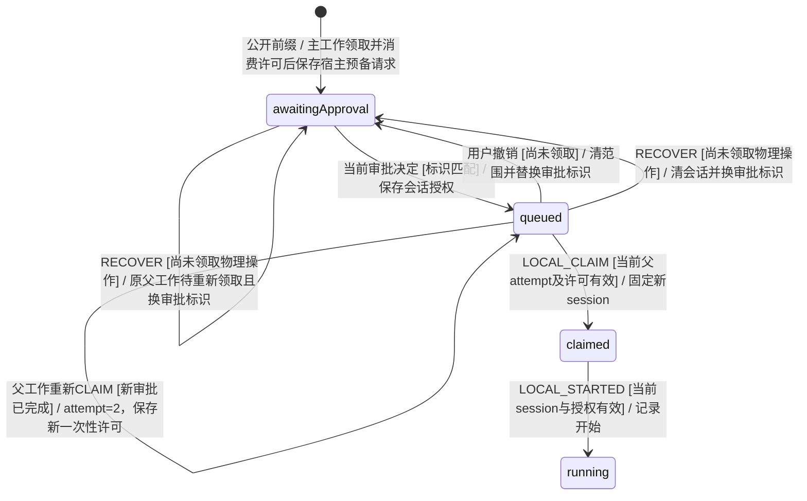

# 宿主审批与执行许可组合验证

对应 KEJ-108 A5 与 BT_N30–BT_N32。旧单命令许可、SessionScope输入枚举和20条生命周期实例继续保留；本页新增真正的有限组合图及所有边对应回放。

## 状态域与共同边界

图型：**有限验证模型**；源码所有者：`TeamEngine` 的可信命令和存储事务、`taskMachine` 的 `LOCAL_*` 上下文守卫、`executionMachine` 的一次性许可和 `hostSession` 的范围撤销。图中阶段仅是现有 `LocalOperation.status` 的投影，不新增产品任务状态。



有限域为一个owner intent、两个parent attempt、一个宿主操作、最多三代审批标识、一次queued撤销和一次物理领取前RECOVER。两种顺序都可达。重新领取父工作和开始执行许可分别是两个真实事务；不把其合成原子动作。恢复前后实际SQLite关闭重开。

旧审批ID的新命令、旧父attempt领取、旧session开始、旧permit及已消费的新permit都不能产生新的效果。相同旧成功command ID可以返回原保存的成功回执；验证要求当前work、授权、许可、用量和候选不变，不错误地把幂等成功等同于新的授权。

`Progress`仅在显式弱公平假设下成立：当前审批、父工作重新领取、消费新许可、领取命令与开始这五种持续可用动作最终被调度。撤销与恢复各至多一次；用户永久不批准时不声称自动推进。模型不覆盖领取后未知物理效果、命令退出、hostRetry、任意多轮、截止时间、模型正文或OS权限，这些沿用已有验证。

## 运行

```sh
TLA2TOOLS_JAR=/absolute/path/tla2tools-1.7.4.jar python3 .agents/skills/verify-squad-authority/scripts/composition-check.py
python3 .agents/skills/verify-squad-authority/scripts/composition-check.py --verify-evidence reports/verify-squad-authority-composition/实际目录
TSX_TSCONFIG_PATH=tests/bdd/tsconfig.json node --import tsx node_modules/@cucumber/cucumber/bin/cucumber.js features/42_authority_composition.feature --import 'tests/bdd/*.ts' --format summary
```

新图使用实际TLC，所有标记边由最短公共可达前缀在Memory/SQLite分别重放，并逐步核对投影；每条边是一次真实存储事务，或一次重建Engine加RECOVER。旧成功回执重放和被拒事件属于状态不变边，仍执行真实公开入口并核对不产生新效果。这里不是TypeScript全程序证明，也不宣称一个代表前缀穷尽同抽象状态下的任意未投影历史。

四个真实源码负对照分别删除审批标识、父attempt、一次性许可及会话撤销检查；必须在真实公共边回放上违反对应性质。变异只写隔离临时源码副本，随后重新验证原源码。独立读回核对TLC完整探索、活性完成、可达性反例见证、所有边数量、双存储、控制失败和清理。

## 本轮验证结果

新增 `ApprovalComposition` 的基线和恢复图各生成183状态、36不同状态、最终队列0；182条标记边在Memory和SQLite分别完整回放。四个可达性见证分别建立重新审批、第二parent attempt、第二轮合法开始、撤销与恢复同时发生；显式弱公平下的`Progress`实际由TLC检查完成。

四个真实源码控制共八次双存储检出；变异丢弃后完整图和所有边复验原实现。独立读回同时核对原始件哈希、完整探索、两负对照后端、所有见证和活性完成。验收BT_N30–BT_N32另外直接执行三场景（每场景两存储），不以三条路径替代36状态图。

原authority检查原样曾因B3准备修复的两个依赖文件hash漂移blocked；逐项审查确认其技能快照和隔离marker分支不在原owner/no-skill前缀中，原权限模型、边界、属性和负对照保持不变，完整34步骤及独立读回随后通过。记录位于`references/drift-review-kej-108-preparation.json`，没有把新准备期证据扩张为命令副作用保证。

最终当前产品源为 `e77f052acacd208fd8eb8587ac6901ba19003220`。原检查最终完整执行与读回为 `reports/verify-squad-authority/e77-final-current`；新增组合最终完整执行与读回为 `reports/verify-squad-authority-composition/e77-final-inputs-complete`（175件）。后者使用冻结后的共同工具，强制模型必需性质/Progress、捕获全部covered实现与夹具原文、持久化实际退出码，并要求双存储负对照正常退出1且为指定性质AssertionError。较早目录只保留历史，不用拷贝inputs补造最新证明。
