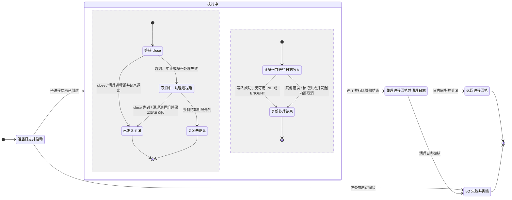

# CLI 进程与回执结算状态图

用项目所用的 XState 6.0.0-beta.5 对 `runProcess` 建模。图按实际观察事件绘制，覆盖单次命令的进程结算和身份记录。可执行模型由调用方发送 I/O 观察事件。 [模型源码](cli-receipt.machine.ts)

## 先到的事件决定进程结算

| 事件顺序 | 进程回执 |
| --- | --- |
| `close(0)` → 普通超时或外部中止 → 身份写入结束 | `succeeded`，`settled: true`、`effectsKnown: true` |
| 外部中止 → `close` → 强制结算期限 → 身份写入结束 | `cancelled`，`settled: true`、`effectsKnown: false` |
| 外部中止 → 强制结算期限 → 迟到的 `close` | `CLI_SESSION_UNCERTAIN`，`settled: false`、`effectsKnown: false` |
| `close` → 身份处理遇到非 ENOENT 错误 | 内部取消，`CLI_NOT_FOUND`，`settled: true`、`effectsKnown: false` |

`close` 停止普通超时、外部中止监听和已预约的取消计时，并立即向同组剩余进程发送 KILL。身份日志独立完成。关闭前的取消先发 TERM，300 ms 后尝试 KILL，1800 ms 后在关闭仍未确认时执行强制结算。发送进程组信号失败时，除进程组已不存在以外，模型记录执行错误并沿用先到的结算结果。 [结算与取消源码](../../src/local-cli.ts#L211)

XState 模型将日志同步、关闭与执行异常汇总为 I/O 完成或失败事件，并保留退出码、信号和结果分类。后续交付物捕获及持久结算回执由 `LocalRuntime` 负责。 [退出分类](../../src/local-cli.ts#L269) · [外层回执保存](../../src/local-runtime.ts#L430) · [真实进程回归](../../tests/local-tools-durability.test.ts#L9)

## 与形式化检查的对应

对照 `2d1df04` 核对九份覆盖清单，`src/local-cli.ts` 是 PR #83 改动的唯一已覆盖源码。交接、授权、协调、交付和宿主续办继续使用同一工作身份、回执和事务边界。本地效果检查继续观察可信回执、工作区租约与检查点，真实 CLI 崩溃窗口也沿用原接线。关闭和强制结算在执行器内争用一次结算，未知效果仍由下游保留资源并核对。九份清单更新源码指纹，沿用原属性、有限域、负对照与历史同步提交。

真实进程测试单独覆盖挂起身份写入时的同组后代，以及关闭前后取消或超时的顺序。这些进程事件在文档模型及真实进程边界验证，属于既有 TLC 有限域之外。 [执行结果接线](../../src/runner.ts#L548) · [本地效果对应](../../.agents/skills/verify-squad-local-effects/references/correspondence.md)
