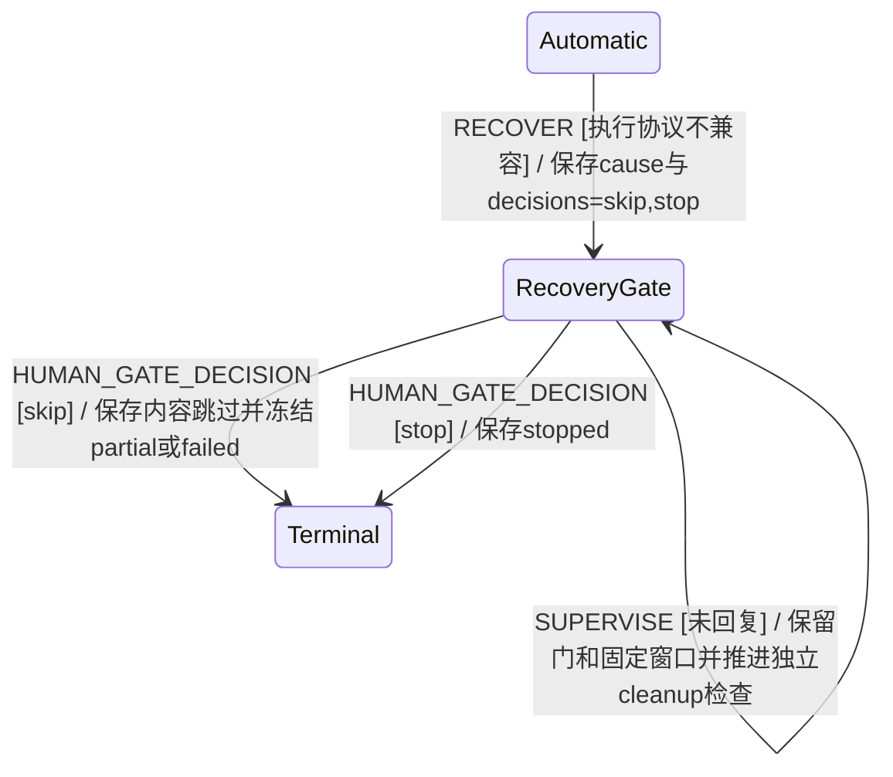

# 不兼容配置的恢复门

EARS R01、R04、R07、R09、R27、R36：如果当前宿主不支持旧任务的固定执行协议，则系统应保存只允许跳过剩余业务或停止的恢复门，普通输入不得把它清成无执行路径的 running。当人类明确跳过时，系统应无新模型调用形成固定 partial/failed，并保留物理清理责任。在必需人类门打开时，系统应继续维护独立 cleanup 的有限检查时间。

核查：不迁移旧执行权限，不自动更换工具协议，不延长原窗口，不将未知效果当作已结束。新任务或明确受支持的迁移另经对应入口。场景为 BT_Y108–Y110。

类型：真实 taskMachine 转移与上下文门；所有者：task/lifecycle、reducer、resilience；既有八阶段不变。

`HumanGate.cause='incompatibleExecution'` 与 `decisions=['skip','stop']` 是持久契约。清理门仍按 operation/work/session 身份由可信回执结算；逻辑冻结不会解锁它。验证入口为 `tests/configuration-recovery-model-fixture.ts`；接线由真实 Engine/双存储场景独立承接。
