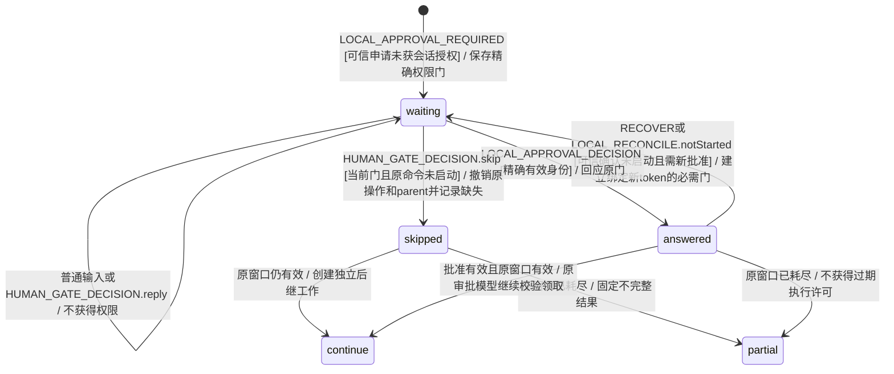

# 宿主权限门与执行许可期限

KEJ-113 R04/R05 补强，验收 BT_Y102–Y106。原实现仅保存 `LocalOperation.approval`，未建立必需人类门；实际模型回放在未收到回复时经历 `LOCAL_APPROVAL_EXPIRED → SUPERVISE` 后成为 ended/failed。轨迹保存于 `work/host-approval-silence-probe.json`。这属于期限代答，不能因为没有未经批准执行就忽略用户决定被丢失的问题。

EARS 核查：当宿主提出必需明确批准时，系统应持久保存绑定 task/work/operation/approval 的权限门；如果 token、父工作或自动窗口到期，系统应继续等待明确决定并保持禁止过期执行；当精确有效批准或拒绝到达时，系统应只回应对应权限门；当用户明确跳过尚未启动的内容时，系统应撤销原等待、退休原父工作并记录缺失，继续独立工作或生成不完整结果。普通补充、普通回复、旧身份、沉默与到期均不能成为批准。

下图为真实 task XState 的上下文生命周期细化，所有者 `src/task/resilience.ts` 与 `src/local-operation.ts`，reducer 同事务同步。任务顶层 waitingHuman 表示该必需门，LocalOperation 执行资格仍由原审批守卫独立控制。

明确停止、删除、目标替换与权限撤销仍可撤销原申请；不把未执行操作变成未知物理效果。批准 token 到期保持原安全性质：过期命令不能启动。兼容变化是到期失败回执不再表示人类已经回答，UI 的持久人类门继续提供跳过或停止入口；精确拒绝可结束已经过期且从未启动的申请，不能批准过期命令。通用 HTTP 401 或任意普通读取失败不自动升级为强制人类门。

验证顺序：先补本场景和细图并从 README/state-diagrams 链接，再运行真实 task XState 的模型红轨迹，模型门槛通过后接 Engine/WebService/HTTP，最后直接执行全部新增 Gherkin。状态机门槛复用 LocalModel 的真实 persist/restore，每个外部动作必须有公开已领取的意图；不以模拟 stdout 自证权限。

并行操作各自保留精确权限门；第二项申请不会取消第一项未回复决定。会话级批准只关闭真实审批模型已经覆盖的申请。恢复保留门身份并同步经过恢复更换的 approvalId，旧 token 不能复用。普通输入或门回复可留作说明，但不能关闭权限门；授权门不提供会被拒绝的新窗口按钮。

BT_Y106 验证纯逻辑退休以外的实际等待：明确跳过会先撤销未启动操作与原 parent，再持久保存原 parent 的取消意图；可信 Runner 领取取消后 abort 原 controller。不能只把 parent 写成 done，令批准等待器一直睡到 token 过期。实际夹具观察原 `waitForWorkspace` 等待从 1 变 0，随后真实后继模型请求发出，原命令启动数仍为 0。

本次实际验证：

| 层 | 命令 | 结果 |
| --- | --- | --- |
| 模型红门槛 | `env -u MODEL_API_KEY node --import tsx tests/host-approval-gate-model-fixture.ts` | 初始断言真实 LOCAL_APPROVAL_REQUIRED 必须建立门失败，保存 `work/host-approval-gate-model-red.log` |
| 真实 task 模型绿门槛 | 同上 | 18 条路径全部通过，每步 persist/restore；含已批准未领取恢复与可信 notStarted 核对后重发申请；`work/host-approval-gate-model.json` |
| 直接 Gherkin | `env -u MODEL_API_KEY TSX_TSCONFIG_PATH=tests/bdd/tsconfig.json node --import tsx node_modules/@cucumber/cucumber/bin/cucumber.js features/61_host_approval_gate.feature --import 'tests/bdd/*.ts' --format progress --format json:work/host-approval-gate-bdd.json` | 22/22 用例通过；其中 4 条真实适配器/Runtime/HTTP/SQLite 接线，其余为模型边界；不把钩子计数当业务覆盖 |

服务接线使用真实 OpenAICompatibleAdapter 的受控 transport 和真实本地准备、journal、HTTP 与 SQLite，未批准时不运行命令。到期事件以显式宿主时间输入推进，验证状态和接线，不将其描述为等待真实十五分钟或真实外部服务验收；页面显示依赖已有通用 HumanBlockers，真实浏览器总回归单独记录。

旧 BT_L52 的“原负责人尚未结束”额外夹具断言原先在 owner 自身已经过期后仍接受 DELIVER 并据此形成 partial。注册请求与原 owner 使用相同局部时长，后注册请求到期时原 owner 必然也已到期，不能假造“请求更早到期、owner仍有效”。现保留原场景要求：HOST_RETRY_EXPIRE 只保存请求未执行原因，不冒充原 owner 已结算；迟到 DELIVER 明确以 WORK_EXPIRED 拒绝，不凭迟到草稿制造部分完成。该无业务材料轨迹最终如实 failed，候选为空、产物不能包含被拒的迟到正文。没有放宽产品期限、手写 deadline、倒退时钟或忽略失败；旧 L27/L49 的恢复审批和收费断言继续原样执行。
