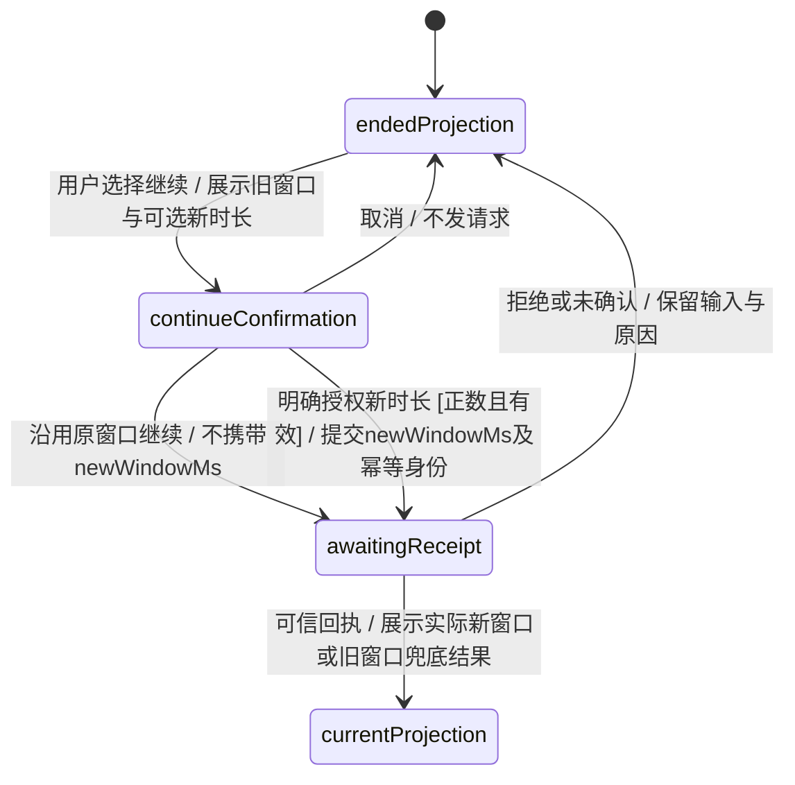
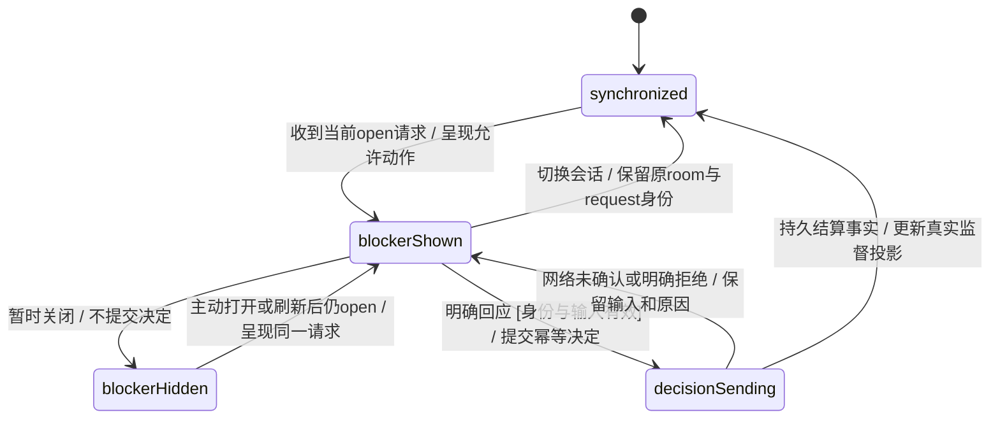
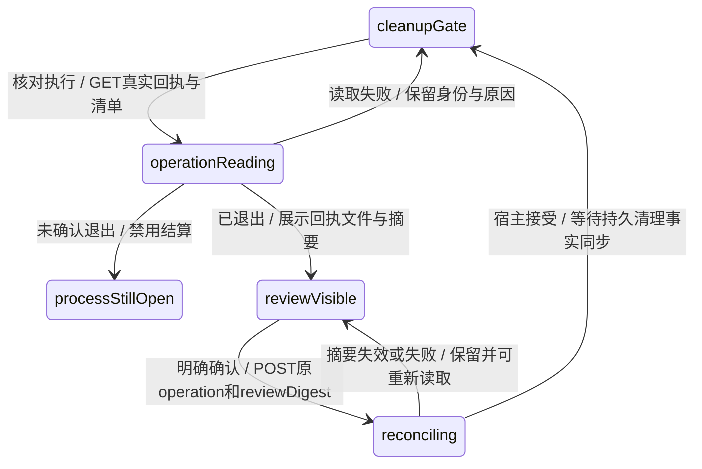
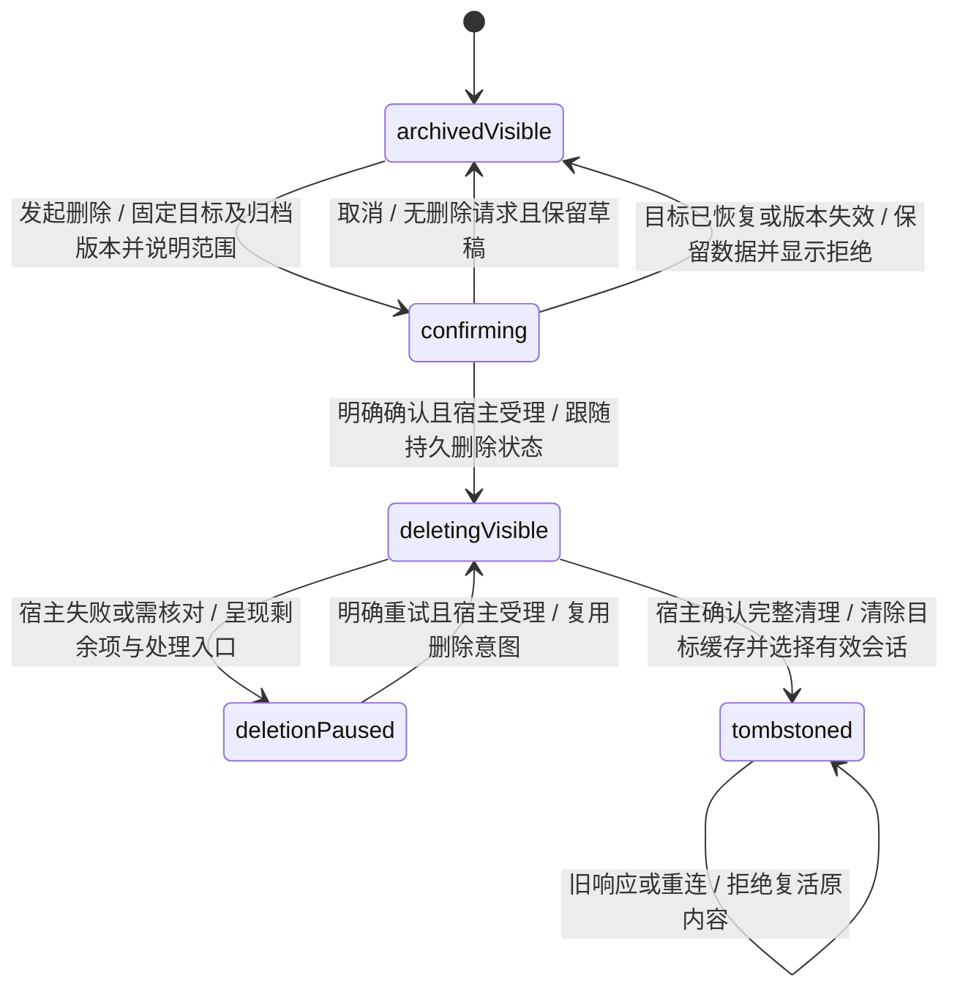

# KEJ-113 / KEJ-114 工作区界面设计与验收

阶段：模型门槛通过后的 UI 接线与真实浏览器验收。本文档及中文场景先于生产 UI 修改；根代理已放行真实 resilience/deletion 模型，界面与全部步骤已实现，真实浏览器结果仍须独立记录。

依据：[KEJ-113](https://linear.app/kejunz/issue/KEJ-113)、[KEJ-114](https://linear.app/kejunz/issue/KEJ-114)，以及仓库 `AGENTS.md`。KEJ-114 最新 R01–R20 包括未完成任务、全部历史版本与会话资源、防复活、可控客户端缓存清理；“归档”继续保留已有任务执行语义，“删除”须另行明确确认。

## 范围与需求核查

UI 只呈现并处理宿主持久化事实，不在页面添加重试调度、超时跳过、释放资源或删除文件逻辑。下列条目以可观察响应转写并核查：

| EARS 条目 | 用户要求与对应验收 | 核查结论 |
| --- | --- | --- |
| UI01 当宿主发布当前未解决人类请求时，网页应自动提示目标、原因和允许动作，并等待明确回复。 | KEJ-113 R04–R06、R39；Y81–Y84、Y90–Y91 | 复用现有宿主授权弹窗的可关闭但不自动答复语义；通用请求必须新增持久身份与动作契约。 |
| UI02 当回复被拒绝或提交未确认时，网页应保留请求和输入，显示原因，并以原幂等身份重试相同动作。 | KEJ-113 R16、R37–R38；Y82、Y85、Y91 | 点击或网络返回受理不等于业务完成；回复与当前请求版本绑定。 |
| UI03 在监督状态发生修复、等待、独立清理或服务故障时，网页应显示真实状态及可用处理入口。 | KEJ-113 R09–R10、R33、R35–R39；Y86 | 不能只用顶层 phase 推测工作健康；需要可信监督投影，不由 UI 推导新的业务转移。 |
| UI04 当最终报告被冻结时，网页应区分当前文件、历史与未核实草稿，并导出携带状态、版本和缺口的宿主报告。 | KEJ-113 R29–R32；Y87–Y89 | 复用宿主冻结文件清单；原始草稿逐字保留，不能仅给原文件加界面标签就当最终报告。 |
| UI05 当用户从归档列表发起删除时，网页应显示精确目标、范围、不可恢复性和未完成工作的安全结算要求，仅在明确确认后提交。 | KEJ-114 R01–R04；Y92、Y95 | 取消不提交；服务端再次验证归档及删除版本，不由弹窗建立权限。 |
| UI06 在删除尚未安全完成时，网页应显示准备、等待核对、清理或暂停及剩余原因，保留允许的重试和核对通道。 | KEJ-114 R03、R08–R09、R15–R20；Y93–Y94、Y98 | 未完成、partial、失败和停止会话均可发起流程；不能因有未知效果一律永久拒绝，也不能提前显示成功。 |
| UI07 当宿主确认约定删除完成时，网页应清除目标会话的所有可控快照、草稿、详情、引用、调试和选择缓存，切换到有效会话或空页并保留其他会话数据。 | KEJ-114 R10–R12、R14、R20；Y96–Y99 | 按目标 roomId 清理，不能用请求返回时的当前选择作为删除目标。 |
| UI08 当旧轮询、列表、归档、恢复或删除响应到达时，网页应按删除版本屏障拒绝复活目标会话。 | KEJ-114 R10–R12、R14；Y97、Y99 | 现有 mergeRooms 假设“没有删除”，需增加单调墓碑与请求身份核验；断连重连先同步删除标记。 |

条目与原意一致，不替代服务端全数据库、所有权清单、全部历史 session、`.pending`、文件系统和共享资源隔离验收。这些删除事实须由宿主完成并投影；列表消失不能证明资源已删净。没有增加需用户重新批准的策略，也不固定产品超时数值。

`@BT_[A-Z]\d+` 为当前验收身份规则；新增 `BT_Y81`–`BT_Y100` 在设计前对 features/tests/docs 查重，未发现占用。该文件默认进入 BDD，不添加排除标签或 acceptance-gaps；步骤已绑定，执行结果须以实际产物为准。

## 宿主响应契约提案

以下字段是 UI 需要的语义，最终名称由根代理统一到 `src/web/contracts.ts`、HTTP、服务及业务事件；未授权 UI 从模型文本制造事实。

### 人类请求与监督

`RoomSnapshot.blockers`：持久请求列表，每项包含 `id/version/taskId/epoch/goalVersion`，用户可读标题和问题、影响范围、`requiredHuman`、状态，以及宿主允许的 `actions`。动作应有稳定 `actionId/label` 和必要输入说明；文本、预算等输入须显式描述并由宿主验证。未知效果核对动作不能让页面自行拼造成功回执。

`POST /rooms/:roomId/blocker-decision` 提交 `{ id, taskId, blockerId, blockerVersion, actionId, text?, newWindowMs? }`。`id` 标识一次明确决定；相同内容重试复用，改变动作或输入建立新身份。`blockerVersion` 为宿主持久门的创建时间。增额另经 `messages` 的 `intent:continue, extraOrdinary`，不把额度字段加到通用决定接口。接口明确拒绝过期、旧目标、删除屏障或权限失败；只有持久请求结果能解除待处理状态。

`WebTask.supervision` 需能区分正常处理、修复、等人、独立清理、宿主故障与已结算，附原因、允许处理入口和可用的 `nextWakeAt/hardDeadlineAt`。断连只表示状态尚待同步，不能新建推进策略或推定完成。

必需人类门优先于自动超时代答；自动窗口耗尽与人类门仍开放分别展示。明确跳过内容只豁免对应内容要求，原核对门和资源清理可以继续开放。现有 hostApprovals 可保留专有审批明细；应避免同一动作出现两套可互相矛盾的决定状态。

### 冻结报告

最终交付投影需有固定 `epoch/goalVersion/revision/status/currentArtifactIds/reportArtifactId` 或等价 manifest。`reportArtifactId` 指向宿主生成、携带逐项核验与缺口的最终报告；原候选草稿继续原样可查。UI 不用 `outcome=partial` 猜测全部历史文件均为当前，也不在下载时重新调用模型生成结论。

### 归档删除

删除进度需有稳定意图身份、单调版本、状态（准备/等待核对/清理/暂停/已删除）、原因、剩余项和允许的重试/处理动作。处理中条目保留必要可读信息；完成后仅保留允许的最小无标题、正文或工具输出的墓碑。

提案入口：`POST /rooms/:roomId/delete` 携带 `{ id, expectedArchiveVersion, expectedDeletionVersion? }`；重试入口携带原删除意图和当前版本。返回实际持久进度或最小 `{ roomId, deletionVersion, status: 'deleted' }`，不能把一般 2xx 受理当作已完成。

`GET /rooms` 应同时提供可见房间与最小删除标记（如 `deletedRooms: [{ roomId, deletionVersion }]`），或语义等价的单调列表版本/增量协议。已删除详情返回一致 `410/ROOM_DELETED` 和无正文删除版本；普通 `404` 是否允许等价由统一 HTTP 契约确认。不能把瞬时网络失败当删除。

客户端保存墓碑后，旧房间列表、详情、归档、恢复及删除响应均不能恢复目标内容。客户端不接受“列表缺少一项”作为删除证明，以保留现有并发创建/归档的安全合并行为。墓碑只存最小身份/版本，不夹带待删标题或内容。

## 交互状态图

图类型：UI 投影和处理流程；源码所有者为 `web/src/App.tsx`、`api.ts`、`room-list.ts` 与新决定门/删除确认组件。此图不声明新增业务 XState 顶层状态；业务请求、删除生命周期和清理操作由宿主模型所有。验收范围为 Y81–Y100。

追加 UI09：当任务已结束且原窗口耗尽时，网页应在继续确认中提供明确的新时长授权选项；仅用户选择授权并提交时，通过 `messages` 的 `newWindowMs` 传递新窗口，取消或沿用原窗口继续不隐式续期。对应 KEJ-113 R07/R12/R37，新增唯一 `BT_Y100`（追加前已查重）。根代理已验证生产 CONTINUE.newWindowMs 路径，UI仍需真实浏览器确认与请求读回。

窗口到期、UI关闭、断连和重启均不触发 `decisionSending`。重复发送同一决定不产生第二个业务动作；旧请求回执只影响原身份。按键操作和焦点必须能到达问题、动作、错误与未处理请求入口。

Y83/Y93 使用真实运维核对路径：`GET operation-review?taskId&workId&operationId` 读回原进程状态、回执、文件清单与摘要；仅 `processState:exited` 时允许明确确认。`POST operation-reconcile` 携带 `{id,taskId,workId,operationId,reviewDigest}`，服务端再次验证当前摘要。删除 waiting 仍保留此入口，内容 skip 不解除物理操作隔离。界面不能用自由文本或本地伪造回执结算。

删除期间新消息、恢复归档和旧批准不可用；宿主仍允许的精确核对动作保持可操作。关闭提示、切换列表或会话、断连不会取消已持久删除，也不清除尚需核对的必要投影。删除完成仅清理目标 room 的草稿、mentions、来源引用、候选选择、发送幂等缓存、详情/调试选择及 `squad-room` 指针；其他 room 草稿保持。

## 模型门槛与实施边界

根代理负责更新 README 状态入口、细化业务图和真实模型，并验证通用人类门/固定窗口/skip/监督/冻结交付/删除及防复活路径。UI 阶段只复用这些已验证事实；在根代理发出 `IMPLEMENT_GO` 前不修改生产界面、API hook或列表合并代码。

需通过的前置模型路径：当前决定及过期拒绝、内容skip与未知效果隔离并存、必需门在截止后仍open、固定交付清单与迟到结果、归档确认/恢复竞争、删除屏障及重试/重启、最小墓碑拒绝旧活动、全部清理完成才deleted。实际UI与HTTP接线仍须后续独立验收，模型通过不能代替浏览器测试。

## 验证入口与证据

20项中文场景由 `tests/bdd/resilient-workspace-ui.steps.ts` 全量绑定，按公开 WebService/Engine 入口准备真实业务前缀，经真实 Chromium 操作 HTTP 工作区并独立读取 SQLite。受控模型回复仅证明接线，不证明真实模型选择效果。

场景中的业务断言不包含颜色、DOM类名、尺寸或布局风格。选择器和视窗样本仅在步骤夹具；关键页面状态、键盘可操作、错误保留、重复请求、跨会话响应、实际下载内容和存储读回属于验收。

必须保留：浏览器 trace/截图、console 与 network 错误、脱敏HTTP身份和响应、SQLite独立读回、实际下载文件内容及hash、删除墓碑/剩余项、清理和关联场景结果。网络迟到通过可释放的响应屏障构造，不依赖固定睡眠制造竞态。

当前真实浏览器尚未执行；生产源码正在多代理并行变更，待统一冻结构建后运行全部场景。已有临时反例不作为修复绿色验收；新夹具必须断言正确行为并保留真实执行证据，不新增镜像生产实现的单元断言。

## 设计阶段的既有模型复验

2026-11-11，生产 UI 修改前：

- `env -u MODEL_API_KEY node --import tsx tests/web-composition-model-gate.ts` 退出0：现有公开任务事务的两会话身份、重复回执与冲突载荷，以及 Inspector 窗口/观察模型路径通过。
- `env -u MODEL_API_KEY node node_modules/vitest/vitest.mjs run tests/task-inspection.test.ts tests/discussion-simulation.test.ts tests/panel-layout-simulation.test.ts --maxWorkers=1 --reporter=dot` 退出0，实际执行2文件2项断言。当前不存在 `task-inspection.test.ts`，不计其执行；已运行讨论195轨迹及面板90转移检查。
- 对现有 `roomMachine` 经公开 `stepRoomArchive/restoreRoomArchive` 逐事件序列化复验：active→archived→重复archive→active→重复restore→archived 的版本为1/1/2/2/3，负时间戳拒绝且状态不变。
- 宿主 Playwright 默认配套浏览器缺失；改用已安装 `/usr/bin/chromium` 实际启动成功，版本155.0.8059.79，`fc-match ':charset=4e2d'` 找到 Noto Sans CJK。这里只证明浏览器能力就绪，未运行产品页面验收。

这些检查只复验既有模型与运行能力，不代替根代理新增 resilience/deletion 模型门槛。可复用夹具 `tests/resilient-workspace-browser-fixture.mjs` 提供真实 Chromium→HTTP→WebService/SQLite、持有真实响应的竞态屏障、下载内容读取及独立数据库读回。该夹具只替换外部模型适配器边界，不伪造应用API成功或直接写预期数据库；运行时强制校验实际构建指纹和结束时源码未漂移。
