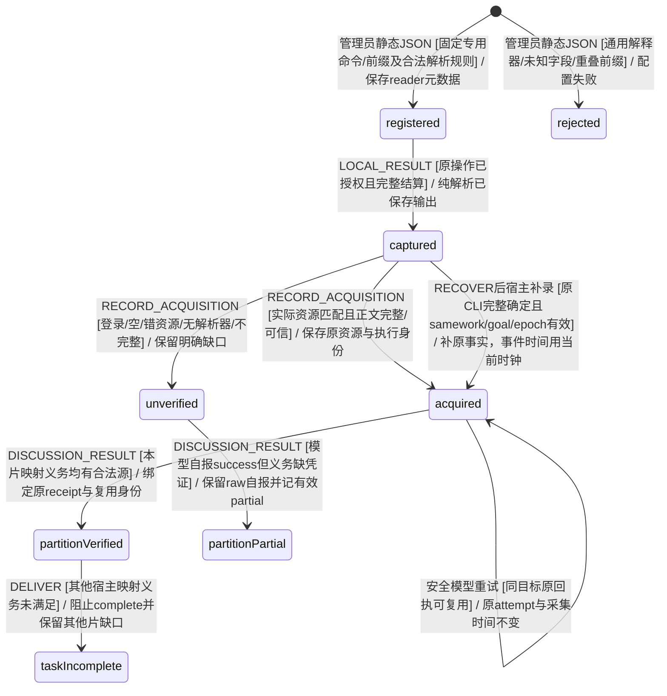
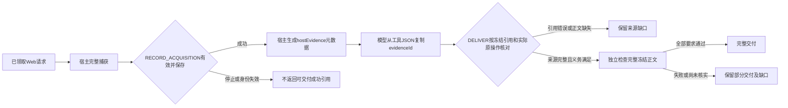

# KEJ-113 资源执行事实与部分发布

需求：[KEJ-113](https://linear.app/kejunz/issue/KEJ-113)。本节承接 R02、R21、R22、R23、R29、R31，与同分支适配器、调度及监督生命周期协作。

已按 EARS、场景、状态图、真实 XState 模型门槛、具体接线的顺序实施。资源凭证、交付预检、固定证据与当前文件选择已接入；本节场景和受控 CLI/HTTP/SQLite 验收已运行。状态图入口见 README 的状态模型与 `docs/state-diagrams.md`；监督、删除和网页的整体验收由同分支其他模块分别记录。

## EARS 核查与场景追溯

| 需求 | 原要求与可观察响应 | 场景 | 核查结论 |
| --- | --- | --- | --- |
| R02 | 当系统接受抓取、读取、执行或分片完成等事实时，应核对具体资源、操作身份、执行轮次和保存凭证；模型叙述不能单独成为执行成功事实。 | BT_E100–E103、E106、E108–E109、E112、E119–E123、E125–E127 | 保留原约束；凭证缺失只阻止相应执行事实及依赖它的完成，不强迫普通推理调用工具。 |
| R21 | 推荐应区分未配置、空目录、无匹配、未安装和未授权；只传已核实的入口及认证/会话前提，凭据不进模型。 | BT_E111、E122–E123；具体配置区分由 `58_execution_recovery.feature` 承接 | 配置元数据与实际可用性分开；本节验证静态可信 reader 登记和正文边界，不重复实现配置探测。 |
| R22 | 工具结果应区分进程退出、传输、认证、资源匹配、正文取得及目标完成；退出零或 HTTP200不足以证明正文。 | BT_E101、E104、E106–E107、E121–E123、E125–E126 | 以宿主内容观察为共同依据，CLI和网页入口统一，不用提示词替代机械门禁。 |
| R23 | 共享读取方法应保存资源范围、版本/配置前提和内容验证状态，只向满足前提的后续工作推荐。 | BT_E104、E110–E111；重评调度由对应分片场景承接 | 共享经验复用同一个内容验证判据，不能自行另设退出零等成功来源；观察不授予权限。 |
| R29 | 必需内容未验证、未明确跳过或存在影响完成的未知效果时，应保留缺口且不得 complete。 | BT_E100、E102–E104、E107、E112–E113、E116–E119 | 保留既有 partial 正确行为；跳过豁免只覆盖明确范围，未知效果另由清理生命周期托管。 |
| R31 | 最终宿主报告应冻结任务/目标/交付版本、正文和当前文件选择，下载文件自带核验、失败、跳过及未决效果声明。 | BT_E114–E118 | partial 具有明确发布选择，旧目标和未选择草稿可查历史但不能列为当前；原始草稿不被篡改为宿主事实。 |

已核查语义一致、触发明确、可观察响应与验证边界、现有能力重用及权限边界。方案属于缺陷修复所需的协议细化，不新增自动认证、安装、加额度或远端写入权限。无需工具任务、合法使用历史观察、旧目标隔离、停止和迟到结果均有显式场景。

原始现场“第5篇 HTTP200/242字符”和68.39秒/1.75秒没有可独立读回的历史回执；本设计依据当前基线的受控反例，不将合成事件冒称原始现场。分析探针留在忽略的 `work/`，正式门禁将迁入场景驱动，不通过分析探针继续断言旧缺陷存在。

## 资源与取得结果协议

补充核查：宿主 `Goal.partitionResources` 是稳定分片 ID 到资源身份的目录。R02/R22 要求全任务读取义务覆盖其并集，而单片只承担对应条目；不能把其他片的服务文档或文件义务压到本片。显式 `resourceRequirements` 的 freshness 优先，同目标 saved 原文可在保留原来源身份下复用；current 则要求当前窗口的对应执行。BT_E100 细化保留原模型自报，并把有效分片结果记为尚未核实；BT_E121 已通过服务文档、文件和 URL 的精确范围模型对照。`resourceAcquisitionSources` 与 missing 查询共用一个判据，返回原凭证身份；分片结果据此保存 reused 来源，不把复用改写为新采集。

R21/R22 增加静态配置入口：管理员可由 `SQUAD_ACQUISITION_READERS_FILE` 提供 JSON 读取器登记，bootstrap 调用 `parseCliAcquisitionReaders` 后传入 Runtime。最小 schema 保留 id/version、专用 command、非空完整 argsPrefix、`format:"json-document"` 与 resource；没有任意 JS、模块路径、shell 或回调。禁止用通用 node/echo/shell 等解释器登记远端读取成功，禁止重叠 command/prefix、非法索引及未知字段；文档解析只接受结构化目标 id/slug 的唯一正文，`fields:{ids,bodies}` 可登记有界简单 JSON 字段名。URL 型必须另有 documentIdArgument，file+JSON 和无法验证目标编号的组合拒绝或 unknown，不能悄悄降为 stdout text。专用读取器自身的服务/租户能力由宿主登记负责，实际 executable/审批仍走原执行链，配置不授予工具、网络或宿主权限。BT_E122/E123 已通过模型及真实静态 JSON/专用 fixture 进程/SQLite/Runner 接线；普通嵌入的受控 Node text profile 仅为测试可信输入，不作为生产网络读取器配置样例。

默认正文集合只有 body/body_markdown/body_html/content；description、title 与 HTTP 状态不是正文。匹配目标编号但仅有简介的结果记 empty。自定义字段是管理员明确的 provider 正文契约；可信 parser 验证后才保存 documentId，来源工作项直接使用精确文档身份及同操作的原凭证正文，避免另一套默认解析器误拒合法字段。URL 凭证若无该 documentId，只能继续按原 JSON 的精确文档编号、唯一正文和状态核对，不能凭 URL 给任意 sourceDocId 背书。

以下为资源取得及宿主登记的上下文生命周期图；所有者为 `taskMachine`、`resource-acquisition.ts` 与 `acquisition-readers.ts`，不增加独立执行 actor。BT_E100/E121–E123 的新分支先由此图约束，再运行真实模型，最后接 bootstrap。

BT_E125 补充已有单次批量读取能力：一个固定 reader 可登记 `resource: {kind:"document-batch", documents:[{id, resource}]}`。宿主预先固定每个原始文档编号与真实 URL/服务文档身份；一次已保存 JSON 返回按每个唯一 id 的独立正文签发多份凭证，保留同一个操作、原尝试和时间。缺失目标记 resource_mismatch，不能用批次中另一文档正文填充；登记中重复 id/资源也拒绝。批次解析属于上图 captured→acquired/unverified 的逐资源分支，真实模型门槛后由既有 map-recovery 实际 Node 批次接线验证；不通过多个重叠 profile 扩张信任。

共享协议位于 `src/resource-acquisition.ts`，公共类型由 `types.ts` 引入。宿主入口为 `TeamEngine.recordAcquisition`；普通 `send(RECORD_ACQUISITION)` 被拒绝，模型、stdout 和共享方法不能自行签发事实。

BT_E127 补充 R02/R22 的实际可用性约束：当真实网页取得观察成功保存后，工具返回应附宿主生成的 `hostEvidence:{evidenceId,acquisitionId,sourceOperationId,status}`；原网页正文的同名字段不能覆盖该元数据。`evidenceId=acquisitionId=receipt.id` 是冻结内容引用，`sourceOperationId=receipt.operationId` 只表示原 HTTP 操作来历。来源工作项的 `sourceEvidenceId`、恢复声明的 `sourceOperationIds` 和检查引文均引用前者；不能将原执行 ID 误作冻结凭证 ID。此约束只细化已有保存观察和候选检查生命周期，不授予工具能力；CLI 两种 ID 原本相同的旧路径不变。

以下为工具结果到候选检查的处理流程，所有者 `resource-acquisition.ts`、`task/evidence.ts`、WorkRunner 和模型适配器；纯门禁先核对真实 taskMachine 的保存/交付/独立检查路径，之后才接真实 SDK 返回。验收 BT_E127，分片恢复由 BT_Y112 承接。

`ResourceIdentity` 表达真实冲突边界内的资源身份，至少支持：

| 资源类型 | 身份内容 | 核对规则 |
| --- | --- | --- |
| URL | 规范化的请求 URL，必要时附被要求的原文档身份 | 保留有语义的路径和查询；不能仅凭同域名或相同尾部编号判等。请求与最终跳转身份均由真实读取器记录，登录跳转不能匹配正文取得。 |
| 服务文档 | 服务身份、空间或租户、原文档 ID/slug | 相同文档编号出现在另一服务/租户时不是同一资源。批量结果逐文档匹配，不能借相邻正文或状态。 |
| 文件 | 工作区身份、规范路径及适用的固定修订 | 不能把不同副本或工作区的同名路径当同一原文；版本要求按当前目标判断。 |

输入材料的固定原文继续使用现有原文/引用目录身份。它可以支持推理和原文引用，不伪造新发生的工具读取。当前工作是否负有重新取得资源的义务来自经过核查的当前用户目标及其合法资源目录；含义不明时沿用输入澄清流程，不根据模型自述猜测授权或创造取得义务。

`HostAcquisition` 保存请求和实际资源、取得状态、`verifier {id, version}`、完整正文和宿主指纹、观察时间、配置/认证前提，以及原操作、task/work、attempt、epoch、goalVersion、requestHash、sourceSnapshot和不可重标的冻结数据。状态区分 `acquired`、`authentication_required`、`resource_mismatch`、`empty`、`incomplete`、`unknown`；传输状态和进程退出码另行保留。`acquired` 还须正文存在、资源匹配、捕获完整及验证器前提可核对。取得正文不自动表示用户目标全部完成。

外层凭证固定现有操作、工作、执行尝试、epoch、goalVersion、requestHash和采集时间。模型只能引用宿主提供的操作标识及原文；`answer.status=success`表示答复自评，不能签发资源取得事实。CLI stdout或网页正文中的同名字段也只是不可信输入。读取义务未满足时，不因遗漏结构化声明或写一句“全部完成”而清除义务。

CLI由宿主登记的读取器或结果验证器识别预期资源及实际返回正文。只有命令、argv、退出码或模型给出的 URL 时不能推断正文已取得；没有可信解析器则保持 `unknown`，原输出仍可查阅。登记的解析器是宿主配置，不来自模型或技能文本。网页读取由真实请求、最终资源和捕获正文生成同一观察；HTTP200登录页为认证前提未满足。通用文本和不确定内容保持保守状态，不将页面标题猜测当无条件证明。

证据索引与交付冻结复用 `verifiedResourceAcquisition`、`acquisitionsForOperation` 和 `savedResourceAcquisitions`。方法共享和分片重评消费该边界，不复制“成功”的判断。方法必须保留原资源范围、配置/验证器版本和认证前提；前提不匹配时不能宣称适用。任何建议都不补充权限或凭据。`src/acquisition-readers.ts` 只解析已持久化输出；没有可信宿主 reader 时保留 unknown。当前 Goal.resourceRequirements 可明确 URL、文档或文件身份；省略时只从当前直接用户目标/已核查原始输入的明确读取要求保守提取 URL，不从模型正文创造任务义务。

## 冻结、版本与部分交付

BT_E126 封闭 `LOCAL_RESULT` 与派生凭证两笔事务间的崩溃窗口：同工作、目标、epoch 的已持久完整确定 CLI 结果可以在重新领取后由可信 parser 补录。凭证保留 operation.parentAttempt/finishedAt/sourceSnapshot，允许原 attempt 小于当前父模型重试 attempt；事件时间取宿主当前时钟。补录不重跑命令、不退额度、不将原观察重标为新读，已终结/停止/换目标/换 epoch 仍拒绝。没有保存原始 HTTP 响应的网页调用不能凭空补录。

完整捕获在宿主 I/O 边界计算正文指纹；原始 CLI 回执及检查点先原子持久化，再由另一事件保存派生资源观察。两笔事务间由 E126 的可信补录封闭恢复缺口。纯模型层冻结并比较实际正文、身份、完整性和验证器信息；不能只信回执内自报 hash 或字符数，等长替换仍应失效。保留现有技能资源的固定原文语义及浏览器可运行的纯数据依赖，不在共享状态模型中引入 Node 专属哈希 I/O。

允许复用原观察时显示原采集身份和时间；需要刷新时旧 epoch/目标的观察不能证明当前处理窗口已重新取得。模型网络失败后的同目标安全重试沿用已经确认的原正文与 localCheckpoint，不把新父 attempt 当成重新读取义务，不重跑非幂等命令。CLI 凭证的 attempt、at 必须等于原 operation.parentAttempt、finishedAt，不能把原取得重标为新尝试或新采集时间。当前目标或尝试不匹配的迟到事件不能改写新目标或授权新 I/O。停止、旧版本、重复事件与原未知效果结算继续经过主任务模型及操作守卫。

完整与部分发布都必须固定明确文件选择，不能以 `currentArtifactIds` 缺省表示全部草稿当前。部分发布记录至少包含任务、目标、epoch、候选修订或确定性兜底身份、结果状态、宿主报告文件、当前交付文件和冻结时间；旧目标及未选择原文作为历史或依据。候选已存在时沿用其合法当前文件选择；没有候选的兜底选择由主监督模型的持久意图明确提供，不能由网页临时扫描全部文件自行决定。

宿主报告独立保存部分完成状态、目标与交付版本、已核验及未核验内容、失败、明确跳过和未决效果清单，引用对应资源与凭证。原始模型草稿可下载原文，但标明核验身份并作为附件；宿主交付入口提供自带声明的报告，避免单独导出后脱离 UI 即误以为完整终稿。内容没有被核实或原目标缺口没有明确豁免时保持 partial；没有业务成果时由主监督流程决定 failed及故障记录，不能创建猜测答案。

最终冻结后，恢复和迟到操作可以核对原资源或追加历史，不能更改已经冻结的报告正文、当前文件选择和结果状态。需要新交付时经明确的新目标或续办版本建立新的候选/发布身份，保留原发布历史。

## 状态图与模型门槛接线

本节不新增独立执行所有者。操作生命周期仍由真实 taskMachine生成、持久化、领取并由 WorkRunner执行，观察以可信事件回传；资源取得状态是操作回执和分片事实的上下文生命周期。主协调者将其接入 README状态入口及 `docs/state-diagrams.md`，明确“读取义务→保存观察→验证取得/缺口→冻结候选→独立检查→完整或部分发布”，以及停止、过期、恢复、旧目标和迟到分支。

新增场景先于纯实现。模型门槛使用真实 taskMachine 的公开事件和受控回执，逐步保存/恢复，核对缺凭证及资源不匹配不能 complete、匹配 CLI/网页观察可用、无工具推理继续合法、冻结内容不可变及部分选择排除旧目标。原 20 路径模型门槛通过后才接真实读取器和 Runner；后续增加网页 sourceItems、同目标模型安全重试、禁止重标取得身份、部分续办不升级成功发布、typed-map 精确范围及凭证窗口补录，当前资源门槛为 30 路径；登记/批次/自定义正文解析另有 21 条真实模型路径。

后续 I/O 接线验证采用受控提供商 HTTP、实际读取输出与SQLite；网页导出验证使用真实服务快照及用户导出动作，浏览器下载按仓库现有契约补充。模型自选正确工具和真实业务语义需单独的真实提供商证据，预排回复不能替代。默认Gherkin入口必须直接执行这些场景，不登记隐藏排除或空步骤。

## 工作记录

1. 完整阅读 AGENTS.md 和 Uncle Bob Mode；确认同分支协作范围及禁止先接I/O的模型门槛。
2. 核对 KEJ-113 六条 EARS、现有凭证/来源绑定/网页读取和部分导出反例，保留已有合法无工具推理与partial保护。
3. 新增 BT_E100–BT_E119 中文场景；与适配器及调度所有者约定共享资源观察，配置检测和分片重评不重复实现。
4. 真实 taskMachine 门槛 `env -u MODEL_API_KEY node --import tsx tests/execution-receipts-model-fixture.ts`：30 路径通过；`tests/acquisition-reader-configuration-model-fixture.ts`：21 路径通过；`tests/source-claims-model-fixture.ts`：11 路径通过。每步经过真实持久化/恢复；回执是受控宿主输入，不声称实际模型或工具执行。
   模型入口 `src/task.machine.ts` 的 SHA256 为 `a147ecce5aa608c858150da78ccdb3d84a6a39737cf69f33f33b62744b3aec6c`；资源纯模块本轮受测 SHA256 为 `adc62f7be3cca22ded73bb7e42cebb893da98b5b1a7c68097ca12bc5f39cca02`。工作树精确依赖指纹保存在 `work/kej113-evidence-model-gate.json`；未提交实现不冒称已属于当前 HEAD。
5. 直接 Cucumber 运行 `features/56_execution_receipts.feature`：BT_E100–E123、E125–E127 的 63 个展开实例通过，全部有步骤绑定。E101/E104 同时运行真实 Node 或本地 HTTP、实际 WebFetch SDK、SQLite、Runner 与适配器；E120 实际 CLI 成功后注入模型 HTTP503，再重开 SQLite 续办，断言只执行一次且凭证仍为原 attempt1/at0，恢复 at17 后独立检查完成。
   E126 同时执行 `receiptWindowRecoveryAcceptance` 的 MemoryStore 与 SQLite：真实 Node 只执行一次，受控宿主切断丢掉派生观察而保留 LOCAL_RESULT，pending 时同 ID 补录先被临时拒绝，重领后同 ID 成功；事件 at110 与原采集 at100 分开，lastActivityAt 不倒退，恢复后真实 deliver/check 到 complete。
6. `env -u MODEL_API_KEY node --import tsx tests/execution-receipts-acceptance.ts` 包含五类 CLI 正文语义、五条网页取得/来源绑定接线、一次检查点恢复，以及静态 JSON 登记的专用 fixture CLI 匹配、错文档、未登记、简介元数据和自定义正文来源工作项五个实际进程路径。网页测试关闭 localTools，模型每次只收到 8 字符窗口，独立检查通过 SQLite 恢复取得宿主完整捕获。测试 transport 把公开资源身份路由到真实本地 HTTP；不证明公共 DNS、真实登录账号或真实模型供应商选择/语义。
7. 已核对部分交付宿主报告中的任务/目标/交付身份、资源凭证清单、核验/失败/跳过/未决效果分类，以及当前选择排除旧目标和未选草稿。原始模型自称全部完成的草稿保留原文，宿主报告不把它复述为完成事实。没有真实 final/candidate/frozen/publication 的旧任务仍返回未设当前选择，避免凭空创建空发布。

8. BT_E127 的真实 SDK 接线已运行：受控模型仅从实际 `web_fetch_result.hostEvidence` JSON 复制 canonical evidenceId，网页正文自带 remote-forged-id 无效；sourceItems、SQLite 重开后的独立检查及 complete 均通过，冻结元数据保存原 HTTP operationId，localTools 关闭且无本地命令。纯模型分别验证合法引用与错误使用执行 ID；当前直接 Gherkin 为 63 个实例、3814 步全部通过。此处没有真实供应商推理/登录语义或任意网页的真实性保证。

## 旧交付契约回归核查

全服务诊断后的 BT_F04/A03/A24/A31/A37/A44 已逐项核对。BT_A31 暴露显式发布记录被忽略后回退旧 final 的真实产品缺口：当前显式发布目标失配或选择为空必须拒绝来源，只有缺少该记录的合法旧格式才允许恢复旧选择。已沿既有来源图与真实 taskMachine 完整前缀/恢复四输入红→绿后最小修复。其余旧断言把宿主停止/部分报告算作业务成果或要求最后摘要复述模型草稿；现逐字段核对固定 manifest、原候选和正文、未验证附件、宿主报告、原来源及无成功发布。A03 在实际交付提交回滚后比较整个 context 完全未变，并验证原领取工作下一次真实 beginExecution 事务被 Storage fault 拒绝。停止恢复只允许唯一宿主 stopped 报告，不允许新修订、候选或成功发布。
