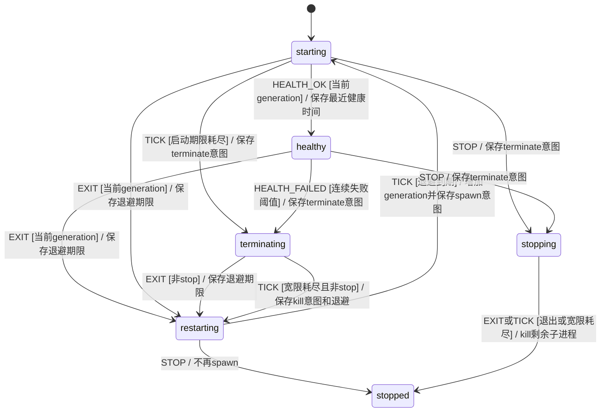

# KEJ-113 宿主守卫与可信路由

EARS核查：当宿主退出、健康检测超时或启动永不就绪时，独立进程守卫应在有界检测及终止宽限后重新启动宿主（R35，BT_Z100）；当人类停止时，守卫应在有界宽限后退出且不再重启（BT_Z101）。当显式引用无效或旧结果被拒绝时，路由应保留当前任务身份（R15/R37，BT_Z102/Z103）；如果临时领取冲突解除，则系统应重新评估而不永久缓存拒绝，成功领取仍幂等（R14/R38，BT_Z104）。当网页继续附带合法额外额度时，系统应完整传递直接授权且保留成本（R16，BT_Z105）。核查与用户要求一致，没有扩大执行权限。

类型：拟建真实XState进程监督模型；所有者`src/process-supervisor.machine.ts`。它位于宿主进程外，仅管理自己创建的子进程，不执行业务重试、工具命令或代替人类授权。目标入口`npm start`和开发宿主使用该守卫；它不覆盖宿主所在机器或守卫自身退出的故障。SQLite无法提交时，宿主健康报告失败，由守卫终止再重开；不能在不可写库上声称业务已完成。

守卫的HTTP健康探测有独立请求超时；不依赖宿主setInterval。旧generation的健康/退出不能影响新进程。所有I/O读取模型意图，先经过真实纯模型事件轨迹门槛再接spawn/fetch/kill。实际进程验证使用受控子进程的退出、挂起和忽略终止故障；不以模拟子进程代替真实kill。

可信路由不新增任务阶段，沿用taskMachine角色、版本、预算和执行许可；模型门槛复验原task/room和执行actor路径后，在Engine事务和真实HTTP验证。拒绝事件不能改变activeTaskId；非当前任务仅明确合法继续且房间空闲时能重新成为当前任务。

实现前门槛已执行：`node --import tsx tests/process-supervisor-model-gate.ts`，真实XState 15个断言路径通过（旧generation、启动截止、连续健康失败、退出/退避、停止宽限及终态无重启）。随后才接入`scripts/supervise.ts`的实际spawn/fetch/进程组终止。主任务原模型门槛`node --import tsx tests/core-model-gate.ts`80条通过；新监督模型另由核心gate覆盖，不以这80条替代新增行为验证。
