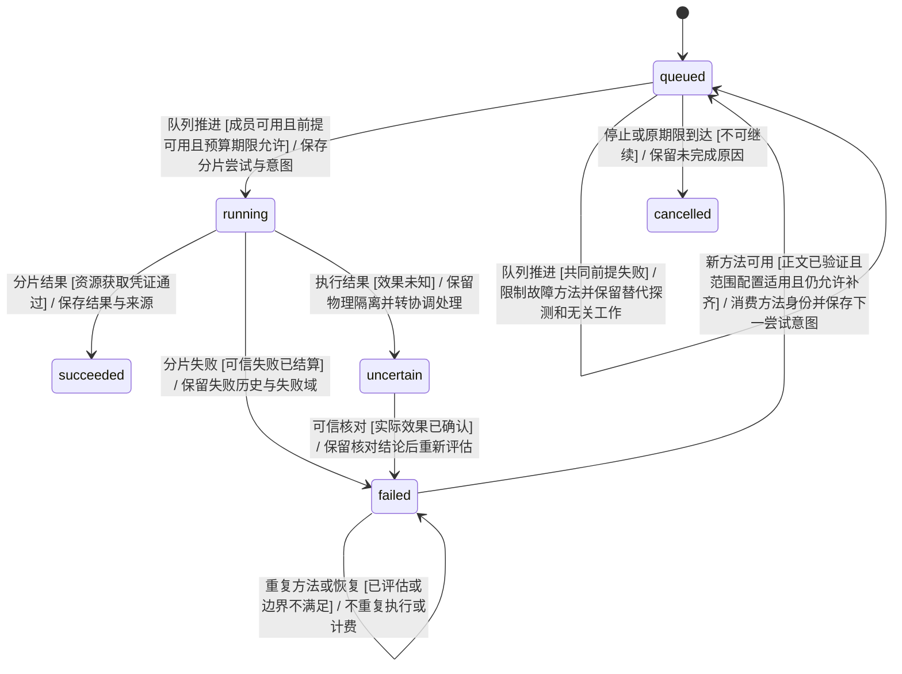
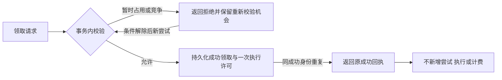
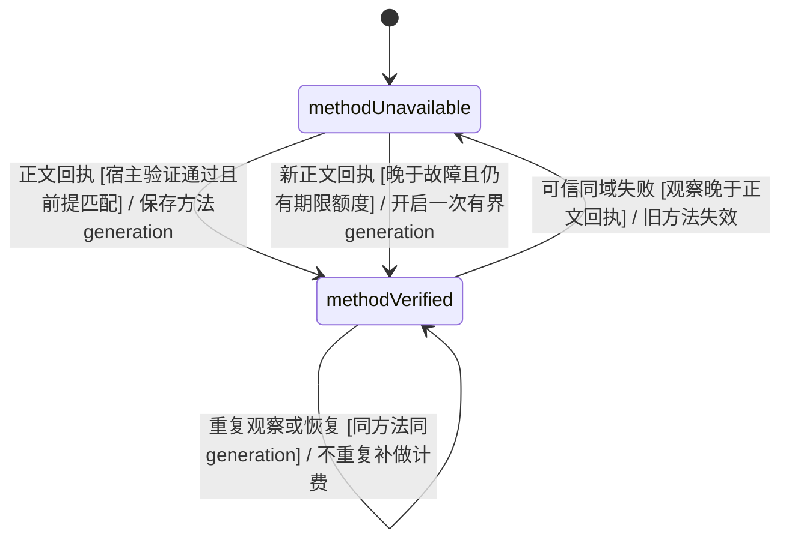
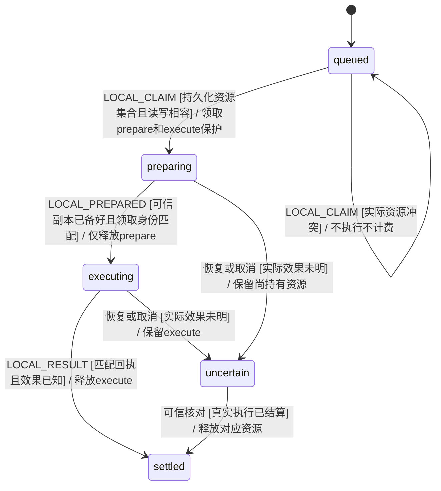

# KEJ-113 分片恢复调度与临时领取拒绝

## 需求来源与核查

权威需求为 https://linear.app/kejunz/issue/KEJ-113 ，当前快照 `work/linear-KEJ-113.json`；本节保留原 EARS 编号和语义，不把分析探针当作产品验收。实现基线为 `15d27144b05086b27ae6b02338c094a3df60fbd2`。

| 编号 | EARS 原要求 | 核查与本模块边界 | 验收 |
| --- | --- | --- | --- |
| R14 | 当领取因成员占用、资源竞争或其他可解除条件临时被拒绝时，系统应允许条件解除后的有效重试；幂等记录不得把临时拒绝变成永久拒绝，同时重复成功请求仍不得重复领取、执行或计费。 | 条件解除可观察、成功幂等与失败可重试无冲突。Engine负责事务回执；状态模型保持成员互斥、执行许可和计费约束。 | BT_Y47–Y48 |
| R23 | 当共享读取方法或失败诊断时，系统应保存其资源范围、版本/配置前提和内容级验证状态，并只向满足前提的后续执行推荐；未证实方法不得被当作已验证成功经验。 | 复用资源获取凭证的单一宿主判据。退出0、模型自述、登录页不构成正文方法成功；配置与来源范围不符时不推荐为成功。能力目录事实继续作为观察而非正文成功。 | BT_Y43–Y44 |
| R24 | 当多个分片因相同读取前提失败时，系统应识别共同失败并限制继续放大该失败的派发，优先验证或修复共同前提、调整成员或方法，并保留不受影响工作的推进。 | 失败域来自可信工具诊断与资源范围，不按任意错误文字或成员发言提升权限。控制派发不能使不相关分片一起停住；需要后续的等待交给守卫协调员具名处理。 | BT_Y41–Y42 |
| R25 | 当后续执行取得经验证且适用的新读取方法或证据时，系统应重新评估仍有价值且允许补齐的旧失败分片，使用剩余期限和预算安排最小补做，而非一律转交负责人重做全部内容。 | 原结果保留；只增加适用的新尝试。原期限不续期，成功片不重跑，未知效果不重放；已消费方法身份在恢复后保留。 | BT_Y44–Y46 |
| R26 | 当操作领取资源租约时，系统应按实际冲突资源、访问模式及隔离副本身份确定租约；不同隔离副本或互不冲突的只读操作不得无故争用同一任务级独占锁，真实共享写资源仍应互斥。 | 实际租约主实现由本地执行资源层负责。本模块只核对租约等待不被误记为工具执行失败，不能因分片补做绕过仍在持有的共享资源。 | BT_Y49；资源隔离场景由租约模块承接 |

核查结论：上述触发、观察结果和权限边界明确；优先复用现有队列、操作回执、预算及已保存的真实来源，不新增跨任务经验库或模型授权路径。R23/R25依赖资源凭证模块，R26依赖本地租约模块。缺少可信诊断时不得宣称识别了共同故障，缺少正文凭证时不得宣称新方法验证成功。

## 已复现事实与实现目标

现有 `advanceMapQueue` 在成员释放后立即派发下一片，候选成员只排除busy。24种受控响应顺序均由最快失败者领取5/8片。成功方法只在下一次模型请求中作为观察投影，不触发旧失败重评。公共Engine临时WORK_BUSY拒绝被幂等缓存后，即使成员释放及SQLite恢复也不能再领同一工作；原有限期限仍可将其转成timeout，因此该项是工作饥饿而非永久全任务死锁。

正式保护使用可执行中文 `features/57_partition_resilience.feature`，独立于 `work/analysis-scheduling-probe.mjs` 和 `work/hidden-budget-queue-probe.mjs` 这些基线诊断。现有 BT_Q27–Q33 的波次、失败历史、停止、未知效果、预算、原期限及历史恢复保护继续保留。

## 纯模型契约与所有者

该图描述**上下文生命周期**，不是新增XState顶层状态。源码所有者为 `src/task/map-queue.ts`、`map-reduce-capacity.ts` 和 `tool-knowledge.ts`，由 `taskMachine` 的已持久化转换生成操作意图；Engine/Runner仅执行领取校验后的意图。

适用范围：BT_Y41–Y46、BT_Y49。`uncertain`的可信核对、局部跳过与最终汇总由守卫协调模型统一决定；本模块不直接释放未知进程或资源，不宣称跳过等于成功。

### 共同前提与方法的事实

- 共同失败记录绑定原工作、分片、尝试、工具/操作回执、目标版本与资源读取域。配置/认证/执行环境失败可归入同一前提；单个资源缺失不得扩大为整个宿主故障。等待租约不构成已执行失败。
- 新方法复用资源凭证模块的 `AcquisitionObservation`：`ResourceIdentity` 标识 URL、文档或文件；`status=acquired`、宿主verifier版本、完整正文hash及实际范围共同构成成功判据。内部纯查询拟由 `acquisitionForOperation` / `verifiedResourceAcquisition` 承接，最终名称以共享接口为准。
- 成功方法至少保存源操作身份、读取范围、宿主执行/工具配置版本与内容验证状态。来源正文不随方法经验泄露，也不替代目标分片独立执行。运行配置、目标版本或读取范围不符的方法不能触发补做。
- 方法身份在一个轮次中幂等消费；每个分片按适用新方法最多形成一个新尝试，仍受任务剩余重试额度和原期限限制。旧 `round.results` 不改写，成功分片不重做。
- 队列不能仅因拒绝继续使用旧方法而失去推进路径：剩余替代探测、其他来源分片或具名协调事件必须仍然可观察。模型文字不能自行授予新权限或增补预算。

### 临时领取拒绝

该图描述**处理流程**，源码所有者为 `TeamEngine.claim/receipt` 和现有XState领取守卫。验收为BT_Y47–Y48。

幂等成功仍由持久化工作尝试与执行actor保护。临时失败不能占住成功身份；既有成功请求的重放不得直接返回另一尝试的许可。存储故障仍按宿主故障处理，不把未提交领取当成已授权执行。

## 验证顺序与当前状态

1. 已阅读AGENTS与Uncle Bob Mode；先提交上述EARS核查、场景和拟细图。
2. 等README入口和统一细图合入、共享凭证接口确定后，进入纯模型实现。
3. 在真实 `taskMachine` 上逐事件persist/restore，先证实24种响应顺序和方法重评轨迹，覆盖停止、版本、原期限、预算、未知效果、重复恢复与迟到事件。
4. 模型门槛通过后再接Engine临时回执处理、Runner共享方法投影、SQLite恢复及Gherkin步骤；不以prompt替代调度状态。
5. 模型与接线命令、源码指纹、实际执行结果待完成后记录。当前文档不宣称上述新场景已执行通过。

本模块不新增重复单元断言；组合时序由可复用模型驱动及中文场景承接。租约等待、资源正文校验与人类决策门分别由对应所有者提供接线证据。

## 同版本前提失效补充

R23/R25的配置版本相同不代表认证状态持续有效。BT_Y50补充时序契约：新的可信同域认证/配置失败使旧acquired方法失效；后续真实完整acquired可开始新的有界generation，重复同一故障之后的同方法观察仍幂等。纯方法投影同时比较可信失败观察时间与acquired时间；不把版本相同当作认证仍有效。原失败历史、任务重试总额度及原期限继续约束新generation。

此图为 `src/task/map-scheduling.ts` 的上下文生命周期，不是新增顶层XState节点；验收BT_Y50。failure时间来自已结算本地操作或宿主固定Web失败事实，不从模型解释提取。

## 宿主结构化资源映射

BT_Y51补充R23/R25的非URL契约。`Goal.partitionResources: Record<稳定partitionId, ResourceIdentity[]>`只来自直接用户/宿主提交的义务映射，不由模型输出字段、目录推断或自然语言升级为绑定。存在映射时，队列与方法投影优先严格使用该映射；编号缺失或身份无法验证时不推断匹配。文档比较service、namespace和id，文件比较workspaceId、path及声明的revision；仅相同完整身份适用，不把文档的服务名或文件父目录当成功读取范围。

该约束细化上文上下文图的「新方法可用[范围配置适用]」守卫；源码所有者仍为map-scheduling/tool-knowledge，验收BT_Y51。URL普通任务继续从显式URL提取资源，已注册URL reader domain仅作为方法适用范围，不能替代独立目标获取回执。

## R26 实际冲突资源与短准备保护

BT_Y52–Y55细化原R26；新增纯策略所有者 `src/local-resource-policy.ts`。`ResourceLease {key,mode:read|write,phase:prepare|execute}` 是可信宿主决定并持久化的冲突描述。模型仅请求工具动作，不能声明后端已隔离、选择copyId或缩减资源集合。

- 只有实际工作区隔离后端、isolatedWork及明确copyId同时成立，sandbox副本执行才持有copy写保护；复制权威源时另持source读准备保护。不同copy可以共享源读，准备完成后释放prepare，执行仍保护自己的copy。
- host、未声明真实隔离的可用后端及直接操作权威源，保守持有source写执行保护。可逃出副本的host/unconfined执行另持统一外部效果写保护，避免不同任务工作区掩盖同一真实宿主冲突。
- verifyWorkspace只读检查需在整个验证阶段持source和copy读保护。读读相容；任何相同key的写与读或写冲突。显式可信sharedResources继续加入，不被副本身份抹去。
- 未知效果、停止和重启不表示已释放。旧快照无新描述时保留原workspace租约。可信runtime在副本准备完成、进程启动前回传LOCAL_PREPARED，只释放prepare阶段；最终匹配回执才释放execute。

此图是本地操作上下文生命周期的资源视角；真实XState状态仍由local-operation/taskMachine持有，Engine事务负责全局读写冲突，Runtime负责真实准备回调。纯门槛先使用真实taskMachine验证策略输入和领取拒绝/允许；之后由Engine/SQLite读写集合及实际副本准备接线验收，不把可用的无沙箱测试后端当OS隔离证明。
