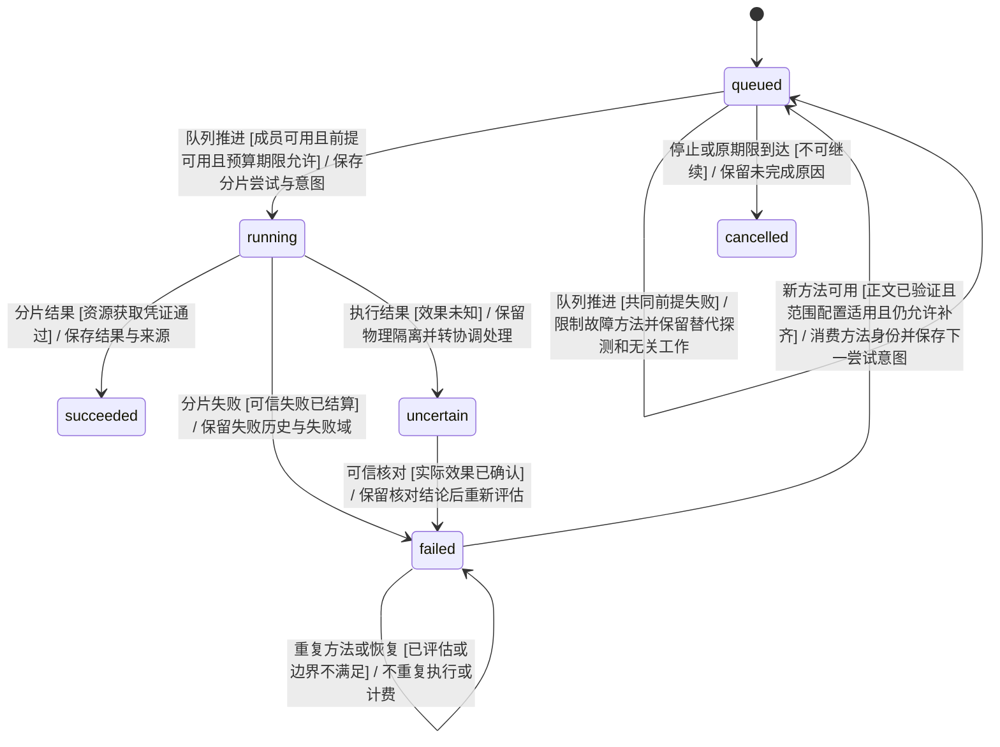
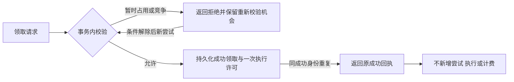
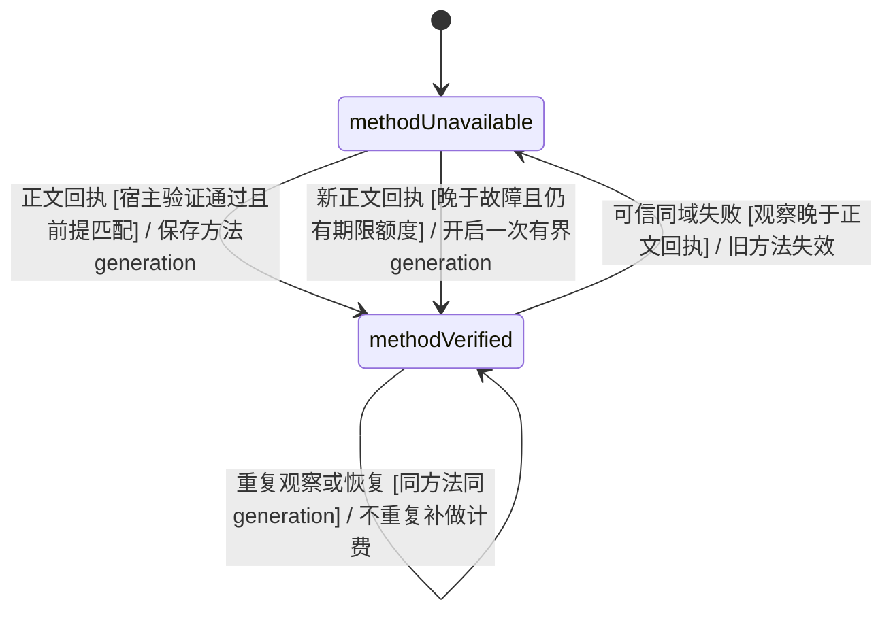
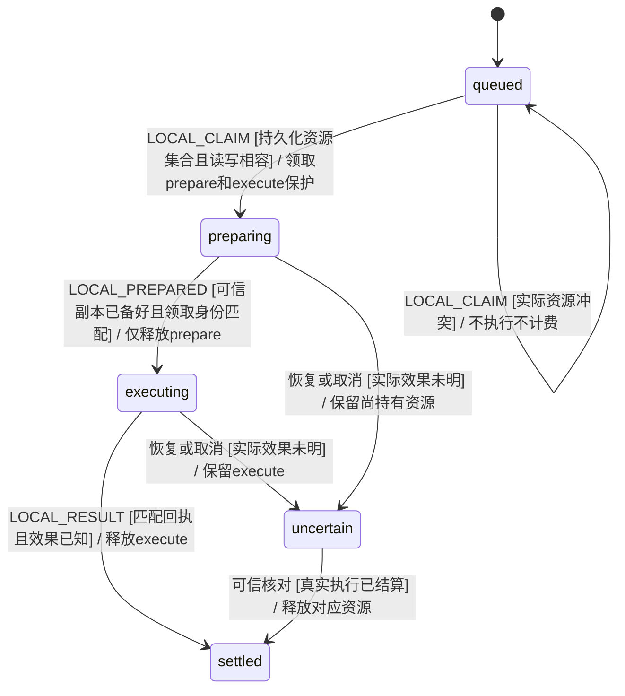
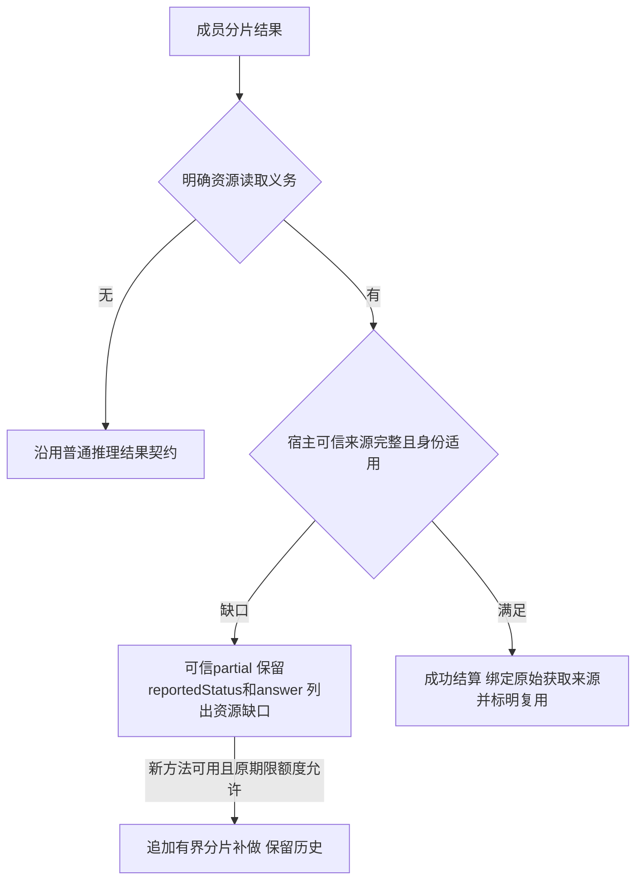
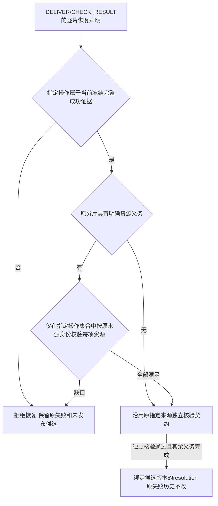
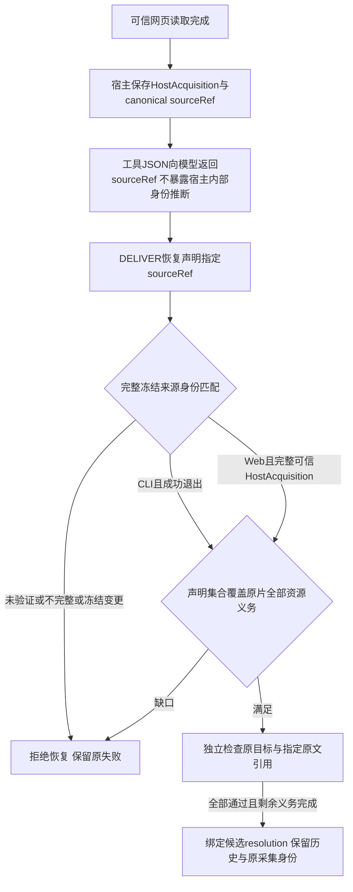

# KEJ-113 分片恢复调度与临时领取拒绝

> 2026-11-12：本文涉及子 Agent 内容核验、分片补救声明与逐片恢复证明的段落和验证命令已被[直接交付契约](remove-map-recovery.md)取代；旧命令和旧证明仅作历史记录，相关模块已删除。资源租约、工具知识和执行身份边界不受此次删除影响。

## 需求来源与核查

权威需求为 https://linear.app/kejunz/issue/KEJ-113 ，当前快照 `work/linear-KEJ-113.json`；本节保留原 EARS 编号和语义，不把分析探针当作产品验收。实现基线为 `15d27144b05086b27ae6b02338c094a3df60fbd2`。

| 编号 | EARS 原要求 | 核查与本模块边界 | 验收 |
| --- | --- | --- | --- |
| R14 | 当领取因成员占用、资源竞争或其他可解除条件临时被拒绝时，系统应允许条件解除后的有效重试；幂等记录不得把临时拒绝变成永久拒绝，同时重复成功请求仍不得重复领取、执行或计费。 | 条件解除可观察、成功幂等与失败可重试无冲突。Engine负责事务回执；状态模型保持成员互斥、执行许可和计费约束。 | BT_Y47–Y48 |
| R23 | 当共享读取方法或失败诊断时，系统应保存其资源范围、版本/配置前提和内容级验证状态，并只向满足前提的后续执行推荐；未证实方法不得被当作已验证成功经验。 | 复用资源获取凭证的单一宿主判据。退出0、模型自述、登录页不构成正文方法成功；配置与来源范围不符时不推荐为成功。能力目录事实继续作为观察而非正文成功。 | BT_Y43–Y44 |
| R24 | 当多个分片因相同读取前提失败时，系统应识别共同失败并限制继续放大该失败的派发，优先验证或修复共同前提、调整成员或方法，并保留不受影响工作的推进。 | 失败域来自可信工具诊断与资源范围，不按任意错误文字或成员发言提升权限。控制派发不能使不相关分片一起停住；需要后续的等待交给守卫协调员具名处理。 | BT_Y41–Y42 |
| R25 | 当后续执行取得经验证且适用的新读取方法或证据时，系统应重新评估仍有价值且允许补齐的旧失败分片，使用剩余期限和预算安排最小补做，而非一律转交负责人重做全部内容。 | 原结果保留；只增加适用的新尝试。原期限不续期，成功片不重跑，未知效果不重放；已消费方法身份在恢复后保留。 | BT_Y44–Y46 |
| R26 | 当操作领取资源租约时，系统应按实际冲突资源、访问模式及隔离副本身份确定租约；不同隔离副本或互不冲突的只读操作不得无故争用同一任务级独占锁，真实共享写资源仍应互斥。 | 实际租约主实现由本地执行资源层负责。本模块只核对租约等待不被误记为工具执行失败，不能因分片补做绕过仍在持有的共享资源。 | BT_Y49；资源隔离场景由租约模块承接 |

核查结论：上述触发、观察结果和权限边界明确；优先复用现有队列、操作回执、预算及已保存的真实来源，不新增跨任务经验库或模型授权路径。R23/R25依赖资源凭证模块，R26依赖本地租约模块。缺少可信诊断时不得宣称识别了共同故障，缺少正文凭证时不得宣称新方法验证成功。

## 已复现事实与实现目标

现有 `advanceMapQueue` 在成员释放后立即派发下一片，候选成员只排除busy。24种受控响应顺序均由最快失败者领取5/8片。成功方法只在下一次模型请求中作为观察投影，不触发旧失败重评。公共Engine临时WORK_BUSY拒绝被幂等缓存后，即使成员释放及SQLite恢复也不能再领同一工作；原有限期限仍可将其转成timeout，因此该项是工作饥饿而非永久全任务死锁。

正式保护使用可执行中文 `features/57_partition_resilience.feature`，独立于 `work/analysis-scheduling-probe.mjs` 和 `work/hidden-budget-queue-probe.mjs` 这些基线诊断。现有 BT_Q27–Q33 的波次、失败历史、停止、未知效果、预算、原期限及历史恢复保护继续保留。

## 纯模型契约与所有者

该图描述**上下文生命周期**，不是新增XState顶层状态。源码所有者为 `src/task/map-queue.ts`、`map-reduce-capacity.ts` 和 `tool-knowledge.ts`，由 `taskMachine` 的已持久化转换生成操作意图；Engine/Runner仅执行领取校验后的意图。



适用范围：BT_Y41–Y46、BT_Y49。`uncertain`的可信核对、局部跳过与最终汇总由守卫协调模型统一决定；本模块不直接释放未知进程或资源，不宣称跳过等于成功。

### 共同前提与方法的事实

- 共同失败记录绑定原工作、分片、尝试、工具/操作回执、目标版本与资源读取域。配置/认证/执行环境失败可归入同一前提；单个资源缺失不得扩大为整个宿主故障。等待租约不构成已执行失败。
- 新方法复用资源凭证模块的 `AcquisitionObservation`：`ResourceIdentity` 标识 URL、文档或文件；`status=acquired`、宿主verifier版本、完整正文hash及实际范围共同构成成功判据。内部纯查询拟由 `acquisitionForOperation` / `verifiedResourceAcquisition` 承接，最终名称以共享接口为准。
- 成功方法至少保存源操作身份、读取范围、宿主执行/工具配置版本与内容验证状态。来源正文不随方法经验泄露，也不替代目标分片独立执行。运行配置、目标版本或读取范围不符的方法不能触发补做。
- 方法身份在一个轮次中幂等消费；每个分片按适用新方法最多形成一个新尝试，仍受任务剩余重试额度和原期限限制。旧 `round.results` 不改写，成功分片不重做。
- 队列不能仅因拒绝继续使用旧方法而失去推进路径：剩余替代探测、其他来源分片或具名协调事件必须仍然可观察。模型文字不能自行授予新权限或增补预算。

### 临时领取拒绝

该图描述**处理流程**，源码所有者为 `TeamEngine.claim/receipt` 和现有XState领取守卫。验收为BT_Y47–Y48。



幂等成功仍由持久化工作尝试与执行actor保护。临时失败不能占住成功身份；既有成功请求的重放不得直接返回另一尝试的许可。存储故障仍按宿主故障处理，不把未提交领取当成已授权执行。

## 验证顺序与当前状态

1. 已阅读AGENTS与Uncle Bob Mode；先提交上述EARS核查、场景和拟细图。
2. 等README入口和统一细图合入、共享凭证接口确定后，进入纯模型实现。
3. 在真实 `taskMachine` 上逐事件persist/restore，先证实24种响应顺序和方法重评轨迹，覆盖停止、版本、原期限、预算、未知效果、重复恢复与迟到事件。
4. 模型门槛通过后再接Engine临时回执处理、Runner共享方法投影、SQLite恢复及Gherkin步骤；不以prompt替代调度状态。
5. 模型与接线命令、源码指纹、实际执行结果待完成后记录。当前文档不宣称上述新场景已执行通过。

本模块不新增重复单元断言；组合时序由可复用模型驱动及中文场景承接。租约等待、资源正文校验与人类决策门分别由对应所有者提供接线证据。

## 同版本前提失效补充

R23/R25的配置版本相同不代表认证状态持续有效。BT_Y50补充时序契约：新的可信同域认证/配置失败使旧acquired方法失效；后续真实完整acquired可开始新的有界generation，重复同一故障之后的同方法观察仍幂等。纯方法投影同时比较可信失败观察时间与acquired时间；不把版本相同当作认证仍有效。原失败历史、任务重试总额度及原期限继续约束新generation。



此图为 `src/task/map-scheduling.ts` 的上下文生命周期，不是新增顶层XState节点；验收BT_Y50。failure时间来自已结算本地操作或宿主固定Web失败事实，不从模型解释提取。

## 宿主结构化资源映射

BT_Y51补充R23/R25的非URL契约。`Goal.partitionResources: Record<稳定partitionId, ResourceIdentity[]>`只来自直接用户/宿主提交的义务映射，不由模型输出字段、目录推断或自然语言升级为绑定。存在映射时，队列与方法投影优先严格使用该映射；编号缺失或身份无法验证时不推断匹配。文档比较service、namespace和id，文件比较workspaceId、path及声明的revision；仅相同完整身份适用，不把文档的服务名或文件父目录当成功读取范围。

该约束细化上文上下文图的「新方法可用[范围配置适用]」守卫；源码所有者仍为map-scheduling/tool-knowledge，验收BT_Y51。URL普通任务继续从显式URL提取资源，已注册URL reader domain仅作为方法适用范围，不能替代独立目标获取回执。

## R26 实际冲突资源与短准备保护

BT_Y52–Y55细化原R26；新增纯策略所有者 `src/local-resource-policy.ts`。`ResourceLease {key,mode:read|write,phase:prepare|execute}` 是可信宿主决定并持久化的冲突描述。模型仅请求工具动作，不能声明后端已隔离、选择copyId或缩减资源集合。

- 只有实际工作区隔离后端、isolatedWork及明确copyId同时成立，sandbox副本执行才持有copy写保护；复制权威源时另持source读准备保护。不同copy可以共享源读，准备完成后释放prepare，执行仍保护自己的copy。
- host、未声明真实隔离的可用后端及直接操作权威源，保守持有source写执行保护。可逃出副本的host/unconfined执行另持统一外部效果写保护，避免不同任务工作区掩盖同一真实宿主冲突。
- verifyWorkspace只读检查需在整个验证阶段持source和copy读保护。读读相容；任何相同key的写与读或写冲突。显式可信sharedResources继续加入，不被副本身份抹去。
- 未知效果、停止和重启不表示已释放。旧快照无新描述时保留原workspace租约。可信runtime在副本准备完成、进程启动前回传LOCAL_PREPARED，只释放prepare阶段；最终匹配回执才释放execute。



此图是本地操作上下文生命周期的资源视角；真实XState状态仍由local-operation/taskMachine持有，Engine事务负责全局读写冲突，Runtime负责真实准备回调。纯门槛先使用真实taskMachine验证策略输入和领取拒绝/允许；之后由Engine/SQLite读写集合及实际副本准备接线验收，不把可用的无沙箱测试后端当OS隔离证明。

迁移边界补充（R26，BT_Y53）：旧workspace_leases没有可信隔离或访问模式声明，任何仍由其他owner持有的旧租约都按未知全局写屏障处理。新policy请求global读/写时不得越过该屏障；旧领取遇新global读/写也必须等待。该限制在原操作可信结算后解除，不按租约年龄假定安全。

BT_Y56补充队列派发守卫：可用成员总数可在恢复后增加，固定并发空位不表示只检查名单前N名。纯动作依次查找满足分片方法权限的成员，成功派发才消耗空位；无合适成员不产生重复的always转换。该转移仍是上文queued→running的「成员可用且前提可用」守卫，无新增业务状态。

## 本模块实施与验证记录

按场景、细图、纯状态模型门槛、具体接线的顺序实施。调度模型从最初39条扩展为48条，包含24种响应顺序、可信共同故障、无关来源推进、原成功片保留、最小补做、原期限/预算/停止/目标/权限/unknown、typed document/file完整身份及未映射、同版本故障失效、尚未交最终answer的即时操作失败、恢复后后位合法成员选择。每个公开事件均通过真实taskMachine并persist/restore。

R26纯门槛11条同时覆盖实际描述符、读写冲突、同copy互斥、unknown/host边界、读读并行、多资源原子拒绝、legacy跨workspace全局屏障、真实LOCAL_PREPARED会话/重复/STOP/期限/另一owner保护。legacy跨workspace负对照先观察错误放行，再加入保守屏障复验通过。

模型门槛后，新增SQLite/Engine接线验证实际资源事务：不同副本同源读同时领取；错误准备回执不释放；仅一份准备完成仍挡源写；两份均完成后源写可领取而同copy仍互斥；最终回执逐资源释放。两次SQLite关闭重开后unknown执行保护仍在，独立副本可以继续。Memory与SQLite均验证多资源原子拒绝不残留先占、另一owner不能释放、同key双phase只释放prepare、legacy新旧双向屏障。子操作回执受控；不将此层声明为OS沙箱证明，实际backend准备/进程接线由本地Runtime验收承接。

旧BT_L109的模型与接线夹具已迁移为宿主配置reader、真实Node输出正文、可信获取凭证及已注册domain范围；不再用exitCode=0当正文成功。真实Runner、SQLite和Node两次独立读取仍验证共享参数脱敏、不共享原正文、不替代目标执行凭证。

```sh
env -u MODEL_API_KEY node --import tsx tests/partition-resilience-model-fixture.ts
env -u MODEL_API_KEY node --import tsx tests/local-resource-policy-model-fixture.ts
env -u MODEL_API_KEY node --import tsx node_modules/@cucumber/cucumber/bin/cucumber.js \
  features/46_shared_tool_knowledge.feature features/57_partition_resilience.feature \
  --import 'tests/bdd/*.ts' --format progress
```

当前并行工作树以上命令分别退出0：48条调度路径、11条资源策略路径、37个直接执行场景/2101步骤通过。对应模块与受测依赖摘要记录在 `work/kej-113-scheduling-evidence.json`。新场景BT_Y41–Y56全部默认参与执行，无新增排除或空步骤。宽回归首次104场景中有5项废弃safe讨论恢复保护失败，已交核心恢复所有者核对；不通过放宽断言掩盖，最终整体复验由主分支汇总记录。

## R02 分片结果的资源事实门禁

BT_Y57–Y59补充最终交付前的分片入口。中文场景和此细图先于生产修改；普通无资源推理沿用既有成功结算，不一律要求CLI。

- 对明确资源获取义务，`recordMapResult`复用资源模块 `requiredResources/missingResourceAcquisitions` 的唯一来源判据，包含宿主稳定partitionId映射。缺口非空时可信part/result状态为partial，保留reportedStatus=原success、原answer及missingResources，标记RESOURCE_ACQUISITION_UNVERIFIED；不接受模型HTTP状态/字符数自述为凭证。
- 缺口已被真实匹配saved源满足时允许复用同goal来源；引用原HostAcquisition身份、原work/attempt/at，显式标reused，不把复用说成当前成员又抓取。current源要求当前epoch及本work；同work安全模型重试仍沿用原始获取attempt与at，不重标采集。
- 新方法补齐partial仍由原R25队列逻辑安排，保留原自报/缺口历史；期限、预算、权限和未知效果约束不变。



该图为 `src/task/map-queue.ts` 的上下文结果接收流程，真实taskMachine的DISCUSSION_RESULT/WORK_FAILED仍持有转换；验收BT_Y57–Y59。未知物理效果在入口前继续受localUnsettled守卫保护，不通过partial降级释放外部效果。模型门槛须先观察当前无凭success被错误接受的红灯，再实现；模型通过后追加真实Engine/SQLite接线，不只在最终DELIVER/CHECK_RESULT挡complete。

## R02 负责人恢复声明的逐片来源绑定

BT_Y60细化同一R02，不新增读取义务。EARS R02-MR：当负责人声明恢复一个具有明确资源获取义务的失败分片时，系统应仅在该声明的sourceOperationIds集合中存在覆盖该片每项义务的合法HostAcquisition时允许独立核验；如果真实资源仅由未指定操作取得，则系统应保留原始失败并报告MAP_RECOVERY_RESOURCE_UNVERIFIED。核查结论：资源身份与freshness复用资源模块；全任务满足获取义务不能证明指定echo命令取得了正文；没有资源义务的历史推理分片保留原恢复契约。



此图是 `src/task/map-recovery.ts` 的上下文处理流程，真实taskMachine仍持有DELIVER/CHECK_RESULT，未增加顶层状态。资源模块先过滤声明操作集合，再复用完整哈希、当前goal、原work/attempt/epoch及freshness判据；只读查询可附原partition定义，不得重标真实来源身份。停止、旧目标、旧epoch、未冻结来源、截断来源及未知效果继续沿用原拒绝边界。模型门槛先重放「opX真实读取、opY只echo、声明Y却complete」负例，再通过公开Engine/SQLite与真实Node命令验证实际接线。

补充实施记录：上述负例在旧真实taskMachine中未产生拒绝，独立check甚至可以引用foo使原分片complete；修复后11条来源绑定路径通过，包括URL/document/file正反例、current原sourceWork、多资源来源集合缺一项与完整覆盖，以及不同work操作ID重名时冻结sourceWork优先。来源只能属于对应冻结证据的sourceWorkId/sourceOperationId，不能靠另一个同名操作替证。原无资源恢复模型23条继续通过。

资源结果门禁6条、调度48条、资源租约11条均复验通过；三类资源各经真实Engine/SQLite关闭重开两次仍保留拒绝和原HostAcquisition。真实Runner与Node先由操作X读取八份文档，再由操作Y完整成功echo foo；声明Y被拒绝，0次check、0条resolution，7条原失败不变。未将受控backend验收扩大为OS隔离证明。

```sh
env -u MODEL_API_KEY node --import tsx tests/partition-evidence-model-fixture.ts
env -u MODEL_API_KEY node --import tsx tests/map-recovery-source-model-fixture.ts
env -u MODEL_API_KEY node --import tsx tests/map-recovery-model-fixture.ts
env -u MODEL_API_KEY node --import tsx node_modules/@cucumber/cucumber/bin/cucumber.js \
  features/26_map_reduce.feature features/46_shared_tool_knowledge.feature \
  features/47_task_efficiency.feature features/52_map_recovery.feature \
  features/57_partition_resilience.feature --import 'tests/bdd/*.ts' --format progress
```

本工作树宽回归136场景/7953步骤全通过；冻结sourceWork细化后定向52+57再跑61场景/3574步骤全通过。产品与测试TypeScript均通过。以上为模块实施与实际接线证据，不替代主分支整体冻结后的验证记录。新BT_Y41–Y60全部默认参与直接执行，无新增排除或空步骤。

## R02 网页来源的恢复入口

BT_Y112与资源凭证BT_E127共同约束统一入口。EARS R02-WEB：当负责人通过网页工具取得与原分片明确资源义务匹配的完整宿主可信获取凭证，并使用工具回传的canonical sourceRef声明恢复时，系统应允许该冻结网页来源进入独立核验；如果来源未核实、不完整、身份错配、旧版本或冻结后改变，则系统应拒绝恢复并保留原失败。CLI来源仍要求成功退出，Web来源不虚构CLI退出码。核查结论：Web与CLI复用同一资源凭证契约；扩大的是既有可信来源入口，不扩大读取权限或忽略资源义务。



此图为map-recovery上下文流程，源码所有者 `src/task/map-recovery.ts`；工具引用保存与回传由资源/evidence/Runner所有者接线。`sourceRef`对应冻结DeliveryEvidenceSource.id；Web原operationId另保留真实请求ID，不能把虚拟证据ID当成新执行或把HostAcquisition改贴到owner。模型门槛先验证完整Web目前被CLI-only守卫错误拒绝，再对停止、目标/epoch、无可信验证器、资源错配、不完整及冻结后变化作负对照。模型通过后使用真实Runner/适配器、SQLite和真实本地HTTP正文服务，模型回放只能从工具JSON取sourceRef，不得读取Engine内部生成声明ID。

最终工具字段为 `web_fetch_result.hostEvidence.evidenceId`，另有acquisitionId、原请求sourceOperationId和status；partitionRecoveries与check引用都复制canonical evidenceId。Web机械守卫还逐项匹配冻结sourceWorkId、原sourceOperationId、requestHash、contentHash与完整content；CLI仍额外要求exitCode=0。首次完整Web轨迹不能生成check，修复后9条真实状态模型路径通过；既有来源绑定11条及旧恢复23条继续提供原来源与版本边界。

```sh
env -u MODEL_API_KEY node --import tsx tests/map-recovery-web-model-fixture.ts
env -u MODEL_API_KEY node --import tsx tests/map-recovery-web-acceptance.ts
env -u MODEL_API_KEY node --import tsx node_modules/@cucumber/cucumber/bin/cucumber.js \
  features/52_map_recovery.feature features/57_partition_resilience.feature \
  --import 'tests/bdd/*.ts' --format progress
```

最后接线结果：2份真实本地HTTP正文、0条CLI操作，owner仅从工具JSON复制证据引用；SQLite重开后原文不重读，独立check一次完成2片resolution，2条失败历史保留。指定第一份网页来源冒充第二片时保留partial、0check/0resolution。定向52+57共62场景/3633步骤通过，产品与tests TypeScript通过。该层证明真实接线与原引用可用，不证明公共DNS、真实账号登录或真实供应商模型的内容判断。

### R25 网页认证观察的时序约束

BT_Y50补齐原R25同版本失效契约：当当前目标/epoch中、同一配置的宿主可信Web观察在已验证方法之后报告authentication_required时，系统应立即使该来源域的旧方法失效，不等待模型最终answer；仅故障后新的匹配正文凭证可开启有界新generation。原HostAcquisition的work/requestID/at保留。未验证unknown、旧配置、旧目标/epoch或快照失效观察不能被升级为共同认证故障。

此变更细化前文methodVerified→methodUnavailable的「可信同域失败」守卫，不新增业务状态。failureFacts从同一savedAcquisitions来源查询可信Web诊断，按已保存原请求身份与原观察时间分组；两片同域真实认证故障才形成共同前提，旧成功和model prose均不能替代新正文。纯状态门槛首先观察「acquired at6→同配置Login authentication_required at8，旧method仍1条」的红轨迹，再复验新正文generation与真实HTTP返回登录页的Runner接线。

```sh
env -u MODEL_API_KEY node --import tsx tests/partition-web-auth-model-fixture.ts
env -u MODEL_API_KEY node --import tsx tests/partition-web-auth-acceptance.ts
env -u MODEL_API_KEY node --import tsx node_modules/@cucumber/cucumber/bin/cucumber.js \
  features/46_shared_tool_knowledge.feature features/52_map_recovery.feature \
  features/57_partition_resilience.feature --import 'tests/bdd/*.ts' --format progress
```

4条纯状态路径通过：即时失效/停止共享与旧补做、故障后一次generation及恢复不重放、两片共同Web认证失败，以及旧配置和unknown负对照。实际本地HTTP200依次返回正文、Login、新正文，SDK/Runner/适配器/SQLite观察到methodCounts=[1,0,1]，原采集时间110/120/130和请求身份保留，0条CLI，SQLite重开不再发请求。最终46+52+57共70场景/4099步骤通过，调度48条与Web恢复9条模型复验通过，产品与tests TypeScript通过；所属生产代码至此冻结。
