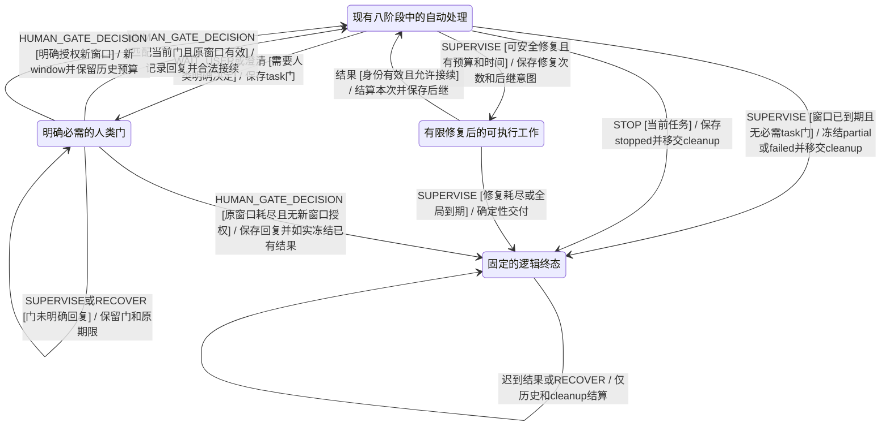
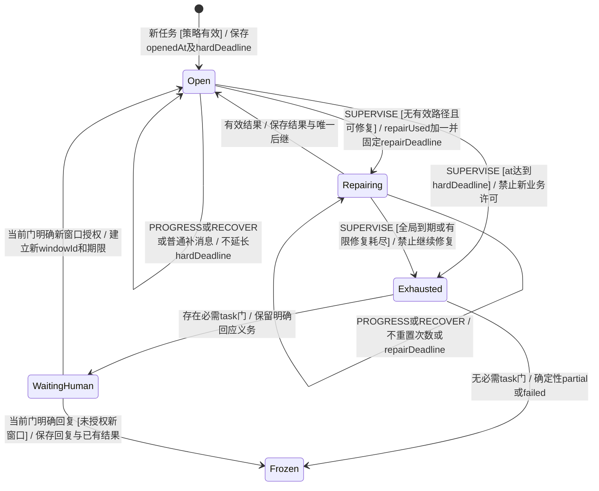
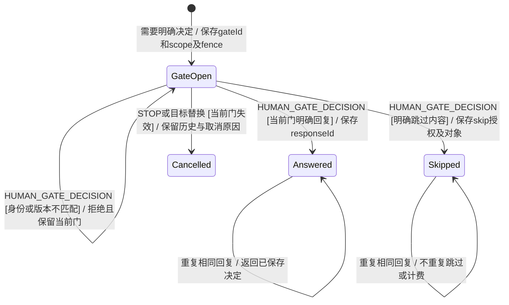
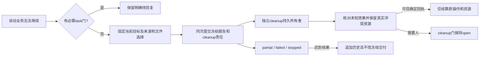

# KEJ-113 核心任务监督与确定性交付

状态：场景与模型设计阶段。本文中的新增事件、上下文生命周期和转移为拟定实现，当前生产 `taskMachine` 尚未具备这些能力。实施仍按场景、状态图、真实 XState、模型门槛、具体接线的顺序推进；`work/fallback-policy-model.ts` 的探索结果不能替代本次真实模型门槛。

目标是把“千方百计的完成任务”落实为持续寻找可执行路径、有界修复和可信收敛。技术失败不能仅被挪到 `waitingHuman` 便被认为已经兜底。人类确实需要决定时必须明确等待；允许缺失的内容可以被明确或预先授权跳过。逻辑任务结束与物理操作结算分别拥有持久责任。

## EARS 与核查

完整需求草稿来自本会话 `work/issue-ears-draft.json`。以下是本模块的实施映射，不把读取配置、资源锁和 HTTP/UI 接线工作重复实现到模型层。

| 需求 | 本模块可观察响应 | 场景 |
| --- | --- | --- |
| R01、R09、R10、R39 | 八阶段均有实际工作、有界在途/唤醒、明确人类门或真实终态；pending 数量本身不是证明 | BT_Y02、Y18 |
| R03、R04、R05 | 必需门持久保存并只接受匹配身份的人类回复；未知效果不被当作已结算 | BT_Y04、Y05、Y11 |
| R06 | 内容级 skip 保存对象、理由与授权，允许独立内容继续；不代答授权或核对 | BT_Y07、Y11 |
| R07、R08 | 固定自动窗口与有限修复不被进展/恢复续命，提供方永不返回仍可收敛 | BT_Y01、Y03、Y06 |
| R11 | 已领取但未获启动许可的工作保存未启动事实并建立后继 | BT_Y13 |
| R12、R37 | 继续、换目标、门回复和到期冻结有一致身份与事务边界 | BT_Y14、Y19 |
| R13 | STOP 与恢复、确定回执的先后不丢停止意图 | BT_Y15 |
| R17、R18、R38 | 期限判定不依赖 tick 先后，保存结果的再激活/消费/后继原子一致 | BT_Y16、Y17、Y20 |
| R27、R28 | 逻辑终态持久交出物理责任；cleanup 的核对门可以继续 open | BT_Y11、Y12、Y15 |
| R29、R30、R31、R32 | 无新 LLM 请求即可形成 partial/failed，固定目标/正文/文件并拒绝晚结果改写 | BT_Y08、Y09、Y10、Y12 |
| R36、R40 | 旧快照可读、迁移不续期；固定版本与责任记录按提交边界保存；报告模型和接线验证范围 | BT_Y20 及实施记录 |

核查结论：上述条目与用户持续推进、明确等待人类及可缺失内容跳过的要求一致；不承诺所有外部任务必然成功，不授权无上限调用或重放未知写效果。必需目标/权限门和 cleanup 核对门明确区分，消除“全局期限到达”与“等待人类明确回复”的冲突。期限与修复参数由配置策略确定；讨论中的 30 秒、60 秒、2 分钟、10 分钟均非已确认默认值。

需复用的现有能力包括预算、`Intent`、执行子 actor、审批、局部操作的 session/receipt、来源校验、版本 fence、`cancelWork` 及有界检查。新模块只负责纯状态判断与更新，不调用模型、进程、文件或数据库。WebService 和 UI 只执行/投影已经持久保存的决定。

## 主任务的监督转移

类型：拟定真实 XState 转移细图。所有者：`src/task/lifecycle.ts` 与 `src/task/resilience.ts`；沿用现有八个顶层阶段，不新增所有生命周期的扁平乘积。验收：BT_Y01–Y20。

图中 `Automatic`、`Human`、`Repair`、`Terminal` 是分组说明，不是新增的父状态。实际八阶段处理规则如下。

| 阶段 | 有效工作与等待 | 无路径或到期处理 |
| --- | --- | --- |
| interpreting | 当前解析意图及已领取执行许可 | 有界解析恢复；明确澄清才建 task 门；否则确定性失败/部分交付 |
| running | 当前 owner/tool、可兑现的讨论/交接 | 有界协调或最小后继；窗口到期冻结 |
| waitingAssistance | 当前协助/评审、已保存结果交接 | 统一期限判定，安全结算并续办；不能只释放工作 |
| coordinating | 当前协调意图与有效启动许可 | 有限协调修复；模型不可用不阻挡确定性交付 |
| waitingHuman | 明确 task 门；cleanup 门单独计算 | 必需 task 门不代答；技术故障没有人类决策问题时仍监督修复/降级 |
| checking | 固定候选检查及一次性检查许可 | 沿用检查上界；失败/耗尽可 partial，不申请无限免费检查 |
| stopping | 已保存的停止意图 | 逻辑停止与物理责任移交后得到 stopped；恢复不重开业务 |
| ended | 冻结交付或历史终态 | 不派发业务；独立清理继续，迟到回执不改正文或 activeTask |

监督事件由可信宿主提交。实际 phase 的合法领取分支、当前 epoch/goalVersion、预算/权限、截止时间、成员占用和执行授权必须一致；`pending` 记录不等于可领取。资源租约的真实可用性由 Engine 的全局事务再校验。进程外监督和全局资源扫描属于宿主实现，不在状态机动作中做 I/O。

## 固定处理窗口与有限修复

类型：上下文生命周期；所有者：`src/task/resilience.ts`。验收：BT_Y01、Y03、Y06、Y20。

普通 `CONTINUE` 可以建立新的执行 epoch，但不得自动建立新的处理窗口。`newWindowMs` 必须来自直接用户明确授权并经校验；新窗口保留普通/检查/协助/重试历史用量。新目标和普通补消息仍受本窗口约束，除非用户明确授予新窗口。

旧快照缺少 resilience 字段时仍可读取。对未结束的旧任务，首次需要提交监督状态时从原始创建消息时间推导一次有限窗口，后续恢复复用已保存值；不以恢复时刻为起点。旧历史终稿不因兼容迁移被重新生成或改写。原 budget、stop、session、attempt、目标和已保存结果保持。

## 人类门与内容跳过

类型：上下文生命周期；所有者：`src/task/resilience.ts`。UI 为投影，不能自行判定授权。验收：BT_Y04–Y07。

`scope=task` 用于必需目标、权限、澄清或直接用户要求先决定的问题；此类门不因超时自动解除。`scope=cleanup` 用于未决物理效果核对，可在逻辑 partial/failed/stopped 后继续 open。内容跳过不能证明操作未执行、不能批准原本未授权的命令，也不能释放未知写效果的资源。

`WAIT_USER`、明确澄清和协调 `askUser` 创建当前 task 门。纯技术故障不凭空制造一个需要用户回答的问题。匹配门的回复可以沿用原 `HUMAN_DECISION` 输入语义；新的 `HUMAN_GATE_DECISION` 额外携带不可混淆的 gateId 与决定。UI 的暂时关闭只改变展示，不发送决定。授权类门的具体执行仍受原审批模型约束，`skip` 只取消/省略相应内容而不批准操作。

## 固定交付与独立物理责任

类型：两个独立上下文生命周期及事务边界；所有者：核心模型保存冻结/移交意图，Engine/宿主领取执行。验收：BT_Y08–Y12、Y15、Y19、Y20。

确定性宿主报告不是把模型草稿改个标题。它固定当前 task/epoch/goalVersion/windowId、宿主正文、当前文件选择、验证状态与 skip/cleanup 清单。当前模型草稿没有独立证据时作为未核实材料列出；旧目标文件不混入当前清单。没有可用业务材料时是 failed，生成的错误报告本身不算完成原任务的成果。存在影响任务完成判定的未知效果时不能 complete。

冻结和移交必须在同一持久提交中出现；提交失败不能把前端展示成完成。未知操作仍保留 workId/operationId/sessionId/实际资源身份，不把 lease 超时当作进程退出证据。清理是否已执行不是发布报告的必要条件，但持久责任必须已建立。清理遍历全部任务，包括非 active、ended 和归档房间；其晚结果不得经通用保存路径重新抢占 activeTask。

## 已复现边界的拟定裁决

| 边界 | 拟定事件与响应 |
| --- | --- |
| CLAIM 成功后 EXECUTION_START 到期 | `EXECUTION_NOT_STARTED` 保存确认未启动，不发适配器调用；按工作类别结算并保存后继/有界修复/真实终态，替代没有后继的裸 SETTLE |
| waitingHuman 内 CONTINUE 旧后台讨论 | 开新 epoch 前退休旧 pending，取消旧轮但保留原意见；如果合法接续必须同步全部 fence；不得保留 active 旧轮阻止 owner |
| STOP→RECOVER→核对 | stop 是持久目标；恢复先结算/移交 cleanup，不能退到无门且无后继的 waitingHuman；逻辑结果维持 stopped |
| 保存协助结果→EXHAUSTED→获准重试 | 原子清除不再适用的终态、合法建立新执行身份、消费一次已存结果并建唯一后继；原来源与计费不改 |
| 回调与 tick 先后不同 | 按可信接收/执行边界与同一期限谓词裁决；截止及之后不视作按时成功。迟到原文保留历史，业务结果只交接一次 |
| 冻结与新输入同时发生 | 同一事务序列及 task/goal/window/gate 身份裁决；先接受输入则快照必须反映，冻结后输入只能明确新窗口/新任务或被明确拒绝 |
| 冻结后 LOCAL_RESULT/LOCAL_RECONCILE | 原物理记录可结算；禁止把逻辑工作恢复成 pending 或生成 owner；保持 frozen 正文和文件清单 |

## 拟定接口

类型草稿位于 `work/kej113-resilience-contract.ts`，由 root 整合公共 `src/types.ts`。正式类型由新 `src/task/resilience.ts` 导出。

- `TeamConfig.resilience?: ResiliencePolicy`：固定自动窗口、修复/取消参数和内容缺失策略；root 统一默认策略，不把功能仅限 opt-in。
- `TaskContext.resilience?: TaskResilience`：持久 window、gates、skips、cleanup、frozen 和下次监督时间；optional 用于读兼容。
- `SUPERVISE`：可信宿主触发，基于当前真实阶段作纯判断，不授权模型自行发监督事件。
- `EXECUTION_NOT_STARTED`：可信 Runner 在领取已提交、启动许可被拒后确认未启动；原 intent/attempt/fence 仍校验。
- `HUMAN_GATE_DECISION`：匹配当前门的 `reply/skip/stop/newWindow`；`newWindowMs` 只接受直接明确授权。
- `CONTINUE.newWindowMs?`：明确的新窗口输入；缺省继续不改变原期限。

核心纯接口拟为 `processingWindow(c)`、`ensureResilience(c)`、`supervisionDecision(c, phase, at)`、`applySupervision(c, event, phase)`、`openHumanGate(c, event, options)`、`decideHumanGate(c, event)`、`freezeIncomplete(c, event, reason)`、`adoptCleanup(c, at)`、`settleCleanup(c, at)`。名称可在模型阶段局部调整，变更行为需先回到场景/图。

## 实施前门槛与验证记录

场景与细图完成后，root 将 README 和状态细图入口接通并发出 `MODEL_GO`，再修改真实模型。模型驱动必须调用真实 `initialTask/stepTask/persistTask/restoreTask`，覆盖上述八阶段、时钟/顺序/重复/版本矩阵及每步持久化；探索模型不能当作完成此门槛。

模型门槛通过后才接 Engine、WorkRunner、适配器与 UI。需要双存储、真实 HTTP、异步取消/进程重启和真实人类门/导出行为验收。不得以 `waitingHuman`、仅存在 feature 文本、规格覆盖关联或探针退出 0 扩大成完整验收。

当前记录：已新增 BT_Y01–Y20 场景提纲并核查 EARS 映射；尚未修改生产模型，模型与集成门槛尚未执行。
