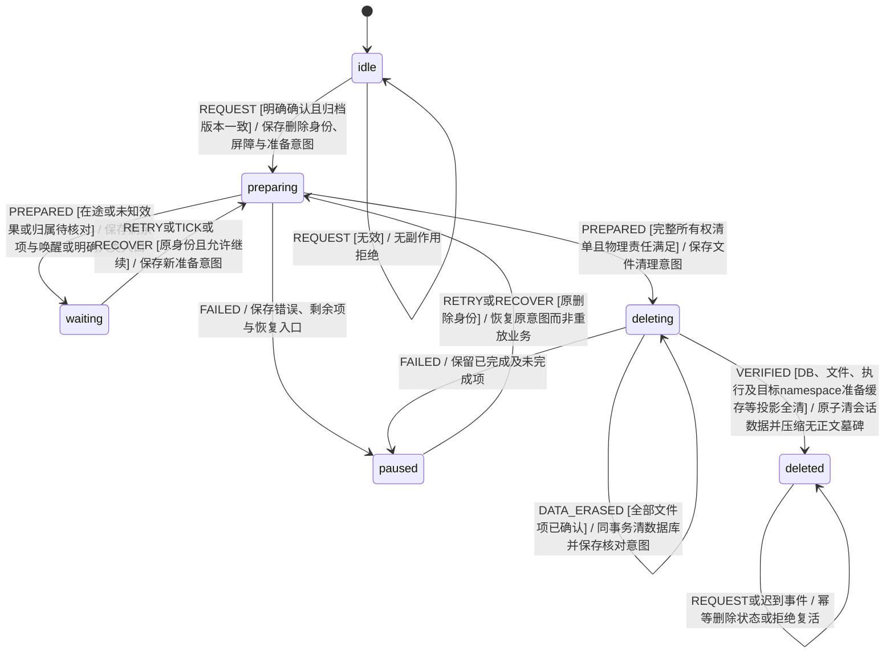

# KEJ-114：归档会话的安全删除

需求：[KEJ-114](https://linear.app/kejunz/issue/KEJ-114/安全干净地删除归档会话并清理关联数据与独占资源)。权威需求读回为 `work/linear-KEJ-114.json`。起始产品基线 `15d27144b05086b27ae6b02338c094a3df60fbd2`；实现分支 `codex/kej-113-114-resilience-and-deletion`。

本文记录需求、独立删除状态模型及已经接入的 Store、Runtime、Engine 和网页服务边界。实现遵循模型先行；各验证层的实际执行状态分别记录在文末。

## 输入与 EARS 核查

原始输入：安全、干净地删除归档中的会话。补充输入：检查能否彻底删干净，包括未完成、部分完成等各种情况。用户已授权实现 KEJ-113 与 KEJ-114；范围是单个明确确认的归档 room，不包含批量清空、删除用户源工程或撤销外部业务写入。

R01–R20 保留 issue 的唯一编号。核查均通过：触发、可观察响应和保护边界明确；未完成并不等于永久拒绝，未知效果并不等于可以强删。删除是独立持久生命周期，现有归档继续执行语义不改变。下表为对应 EARS 响应的压缩索引，权威原文仍是 issue。

| 需求 | 经核查的可观察响应与边界 | 场景 |
| --- | --- | --- |
| R01 | 当用户选择删除时，应明确目标、范围、不可恢复性与未完成处理；仅明确确认提交，取消不改变数据。 | X01 |
| R02 | 当受理时，应复验存在、归档状态、版本、身份与权限；失效请求无清理副作用。 | X02、X06 |
| R03 | 当存在未完成工作时，应受理安全删除并冻结、撤销、停止或接管全部执行；未决显示处理/核对及入口，不假完成。 | X03、X04 |
| R04 | 当确认有效时，应先持久删除意图、目标版本、清单与屏障；新业务、恢复和审批须按事务与版本拒绝。 | X05、X06 |
| R05 | 当清理时，应删除全部会话快照、回执、网页事件及 measurement、调试记录和相关索引，旧 URL 无正文。 | X07、X17、X27 |
| R06 | 当删文件时，应依据受信 namespace/操作/session 清单，仅删受控根内独占资产并防路径/链接/替换越界。 | X08、X09 |
| R07 | 在删除中，应保护其他会话、源工程、共享技能、服务锁、账号与未确认资源。 | X10、X21 |
| R08 | 当跨 DB/FS 时，应持久进度、幂等重试和重启续办；局部事务一致，不伪造文件回滚或过早成功。 | X11、X27 |
| R09 | 如果失败或新发现未知效果，应保留必要材料、阶段、原因和恢复入口及责任者。 | X12、X23、X25 |
| R10 | 当重复、迟到、轮询或重放到达时，应幂等或拒绝，不复活、不新增孤立事件或执行。 | X13 |
| R11 | 在防复活需要记录时，应仅保留不含标题/正文/产物/输出/凭据的最小独立标记。 | X14 |
| R12 | 当删除时，应清服务与可控客户端投影、草稿及持久缓存，切换有效目标，保护其他会话草稿。 | X15 |
| R13 | 当存在共享引用时，应保留其他会话独立副本或明确依赖；外部清理只用已支持能力，不删共享账号与业务结果。 | X16 |
| R14 | 当所有项独立核对完成时，应删除完成，所有旧内容入口及重启均不可恢复读取。 | X17、X24、X27 |
| R15 | 当枚举时，应遍历全部历史任务、目标、epoch、轮次及尝试，覆盖八阶段四结果，不以 active/outcome 判空。 | X03、X18、X19 |
| R16 | 当清内容时，应覆盖所有发布/部分/失败/历史产物、附件、来源、检查材料及原始输入和检查点。 | X20 |
| R17 | 当追踪文件时，应绑定 room/namespace/work/attempt/operation/全部 session；跨 room 标识可碰撞，旧数据不唯一须核对。 | X21、X22、X23 |
| R18 | 当清准备残留时，应覆盖 scratch、检查输出、半成品 copy、marker、journal pending 和旧 session 日志，不能同名删共享资源。 | X08、X10、X22 |
| R19 | 当发现孤儿时，应核对所有者/引用/进程/效果并持久跟进；不能凭年龄、共享 key、operationId 清空。 | X23 |
| R20 | 当显示完成时，应独立核对全清单、实际执行、服务与客户端投影，仅保留无正文墓碑；有遗留如实显示未完成。 | X24、X25、X27 |

`BT_X01–BT_X27` 使用仓库未占用的单字母前缀，符合 `scripts/spec-coverage.ts` 的 `^@BT_[A-Z]\d+$`。27 个定义展开为 105 个用例，均有直接步骤绑定；X01、X15、X24 使用真实浏览器，其余 102 个用例使用公开 Engine/WebService/HTTP 与实际 SQLite、目录或进程。没有新增人工豁免。

## 删除生命周期

图类型：**真实 XState 删除作业模型**，所有者 `src/room-deletion.machine.ts` 导出的独立 `roomDeletionMachine`；不改八种任务阶段的含义。组织归档仍由现有 `roomMachine(active/archived)` 负责；删除作业从受信归档事实建立，删除状态由 Store 单独持久化，不能依赖 `activeTaskId`。



守卫只读取持久事实，不访问文件、进程或网络。模型动作仅更新 context 与生成持久操作意图。可信引擎在事务中领取意图后，删除运行器才执行所有权扫描、停止/核对、文件清理与独立读回，并以带 `deletionId/revision/intentId/attempt` 的事件回传。数据库提交失败不执行下一阶段 I/O。取消/暂停删除不能复活已经移除的数据；关闭和重启恢复原 job。未知效果由原物理清理或删除清理所有者持久接管，在核对结束前保留必要证据且不返回 deleted。

目标是支持所有合法任务阶段与结果；单个 room 内一律枚举所有任务和操作。`ended`、`partial`、`stopped` 和 `activeTaskId=null` 都不能跳过资源检查。运行中的任务要停止派发并可靠结算/接管；未完成业务不能自行产生后继。删除等待必须有下一核对时间或明确人类事件及处理入口，不允许无人负责的等待。

BT_X26 补强同一 `preparing → waiting → preparing` 模型路径：逻辑运行器超时、abort 或 detach 不能证明 Runtime 的复制、mkdir、journal 等实际 Promise 已结束。`LocalRuntime` 独立按可信 room owner 跟踪完整 execute Promise，`roomQuiescent(roomId)` 仅在实际 I/O 全部结算后成立；无 owner 的旧嵌入操作在运行时保守阻塞删除。inventory 的 `executionsSettled` 必须同时满足该事实。文件准备未结束时保留等待，结束后重新扫描最后创建的文件，不能在已删后迟到创建资源。

R12/R20 的投影包括 `LocalRuntime.workspaces` 内的已准备副本 promise，而不只有网页和文件。复用既有 VERIFIED 投影前提，不增加状态：成功移除经过所有权校验的 workspace 时，只退休该 namespace 的准备缓存；移除 copy 时，只退休该 namespace/work 的缓存；absent 幂等结果也执行同样退休。`verifyRoomCleanup` 必须独立确认 inventory 全部历史 task namespace 没有准备缓存，文件消失不能替代该条件。共享 registry 与其他 room 的 namespace 不在清理范围。X25 以两 room 的真实副本及“只移除文件、漏清准备缓存”的故障注入验证保留、拒绝假完成和原请求重试恢复。

该故障注入模拟旧运行时代码漏清内存投影，不通过伪造文件 identity 重放已完成清理。真正重建 Runtime 后可继续原持久删除请求；若 database 已清，准备重试不能重新插入空 room 行，否则独立数据库核对会正确阻止完成。纯模型显式复验 `dataErased=true → VERIFIED失败 → RETRY → PREPARED → 仅verify → deleted`：原删除身份和 dataErased 不变，不重新生成 eraseData 或业务写入许可。新正常清理在向状态机回传 ASSET_REMOVED 之前退休对应缓存，进程崩溃也不会保存旧内存 promise。

BT_X27 复验同一 `eraseData → verify → deleted` 模型，不增加状态或权限。真实 `WebService(':memory:')` 必须让 Store 快照/回执/墓碑与网页会话/事件共享同一个 SQLite connection；两个独立 `new DatabaseSync(':memory:')` 代表不同数据库，不能构成同库删除事务。沿用原完整性守卫：四类目标业务记录消失、其他会话保留、HTTP 410 与防复活读回全部通过后才能完成；共享 connection 只有一个明确关闭所有者。该接线用实际内存数据库检验，不能切换成文件数据库或自制 MemoryStore 替代。

## 已固定的共享契约

### 持久作业与 Store

独立 `room_deletions(room_id PRIMARY KEY,data)` 保存删除 XState 快照；不将作业只放入待删 `rooms.data`。Store 的域接口如下，精确类型以 `src/store.ts` 为准：

```ts
readDeletion(roomId: string): SavedRoomDeletion | undefined;
listDeletions(): SavedRoomDeletion[];
stepDeletion(roomId: string, event: RoomDeletionEvent): SavedRoomDeletion;
transactDeletionSettlement<T>(roomId: string, proof: DeletionSettlementProof, fn: (tx: Transaction) => T): T;
eraseDeletionData(roomId: string, event: DataErasedEvent): SavedRoomDeletion;
finishRoomDeletion(roomId: string, event: VerifiedEvent): SavedRoomDeletion;
verifyDeletionDataGone(roomId: string): boolean;
deletionLeases(roomId: string): { key: string; owner: string }[];
```

`Store.finishRoomDeletion` 在**同一个 SQLite connection/事务**删除 `rooms`、`receipts`、`web_rooms`、`web_events` 中目标 room 行，并把 job 压缩为墓碑，避免原 web connection 与 Store connection 的伪原子提交。表不存在时按空处理，但不能忽略真实 SQL/提交错误。内存 Store 提供相同域语义；WebService 在提交最终清理前退役本 room 执行器与服务投影，在提交后通知客户端清缓存。客户端离线清理通过墓碑同步防复活，不声称擦除用户另存文件。

普通 `Store.transact(roomId, ...)` 在删除屏障/墓碑下拒绝创建或修改 room；原操作结算只能通过明确的可信 settlement 意图与内部宿主入口进入删除事务，不能向任意调用者开放一个 `allowDeleting` 布尔绕过开关，也不能成为新业务派发许可。旧 `read()` 返回空对象不再允许迟到事务写回空 room。请求幂等身份、归档版本和删除版本必须与屏障同事务核对。

完成后仅保留 room 不透明身份、deletionId/版本、完成时间及请求幂等摘要；去除 manifest、路径、标题、正文、原事件和工具内容。墓碑不参与普通会话历史。墓碑命令身份不复用普通待删回执表；不同幂等 id 重复请求返回一致删除状态。

### 运行时所有权与文件清理

Runtime 接口（精确类型以 `src/local-runtime.ts`、`src/runtime-ownership.ts` 为准）：

```ts
interface RuntimeOperationOwner { roomId: string; taskId: string }
// 新增可选第6参以兼容旧嵌入；新生产runner始终传可信owner。
execute(work, operation, signal, started, observe?, owner?: RuntimeOperationOwner);
roomQuiescent(roomId: string): boolean;
planRoomCleanup(input: RoomCleanupInput): Promise<RuntimeCleanupInventory>;
cleanupRoom(claim: ClaimedRuntimeCleanup, signal: AbortSignal): Promise<CleanupReceipt>;
verifyRoomCleanup(inventory: RuntimeCleanupInventory): Promise<boolean>;
```

Runtime 在原 journal `prepared` 写入和任何目录准备前，先保存所有权记录：roomId、taskId、namespace、workId、parentAttempt、operationId、local attempt、sessionId 与预期资产。每次 session 都有独立不可被新 session 覆盖的记录。创建前记录预期路径，才能覆盖准备一半即崩溃的目录/文件；清理完成后再清该记录。journal 新记录可同时携带同一 owner；旧 journal 保持可读，不伪造旧 owner。

完整 inventory 从 **全部 room task/intents/localOperations**、可信所有权记录和已持久事件中的精确 session 关联重建，不能只用当前 `op.sessionId`。operationId/workId 不全局唯一，journal 和 copy marker 的旧格式不足以单独证明 room。无法唯一归属的旧资产进入明确核对；禁止按年龄或仅按 operationId/共享源路径删除。

文件动作只接受服务端计算并持久化、领取过的 manifest。清单包含允许的资产类型、根目录内规范相对路径、所有权身份与用于防替换的文件身份；不接受客户端或模型传入任意删除路径。核对根和父链、拒绝越界/链接替换，清理只移除已证明的目录项，不跟随符号链接到外部。共享根内的名字不能单独成为删除许可。全部会话独占文件都应列入 final verification，包括所有权记录自身。

| 资产 | 所有权/范围 | 清理边界 |
| --- | --- | --- |
| `workspaces/<namespace>` | `fingerprint({roomId,taskId})` 的默认独占任务根 | 包括整个根内 scratch/任务产物；配置源工程时不得删外部根 |
| `copies/<digest(namespace:workId)>` | 同一 work 的副本，含未准备完目录 | 不仅依赖 `op.isolated` 或完成 marker；依据可信工作种类与所有权记录 |
| 对应 `copies/<hash>.json` | 副本 marker | 与副本分别纳入清单，避免删目录留 marker |
| 独占根内 `.home/.tmp` | 沙箱 scratch | 共享源工程或宿主 HOME 内的同名目录不属本 room |
| 独占根内 `dist/test-results/reports/coverage` | 验证及部分输出 | 遍历完整目录，不以最多100项输出摘要作为全清单 |
| `sessions/<digest(sessionId)>.json` 与 `.json.pending` | 全部历史 session 的 journal 和原子写临时文件 | 先结算/接管物理效果，未知时保留核对材料 |
| `logs/<digest(sessionId)>.log` | 全部历史 session 的日志 | 不能只清当前 session 或只依据非全局唯一operationId |
| 新运行时 ownership 记录 | 绑定完整 room/namespace/attempt/session | 本 room 所有资产核对后清理；完成墓碑不得残留路径/内容 |
| `cleanup/<digest(asset.path)>.data` | 已领取清理项的原子移入暂存 | 中断后原位置或暂存位置至多存在一个，核对同一文件身份；重试及独立核对同时覆盖两处 |
| `skills/<version>`、bindings及其pending | 跨 room 共享缓存 | 不按 room 删除；独立缓存回收不在本期单room清理中扩大 |
| `service.lock`、原技能、账号配置、外部 workspaceRoot | 全局/用户所有 | 保留，不能为了看起来干净而删除 |

数据库 `workspace_leases.owner` 是不可逆指纹且无 room 外键。由所有已知操作重建精确 owner，并核对实际进程/效果后处理；共享 key 不证明归属。孤儿 lease 和不能归属的文件由独立清理责任持久跟进，不能移除 room 后丢失处理者。

## 与 KEJ-113 R26 的资源键边界

R26 的实现另按 KEJ-113 场景/模型门槛推进；这里记录共享设计约束：`workspaceId` 保留来源/版本血缘，新的执行 `conflictKey` 在 LOCAL_CLAIM 前由可信 runtime 和持久 work/namespace 确定，沙箱隔离 work 对应实际 copy key；真实共享写入或宿主未知外部影响继续争用相应真实资源。

不能仅凭 `isolated=true`、后端 `available=true` 或模型自述判断独占范围。只有可信 backend 明确提供实际沙箱隔离能力，且资源声明证明影响限制在副本内，才使用副本执行 key；host CLI 可访问副本之外，未明确的效果继续保守使用真实共享/外部冲突资源。受控进程测试后端不自动获得 OS 隔离声明。

副本准备对源快照的短暂一致性保护与副本执行租约分开。可用持久 preparation claim 保护源读取，`LOCAL_PREPARED` 提交副本/版本事实后只释放该准备资源，执行继续持有副本资源；不能整段命令一直独占源工程，也不能为并发删除源保护。资源集合的领取/失败回退必须原子，不得出现领取失败释放另一个owner租约。删除 inventory 需记录两类资源，未知效果只隔离实际受影响资源。

## 验证门槛与工作记录

顺序：中文 Gherkin → 本文删除图与 README/state-diagrams 入口 → 独立真实 XState 删除模型 → 受控事件与持久化/恢复模型门槛 → Store/Runtime I/O → Engine/WebService/HTTP/UI → 接线及独立读回 → 故障负对照与相关 CI。

模型门槛至少包含：确认/版本拒绝、八任务阶段与九操作状态的输入事实、四种结果、全历史枚举、永久屏障、逐项进度、等待核对、暂停/重试、重复/迟到、终态压缩、重启恢复、共享资源不变。文件/SQLite不伪装为模型测试；后续由真实临时目录、真实SQLite和公开服务入口验证。

已按顺序完成中文场景、入口及细图、真实 XState 模型红绿门槛，再接 Store/Runtime/Engine/WebService。未提交或推送。

| 层 | 可重复命令（均取消真实模型凭据） | 本次实际结果 |
| --- | --- | --- |
| 独立删除模型 | `env -u MODEL_API_KEY node --import tsx tests/room-deletion-model-fixture.ts` | 45 条轨迹、315 次真实转换；逐步 persist/restore；输出 `work/kej114-model-gate.json` |
| 资源准备模型 | `env -u MODEL_API_KEY node --import tsx tests/local-resource-preparation-model-fixture.ts` | 6 条真实 taskMachine 轨迹；覆盖精确 session、准备释放、重复/迟到、STOP 与过期 |
| Store/服务/进程/文件接线 | `env -u MODEL_API_KEY node --import tsx tests/room-deletion-acceptance.ts` | 25 条独立路径通过：Memory/SQLite 原子失败回滚、八阶段、九操作状态、两历史 session/跨 room 标识碰撞、五类路径防护 |
| 直接 Gherkin（服务侧） | `env -u MODEL_API_KEY node --import tsx node_modules/@cucumber/cucumber/bin/cucumber.js features/55_archived_room_deletion.feature --import 'tests/bdd/*.ts' --tags 'not @real_browser' --format progress --format json:work/kej114-bdd.json` | 102/102 用例通过，包含六中断点、四故障、非 active 未决租约、真实持久删除领取后文件边界、实际准备 Promise 等待、共享技能实际快照/绑定及准备缓存的跨 room 隔离保护，以及真实 SQLite 内存宿主 |
| TypeScript | `env -u MODEL_API_KEY node node_modules/typescript/bin/tsc --noEmit -p tests/tsconfig.json` | 删除模块及其接线通过；后续共享源码变动须在总检查复跑 |
| 浏览器 | X01、X15、X24 调用 `ResilientWorkspaceUICase` 的真实 Chromium/HTTP/SQLite 夹具 | 单独标记真实浏览器；最终统一构建及全场景执行结果由仓库总验证记录给出，不能把上面的服务侧通过扩大成客户端已清 |

运行中/cancelling 的夹具先等待真实 PID 身份及命令实际写入，再请求停止；核对也等待真实退出，避免把模型提前保存的 started 标记当作实际启动证据。数据库故障在真实清理项移除后、回执事务提交时注入，重试依据原进度重建，不假装文件回滚。文件不可写通过 I/O 边界的明确 EACCES 故障注入，未声称验证所有操作系统权限环境。旧归属不唯一的修复使用可信宿主所有权核对，不由模型或任意 HTTP 路径声明。

保证边界：测试使用本地受控进程后端验证生命周期和实物文件，不自动获得 OS 沙箱能力声明；真实沙箱资源并行由 R26 的独立能力声明和租约门槛验证。未知效果或未确认归属仍保留材料并显示 waiting/paused，不能因逻辑终态或删除重试就释放 unknown 或显示彻底删除。七种定向源码负对照由 `tests/resilience-negative-controls.mjs` 在隔离副本执行，其中包含墓碑屏障、真实准备 I/O 及漏退役准备缓存三项；以总验证实际报告为准，不声称穷尽故障。

准备缓存补强实跑证据：旧实现的缺 purge 故障错误进入 deleted（`work/deletion-runtime-projection-red.log`）；修复后两 room 的实际副本与“只移除文件”故障正确进入 paused，真正重建 Runtime 后继续同一删除请求成功（`work/deletion-runtime-projection.json`）。追加第七条源码变异移除 `retireWorkspaceCache` 调用，baseline、断言检出与恢复原版全部通过，前六条语义不变（`work/deletion-projection-negative-controls/result.json`）。Memory/SQLite 原接线轨迹同时验证 dataErased 后合法 prepare proof 也不能执行 business 事务、不能插回空 room，Engine 保持健康。

SQLite 内存接线证据：`deletionMemoryServiceAcceptance` 真实创建 `WebService(':memory:')`；只在同步构造期间被动观察 Node 公开 `DatabaseSync.exec`，原 SQL 完整执行并在 finally 恢复接口，不读取服务私有字段。独立 `PRAGMA database_list` 确认 main 无文件路径，实际连接数为 1；同连接 SELECT 确认两会话四类记录均曾存在，删除后目标四类归零、外部会话逐项不变，HTTP 410 与重复/迟到请求不复活。公开 close 调用实际只释放连接一次，重复 service.close 安全。X27 及独立接线均通过，记录于 `work/kej114-memory-bdd.json`、`work/kej114-memory-integration.json`。
