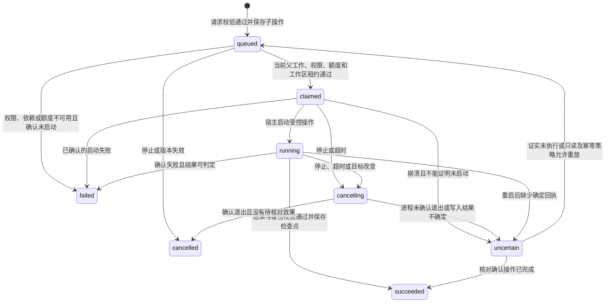

# Squad 本地 Skills 与 CLI 能力方案

> 状态：方案已落地，具体使用与验证边界见 [本地工具运行说明](local-tools.md) 和 [验证记录](local-tools-verification.md)。资料核对日期：2026-10-29。

## 推荐结论与范围

方案可行。建议采用**服务统一发现、所有 Bot 默认可用、技能按需激活、CLI 经现有状态机和宿主执行器运行**的结构。Bot 是同一服务中的角色，不必为每个 Bot 各扫描一遍磁盘或启动一套常驻 Agent 框架。

本文保留最初的设计依据；实现采用共享注册表、持久化父工作内子操作与 Linux SRT 后端。模型 JSON 接口沿用下表名称，事件实际命名为 LOCAL_REQUEST / LOCAL_CLAIM / LOCAL_STARTED / LOCAL_RESULT / LOCAL_REJECTED / LOCAL_RECONCILE。首期支持单服务实例，默认禁用网络；当前验证宿主不允许创建 OS 命名空间，生产沙箱验收须在具备相应能力的主机执行。

### 设计时的 Squad 对应（历史基线）

代码基线：`f3a5d7a156aee60037a677f4a27a60ad414c060d`。

| 已有能力 | 设计时边界 | 本方案接入点 |
| --- | --- | --- |
| `src/skills.ts` 的 `findSkills` | 搜索 skills.sh，返回名称及链接；不加载本地技能、不安装 | 保留公开搜索，新增独立本地注册表 |
| `src/model-adapter.ts` 的结构化工具循环 | 模型可请求公开技能搜索、网页搜索与抓取；普通工具目前只对 owner / assistance / facilitator 开放 | 增加本地技能和 CLI 动作；工具动作与最终角色输出分层校验 |
| `WorkRunner` / `WorkScope` | 已领取工作、预算、取消信号、格式重生及工具包装 | 统一承接本地读取和 CLI，继续透传授权、取消和记录 |
| `src/task.machine.ts` | 已有意图领取、版本隔离、额度及 unsafe 恢复；顶层 `TOOL` 会取消当前工作并安排负责人工具意图 | 新增父工作内的局部子操作，不能直接套用顶层 `TOOL` |
| `WebService` | 构造期间即恢复群聊并 kick 工作；执行详情包装现有 scope | 技能运行时就绪后才能恢复/调度；新 scope 方法同步接入详情 |
| 仓库 `.agents/skills/verify-squad*` | 已有项目级技能包，但不等于运行服务账号的全局目录 | 可用作受控验收夹具；项目目录另行显式配置 |

对应源码见文末 [R1]–[R6]。

## 1. 服务启动时发现和挂载

默认根目录采用 `~/.agents/skills/`，识别其下包含 `SKILL.md` 的技能目录。这是将需求中的 `~/.agents/` 具体落实到跨客户端约定，而不是把整个目录下的配置、历史或任意 Markdown 都当技能。[S1][S2]

`~` 指**运行 Squad 服务的系统账号的 home**。远程部署扫描服务器目录，不扫描浏览器所在电脑；容器部署需显式只读挂载宿主技能目录并配置容器内根路径。

启动流程：

1. 解析受信配置中的扫描根目录，检查读取条件和执行后端依赖。
2. 有界枚举技能入口，解析 YAML frontmatter，校验必要字段和路径，同时以正文及包内资源的 manifest/内容摘要绑定发现版本，记录有效技能、跳过项及原因；不执行任何脚本。包资源超过扫描上限时明确标记不可用，不在未固定版本的情况下悄悄继续。
3. 建立只读 `SkillRegistry`，生成 `catalogVersion`，为 Bot 提供名称、用途、来源和稳定 `skillId`。大目录通过分页/本地关键字搜索访问，不把所有正文注入每次模型请求。按需加载是指向模型提供正文/资源的时点，不限制服务为固定版本而读取内容摘要。
4. 将注册表、CLI 后端及执行策略注入宿主，再创建/恢复 `WebService` 和调度工作。当前构造即调度的顺序需调整，不能先恢复工作再异步补挂载。

缺失目录视为空目录；单个损坏文件、循环链接或无权限技能不拖垮服务。扫描有目录数量、深度、文件大小和时间边界，达到边界明确标记扫描不完整，不伪称全部加载。首期启动扫描；新增/更新技能后重启生效，暂不引入文件监听和运行中热替换。

### 链接、冲突与版本

- 支持用户安装的顶层技能链接，记录其解析后的包根，按真实来源去重；拒绝包内资源路径穿越、逃出包根的链接和特殊设备文件。失效/循环链接记录为不可用。[S3]
- 同名不同来源保留带来源的 `skillId`；名称别名有冲突时返回明确候选，不随机选择。首期只启用用户全局根；项目 `.agents/skills/` 可作为显式受信的附加根，不自动读取所有克隆仓库。
- 目录版本与技能内容版本分开，启动扫描时已绑定包版本。激活时在临时区生成共享的、有大小边界的只读内容快照，复验其与启动 manifest 完全一致后原子发布，按内容哈希复用；同版本不为每个 Bot 复制。源文件在扫描后变化则返回需要重启/重建目录的明确结果，不将旧用途描述与新正文或脚本混用；已存在的旧快照可继续按原版本使用。
- 已激活技能、读取过的资源版本及工具回执纳入工作检查点。恢复时不能悄悄改用新技能版本；找不到原版本时明确阻塞，重新规划后再采用新版本。

这里的“挂载”首先是注册目录并提供受控访问；运行脚本时才将选中的技能快照只读映射到执行环境，不是把整个用户 home 挂给每个 Bot。

## 2. 所有 Bot 默认共享的接口

| 拟议接口 | 用途 | 返回结果 |
| --- | --- | --- |
| `listSkills({query?, cursor?})` | 查看或搜索本地技能 | 分页元数据、来源、兼容性提示、catalogVersion |
| `loadSkill({skillId})` | 激活一个技能 | 完整 SKILL.md、skillVersion、资源清单及虚拟 skillDir |
| `readSkillResource({skillId, path})` | 按需读取包内引用/资源 | 受限内容、资源哈希、续读信息 |
| `runCli({executable, args, cwd?, timeoutMs?, skillId?})` | 执行已安装 CLI 或技能脚本 | operationId、状态、退出码、受限日志与输出文件清单 |

“调用 skill”指激活工作规范后使用已有工具完成步骤，不把任意 `SKILL.md` 当可调用函数，也不在读取技能时自动执行脚本。普通 CLI 可不依赖某个 skill；来源于技能的命令记录 skillId 和版本。

全局基础能力默认开启，现有方案师、核查员、Builder 和促进者均继承；后加 Bot 也自动继承，允许显式关闭。`Bot.tools` 的既有业务工具权限继续保留；基础 CLI 能力和项目文件写权限另有宿主策略，不把 `writeArtifact` 误当文件系统权限。

按工作阶段控制动作：owner、assistance、facilitator 和 check 均可获得执行工具，check 的最终结果仍须符合 check 协议。核查和后台讨论阶段不得修改权威工程；运行 check/build 等会写输出的验证时，使用绑定工程版本的可写临时副本或 overlay，产物及 dist/test-results 写入副本，核对结果后不自动合回工程。后台讨论中的 Builder 也遵守这条边界。纯意图解析和纯讨论汇总仍保持原职责，不因共用一个 Bot 身份就自动获得写入或新调度权限。这是阶段边界，不是只有 Builder 能用 CLI。

复用第三方模型兼容的 JSON 动作协议，不要求供应商原生 function calling，不引入新的 Agent 框架。必须先区分中间工具动作和最终角色结果，再校验角色协议，避免核查阶段的合法工具请求被误判为“type 不是 check”。现有 `findSkills` 保持“搜索公开技能”的语义，找到技能不自动安装。

技能正文用明确的来源、版本和边界包装，按当前任务激活；工具输出及引用内容继续作为资料处理。技能的 `allowed-tools` 不能扩大宿主权限，技能也不能授权恢复历史任务、改变成员调度或绕过直接用户限制。

## 3. CLI 运行环境

建议采用 Node `spawn`/`execFile` 承接进程生命周期，另以操作系统沙箱约束文件与网络。参数为 executable + argv；不拼接模型生成的 shell 字符串。Node 的 `shell:false` 与 `cwd` 本身不构成隔离，脚本和解释器仍有执行程序的能力。[S4]

轻量后端优先验证 Anthropic Sandbox Runtime 的固定版本，复用 macOS / Linux 的 OS 限制；若目标主机或策略不满足要求，再选择容器后端。不得因后端缺失静默退回全权限宿主执行。SRT 目前仍是研究预览，而且默认文件读取允许全盘，必须单独验证读取限制，不能只配置工作区可写。[S5]

建议默认策略：

- 每个任务有明确的工作区身份与目录；与 Squad 服务目录、数据库和模型 `.env` 分离。工程内容、任务临时目录按当前任务策略开放；选中的技能快照和系统运行依赖只读，不暴露整个 home。
- 同一工作区的 CLI 首期串行执行，模型推理和不同独立工作区可并行。成员互斥不等于工作区互斥，不能只依赖现有 Bot 锁；若多个任务挂同一真实工程，也按同一工作区身份加锁。锁由宿主事务管理并带租约/进程会话标识，不在不同任务快照里各自维护一把独立锁。
- 子进程仅收到受控环境，不继承模型 API key 和完整服务环境。需要登录态的 CLI 通过宿主预配置的命令配置提供所需凭据；普通执行不弹确认框，也不临时猜测/搬运其他账号凭据。
- 命令默认超时建议120秒，可配置，但始终受父工作剩余期限约束；保留现有3小时工作上限。stdout/stderr 流式读取并限制模型回传长度、日志落盘体积及总运行资源，截断须明确标记。
- 记录命令、工作区、开始/结束时间、退出码、信号和有界日志，敏感参数不写入公共群聊。产物导入需校验真实路径及大小；首期复用文本产物，非文本文件保留受控清单，完整二进制附件下载作为独立增量。
- CLI 不存在、依赖缺失或执行失败均返回真实原因；启动不执行 npm/pip 安装，不自动运行技能中的 setup。仅把已安装技能挂载进来，不等于安装其 CLI、运行时、MCP 或浏览器插件，也不保证所有跨产品技能可直接执行。

当前仓库 HTTP 层有 Origin 来源检查，未见账号级认证。[R7] 若通过隧道向外提供服务，启用本地 CLI 前须确认访问网关已有身份校验，或补充对应认证；Origin 检查不能代替调用方身份。首期按单个受信服务账号设计，不据此宣称支持公网匿名任务或多租户隔离。

停止时向执行会话发出取消，等待实际退出并清理后代进程；必要时先温和终止再强制终止。收到 AbortError 或“已发信号”不能直接声称结算完成；无法确认或存在未核对写入时进入结果不确定状态。[S4] 重启先核对/清理旧执行会话，再允许同工作区的新写入；不能仅凭租约过期就接管，也不能仅凭一个可能已复用的 PID 杀进程，须核对执行会话身份。

## 4. 先在状态机层跑通局部操作

不改变 running / waitingAssistance / coordinating / checking 等业务顶层阶段；在父 Work 内新增持久化 `localOperations` 子操作记录及检查点。现有顶层 `TOOL` 会取消当前工作并只安排负责人，且成员忙碌锁会阻止同 Bot 的普通第二个工作，因此不能原样拿它实现模型循环中的 CLI。

拟议事件为 `LOCAL_OPERATION_REQUESTED / CLAIMED / STARTED / COMPLETED / FAILED / CANCEL_REQUESTED / SETTLED / RECONCILED`；具体命名留给后续规格。这些是方案中的新契约，不是当前已存在的接口。

关键约束：

1. 父工作已领取，且 epoch、goalVersion、执行会话和权限有效，才能保存并领取子操作；纯状态动作不读取磁盘或启动进程。
2. operationId 在首次保存时固定；重试/恢复复用逻辑身份，校验请求哈希，不能仅按命令字符串去重。实际重放另记 attempt，不重复使用已消费的授权。
3. 启动扫描与目录元数据不消耗任务请求额度。每次获准的技能正文/资源读取及 CLI 启动计一次 ordinary；后续模型请求仍按普通/检查原有额度计费。子操作领取消费一次，不能再通过通用追加请求钩子重复扣费；重复回执也不重复扣额。新操作必须沿用父工作所在讨论/评审的汇总和负责人续办保留额度，额度不足则不启动。
4. 工作区租约和子操作领取在宿主存储事务中协调；领取后、发起实际 I/O 前再次检查取消与租约。失效执行会话不能继续发新命令。首期由一个服务实例管理执行会话；跨实例运行需独立验证共享租约能力。
5. 技能激活、模型发出的结构化动作、子操作结果和模型续办检查点必须持久化。当前适配器中间 messages 在内存中，不能只新增一个 await runCli 就声称支持安全恢复。
6. CLI 默认按可能写入处理。只有宿主可验证的只读/幂等配置才可自动重放；技能或模型不能自行声明“这是安全命令”。重启发现可能已经执行的写入时先核对，不能盲目重跑整个父 Work。
7. 父工作和工作区不能在子进程或写入结果尚未核对时释放给后续写入；迟到/旧版本结果只能结算对应旧操作，不能进入当前候选结果。成功的 CLI 回执先保存，之后才让 Bot 继续分析或交付。

该方案不承诺任意 CLI 的 exactly-once 外部效果。持久化领取与 OS 进程启动不能成为同一原子事务；面对无法判断是否已写入的情况，明确进入 uncertain，并由自动核对或用户已授权的后续处理解决。

兼容旧任务时，缺失局部操作/激活记录可迁移为空，但旧 payload 缺失 CLI 能力不能按默认 true 放行。新任务为所有 Bot 明确赋予基础能力；旧活动工作经恢复事件核对当前权限、版本和未决效果后才能启用。工程验证同时记录 workspaceRevision/候选版本，不能用旧副本的测试结论声称新工程已通过；权限撤销始终以当前宿主配置为准。

建议模块边界为：独立本地技能注册表负责发现、索引和版本快照；独立 CLI 执行后端负责进程和工作区；`task.machine.ts` 保存局部操作及守卫，`TeamEngine` 做事务和租约，`WorkRunner` 暴露受控 scope。`model-adapter.ts` 处理结构化动作与角色协议，`WebService` 包装同一 scope 并展示已持久化记录，启动入口负责先准备运行时再恢复任务。

## 5. 建议实现顺序与验收门槛

| 阶段 | 工作 | 完成标准 |
| --- | --- | --- |
| 1. 行为规格与图 | 新建本地技能/CLI Gherkin，更新 README 状态入口及局部操作细图 | 明确所有 Bot、目录来源、权限、预算、停止和恢复分支 |
| 2. 真实状态模型 | 增加子操作、检查点、当前权限/技能版本及租约守卫 | 纯转换和受控时钟仿真通过，记录模型版本、命令、关键轨迹；此时不启动真实 CLI |
| 3. 注册表与激活 | 启动扫描、目录索引、按需激活、只读版本快照 | 正常/缺失/损坏目录、同名、链接、变更、缺依赖均有真实结果 |
| 4. 执行器与适配器 | CLI 后端、workspace、预算、取消、协议循环和 trace 包装 | 先受控子进程夹具，再真实命令；所有 scope 包装一致 |
| 5. 集成验收 | 现有成员执行过程展示激活/命令/退出码/日志，接入恢复 | 每个 Bot 均能完成一个真实技能任务，停止、重启和多 Bot 竞争无重复写入或静默丢失 |

验收情形已细化为 features/24_local_skills_cli.feature 的 BT_L01–BT_L18；逐项测试与部署边界见验证记录：

- 服务只扫描一次用户技能根；全部 Bot 能看到同一目录版本，新增 Bot 自动继承。
- 指定一个技能后，先加载正文，再读取相对引用并运行包内脚本；结果继续返回原 Bot。
- 目录缺失、YAML 错误、同名冲突、缺 CLI、失效链接、跨包路径和指令越权均可诊断。
- 核查员、Builder 与促进者都能调用基础接口；纯意图解析不能趁机写工程；核查最终协议不被中间工具动作破坏。
- 不同 Bot 竞争同一工程写入时排队，其他独立工程不受阻；停止期间不得继续领取本轮新命令。
- 核查/讨论可在隔离副本运行会写 dist/test-results 的真实验证命令，权威工程不变；输出记录所测工程版本。
- 额度耗尽、超时、子进程产生后代、输出过大和服务退出均有确定结算或明确 uncertain。
- 覆盖保存请求前、领取后启动前、启动后回执前、结果已保存但模型未续办四个崩溃窗口；验证不盲重跑写入。
- 修改技能后重启，新任务使用新版本；旧任务不能混用新旧脚本；普通模型格式重生不重复已完成 CLI。
- 启动后、首次激活前修改技能，或制作快照期间修改文件，均不会发布混合版本；旧 payload 缺失新能力、当前权限撤销和租约过期均不能越权执行。
- 文件/网络/凭据边界以执行夹具实测，不能把 cwd、shell:false 或命令白名单当隔离证明。

首期不做技能市场自动安装、任意目录递归扫描、热更新、每 Bot 常驻终端或交互式 TTY。后续确需长驻进程/PTY 时，另建受管理的会话状态与恢复协议。

## 代码核对来源

- [R1] [公开技能搜索](https://github.com/kejun/squad/blob/f3a5d7a156aee60037a677f4a27a60ad414c060d/src/skills.ts) 与 [现有能力说明](https://github.com/kejun/squad/blob/f3a5d7a156aee60037a677f4a27a60ad414c060d/README.md)。
- [R2] [模型适配器](https://github.com/kejun/squad/blob/f3a5d7a156aee60037a677f4a27a60ad414c060d/src/model-adapter.ts#L112)：工作角色、JSON 动作循环与最终输出校验。
- [R3] [WorkRunner](https://github.com/kejun/squad/blob/f3a5d7a156aee60037a677f4a27a60ad414c060d/src/runner.ts#L60)：领取、scope、预算、取消及结果提交。
- [R4] [任务状态机](https://github.com/kejun/squad/blob/f3a5d7a156aee60037a677f4a27a60ad414c060d/src/task.machine.ts#L378)：恢复守卫；`CLAIM`、`CONSUME`、`RECOVER`、`TOOL` 和成员互斥。
- [R5] [WebService 启动](https://github.com/kejun/squad/blob/f3a5d7a156aee60037a677f4a27a60ad414c060d/src/web/service.ts#L50) 与 [scope 包装](https://github.com/kejun/squad/blob/f3a5d7a156aee60037a677f4a27a60ad414c060d/src/web/service.ts#L300)。
- [R6] [团队默认配置](https://github.com/kejun/squad/blob/f3a5d7a156aee60037a677f4a27a60ad414c060d/team.config.ts)、[功能开发门槛](https://github.com/kejun/squad/blob/f3a5d7a156aee60037a677f4a27a60ad414c060d/AGENTS.md) 及 [项目技能](https://github.com/kejun/squad/tree/f3a5d7a156aee60037a677f4a27a60ad414c060d/.agents/skills)。
- [R7] [HTTP 入口](https://github.com/kejun/squad/blob/f3a5d7a156aee60037a677f4a27a60ad414c060d/src/web/http.ts#L43)：API 来源检查及任务提交路由；外层网关认证不在该文件中。

## 一手资料核实

以下区分已经核实的规范/实现事实与针对 Squad 的设计推论。

### 1. Skill 是按需读取的技能包

Agent Skills 规范要求技能目录至少包含 `SKILL.md`，文件由 YAML 元数据和 Markdown 指令组成；`scripts/`、`references/`、`assets/` 等资源可选。`compatibility` 可说明所需系统包或网络条件；它不是自动安装依赖的协议。`allowed-tools` 仍是实验性字段，各客户端支持可能不同。[S1]

设计推论：发现技能、加载指令、读取资源、执行命令应是不同操作。扫描不能等同于执行脚本，也不能因读取到 `allowed-tools` 就扩大宿主已有权限。

### 2. 默认扫描位置应具体到 `~/.agents/skills/`

官方接入指南列出用户级 `~/.agents/skills/` 与项目级 `<project>/.agents/skills/` 作为跨客户端共享约定，同时明确基础格式规范并不强制技能存放路径。推荐启动先给模型提供技能名称和描述，选中后才加载正文，再按需读取引用资源。[S2]

设计推论：用户所说的扫描 `~/.agents/`，首期可落实为扫描其 `skills/` 子目录，而不是将整个目录中的任意文件作为系统指令。由服务统一建立目录，再供全部 Bot 共享，避免每个 Bot 重复扫描和把全部正文塞进提示词。

### 3. 应兼容已安装技能的符号链接

Vercel Skills 的 `getCanonicalSkillsDir()` 在全局模式下以 `homedir()` 为基址，其规范副本位于 `.agents/skills`。安装器支持复制及符号链接模式；`link` 模式甚至允许规范目录本身指向原技能源码。不能只通过 `Dirent.isDirectory()` 发现技能，否则会漏掉链接目录。[S3]

设计推论：保留真实来源路径与解析后的路径；同一真实技能去重。认可的目录入口可以是符号链接，但技能资源读取仍需做相对路径和 `realpath` 校验，不能借包内链接读取任意宿主文件。失效或循环链接应被跳过并记录原因。

### 4. CLI 接口应传 executable 与 argv，取消不能只看已发出信号

Node.js 24 的 `execFile` 支持独立可执行文件和参数数组，以及 `cwd`、`env`、`signal`、`timeout`、`maxBuffer`；默认不启动 shell。文档说明发出终止信号不等于进程已经退出，Linux 上终止父进程也不会自动终止其后代。[S4]

设计推论：优先结构化参数和受控环境，长输出可用 `spawn` 流式读取并限额。停止需等待进程结算并处理进程组/沙箱会话。`shell:false` 解决隐式 shell 解析问题，不提供文件或网络隔离；显式启动解释器仍可执行任意程序。

### 5. 实际沙箱可复用，但需明确配置与保证范围

Anthropic Sandbox Runtime 提供基于操作系统的文件及网络限制：macOS 使用 `sandbox-exec`，Linux 使用 `bubblewrap` 等依赖。项目仍标记为研究预览。其当前文档的文件读取默认允许、写入默认拒绝、网络默认拒绝；仅配置工作区写权限不能隔离宿主其他文件的读取。[S5]

设计推论：它可作为轻量候选执行后端，但必须固定并验证版本、检查平台依赖、显式约束读取/写入/网络与凭据；不能把子进程的 `cwd` 当成沙箱，也不能把官方默认值当成 Squad 已具备的隔离保证。缺少可用后端时返回真实不可用原因，不在启动时偷偷安装或降级为无边界执行。

## 资料来源

- [S1] [Agent Skills 格式规范](https://agentskills.io/specification)：目录结构、元数据、`compatibility` 与实验性 `allowed-tools`。
- [S2] [Agent Skills 官方接入指南](https://agentskills.io/client-implementation/adding-skills-support)：三级按需加载、用户/项目目录约定、专用激活工具、资源读取及目录权限。
- [S3] [Vercel Skills 安装器源码](https://github.com/vercel-labs/skills/blob/main/src/installer.ts)：`getCanonicalSkillsDir`、`InstallMode`、`isDirEntryOrSymlinkToDir` 和链接处理。此链接随主分支变化，落地时应固定对应版本再核对。
- [S4] [Node.js 24.21.0 child_process 文档](https://nodejs.org/download/release/v24.21.0/docs/api/child_process.html)：`execFile`、`spawn`、`subprocess.kill` 及子进程退出语义。这里核实 API 能力，不要求 Squad 升降级到该补丁版本。
- [S5] [Anthropic Sandbox Runtime 官方 README](https://github.com/anthropics/sandbox-runtime/blob/main/README.md)：OS 后端、读写与网络策略、平台依赖及研究预览状态。此链接随主分支变化，不能代替实际安装版本的验证。
