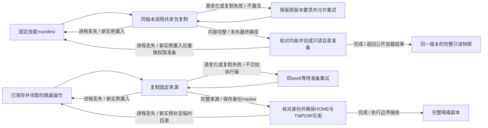

# 技能快照与隔离副本准备验证

本页记录 KEJ-108 的宿主准备流程和验证边界。验收入口为 `features/38_adapter_composition.feature` 的 BT_L81–BT_L84。工作区发布前版本复核、CLI 未知效果与恢复仍按原任务模型；这里仅检查首次准备及重入。

## 准备状态与所有者

以下是**宿主处理流程**，所有者分别为 `src/local-skills.ts` 的 `SkillRegistry` 和 `src/local-runtime.ts` 的 `LocalRuntime`，不是新增的任务 XState 状态。外部操作仍要求先保存、领取对应的 `LocalOperation`。状态机不访问文件、不启动进程。



技能最终路径存在只说明内容已发布，不能省略只读目录准备；合法副本 marker 绑定已复制的来源与工作身份，不能省略本次使用前的临时目录准备。这两项须可重复完成，才能让准备期进程丢失后的重入收敛。技能内容校验不通过仍拒绝；目录只读准备不替代 hash 校验。

## 先行证据和修复边界

HEAD `64322436c87b216f9dd9ba1a137738e5cd923497` 上的七例基线为五通过、两失败，原始证据保留在 `reports/kej-108-preparation/initial/`：

- 技能目录实际 rename 后、递归只读准备前，子进程收到 SIGKILL。新进程通过公开 `load/read` 得到完整内容，但已存在目录分支跳过只读准备，根目录写位仍为 `0200`（十进制 128）。这是权限位检查，不以 root 账号能否强制写入推断权限。
- 隔离副本 marker 实际写入后、HOME/TMPDIR 创建前，子进程收到 SIGKILL。新 `LocalRuntime` 复用身份 marker 后向受控 backend 交付缺少 `.home/.tmp` 的副本，得到 `PREPARATION_INCOMPLETE`。

最小修复只补足重入分支的既有准备义务，不增加任务状态、事件、权限或新的调度路径。先行契约和本图写入后，执行 `tests/core-model-gate.ts` 的真实 XState 纯模型门槛，再改宿主实现。模型层能核对原 `LOCAL_REQUEST/CLAIM/STARTED/RESULT` 的状态和身份边界，文件权限、rename 和 scratch 创建没有模型层可执行行为，必须由这里的真实文件系统集成证据承担。

## 重复执行与结果边界

```sh
node --import tsx tests/core-model-gate.ts
node --import tsx tests/preparation-composition-fixture.ts --all
TSX_TSCONFIG_PATH=tests/bdd/tsconfig.json node --import tsx node_modules/@cucumber/cucumber/bin/cucumber.js features/38_adapter_composition.feature --import 'tests/bdd/*.ts' --tags '@BT_L81 or @BT_L82 or @BT_L83 or @BT_L84' --format summary
```

七例包含同注册表并发加载、真实复制中源变更与同实例重试，以及技能最终路径、副本 marker 前后四个真实子进程丢失窗口。每案从公开 `SkillRegistry.discover/load/read/snapshot` 或 `LocalRuntime.create/execute` 进入，不调用私有方法，不把 Promise Map 大小当验收。

子进程里的文件系统包装仅在生产模块调用真实 `copyFile/rename/writeFile` 的边界通知屏障；父进程在准确窗口发送 SIGKILL，重开由新实例走正常公开路径。工作区测试从真实 `TeamEngine` 公开命令建立后台讨论工作和子操作，再让明确注入、不启动进程的 backend 检查收到的来源、HOME/TMPDIR。此处不声称该 backend 提供 OS 沙箱隔离。

证据记录实际退出信号、屏障、公开结果、源码 SHA-256 与临时目录清理。机器断电、存储设备刷盘、任意外部篡改文件或权限以及跨进程同时写同一注册表均不在本切片承诺内。模型或源码负对照不写入产品文件，须在隔离加载环境运行，并在丢弃变异后复验原源码。

## 本次结果

两处复用分支已补足可重复的准备义务：`SkillRegistry` 对内容验证通过的既有路径再完成只读目录准备；`LocalRuntime` 在合法 marker 的副本返回前确保 HOME/TMPDIR 存在。正常复制、权限、预算和任务转换保持原契约。

先行模型门槛完成 80 条纯真实 XState 验证；七个准备组合场景及 BT_L81–BT_L84 的 7 场景 / 21 业务步骤直接验收全部通过。原五绿两红保留在 `initial/`，不以修复后结果覆盖。

```sh
node tests/preparation-composition-controls.mjs
node tests/preparation-composition-readback.mjs
```

两个真实源码负对照分别跳过上述重入权限和 scratch 准备，均在原 SIGKILL 窗口后的目标断言失败；丢弃变异后各自通过原源码恢复复验。变异只在子进程模块加载期间生效，产品文件哈希保持不变。独立读回核对 12 件证据通过，包含源码哈希、真实 SIGKILL、屏障、最终公开结果与临时目录清理。结果文件保存在 `reports/kej-108-preparation/`。

## 补充审查：检查副本的验证输出目录

在合法检查前缀下，`LocalRuntime.execute` 在后端调用之前还会确保 dist、test-results、reports、coverage 存在。复用 marker 的路径只补 HOME/TMPDIR 并不代表缺失检查输出目录；不能通过给检查命令虚构自定义 cwd 绕开 `verificationActionProblem` 来制造反例。

BT_L84 追加“检查副本标记后进程丢失”：真实公开提交“运行 npm run build”→负责人 DELIVER→领取 check，从 `payload.verification.action` 原样创建命令；marker 后真实 SIGKILL，再由新实例重入。受控后端核对默认 cwd、固定来源、HOME/TMPDIR，以及传入 writeRoots 的全部四个验证输出目录。当前实现通过，**本审查没有产生新的产品修复**。

额外真实源码负对照仅在子进程加载时移除 execute 中创建 `workspace.path` 下验证输出目录的那处语句；准备期 SIGKILL 与公开命令守卫保持不变。新案准确报告四个缺失目录，丢弃变异后恢复通过。当前可复跑入口仍为完整 fixture `--all`、controls 和 readback，已扩展到8案、3变异及各自恢复（6项控制）、15件独立读回；原7案红基线不被改写。
