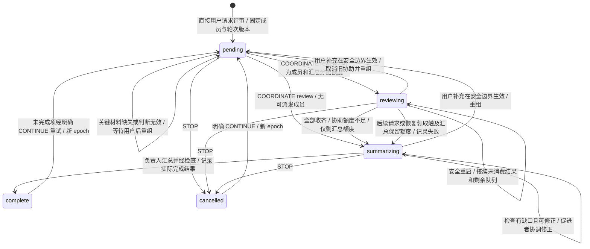
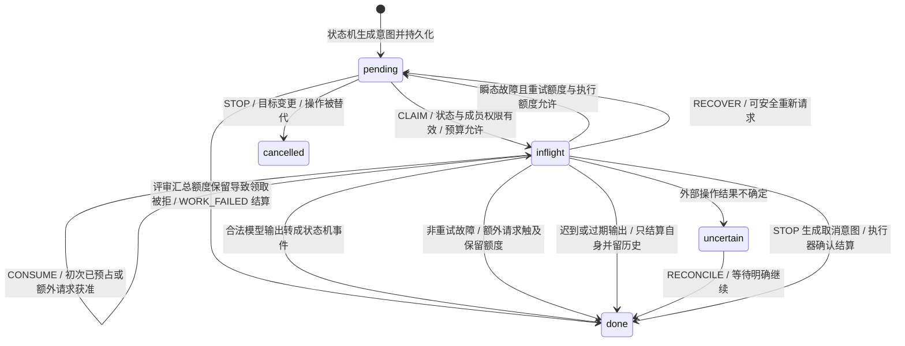
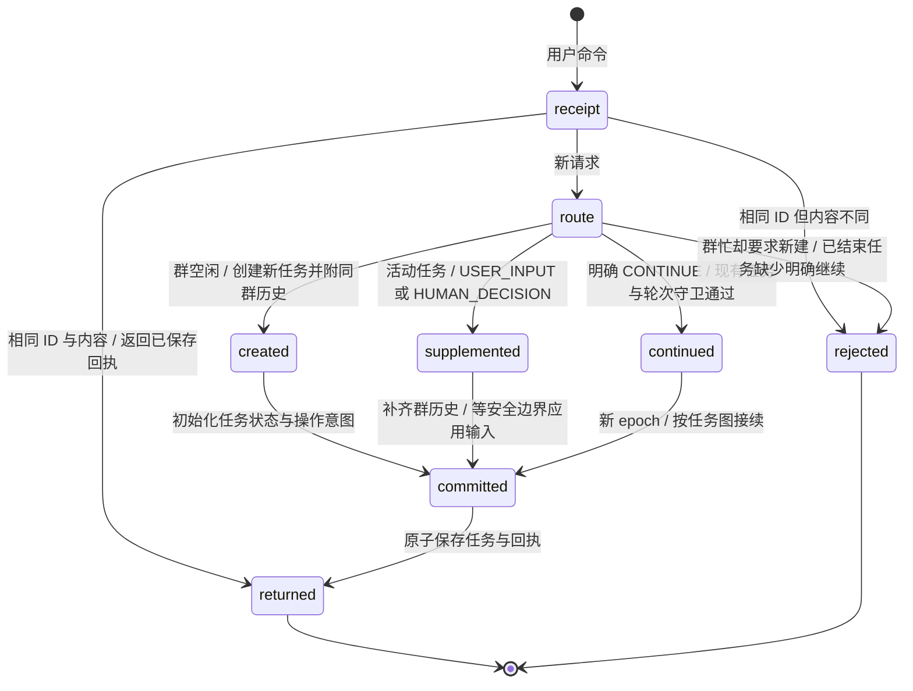
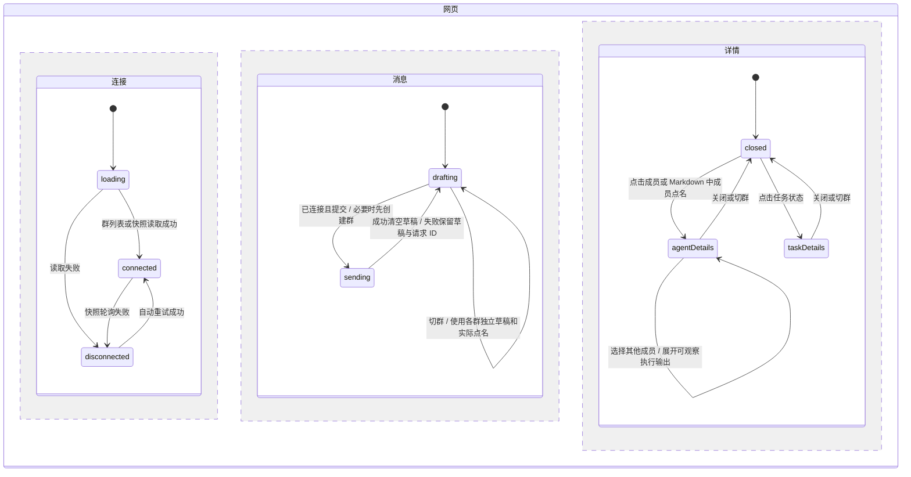
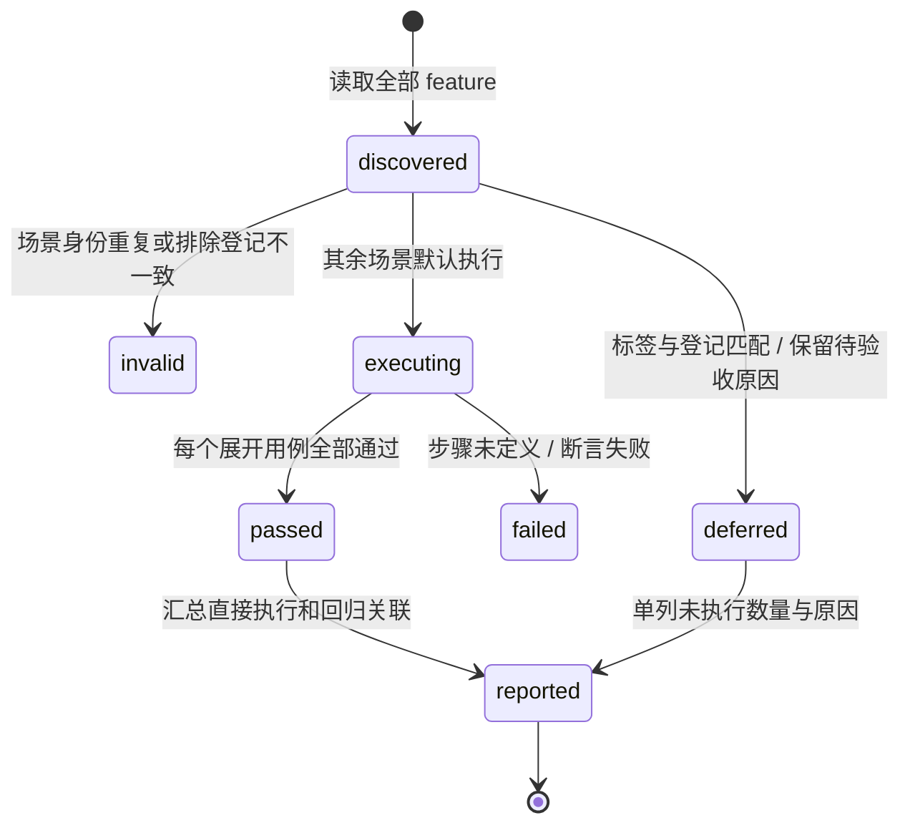

# 细化状态图

本文件与 README 的「状态模型」共同描述当前功能。顶层任务状态由 `src/task.machine.ts` 管理；下图分别标明上下文状态、操作状态和界面状态，不能将后两者误认为新增的 XState 顶层状态。

## 成员评审

对应 `TaskContext.review.status`。目标成员只由直接用户请求确定，促进者不能替换名单，也不能用 continue、assist、replan 或 finish 跳过待组织的评审。

- `complete` 表示评审轮次结算，任务是否成功仍以 `outcome` 为准；成员失败、超时或队列未收齐会标记缺口，最终为 partial。
- 评审组织与收集阶段必须保留一次普通请求供负责人汇总。首次领取、额外模型请求、技能搜索、重试与恢复重新领取都检查这条限制；首次模型请求已由领取预占，不重复扣款。触及保留额度的成员操作按失败结算，推进汇总，不能直接耗尽该额度或继续重试。
- 完成检查使用独立 checks 额度；若用户配置的总额度连组织和汇总都不足，或停止、故障、检查额度不足，则可直接结束或等待用户，不能承诺完成汇总。
- 结果必须先 RECORD_RESULT 持久化，再以 HELP_RESULT 消费；结果 ID 防止重复消费，epoch/goalVersion 隔离迟到结果。配置撤销成员或权限时暂停恢复。初次评审直接进入组织阶段，避免负责人先回答一次才拉人。

## 外部执行操作

对应 `Intent.status`。网页只提交用户命令；状态机产生操作意图，事务保存后由 `WorkRunner` 领取，只有领取成功的操作才可调用模型或工具。

每个额外模型请求和技能搜索都先经 `scope.authorizeAdditionalRequest` 的 CONSUME 检查。被拒后禁止发起 I/O。模型 HTTP 408、429、5xx 或网络故障可有限重试；协议错误与不可恢复故障按任务图转移。技能搜索不会安装技能。停止首先持久化并派发取消意图，AbortSignal 传入模型和搜索；取消请求发出不等于原操作已结算。外部结果不确定时必须核对，不能直接重放。

OpenCode 会话标识只影响传输：网页使用群 ID，CLI 使用持久任务 ID，适配器哈希后添加请求头，不创建另一条调度路径。HTTP 错误只保留已校验的短代码；MissingSessionID 即使附带参数标识，也应提供缺少会话头的提示，仍沿用 WORK_FAILED 转移。瞬态故障到达重试上限时，等待原因应同时说明原错误和额度限制。执行日志是观察记录，不驱动业务转移。

## 群历史与消息路由

以下是 `TeamEngine.submit` 的单次事务处理路径，节点是处理阶段，不另行持久化为任务状态。

历史仅来自同群其他任务，保留来源 taskId，限制消息、产物、黑板和目标摘要数量及总文本量。历史只作为模型上下文，不计为本轮交付产物，不复活已结束任务，不从历史中的指令发起调度。成员评审识别仅处理直接用户文本及编辑器实际选中的点名；代码、引用和 Bot 消息不触发全员评审。

HANDOFF 沿用 running 的状态内转移：先确认边界和新成员权限，再记录原负责人、新负责人、目标版本及产物/黑板引用，取消旧待执行意图并准备新负责人输入。群提示与持久记录必须能还原交接双方，不能只保存接任者。

## 网页交互

对应 React 状态和服务器快照的投影，不直接修改业务状态或调用模型。连接、发送与详情面板分别变化。

快照提供群消息、任务状态、评审进度和成员执行日志。消息经 Markdown/GFM 渲染，跳过原始 HTML，代码和已有链接不转成成员按钮。等待用户时发送消息映射 HUMAN_DECISION；继续按钮提交 CONTINUE，停止按钮提交 STOP，均通过 HTTP 服务进入 TeamEngine。HTTP 不接受客户端任意状态机事件。产物下载只读取实际持久化内容。

## 验收执行与覆盖报告

这是测试宿主的处理流程，不增加业务 XState 状态。群历史与评审对应 BT_G01–BT_G14，模型传输对应 BT_M01–BT_M06，Markdown 对应 BT_U10–BT_U13；前述业务状态和交互状态继续复用。协调判断应在转移时保留选择原因及所依据记录，供 BT_O02 核查；监督输入及负责人接续输入应携带已保存的重复失败记录，供 BT_O01、BT_E02 核查。上述修正沿用既有状态转移，仅补齐上下文和记录。

