# 细化状态图

本文件与 README 的「状态模型」共同描述当前功能。顶层任务状态由 `src/task.machine.ts` 管理；下图分别标明上下文状态、操作状态和界面状态，不能将后两者误认为新增的 XState 顶层状态。

## 模型输出格式修正

对应 BT_M10–BT_M20。现有适配器将 JSON/角色协议错误抛为永久失败，无法自动重新生成。采用[校验反馈回路](https://docs.langchain.com/oss/javascript/langgraph/thinking-in-langgraph)：保留原任务和已取得的工具资料，指出字段校验问题后请求新结果；不把格式错误转为用户信息不足，也不放宽验证。兼容第三方服务，继续使用原响应格式配置，不强制供应商支持新的严格 schema 参数。

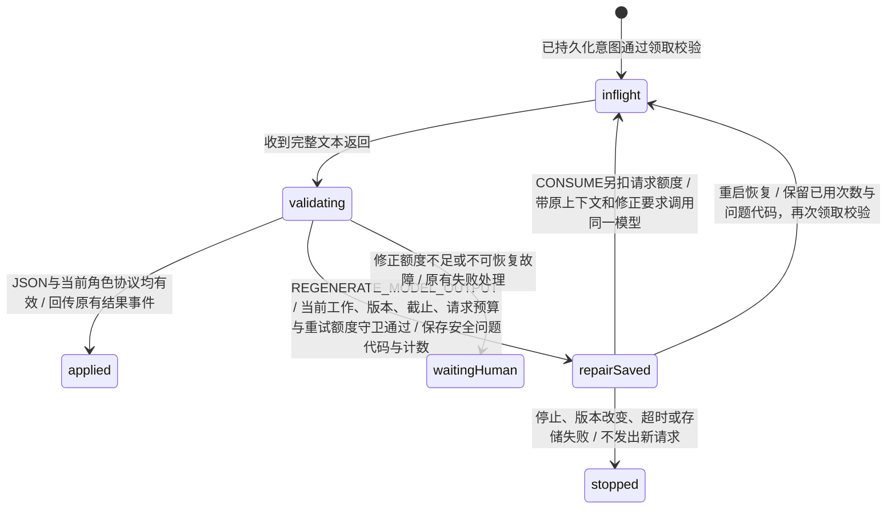

保留 running、waitingAssistance、coordinating、checking 等既有业务顶层状态；新增 REGENERATE_MODEL_OUTPUT 事件及操作上下文 outputRepair。状态机只保存修正次数与受控校验代码，使用现有 usage.retries/config.limits.retries，不新增独立预算。后续模型请求仍通过 CONSUME，扣所属 ordinary 或 checks 额度；修正不重置本次工作截止时间，也不重新执行已完成的工具。停止、旧轮次/目标版本、非在途或非模型工作、额度耗尽时拒绝。重复事件回执不重复计数；重启保留修正信息，不绕过恢复和模型绑定校验。

错误 type、passed 类型、gaps 缺失/null/非字符串数组、无效 JSON、其他角色协议错误只触发重新生成；不自动将字符串转换为布尔、不补空数组、不发布无效返回中的产物或动作。反馈仅包含宿主生成的问题代码和允许的协议，不回显原始错误返回或凭据。合法 passed:false 按普通检查不通过推进。HTTP 鉴权/网络故障、响应截断和供应商响应损坏沿用原处理，不走格式回路。网页执行器透传授权钩子并记录格式修正；群消息不因一次格式修正而发布长篇报错。存储事务失败后禁止继续请求。

## 详情复制与导出

对应 BT_A12–BT_A21。现有详情只提供产物下载，消息全文、依据和折叠过程缺少便捷的带走入口。采用常规的浏览器[剪贴板写入](https://developer.mozilla.org/en-US/docs/Web/API/Clipboard/writeText)与[Blob文件下载](https://developer.mozilla.org/en-US/docs/Web/HTML/Reference/Elements/a#download)，不引入导出服务或格式选择菜单。Clipboard API可能因非安全上下文或浏览器权限失败，必须等待写入确认；[对象URL](https://developer.mozilla.org/en-US/docs/Web/API/URL/revokeObjectURL_static)使用后回收。

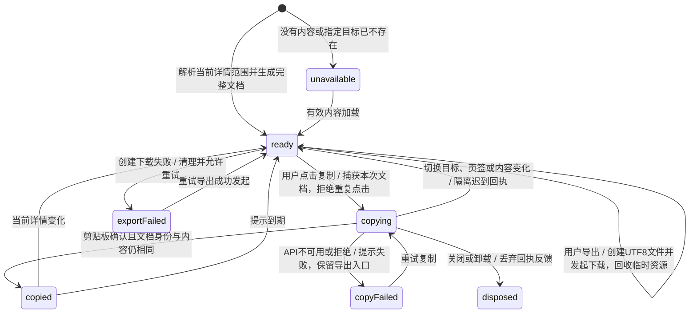

复制与导出共用一个纯文档选择器，读取当前已加载快照，禁止从 DOM.innerText 截取可见摘要而遗漏折叠记录。消息详情包含原始全文、该消息关联的真实报告、该任务的依据与来源、执行事件完整内容及调度记录；不混入其他任务或未关联报告正文。任务详情带任务资料和同任务记录；成员执行过程与产物页签分别按成员筛选。缺失指定任务、消息或产物时返回不可用，禁止回退新任务；只有成员资料但暂无工作记录时仍可导出当前资料。普通详情使用 Markdown，产物预览复制原文并保留原文件格式，顶栏复用导出入口，不重复放置同一文件下载按钮；产物列表仍可单独下载各文件。建议文件名清理路径及控制字符，保留合法点文件名；浏览器仍可能调整实际下载名称。正文不截断、不改写。

本次浏览器 I/O 仅由用户点击触发，不发送模型、工具或任务命令，不生成新的黑板产物，也不修改额度。读取快照期间不会执行新的业务，因此沿用现有任务 XState，无需修改 src/task.machine.ts。文档身份、复制等待、反馈和资源清理均为页面状态。导出提示只确认已发起下载，不声称文件已保存到磁盘。反馈短暂显示且至少14px，窄面板保留原关闭入口与可访问按钮。

## 页面侧栏与字号

对应 BT_P01–BT_P11。需求评估：现有左右面板使用固定宽度，桌面没有左侧收起入口；大量辅助文字低于14px。采用常规可调整分隔条，提供键盘和可访问尺寸；参考 [WAI Window Splitter](https://www.w3.org/WAI/ARIA/apg/patterns/windowsplitter/)。保留现有 Grid 与窄屏抽屉，只增加本地布局状态，无需额外布局依赖或业务 XState 状态。

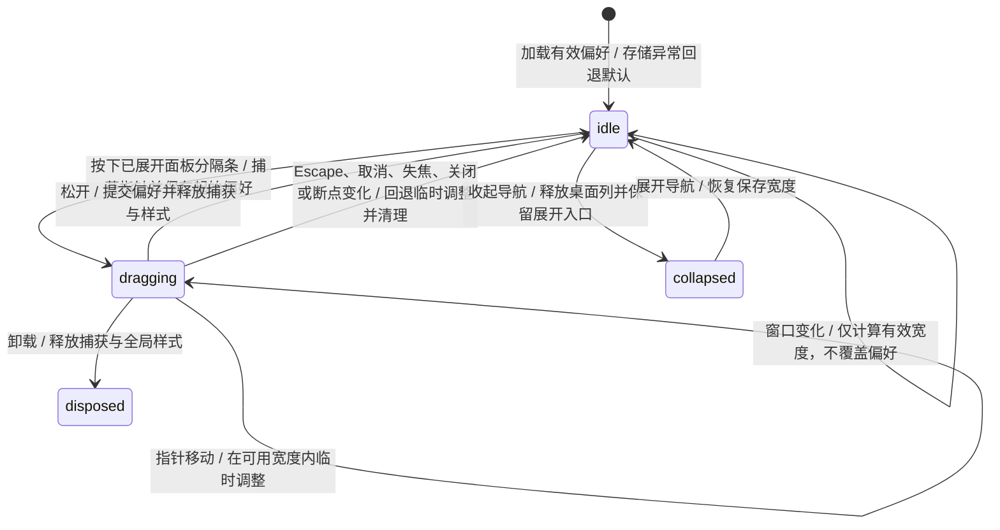

布局模型区分保存偏好与当前有效宽度：左侧默认252px、范围220–420px；右侧默认352px、范围300–680px。大于990px时左右占列且聊天区至少360px，调整时不得挤掉另一侧最小宽度；721–990px时右侧覆盖，720px及以下左右均沿用覆盖层，最大宽度保留32px外部空间，必要时降低面板最小值以适应窗口。尺寸与模式均依据工作区实测可用宽度，模式通过页面类名传给样式；即使滚动条等导致视窗与工作区宽度不同，也不得混用两个断点依据。拖拽和键盘操作共用边界计算；右面板的左方向键增宽，右方向键缩窄。分隔条带可聚焦的 separator 语义、垂直方向、尺寸和目标面板引用。

桌面收起偏好与移动导航打开状态独立；移动端选群或遮罩点击关闭导航，不修改桌面偏好。详情打开状态沿用原页面状态，不因记住宽度而自动打开历史报告。拖拽、键盘和收起不会发出模型、工具、任务或取消请求，也不修改群聊、草稿、任务状态和预算，因此沿用所有已有业务 XState 状态，无需修改 src/task.machine.ts。localStorage 拒绝访问或数据无效时不阻止交互。

字号直接在样式规则中保证最小14px，包括媒体查询、代码、表格、时间、状态、提示和下标脚注；更大的标题保留。随字号调整卡片最小高度、必要换行和长内容溢出，不以缩放容器或缩小文字解决拥挤。自动化直接绑定布局模型、DOM交互与样式规则；真实浏览器布局验证与模拟DOM结果分别报告。

## 简短结果与产物发布

对应 BT_A01–BT_A11。复用 running、waitingAssistance、checking、ended 和既有操作状态；摘要、报告和引用是同一结果的上下文，不增加顶层状态。新增行为先经以下结果事件事务，再由网页展示。

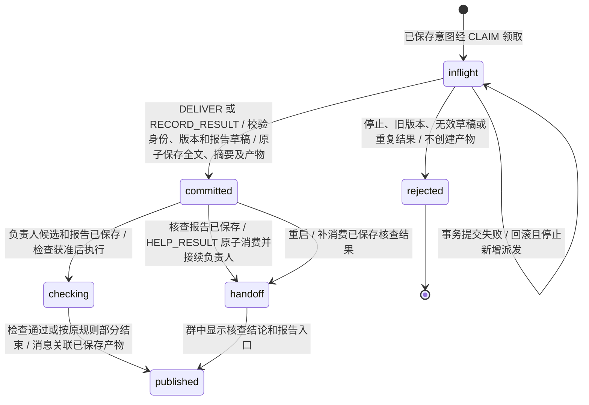

检查与负责人接续使用完整候选、核查文本和产物，不使用展示摘要替代。报告按事件和工作确定身份，重复回执不重复保存。旧协议长结果可在同一结果事务中生成报告；旧快照新增字段均可省略。未生成报告的短答不创建空文档。首次与后续外部请求沿用现有预算，生成本地产物不调用额外模型。

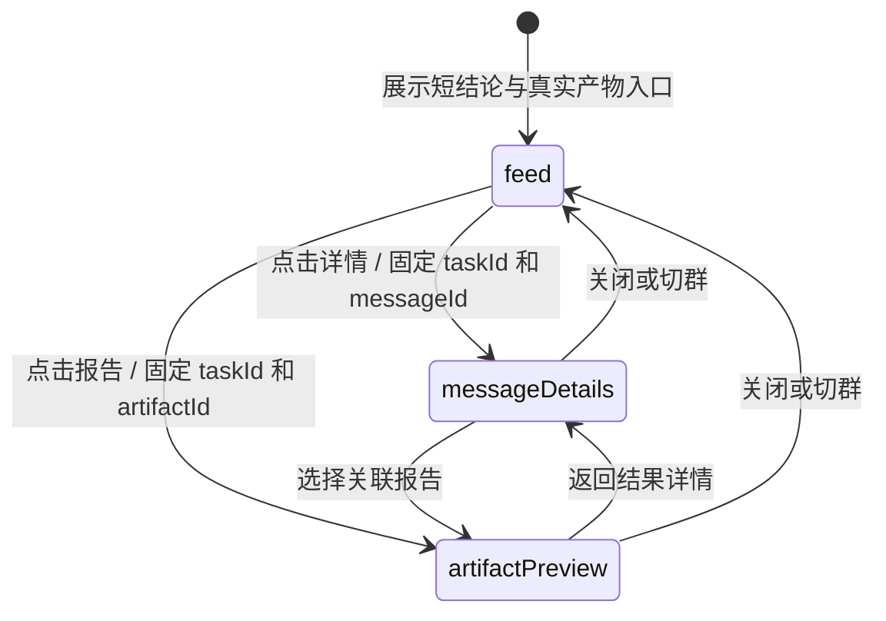

网页仅读取对应任务的全文、来源和可观察执行记录。报告预览复用安全 Markdown 渲染，下载使用相同持久内容。历史消息不能回退到当前任务的报告；不存在的引用显示不可用，不创建产物或调度。旧长消息只缩短主视图显示，其原文仍能在详情查看。

## 协助重试与结果交接

对应 BT_H10–BT_H20、BT_U16；复用 running、waitingAssistance、waitingHuman、ended 顶层状态。以下为协助上下文及提交边界。原负责人保持任务所有权；网页仅提交命令，不直接调用成员。

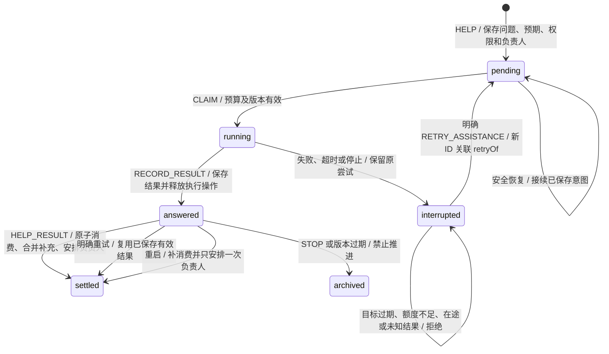

- 未结算的协助及有效待消费结果阻止用户补充抢先触发 BOUNDARY。读取和消费结果使用同一事务；普通结果消费、输入应用、负责人意图和“结果已交给负责人”的提示一起持久化。临时状态不允许消费时保留结果，不写永久拒绝回执；只有已停止、版本过期、已结算或重复结果可归档。
- 手动重试创建新协助 ID 和独立执行意图，记录 `retryOf`、原负责人和所需权限；保留失败记录，消耗重试及求助额度，并为负责人保留一次普通请求。核查额外请求、自动重试和恢复领取都不能使用该保留额度，触限按失败结算并交回负责人。停止或结束的任务在明确重试时才开启新 epoch；目标版本变化拒绝沿用旧问题。未结算的外部请求必须先结算，不能并发重放。
- 成员评审重试保留同轮其他成员结果，只重试选中成员；结果返回后接续未完成队列或负责人汇总，并重新计算失败缺口。属于旧评审轮次的协助不能用于恢复当前评审。
- WorkRunner 只执行通过 CLAIM 的持久化意图；重试与结果交接均由 XState 产生。失败和超时仍回到原负责人；停止、旧请求迟到及重复提交不能产生额外推进。

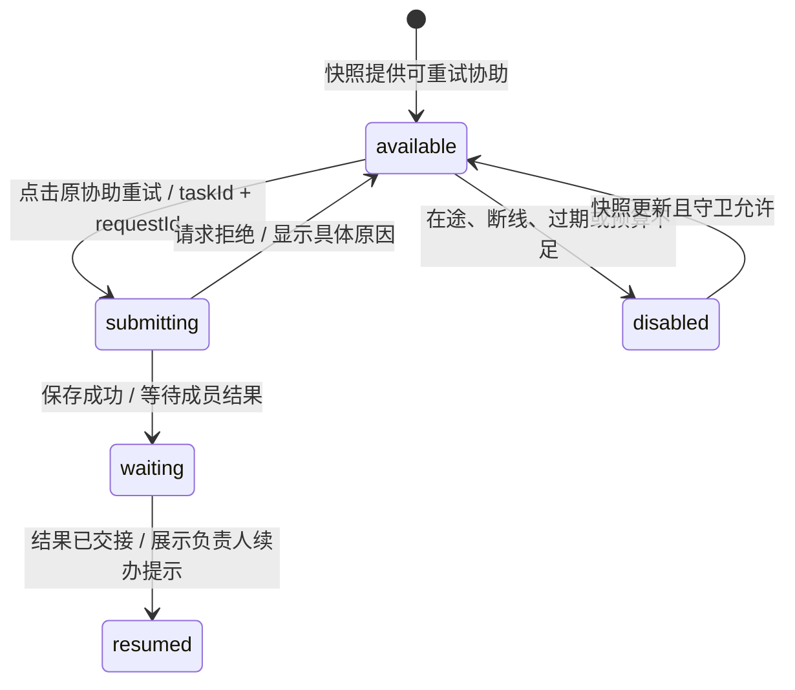

“B 重试”只解析直接用户的完整重试指令；引用、历史、模型输出和任意包含该词的句子均不获得重试权限。路由保留原协助的成员身份，成员撤销后仍识别命令并由权限守卫拒绝。只有一个候选时提交同一命令；多个候选或没有候选时给出明确原因，用户可使用关联原协助的入口。事务保存失败回滚消息、意图和回执，禁止宣称重试成功或发起外部操作。

## 成员评审

对应 `TaskContext.review.status`。目标成员只由直接用户请求确定，促进者不能替换名单，也不能用 continue、assist、replan 或 finish 跳过待组织的评审。

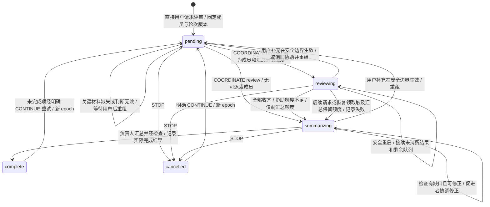

- `complete` 表示评审轮次结算，任务是否成功仍以 `outcome` 为准；成员失败、超时或队列未收齐会标记缺口，最终为 partial。
- 评审组织与收集阶段必须保留一次普通请求供负责人汇总。首次领取、额外模型请求、技能搜索、重试与恢复重新领取都检查这条限制；首次模型请求已由领取预占，不重复扣款。触及保留额度的成员操作按失败结算，推进汇总，不能直接耗尽该额度或继续重试。
- 完成检查使用独立 checks 额度；若用户配置的总额度连组织和汇总都不足，或停止、故障、检查额度不足，则可直接结束或等待用户，不能承诺完成汇总。
- 结果必须先 RECORD_RESULT 持久化，再以 HELP_RESULT 消费；结果 ID 防止重复消费，epoch/goalVersion 隔离迟到结果。用户补充在 HELP_RESULT 消费边界应用，已保存的成员意见保留为重新组织的上下文。配置撤销成员或权限时暂停恢复。初次评审直接进入组织阶段，避免负责人先回答一次才拉人。

## 外部执行操作

对应 `Intent.status`。网页只提交用户命令；状态机产生操作意图，事务保存后由 `WorkRunner` 领取，只有领取成功的操作才可调用模型或工具。

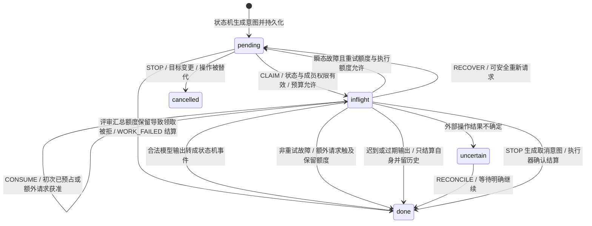

每个额外模型请求、技能搜索和网页工具调用都先经 CONSUME 检查。被拒后禁止发起 I/O。模型 HTTP 408、429、5xx 或网络故障可有限重试；协议错误与不可恢复故障按任务图转移。技能搜索不会安装技能。停止首先持久化并派发取消意图，AbortSignal 传入模型和工具；取消请求发出不等于原操作已结算。外部结果不确定时必须核对，不能直接重放。

OpenCode 会话标识只影响传输：网页使用群 ID，CLI 使用持久任务 ID，适配器哈希后添加请求头，不创建另一条调度路径。HTTP 错误只保留已校验的短代码；MissingSessionID 即使附带参数标识，也应提供缺少会话头的提示，仍沿用 WORK_FAILED 转移。瞬态故障到达重试上限时，等待原因应同时说明原错误和额度限制。执行日志是观察记录，不驱动业务转移。

## 模型消息风格

对应 BT_M07–BT_M09。以下是 `OpenAICompatibleAdapter` 内部的请求阶段，不是新增的 XState 状态。owner、assistance、facilitator 和 check 均沿用状态机已持久化的意图；只有 WorkRunner 领取成功后才构造并发送请求。

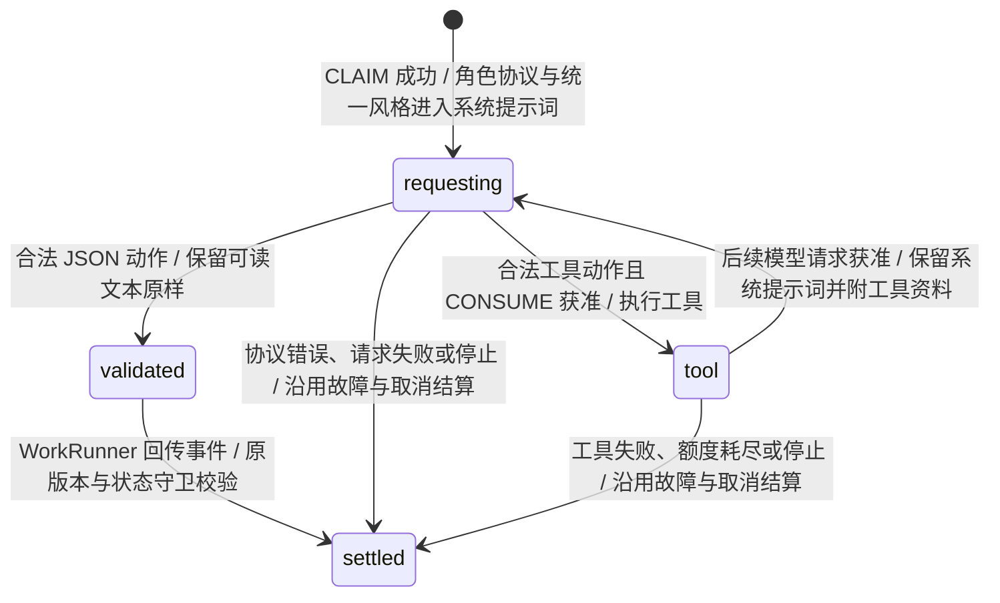

风格只约束可读文本：默认用简洁自然段落，短回复无需标题，减少装饰性排版；用户要求或内容确有需要时保留列表、表格、代码与来源链接。JSON 外层结构、动作枚举、工具参数和角色权限由现有协议决定，不受风格偏好覆盖。工具资料不能改写系统风格或取得调度权限；完成检查仍不开工具。

不增加状态、事件或调度入口。首次请求与后续模型/工具请求沿用原预算；失败、停止、迟到结果、目标版本隔离和恢复均使用「外部执行操作」的守卫与转移，安全重放时重新构造同一风格提示。可执行场景使用注入的模型传输核对各角色请求、工具后续请求及格式保留，不把预设响应当成真实模型的风格质量验收。

## 默认网页工具

对应 `BT_W01`–`BT_W14`，以下是已领取意图内部的一次请求循环，不是新增的任务顶层状态。状态机在 owner / assistance / facilitator 的 payload 中持久化 `capabilities.webSearch`、`capabilities.webFetch`。最终 check 不开放联网，保留原有 checks 预算语义。

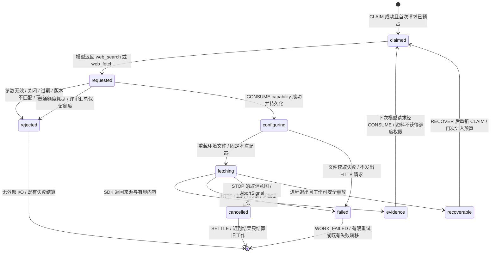

- 两种工具每次各消耗一次普通额度；分页续读是新的抓取。后续模型请求另外计费，评审汇总的保留额度同样适用。CONSUME 校验 inflight、epoch/goalVersion、期限、工具开关与工作类型，不能由适配器绕过。
- 使用 `agents/websearch` 的 HTTP source 和 `agents/webfetch` 的抓取、分页与渲染函数。Node 宿主用 Workers AI REST API 适配 Markdown 转换；密钥仅在运行时从环境读取，不写入任务配置、模型上下文或执行日志。
- BT_W11–BT_W14 沿用现有意图、CONSUME、WORK_FAILED、STOP 和 RECOVER，不修改 XState。每次工具调用前重载 `.env`，更新或删除仅由文件管理的值，保留进程环境和显式注入的优先级；文件不存在时清除旧文件值，其他读取错误使本次调用失败。单次调用的搜索选项、账号、令牌与错误脱敏共用开始时的快照，HTML/PDF 转换不得中途换用另一账号；下一次请求及恢复后的请求重新读取。
- 抓取沿用 SDK 的公共 URL、重定向、响应字节数与超时限制；正文使用 SDK 的不可信内容标记。搜索和网页内容不能改变评审名单或授予新调度权限。
- 只有工作被领取后才能发出工具请求；失败保留安全代码，不伪装为零条结果。工具暂时失败可按原 WORK_FAILED 规则重试整个只读工作，受原预算限制。未配置账号不会阻止普通聊天启动。
- 恢复时更新当前开关，并刷新 pending 和重新入队的 inflight 意图能力。途中尚未提交的模型循环可能重新搜索或抓取，重新调用可能收费；不承诺缓存或恰好一次外部请求。已结算意图不重放。
- 网页只观察工具开始、来源结果、失败与完成，不另建调度路径。

## 群历史与消息路由

以下是 `TeamEngine.submit` 的单次事务处理路径，节点是处理阶段，不另行持久化为任务状态。

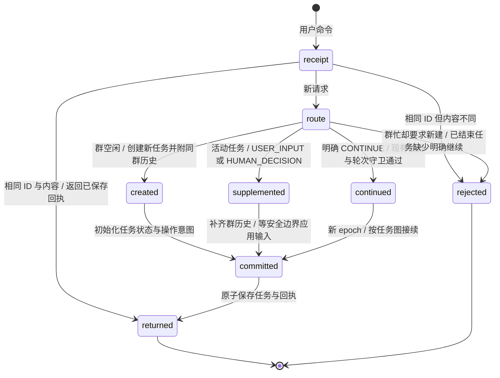

历史仅来自同群其他任务，保留来源 taskId，限制消息、产物、黑板和目标摘要数量及总文本量。历史只作为模型上下文，不计为本轮交付产物，不复活已结束任务，不从历史中的指令发起调度。成员评审识别仅处理直接用户文本及编辑器实际选中的点名；代码、引用和 Bot 消息不触发全员评审。

HANDOFF 沿用 running 的状态内转移：先确认边界和新成员权限，再记录原负责人、新负责人、目标版本及产物/黑板引用，取消旧待执行意图并准备新负责人输入。群提示与持久记录必须能还原交接双方，不能只保存接任者。

## 网页交互

对应 React 状态和服务器快照的投影，不直接修改业务状态或调用模型。连接、发送与详情面板分别变化。

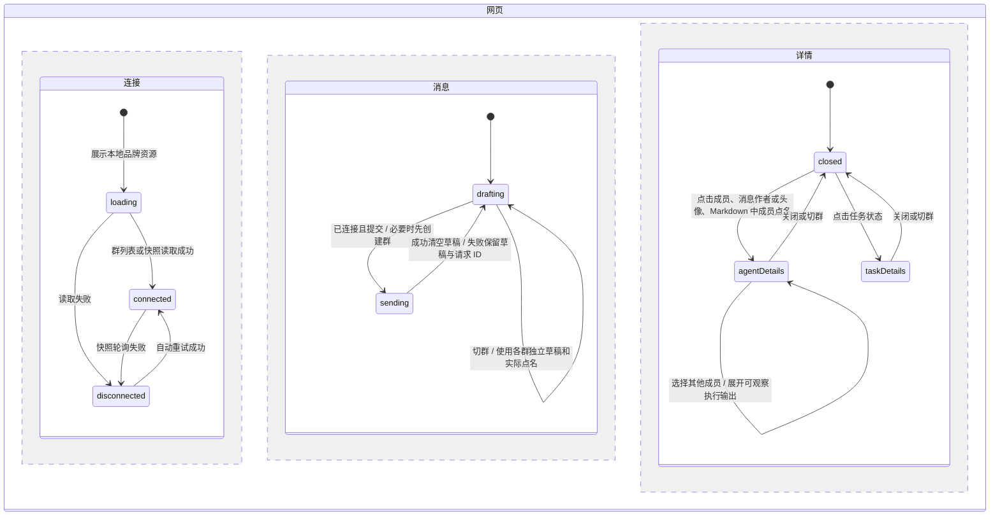

品牌展示对应 BT_U14：侧栏保留 squad. 文字，欢迎区仅显示图标，浏览器图标引用同一份本地 SVG。资源使用正方形视口等比缩放，不依赖外部图片服务。展示沿用 loading / connected / disconnected 及原有消息、详情状态，不产生业务事件或外部操作意图，因此无需新增 XState 状态或转移。

消息正文对应 BT_U15：在原有消息展示中以 14px 基础字号渲染 Markdown，各布局均沿用该字号，保留段内换行与语义结构。仅调整现有状态下的样式，不产生事件或 XState 转移。

界面精简对应 BT_U17–BT_U19：导航、成员、消息和输入区通过分组、间距与明确的操作名称区分；欢迎区只保留品牌、主标题和快捷提问。消息作者使用展开图标并保留可访问名称，替代每条消息底部重复的过程按钮；侧栏与头像入口继续可用。详情空状态只显示简短状态，正常连接不重复解释自动同步，离线时保留提示。连接状态、等待回复、发送失败、停止与继续、协助重试原因、执行身份和预算等影响操作的信息仍然显示。

上述调整只改变原有 loading / connected / disconnected、drafting / sending 和详情状态的渲染，不新增 XState 状态或转移，也不改变 HTTP 命令与副作用边界。测试直接渲染视图和详情组件，验证内容、可访问入口与禁用状态；完整浏览器交互仍按原有待验收项单列。

快照提供群消息、任务状态、评审进度和成员执行日志。消息经 Markdown/GFM 渲染，跳过原始 HTML，代码和已有链接不转成成员按钮。等待用户时发送消息映射 HUMAN_DECISION；继续按钮提交 CONTINUE，停止按钮提交 STOP，均通过 HTTP 服务进入 TeamEngine。HTTP 不接受客户端任意状态机事件。产物下载只读取实际持久化内容。

## 验收执行与覆盖报告

这是测试宿主的处理流程，不增加业务 XState 状态。群历史与评审对应 BT_G01–BT_G14，模型传输对应 BT_M01–BT_M06，Markdown 对应 BT_U10–BT_U13；前述业务状态和交互状态继续复用。协调判断应在转移时保留选择原因及所依据记录，供 BT_O02 核查；监督输入及负责人接续输入应携带已保存的重复失败记录，供 BT_O01、BT_E02 核查。上述修正沿用既有状态转移，仅补齐上下文和记录。

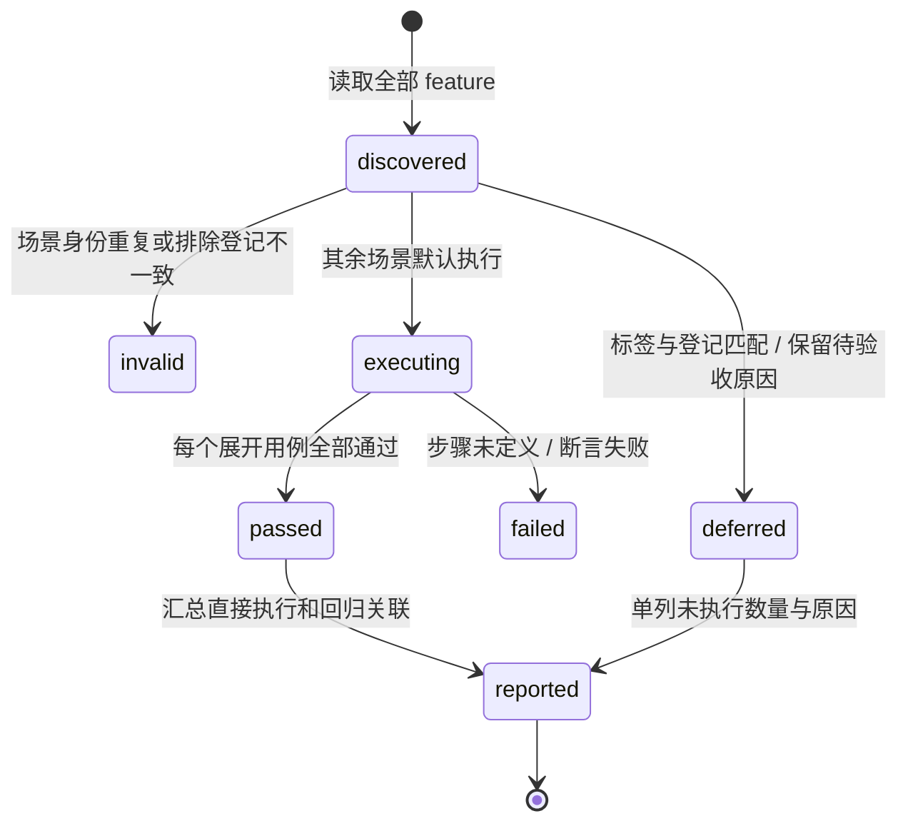
