# 分层状态图

设计依据见 [XState 八条原则](xstate-design.md)，真实任务主阶段见 [README](../README.md#状态模型)。任务阶段与执行子 actor 的组合见[多 actor 设计](task-actors.md)，外部执行继续遵守持久意图、领取和启动许可边界。

任务阶段、预算和结果交接由根 actor 拥有；每次执行尝试的启动、取消和结算由子 actor 拥有。BT_N06–BT_N15 对应[真实 actor 树与执行状态图](task-actors.md)，在一个存储事务内保存父子快照。此前 BT_N01–BT_N05 的[模块拆分](task-machine-refactor.md#模型组合图)保留为历史记录，既有业务约束继续有效。

| 层次 | 状态所有者与事实来源 | 读图方式 |
| --- | --- | --- |
| 真实 XState | `taskMachine`、`executionMachine`、`roomMachine`、两个 Inspector 模型 | 与源码节点、守卫和事件对应；业务 ended 不等于 final |
| 任务上下文 | `src/types.ts` 的枚举、`src/task.machine.ts` 的纯更新 | 是主任务拥有的持久化子生命周期，不是已启动的 actor |
| 执行与适配器 | `TeamEngine` / `WorkRunner` / 适配器与宿主 | 意图状态单独画；校验、HTTP、存储步骤使用 flowchart |
| 网页与观察 | React 状态、派生条件、本地纯布局和观察模型 | 明确 UI 投影与真实模型，布局和视觉约定分开 |

箭头按 `事件 [守卫] / 纯更新或保存意图` 阅读。同一事件的分支以源码顺序为准；真实机器的无 target 更新会标明“无target”，图上的回环不代表重新进入。流程节点不承诺可持久化或恢复。

- [任务拥有的上下文生命周期](#任务拥有的上下文生命周期)：输入、协助、评审、讨论、交付。
- [执行与适配器边界](#执行与适配器边界)：持久意图、本地操作、模型修正、网页工具和宿主。
- [房间与可信命令](#房间与可信命令)：路由、历史与归档。
- [网页与观察](#网页与观察)：群聊、导出、面板、调试和 Inspector。
- [验证模型与文档](#验证模型与文档)：模型回归、文档核对与验收报告边界。

## 事务与外部执行的共同边界

**图型：处理流程；所有者：`TeamEngine` / 持久存储 / `WorkRunner`。**

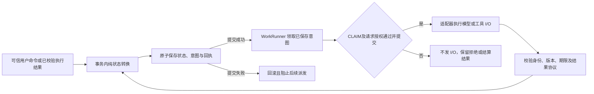

| 横切边界 | 各图共同遵守的契约 |
| --- | --- |
| 预算与权限 | 首次 CLAIM 预占所属 bucket，额外请求先 CONSUME；评审/讨论及续办保留额度同样校验；拒绝后不得发 I/O |
| 停止 | 先保存取消意图，再由执行器传递 AbortSignal/取消；发出取消与实际结算分开，物理操作未知时保留锁与 uncertain |
| 失败与重试 | 有限重试共享原预算和期限规则；协议修正不放宽输出校验，存储失败后停止派发 |
| 身份与迟到 | 事件绑定工作、attempt/session、epoch/goalVersion及适用的讨论/评审 ID；旧结果只可结算自己的旧操作 |
| 重复与交接 | 命令回执、结果消费和后继意图在事务内去重；临时拒绝不把未消费结果永久封死 |
| 重启恢复 | 先校验配置、成员、权限、模型绑定和物理会话；已结算不重放，安全未完成操作可再领取，未知写入先核对 |
| 观察与 UI | 只观察提交后的状态；日志、历史、引用、工具输出和 Bot 发言不获得调度权限 |

## 任务拥有的上下文生命周期

### 输入意图解析

对应 BT_I01–BT_I21。保留原执行内核，以 [Zod 运行时契约](https://zod.dev/basics)校验规则与模型结果；按 [XState 持久化](https://stately.ai/docs/persistence)的快照边界保存解析工作。结构化生成仍需宿主校验，参考 [AI SDK 结构化数据说明](https://ai-sdk.dev/docs/ai-sdk-core/generating-structured-data)，不引入该 SDK。项目继续固定 XState 5，不升级执行框架。

**图型：上下文生命周期；所有者：`taskMachine / InputAnalysis.status`。**

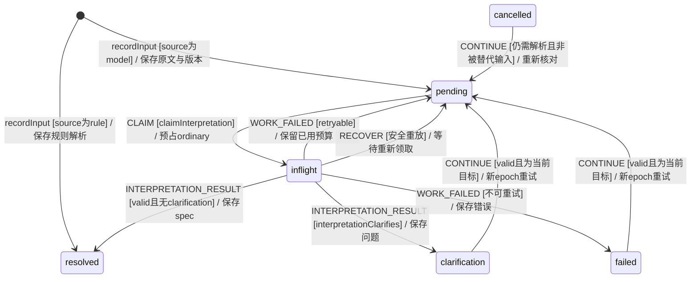

STOP 或目标变化把未完成解析记录置 `cancelled`；新输入有自己的记录，不把旧已解析记录重置。resolved 后的规划与执行是任务阶段和意图变化，不是 `InputAnalysis.status` 的额外枚举值。

当前有 interpreting 顶层状态、interpretation 操作种类、INTERPRETATION_RESULT 事件和可选 inputAnalyses 上下文。旧快照缺少该字段视为空，不强制迁移。每条记录保留输入 ID、原文、可信动作、来源、状态、epoch、goalVersion、解析结果与工作 ID；工作沿用 pending/inflight/done/cancelled、deadline、模型绑定、requestCount 和既有回执。所有模型 I/O 均在已提交并领取的操作上发起，解析禁用技能与网页工具，不获得新的调度权限。

规则只匹配直接输入的完整停止、继续和重试命令，点名只接受配置中的成员。引用、代码、否定句、历史和 Bot 内容不触发控制命令。模型仅解释 request/supplement/decision/review 中已由可信入口确定的动作，不能返回 stop/continue/retry、修改负责人或扩大直接用户指定的评审范围。Zod 契约严格拒绝额外字段；动作须与解析输入一致；每个引用须同时匹配实际提供的类型、ID 和 taskId。低置信度必须带澄清问题。原始 Goal、显式约束及完整消息始终独立保留，不能被模型摘要替换。

复杂补充先持久化为待应用输入，到没有在途工作且协助结果已消费的安全边界再解析；解析优先于后继负责人和旧交付检查，未解析或需澄清时不得发布完成结果。所有待解析输入处理完后，按原 review 队列或负责人流程继续，全部角色收到同一组已校验意图及原始输入。澄清和最终失败进入 waitingHuman，不执行猜测结果；用户补充或明确继续后重试未完成解析。

首次解析领取扣 ordinary，后续请求及格式修正继续通过 CONSUME 与 REGENERATE_MODEL_OUTPUT，重试共享 usage.retries；额度不足不得请求。STOP 保存取消意图并经原 AbortSignal 传递；停止、过期工作、epoch/goalVersion 不一致、已结算或重复结果都不能调度后继工作。目标改变取消旧解析；重启只恢复安全未完成工作，并重新检查模型绑定、配置和预算，已提交结果不重放。事务失败同时回滚输入、解析、后继操作和回执，并阻止本引擎继续请求。网页投影 interpreting 和 inputAnalyses，过程记录显示真实解析请求与结果，不展示隐藏推理。

当前产物与黑板正文同引用目录一起提供给解析模型，避免只有 ID 而缺少指代依据。自定义执行器即使绕过适配器仍须经状态机复核，非法当前结果进入 waitingHuman；未关联已领取解析工作的伪造事件不能改变阶段，迟到结果只结算自己的旧工作。澄清或失败后 CONTINUE 先重建解析操作，不直接安排负责人。解析期间追加的输入按顺序解释，全部完成后再规划；旧结果不得抢先发布。明确控制消息也随 STOP、CONTINUE 或 RETRY_ASSISTANCE 保存原文和回执。

网页等待用户时自动附加的 decision 分类不能盖过完整的直接停止或继续命令；显式 new、retry 等专用入口仍保留原语义。即使补充走规则路径，CHECK_RESULT 也不能在存在未应用输入时发布完成，必须先回到原安全边界应用补充。

### 协助重试与结果交接

对应 BT_H10–BT_H20、BT_U16；复用 running、waitingAssistance、waitingHuman、ended 顶层状态。以下为协助上下文及提交边界。原负责人保持任务所有权；网页仅提交命令，不直接调用成员。

**图型：上下文生命周期；所有者：`taskMachine / Assistance.status`。**

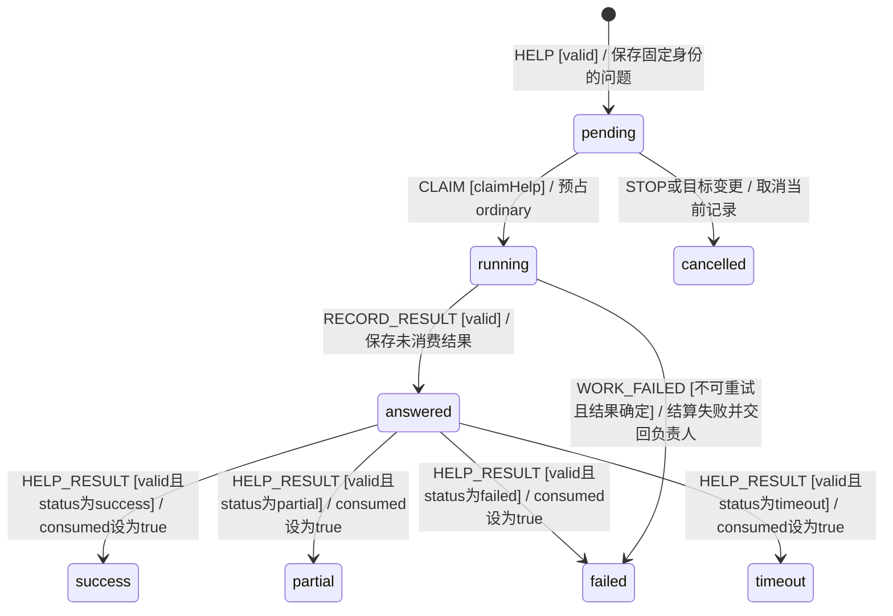

**图型：处理流程；所有者：`taskMachine` 的 `RETRY_ASSISTANCE` / `acceptHelpResult`。**

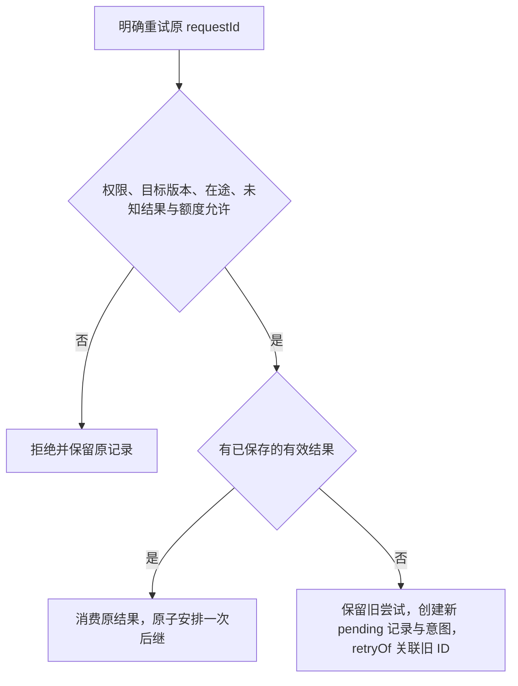

`pending / running / answered` 在 STOP 或目标变更时成为 `cancelled`；已答结果的 `RecordedResult.consumed` 单独记录是否消费。上图只画执行器常用的“先保存再消费”路径，受信任的有效 HELP_RESULT 也可直接结算允许的原记录。重试的新记录不是旧记录的回跳，`settled / interrupted / archived` 不是 Assistance.status 枚举值。

- 未结算的协助及有效待消费结果阻止用户补充抢先触发 BOUNDARY。读取和消费结果使用同一事务；普通结果消费、输入应用、负责人意图和“结果已交给负责人”的提示一起持久化。临时状态不允许消费时保留结果，不写永久拒绝回执；只有已停止、版本过期、已结算或重复结果可归档。
- 手动重试创建新协助 ID 和独立执行意图，记录 `retryOf`、原负责人和所需权限；保留失败记录，消耗重试及求助额度，并为负责人保留一次普通请求。核查额外请求、自动重试和恢复领取都不能使用该保留额度，触限按失败结算并交回负责人。停止或结束的任务在明确重试时才开启新 epoch；目标版本变化拒绝沿用旧问题。未结算的外部请求必须先结算，不能并发重放。
- 成员评审重试保留同轮其他成员结果，只重试选中成员；结果返回后接续未完成队列或负责人汇总，并重新计算失败缺口。属于旧评审轮次的协助不能用于恢复当前评审。
- WorkRunner 只执行通过 CLAIM 的持久化意图；重试与结果交接均由 XState 产生。失败和超时仍回到原负责人；停止、旧请求迟到及重复提交不能产生额外推进。

**图型：UI 投影；所有者：`网页协助重试入口及服务器快照`。**

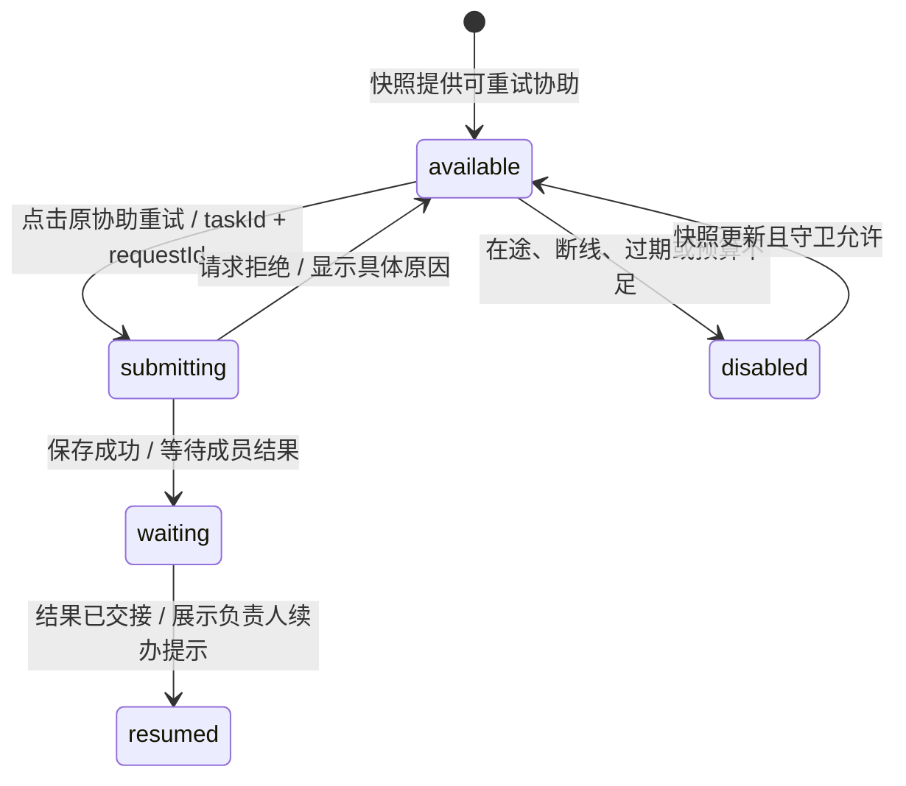

“B 重试”只解析直接用户的完整重试指令；引用、历史、模型输出和任意包含该词的句子均不获得重试权限。路由保留原协助的成员身份，成员撤销后仍识别命令并由权限守卫拒绝。只有一个候选时提交同一命令；多个候选或没有候选时给出明确原因，用户可使用关联原协助的入口。事务保存失败回滚消息、意图和回执，禁止宣称重试成功或发起外部操作。

### 成员评审

对应 `TaskContext.review.status`。目标成员只由直接用户请求确定，促进者不能替换名单，也不能用 continue、assist、replan 或 finish 跳过待组织的评审。

**图型：上下文生命周期；所有者：`taskMachine / TaskContext.review.status`。**

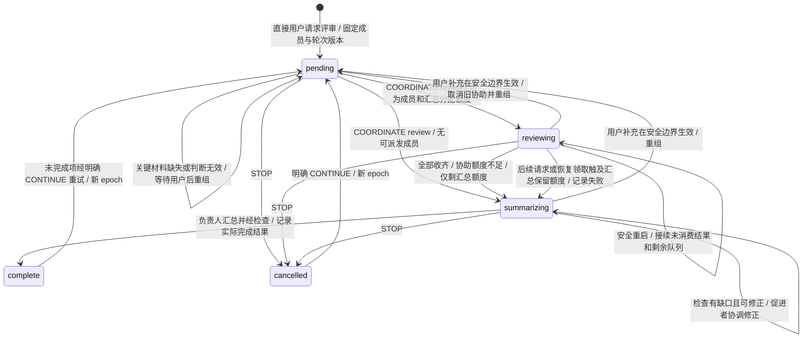

- `complete` 表示评审轮次结算，任务是否成功仍以 `outcome` 为准；成员失败、超时或队列未收齐会标记缺口，最终为 partial。
- 评审组织与收集阶段必须保留一次普通请求供负责人汇总。首次领取、额外模型请求、技能搜索、重试与恢复重新领取都检查这条限制；首次模型请求已由领取预占，不重复扣款。触及保留额度的成员操作按失败结算，推进汇总，不能直接耗尽该额度或继续重试。
- 完成检查使用独立 checks 额度；若用户配置的总额度连组织和汇总都不足，或停止、故障、检查额度不足，则可直接结束或等待用户，不能承诺完成汇总。
- 结果必须先 RECORD_RESULT 持久化，再以 HELP_RESULT 消费；结果 ID 防止重复消费，epoch/goalVersion 隔离迟到结果。用户补充在 HELP_RESULT 消费边界应用，已保存的成员意见保留为重新组织的上下文。配置撤销成员或权限时暂停恢复。初次评审直接进入组织阶段，避免负责人先回答一次才拉人。

### 工作期间的后台讨论

对应 BT_T01–BT_T17。沿用任务顶层状态，在 src/task.machine.ts 增加持久化 discussion 上下文和带 discussionId 的操作；主工作与讨论分别推进，讨论不能变更负责人或主目标。需求依据和替代方案见 [评估](background-discussion.md)。

**图型：上下文生命周期；所有者：`taskMachine / TaskContext.discussion.status`。**

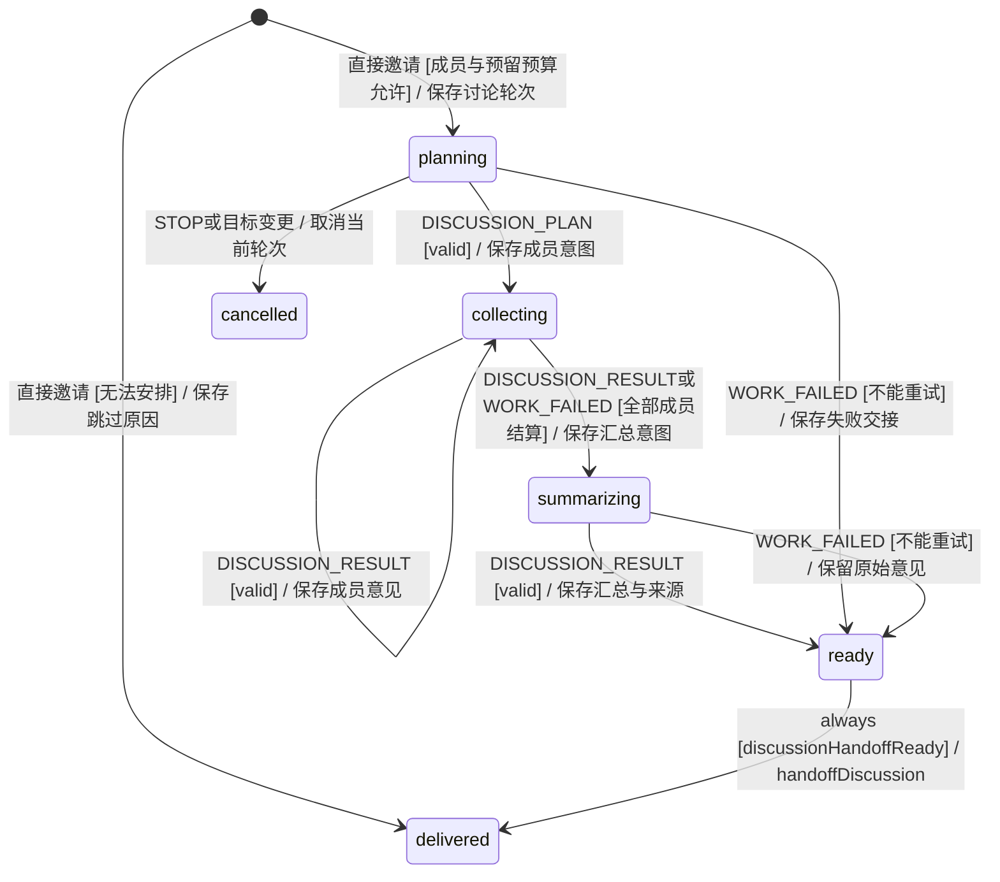

`planning / collecting / summarizing / ready` 在 STOP 或目标版本改变时统一变为 `cancelled`；等待用户、主请求未结算或仍有待应用输入时，ready 保持不交接。它与主阶段可同时推进，但不是已实现的 XState parallel 或子 actor。

每次外部请求都先保存意图，再经 CLAIM 检查轮次、epoch、goalVersion、期限、成员互斥和预算，之后 CONSUME 才调用适配器。成员复用 assistance 协议但不进入主流程单一 assists 等待关系；协调员安排复用 facilitator 协议，汇总使用 discussionSummary 的只读 answer 协议。结果携带已领取 workId 与 discussionId，保存原文、报告、状态和下一步意图同事务提交，重复或旧结果拒绝。讨论无权重新邀请、修改目标、发起嵌套协助或提前发布最终交付。

主流程 running 的 DELIVER 在讨论尚未交接时只保存候选草稿，不进入 checking；其他需要负责人接续的结果也等待讨论。ready 且无主请求、无未结算主协助和待解析输入时交接一次，恢复原 running 工作，最后沿用 checking。等待用户不会被后台结果擅自解除。讨论失败和跳过原因进入交接，最终交付如实标为部分完成。

主请求在讨论期间报告 BLOCKED 或达到重复失败阈值时，保持 running 并保存阻塞原因和延后协调标记，等待正在收集的新依据；不另发可能提前结束任务的监督请求。讨论交接清除延后协调标记，将原阻塞与意见一起交给负责人。

取消、结束与硬约束变化覆盖全部操作，普通主工作切换只取消主操作。重启重新校验成员、权限、版本和模型绑定，仅恢复未完成安全意图；已提交意见不重放。网页执行器按具体工作启动有界异步请求，不再按整个群阻塞；调度资格始终来自状态机和事务领取，宿主不自行选择成员或修改讨论状态。

宿主中的在途工作以群 ID 与工作 ID 共同标识，避免不同群的相同输入编号互相阻塞。没有成功领取或消费结果时让出执行，等待已有请求结算、下一条命令或定时检查，不递归空转领取。宿主或存储故障暂停该群本进程中的后续派发，沿用 waitingHuman 与存储故障保护；这些是执行器互斥与生命周期规则，不新增业务 XState 状态。

讨论结果的拒绝边界对应 BT_V14：缺少 fence、错误讨论轮次、过期版本或将讨论结果关联到主工作时，只保存拒绝记录，不能结算当前有效在途工作。只有工作 ID、讨论轮次和工作自身版本边界完整匹配的真实完成事件，才可结算该工作；当前轮次内的协议错误按原失败分支结算，旧轮次的有效迟到完成只结算自身并留存历史。

**图型：结果处理流程；所有者：`WorkRunner / taskMachine`。**

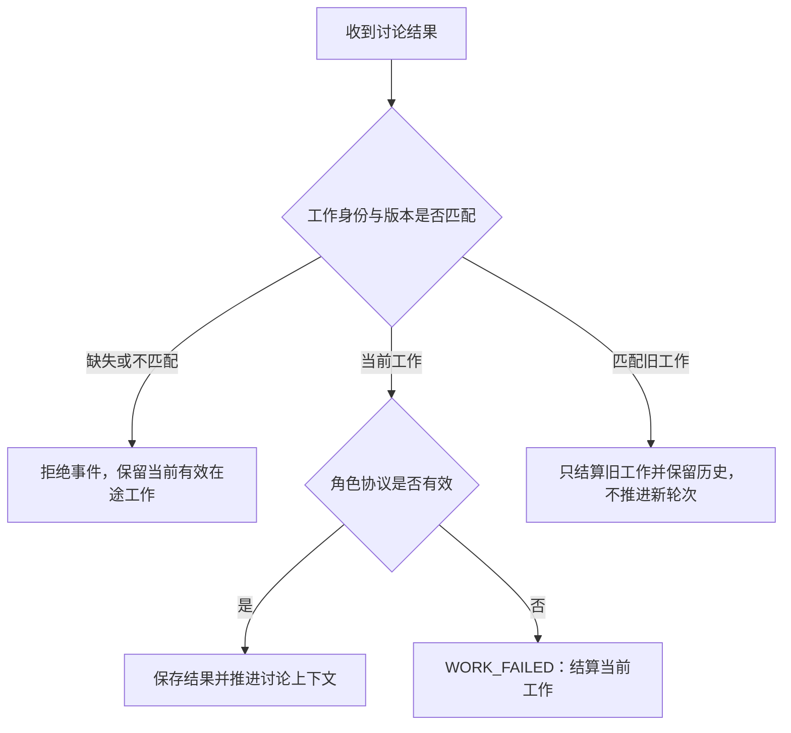

### 简短结果与产物发布

对应 BT_A01–BT_A11。复用 running、waitingAssistance、checking、ended 和既有操作状态；摘要、报告和引用是同一结果的上下文，不增加顶层状态。新增行为先经以下结果事件事务，再由网页展示。

**图型：事务处理流程；所有者：`taskMachine / TeamEngine`。**

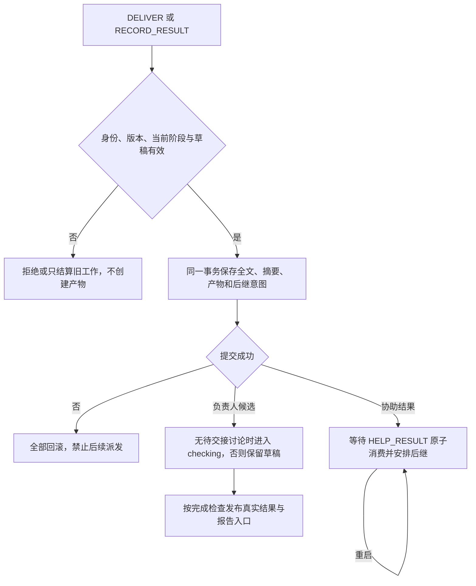

检查与负责人接续使用完整候选、核查文本和产物，不使用展示摘要替代。报告按事件和工作确定身份，重复回执不重复保存。旧协议长结果可在同一结果事务中生成报告；旧快照新增字段均可省略。未生成报告的短答不创建空文档。首次与后续外部请求沿用现有预算，生成本地产物不调用额外模型。

**图型：UI 投影；所有者：`Workspace / Details 的固定 taskId 和产物引用`。**

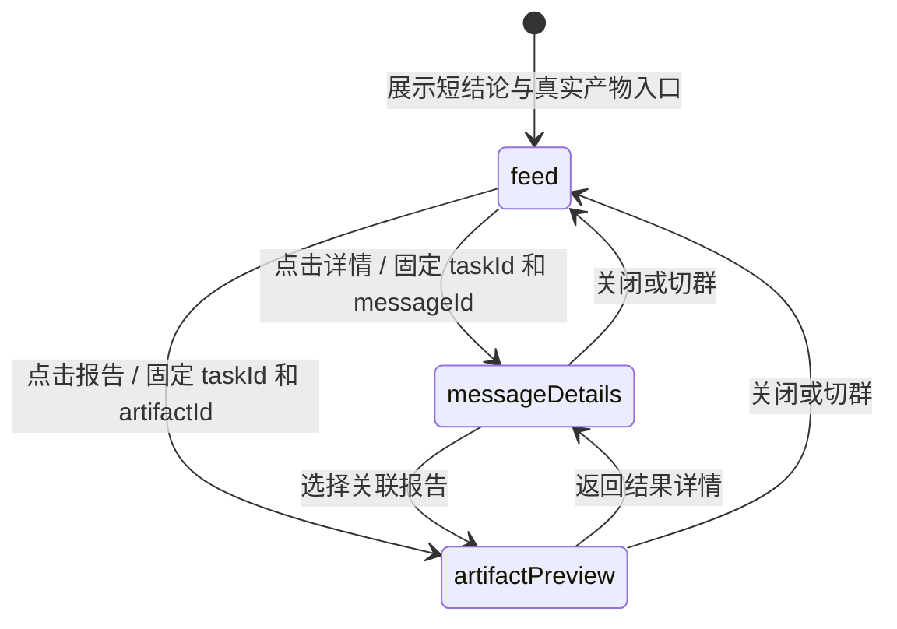

网页仅读取对应任务的全文、来源和可观察执行记录。报告预览复用安全 Markdown 渲染，下载使用相同持久内容。历史消息不能回退到当前任务的报告；不存在的引用显示不可用，不创建产物或调度。旧长消息只缩短主视图显示，其原文仍能在详情查看。

### 候选版本与当前交付

本图描述任务上下文生命周期，所有者为 `taskMachine`，持久化边界为 `TeamEngine` 事务。覆盖 BT_A22–BT_A26。

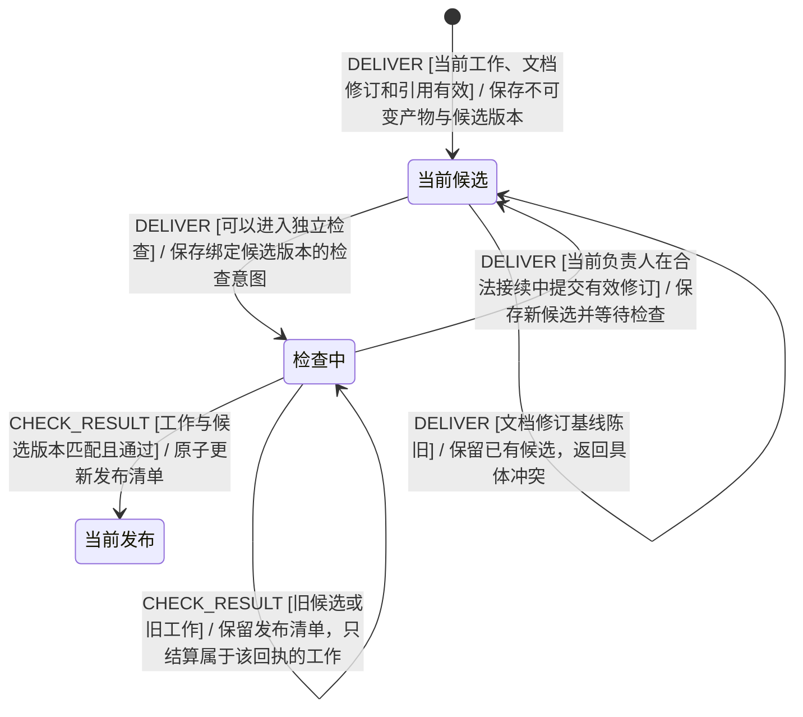

文档身份独立于文件名，修订关联当前任务和目标中的明确产物。旧产物缺少版本关系时，各自作为独立文档。当前交付视图以最近通过的清单为准，原消息仍按原始 artifactId 定位。候选和文档版本均由宿主分配。独立检查意图固定候选版本，领取后才可发起检查。停止、额度耗尽、目标变化和恢复遵守既有工作、权限和版本约束。

执行阶段可用 `readArtifact` 查读获准的历史报告，仍按本地读取的任务、目标、游标和额度边界处理。独立检查在固定材料内获得对照所需的同任务同目标原报告正文，每份报告只放一次，其他任务的报告不进入检查输入，也不产生模型工具调用或读取额度。当前候选与发布指针继续由交付事件管理。

### 候选预检与独立验收

**图型　任务上下文生命周期。所有者　`taskMachine`；事务由 `TeamEngine` 保存，`WorkRunner` 执行。验收　BT_F03–F04、BT_F07–F08、BT_F10–F11、BT_F14–F21、BT_M30。**

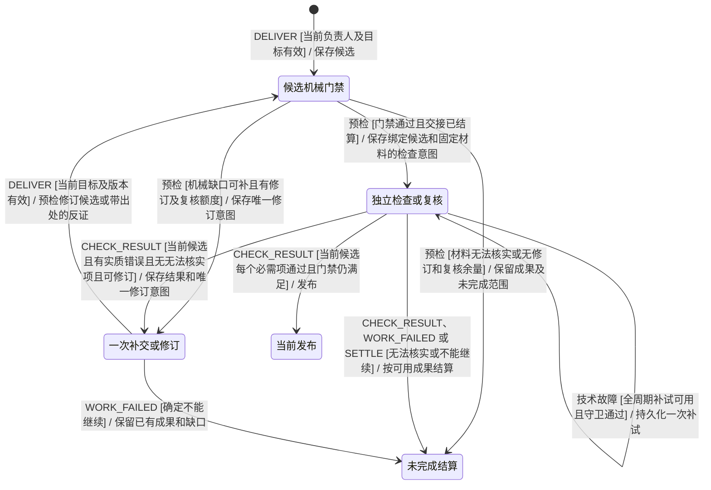

图中的门禁、修订和检查节点描述沿用的 running、checking、ended 阶段内的交付事实。已入队的宿主续办、必要协助、讨论及评审先按原交接边界处理，在途物理操作先结算或核对。检查只收到结算而没有验收结果时，先接续已入队的交接，否则本轮结束。只有现有的真实人工操作入口可进入等待。

原始可信用户输入形成带稳定 ID 的有效要求；保留主目标、必需产物、硬约束与验收项。机械门禁根据实际产物、可见材料与宿主验证回执判断，候选与发布历史分离。模型逐项返回结果和异常项所需的来源证据；宿主校验 ID 唯一且完整，引文属于所指来源，结合全部必需项与当前机械事实决定发布。首次检查和修订后的复核覆盖全部有效要求，使用同一证据快照。

BT_I04：检查意图只固定当前有效输入中已校验、可从本群历史按任务和记录 ID 定位的引用。历史材料可供核对引文，不能成为本轮产物或证明当前状态；无法取得已获准的材料则结束验收。复核沿用首次检查固定的原文。

首检与复核正常共授权 1–2 次检查模型请求，整个周期最多另一次技术补试，受既有 checks、retries 和截止时间约束。机械补交和语义修订共用一次机会；排修订前同时确认普通额度、最终检查和适用的工程复核额度。记录跟随事务持久化，服务重启、重复事件、同周期候选更新或 epoch 变化均不重置。可信用户明确继续可开始有限新周期并保留历史用量。

`WorkRunner` 领取检查意图后从允许的持久化记录构造输入；检查不发工具请求。材料超限或不完整导致无法核实时保存具体缺口。旧目标的来源不进入检查材料，失败回执不得证明资料采集成功。当前有效版本的检查结果只有机械门禁仍成立才可发布；停止、目标变化或迟到结果只按原取消和结算边界处理。无法继续时有可用成果结算 partial，无可用成果结算 failed，用户停止仍按 stopped 结算。

## 执行与适配器边界

### 外部执行操作

对应 `Intent.status`。网页只提交用户命令；状态机产生操作意图，事务保存后由 `WorkRunner` 领取，只有领取成功的操作才可调用模型或工具。

**图型：上下文生命周期；所有者：`taskMachine / Intent.status；执行器为 WorkRunner`。**

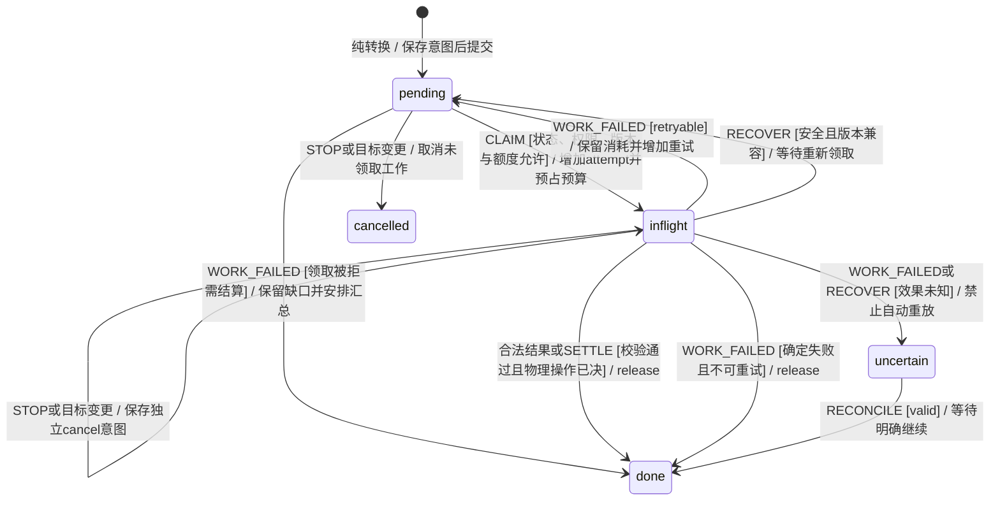

STOP 不会立即把原 inflight 置 done；cancel 意图发出或结算也不等于原工作已决。迟到结果只有在身份验证后才能结算自身，不能推动新目标。LOCAL_RESULT / LOCAL_RECONCILE 在证明子操作已决且目标有效时，还可能使原 uncertain 父意图回到 pending；见本地子操作图。

每个额外模型请求、技能搜索和网页工具调用都先经 CONSUME 检查。被拒后禁止发起 I/O。模型 HTTP 408、429、5xx 或网络故障可有限重试；协议错误与不可恢复故障按任务图转移。技能搜索不会安装技能。停止首先持久化并派发取消意图，AbortSignal 传入模型和工具；取消请求发出不等于原操作已结算。外部结果不确定时必须核对，不能直接重放。

OpenCode 会话标识只影响传输：网页使用群 ID，CLI 使用持久任务 ID，适配器哈希后添加请求头，不创建另一条调度路径。HTTP 错误只保留已校验的短代码；MissingSessionID 即使附带参数标识，也应提供缺少会话头的提示，仍沿用 WORK_FAILED 转移。瞬态故障到达重试上限时，等待原因应同时说明原错误和额度限制。执行日志是观察记录，不驱动业务转移。

### 本地技能与 CLI 子操作

对应 BT_L01–BT_L13。沿用主任务顶层阶段，子状态与检查点保存在父 Intent 内，由真实 taskMachine 纯转换验证。服务先建立有界共享目录，再恢复任务。listSkills 只读内存元数据免费；正文、资源、CLI 及宿主工程核验每次领取扣一次 ordinary；检查模型请求扣 checks。讨论、评审与负责人续办保留额度继续有效。

**图型：上下文生命周期；所有者：`taskMachine / Intent.localOperations[].status；src/local-operation.ts`。**

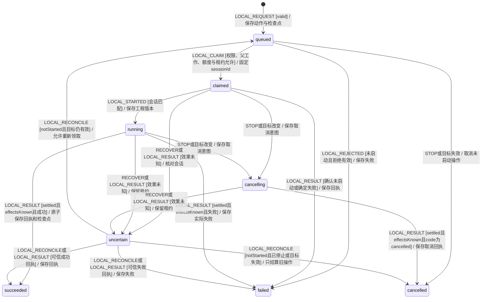

已知回执统一由 `finishOperation` 按实际结果结算：`code=cancelled → cancelled`，否则 `ok=true → succeeded`，其余 `→ failed`；适用于 claimed、running、cancelling 和 uncertain 中合法收到的结果，包括停止后才返回的真实成功或失败。停止、旧目标及版本不兼容阻止父工作续办，不把历史成功伪写成取消。

LOCAL_REQUEST 固定 operationId、请求摘要、父会话 attempt、技能版本与模型动作。LOCAL_CLAIM 与跨群共享的工作区租约在同一存储事务中提交；竞争者保持 queued，不消费预算。租约到期不是进程结束证明，不自动接管。实际执行前再次确认当前父工作、权限、取消和领取身份。回执只能结算自己的 operationId 与 sessionId；迟到回执不恢复候选或新目标。SETTLE、普通最终输出、重试、目标边界和新父工作均不能释放尚有未决子操作的工作锁。

停止会将已领取子操作置 cancelling 并发取消意图，执行器等待沙箱会话和后代退出；可能写入的取消/崩溃保留 uncertain，直到核对回执/效果。重启先核对本地会话日志与存储，再调度父工作；没有会话启动记录可证明未执行，已有回执可补交，缺少证据则保持 uncertain 和租约，不重放写入。旧任务缺失能力默认不授权；显式恢复核对通过后仅为兼容版本的新动作启用当前配置。

技能注册表固定启动 manifest；激活原子发布同版本只读快照，资源按包内相对路径读取；正文和资源不是调度权限。执行阶段的 Bot 默认获得四个本地接口；解析、纯汇总和独立检查模型不执行这些工具。宿主工程验证与后台讨论命令用隔离副本并标记工程 revision；主工作区仍为权威来源。执行后端不可用返回真实失败，不退回无沙箱进程。文件、日志、环境、网络和进程 I/O 在执行器完成，状态机不访问文件或启动进程。

可信 LOCAL_RECONCILE 或 uncertain 操作的 LOCAL_RESULT 回执全部结算后，若目标仍有效且未停止，返回原主工作的阶段（owner→running、assistance→waitingAssistance、facilitator→coordinating、check→checking），复用检查点继续。旧目标和停止任务只结算旧操作，不恢复执行。

BT_L14 的宿主 `local:operations` 命令读取未决会话与当前工作区清单，只有进程已退出、会话身份和审阅摘要匹配时才把操作者确认转换为 LOCAL_RECONCILE(receipt)。未退出、身份不明或摘要过期时不发事件。停止任务完成结算，活动任务由既有恢复守卫回到原工作阶段；此入口不重新执行命令。

工作区命名空间在 LOCAL_REQUEST 中固定为群 ID 与任务 ID 的宿主摘要；默认目录和核查副本均绑定此命名空间。即使两个群使用相同消息/工作 ID，也不会共用默认目录或副本。显式指定同一 canonical 工程时才共享工作区租约。

BT_L15 的调试模板沿用同一 taskMachine 与局部操作状态，不新增调度规则。LOCAL_* 模板绑定父工作、operationId、attempt、命名空间、会话身份和 fence；离线沙箱仍只进行纯转换，CLI 文本是合成资料。模板与形状校验属于图的输入投影，先复验上述真实模型后接入。

BT_L16：活跃后台讨论成员的 LOCAL_RESULT(uncertain) 只保留该子操作与成员锁，不改变仍在执行的主阶段。方案师照常将草稿存入 candidate，因讨论未完成而暂停最终检查；核对并完成讨论后再汇总交接。服务重启时仍统一先恢复未决物理会话，禁止重放未知写入。

BT_L17：在独立检查前，确定的工程验证命令经持久化、领取和回传在隔离副本执行。验证回执可用且独立检查通过时，发布前由宿主领取内部 verifyWorkspace 操作，沿用 LOCAL_REQUEST → LOCAL_CLAIM → LOCAL_RESULT、ordinary 额度及工作区租约；核对首次复制所绑定的源版本、当前权威工程与当前检查副本。源变化、回执过期、复核未完成或未知效果均阻止发布；仅明确允许的输出目录 dist/test-results/reports/coverage 不计入源版本。版本复核不重跑 CLI，恢复后仍要核对当前版本。

隔离验证仅允许输出目录与任务临时目录可写，源文件保持只读。即便受控执行夹具或外部编辑曾改变副本输入再恢复，每次 CLI 回执中的输入变化标记也会阻止发布。后台讨论可在副本试验，结果不合回权威工程。

工程副本保留包内工具的相对链接（包括 node_modules/.bin），解析后的目标必须在工程内；拒绝逃逸和循环。此为受领取后执行的文件副作用，沿用同一局部操作模型，不增加调度转移。BT_L09 同时运行真实 npm build，检验链接、可写输出与源版本复核的接线。

BT_L18：成功激活同时记录 TaskContext.localSkillVersions；新意图、领取和 LOCAL_REQUEST 都继承当前任务绑定，避免同一任务换 Bot/续办后改用重启时的新版本。来源 ID 与内容版本独立，名称先解析为来源 ID 再选择已固定版本。明确的用户目标版本变化或协调员 replan 可重建任务绑定；旧 Work 自身仍保留原绑定，用于结算和审计。

版本不兼容的恢复只允许核对并结算已存在的物理操作；LOCAL_RESULT/LOCAL_RECONCILE 必须保留不兼容原因，不将父工作重新置 pending，也不返回执行阶段。可信旧回执不授予新协议或新模型配置的执行权限（BT_L12）。

### 模型输出格式修正

对应 BT_M10–BT_M20、BT_M23–BT_M30。完整响应未通过 JSON/角色协议校验时，采用[校验反馈回路](https://docs.langchain.com/oss/javascript/langgraph/thinking-in-langgraph)：保留原任务和已取得的工具资料，指出字段校验问题后请求新结果；不把格式错误转为用户信息不足，也不放宽验证。兼容第三方服务，继续使用原响应格式配置，不强制供应商支持新的严格 schema 参数。

**图型：适配器处理流程；所有者：`WorkRunner / OpenAICompatibleAdapter；父 Intent.outputRepair`。**

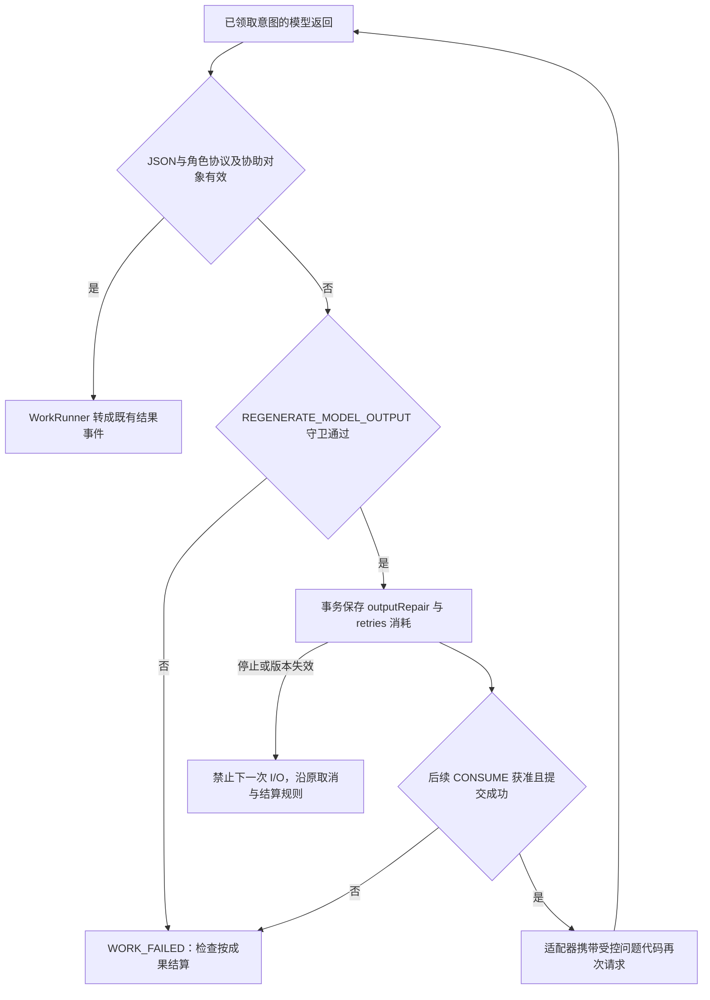

执行阶段角色校验和修正期间父意图仍为 inflight。独立检查以 WORK_FAILED 结算失败尝试并持久化全周期补试，再领取同一检查意图与原候选、材料。重启按原安全边界恢复；已用次数保留。

保留 running、waitingAssistance、coordinating、checking 等既有业务顶层状态；使用 REGENERATE_MODEL_OUTPUT 事件及操作上下文 outputRepair。状态机只保存修正次数与受控校验代码，使用现有 usage.retries/config.limits.retries，不新增独立预算。后续模型请求仍通过 CONSUME，扣所属 ordinary 或 checks 额度；修正不重置本次工作截止时间，也不重新执行已完成的工具。停止、旧轮次/目标版本、非在途或非模型工作、额度耗尽时拒绝。重复事件回执不重复计数；重启保留修正信息，不绕过恢复和模型绑定校验。

检查协议只接受完整的 `criteriaResults`。缺失、未知或重复的验收 ID，非法类型或错引文按检查协议错误处理；有效的不通过结论进入有界语义修订。格式修复与适用的瞬态网络补试共享一次全周期机会。补试或预算用尽后按已有成果结算，保留未核实范围。鉴权拒绝等不可补试故障直接结算。其他角色继续使用各自既有修正和故障路径。反馈仅含宿主生成的问题代码与协议约束；事务保存失败后禁止继续请求。

### 协调决策校验与等待原因

BT_M23–BT_M29。**图型：真实 XState 的既有转移与执行器协议；所有者：`taskMachine / Intent.payload / OpenAICompatibleAdapter`；验收范围：当前负责人身份、受控重生成、最终拒绝与可见等待原因。**

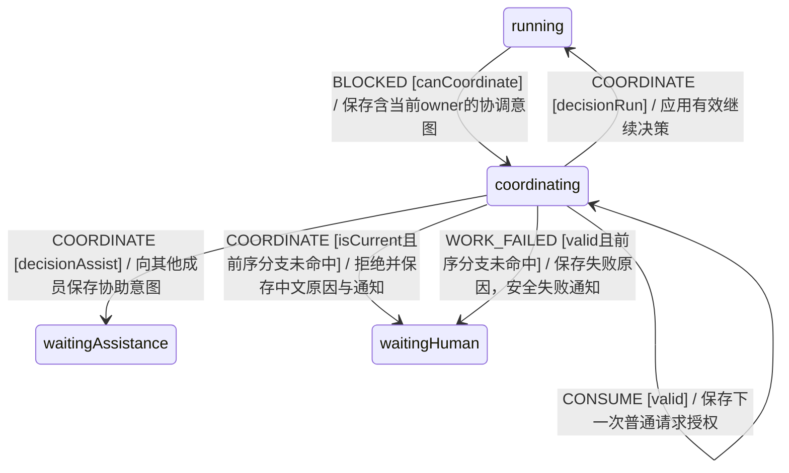

上图摘录现有状态和分支；没有新增状态或业务事件，完整分支仍以真实任务机器为准。适配器读取领取事务已经保存的当前 `payload.owner`，不能用 defaultBot、work.target 或历史消息猜负责人；新协调意图创建时写入，旧意图在 CLAIM 时补齐。恢复后的安全意图先重新领取再调用模型。已持久保存的负责人不能被模型输出改变，HANDOFF 仍遵守现有执行边界。自定义宿主若绕过领取直接调用适配器且缺少有效负责人，则在首次模型 HTTP 请求前以 COORDINATION_OWNER_MISSING 明确失败，不猜身份或消耗修正循环。

`assist` 的目标必须是已配置且不同于当前负责人的成员。违反这一输出协议时，在提交 COORDINATE 前请求既有 `invalid_decision` 修正；反馈只含宿主生成的安全规则，不保存或回显无效原文。模型可重新选择有效 continue 或 assist，不由程序强行改写判断。后台讨论仍遵守 review 协议及原授权目标，不能利用本次校验扩大讨论范围。

首次领取和后续请求沿用 ordinary 额度，修正另消耗共享 retries；停止、期限、旧目标版本、存储失败和无权限边界继续由既有模型校验，未获授权不得发出下一次 I/O。最终无效 COORDINATE 仍由 SELF_DEPENDENCY 等领域规则拒绝；中文等待原因只绑定当前协调结果回退到 waitingHuman 的分支，不让其它状态或迟到结果覆盖已有问题。后续 ACTIVITY 等命令可改写 reply，但必须保留 reason 和通知。网页使用既有 reason 和群消息投影，不把最近命令回执当作持久等待原因。结果未知或不安全重放的协调工作仍保留原有核对与结算要求；新增失败通知只覆盖已知安全的普通协调失败，不改变讨论或取消路径。

### 默认网页工具

对应 `BT_W01`–`BT_W14`，以下是已领取意图内部的一次请求循环，不是新增的任务顶层状态。状态机在 owner / assistance / facilitator 的 payload 中持久化 `capabilities.webSearch`、`capabilities.webFetch`。最终 check 不开放联网，保留原有 checks 预算语义。

**图型：适配器处理流程；所有者：`WorkRunner / CloudflareWebTools`。**

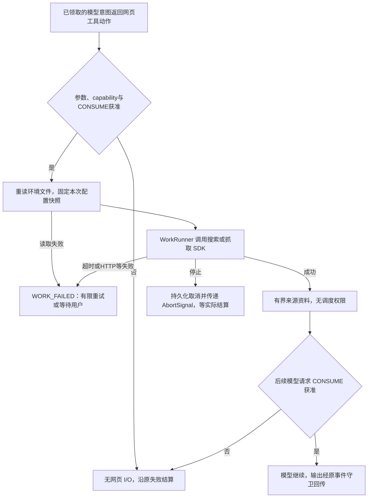

- 两种工具每次各消耗一次普通额度；分页续读是新的抓取。后续模型请求另外计费，评审汇总的保留额度同样适用。CONSUME 校验 inflight、epoch/goalVersion、期限、工具开关与工作类型，不能由适配器绕过。
- 使用 `agents/websearch` 的 HTTP source 和 `agents/webfetch` 的抓取、分页与渲染函数。Node 宿主用 Workers AI REST API 适配 Markdown 转换；密钥仅在运行时从环境读取，不写入任务配置、模型上下文或执行日志。
- BT_W11–BT_W14 沿用现有意图、CONSUME、WORK_FAILED、STOP 和 RECOVER，不修改 XState。每次工具调用前重载 `.env`，更新或删除仅由文件管理的值，保留进程环境和显式注入的优先级；文件不存在时清除旧文件值，其他读取错误使本次调用失败。单次调用的搜索选项、账号、令牌与错误脱敏共用开始时的快照，HTML/PDF 转换不得中途换用另一账号；下一次请求及恢复后的请求重新读取。
- 抓取沿用 SDK 的公共 URL、重定向、响应字节数与超时限制；正文使用 SDK 的不可信内容标记。搜索和网页内容不能改变评审名单或授予新调度权限。
- 只有工作被领取后才能发出工具请求；失败保留安全代码，不伪装为零条结果。工具暂时失败可按原 WORK_FAILED 规则重试整个只读工作，受原预算限制。未配置账号不会阻止普通聊天启动。
- 恢复时更新当前开关，并刷新 pending 和重新入队的 inflight 意图能力。途中尚未提交的模型循环可能重新搜索或抓取，重新调用可能收费；不承诺缓存或恰好一次外部请求。已结算意图不重放。
- 网页只观察工具开始、来源结果、失败与完成，不另建调度路径。

### 技能搜索结果解析

对应 BT_M21–BT_M22。沿用 `src/task.machine.ts` 的真实执行意图与顶层状态，无需修改 XState：来源格式是只读适配器的返回数据契约，不产生业务状态、事件或新的操作意图。以下细化图中的请求与解析阶段属于已领取的同一个 inflight 意图。

**图型：适配器处理流程；所有者：`WorkRunner.findSkills / src/skills.ts`。**

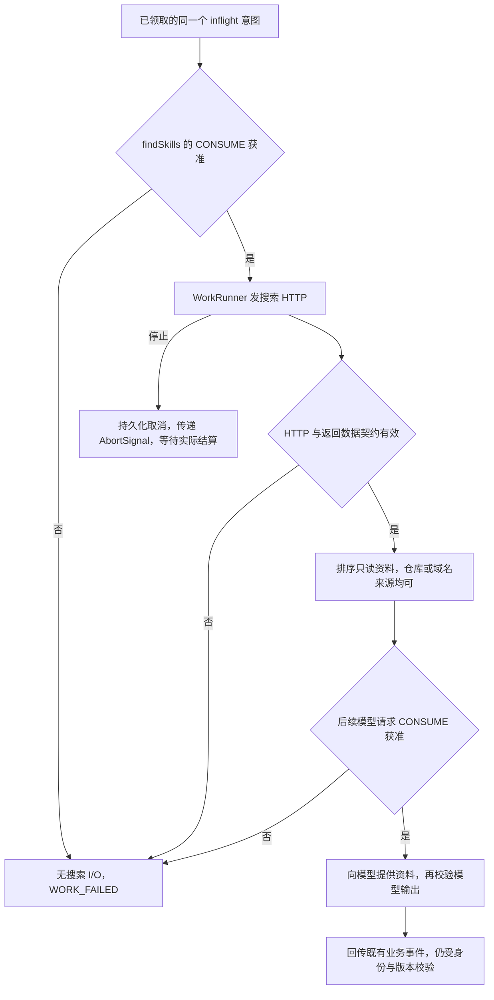

有效空数组仍是零结果；同批仓库与域名结果均保留，任何真正畸形项仍令搜索失败。来源不获得安装、命令执行或任务调度权限；链接固定为 skills.sh 的来源路径与编码后的技能标识。初次模型请求由 CLAIM 预占，每次搜索和后续模型请求各经一次 CONSUME 扣额；预算不足、停止和过期版本仍由原状态机拒绝。恢复只按现有安全意图规则重新领取，不保存供应商返回值为新调度依据。

2026-10-30 的故障复现：查询 `general purpose assistant skills` 返回 HTTP 200，包含 `source=skills.volces.com`，原仓库来源正则导致整批抛出 `Invalid skill search result`。一手依据：[实时搜索接口](https://skills.sh/api/search?q=general%20purpose%20assistant%20skills&limit=20)、[上游 CLI](https://github.com/vercel-labs/skills/blob/main/src/find.ts)。

### 模型消息风格

对应 BT_M07–BT_M09。以下是 `OpenAICompatibleAdapter` 内部的请求阶段，不是新增的 XState 状态。owner、assistance、facilitator 和 check 均沿用状态机已持久化的意图；只有 WorkRunner 领取成功后才构造并发送请求。

**图型：适配器处理流程；所有者：`OpenAICompatibleAdapter / WorkRunner`。**

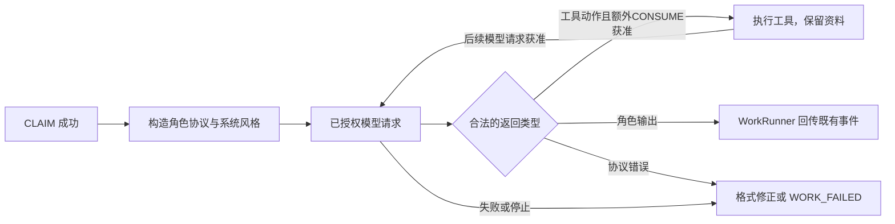

风格只约束可读文本：默认用简洁自然段落，短回复无需标题，减少装饰性排版；用户要求或内容确有需要时保留列表、表格、代码与来源链接。JSON 外层结构、动作枚举、工具参数和角色权限由现有协议决定，不受风格偏好覆盖。工具资料不能改写系统风格或取得调度权限；完成检查仍不开工具。

不增加状态、事件或调度入口。首次请求与后续模型/工具请求沿用原预算；失败、停止、迟到结果、目标版本隔离和恢复均使用「外部执行操作」的守卫与转移，安全重放时重新构造同一风格提示。可执行场景使用注入的模型传输核对各角色请求、工具后续请求及格式保留，不把预设响应当成真实模型的风格质量验收。

### 任务级证据读取

**图型　处理流程。所有者　`taskMachine / Intent.localOperations`，模型契约在 `src/local-operation.ts`，执行器为 `WorkRunner`。验收　BT_L38–BT_L43。**

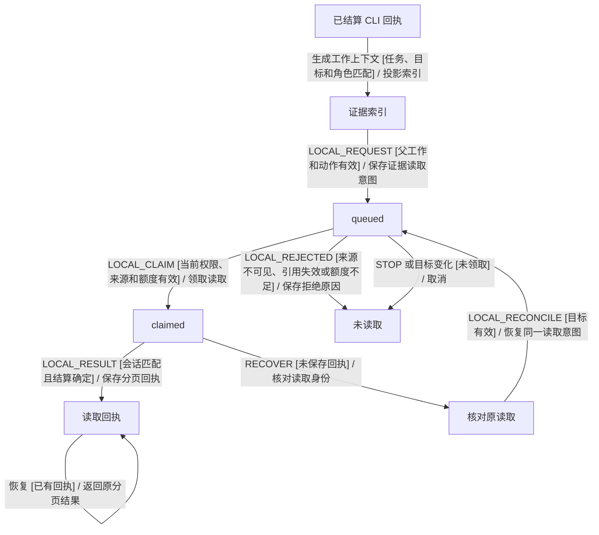

证据索引由已结算的 CLI 操作派生，正文只保存在原回执中。负责人和协调员在执行阶段可查读当前目标范围内获准的证据；协作者只接收宿主在分工时确认的证据引用。检查员获得已领取意图绑定的只读证据投影，首检和复核使用同一来源 ID 和内容摘要，每份已保存的相关原文只投影一次。材料超限时明确结算无法核实。查读请求及领取阶段均以当前权限、父工作、fence 和来源为准。无法访问的引用不提供正文或来源细节；失败、缺失和截断的回执分别提供可核实的状态。

查读仍走保存、领取、回传的子操作契约。读取范围限于存储中已保存的脱敏正文，不访问日志路径、启动进程或触发远程采集。每个新的分页读取只在第一次成功领取时消耗一次 ordinary；恢复读取仍使用同一操作身份。分页游标绑定来源操作、内容摘要及输出流，失效游标返回明确缺口。

同目标旧 epoch 的已结算回执带原采集时间并标为历史观测。显式刷新使用新的真实外部操作意图，遵循原有额度与审批；当要求确认当前工程修订时仍需 `verifyWorkspace` 等当前验证。未决及未经核对的执行结果不进入证据索引。停止、过期或旧 fence 的结果最多结算原操作，不能推进当前工作。

### 宿主命令按次授权

BT_L35–BT_L37增加当前任务会话授权（任务拥有的上下文生命周期，所有者taskMachine / hostSession）。用户明确选择会话后，范围为同任务、epoch、目标版本、工作区、命名空间及同一宿主账号和环境；包括当前任务全部Bot。页面刷新保留，任务结束、停止、版本/epoch改变、服务RECOVER或用户撤销时清除。每条命令仍先准备具体计划，再由纯模型判断是否复用，重新领取后运行时重核完整digest；不自动将sandbox改为host。模型与工具内容不能创建授权。

```mermaid
stateDiagram-v2
    [*] --> 按次审批
    按次审批 --> 会话有效: LOCAL_APPROVAL_DECISION [approveSession] / 保存范围并批准匹配计划
    会话有效 --> 会话有效: LOCAL_APPROVAL_REQUIRED [范围匹配] / 固定本条计划并排队
    会话有效 --> 按次审批: 结束、停止、版本变化、RECOVER、REVOKE_HOST_SESSION / 清除授权
```

撤销只影响尚未启动的操作；已开始的命令仍按原取消/结算规则处理。等待中及未领取的匹配操作可复用授权；撤销后排队命令重新等待批准，已领取但未启动的操作必须在LOCAL_STARTED重核授权。范围不匹配仍显示按次审批，未知效果不重放。会话不跨任务继承，不绑定某一CLI或参数；授权说明明确它允许本任务后续所有宿主命令。单条工程/可执行文件/环境指纹及额度、租约校验不变。

BT_L23–BT_L30。在 `runCli` 上显式请求 `execution: host` 和 `reason`，只表达申请，不能批准。默认仍使用沙箱；普通失败不自动重跑。审批生命周期属于 `src/local-operation.ts` 的持久上下文，由真实 `taskMachine` 的 LOCAL_* 事件驱动，不另造顶层任务阶段。

**图型：任务拥有的上下文生命周期；所有者：`taskMachine / LocalOperation`。**

```mermaid
stateDiagram-v2
    queued --> claimed: LOCAL_CLAIM [当前工作与租约有效] / 准备命令
    claimed --> awaitingApproval: LOCAL_APPROVAL_REQUIRED [尚未启动] / 保存命令与期限，释放租约
    awaitingApproval --> queued: LOCAL_APPROVAL_DECISION [当前用户批准且标识匹配] / 保存一次批准
    awaitingApproval --> failed: LOCAL_APPROVAL_DECISION [用户拒绝] / 拒绝回执
    awaitingApproval --> failed: LOCAL_APPROVAL_EXPIRED [过期] / 过期回执
    awaitingApproval --> cancelled: STOP 或版本撤销 / 使批准失效
    queued --> awaitingApproval: RECOVER [存在未消费批准] / 换批准标识，重新确认
    claimed --> running: LOCAL_STARTED [批准与实际命令仍匹配] / 保存进程身份
    claimed --> failed: LOCAL_RESULT [命令或工程改变且未启动] / 失效回执
    running --> succeeded: LOCAL_RESULT [退出且效果确定] / 保存结果
    running --> uncertain: LOCAL_RESULT 或 RECOVER [效果不明] / 保持租约待核对
```

宿主预备读取也在已持久化领取之后执行；预备不启动进程、不扣 CLI 执行额度。等待保持原模型检查点，释放工程租约，通过通知唤醒，不重复请求模型或促进者。宿主真正执行前再次领取、扣一次 ordinary、核对可执行文件、完整 argv、真实 cwd、工程内容、宿主环境及工作版本；任一变化返回失效，不自动扩大批准范围。批准使用不可替换的请求标识，重复命令有事务回执；模型、技能、日志和普通消息不能产生批准事件。

拒绝返回原 Bot；停止、过期、权限撤销与旧目标不能执行。重启后未消费的批准回到等待，并更换标识；已领取或运行的操作沿原持久日志核对，不重放宿主副作用。确认未启动而重新入队的宿主操作同样换批准标识，再次等待用户。保留执行身份、取消后代、额度与未知效果约束。宿主环境指服务所在机器及账号，使用真实 HOME 和认证环境，不承诺继承其他机器、其他账号或尚未授予的系统权限。

**图型：UI 投影；所有者：`HostApprovals / WebService`。**

待批准快照触发授权对话框；关闭只收起提示，待处理卡片仍可重新打开。允许本次或拒绝通过同源 JSON HTTP 命令提交任务、工作、操作和批准标识，不接收替换命令参数。提交失败保留请求并可重试；切群后的旧响应不更新当前群。可信命令经 TeamEngine 事务及状态机守卫提交后通知原运行器；服务端没有从网页绕过状态机启动进程的路径。

### 失败命令的宿主续办

图型为任务上下文生命周期。业务所有者为 `taskMachine / hostRetryRequests / hostRetryBatch`，可信入口为 `TeamEngine`。验收覆盖 BT_L31–BT_L37 和 BT_L45–BT_L55。顶层阶段沿用现有任务机器，逐条授权与执行沿用 `LocalOperation`。

```mermaid
stateDiagram-v2
    state "待安全边界" as Pending
    state "续办中" as Active
    state "待核对" as Uncertain
    state "已交接" as HandedOff
    state "无法续办" as Unavailable

    [*] --> Pending: REQUEST_HOST_RETRY [来源、权限、目标与最低额度有效] / 保存固定请求
    Pending --> Pending: REQUEST_HOST_RETRY [同一来源] / 返回已保存请求
    Pending --> Active: 安全边界 [主线已结算且最低额度满足] / 固定顺序并保存首条操作意图
    Pending --> Unavailable: 安全边界 [最低额度不足] / 记录未执行原因
    Pending --> Unavailable: 停止、目标变化或到期 [尚未启动] / 结算并保留原因
    Active --> Active: LOCAL_RESULT 或批准决定 [本条已确定结算] / 保存回执并生成下一条意图
    Active --> Uncertain: LOCAL_RESULT [本条效果不明] / 冻结后续外部操作
    Uncertain --> Active: LOCAL_RECONCILE [核对完成且目标有效] / 继续当前批次
    Active --> HandedOff: 批次结算 [各项效果均确定] / 交给一次负责人综合
    Active --> Unavailable: 停止或目标变化 [后续项未启动] / 取消后续项
    Uncertain --> Unavailable: 核对完成 [任务已停止或目标失效] / 仅结算已启动项
```

失败记录入口只提交任务、工作、操作标识与原请求摘要。可信用户命令通过时，活动任务只登记请求，保留当前 epoch、已保存候选、协助结果及仍有效的会话授权。已正常结束的任务在首次明确续办时重新激活，隔离旧 epoch 并清除失效授权。等待审批、未决物理效果、已停止、旧目标、其他活动任务、权限关闭、伪造参数和截断的写入清单仍按原边界拒绝请求。隔离检查或讨论的失败记录需保留原副本范围，普通负责人的续办入口拒绝这些记录。原成员的本地工具权限也会在审批、领取及启动时复核。

安全边界要求主线结果保存并结算，且已有协助、讨论、评审和用户输入按原流程完成交接。交付、检查和协调结束分支在最终发布前检查续办集合。待办登记不消耗或预留额度，安全边界才原子核对并预留每条执行、一次负责人综合及一次独立检查的最低额度。启动批次保留候选历史，发布须等待吸收回执后的候选重新通过检查。未达最低额度时记录每项未执行原因并按现有部分完成或失败路径结束。

领取端只执行已保存的固定操作意图。命令分别准备、审批、领取和结算，批准前释放工作区租约。已保存回执驱动状态机生成下一条意图。批次内新的有效请求进入后续待办。请求期限按登记时钟固定，单条执行受请求与父工作中较早期限约束。未启动到期保留未执行原因，已启动到期按原取消和结算处理。未知效果保留租约且等待核对，后续项保持未启动。

重启保持顺序及已结算回执，未消费批准和会话授权失效。停止、目标变化和权限撤销使适用的未启动项失效，迟到回执只能结算自己的操作。会话批准沿用 BT_L35–BT_L37 的匹配范围，每条命令仍重核完整计划及 digest，启动前再次核对撤销和期限。

**图型：批次占用的上下文生命周期。所有者：`taskMachine / hostRetryBatch`。验收：BT_L53–BT_L55。**

```mermaid
stateDiagram-v2
    state "批次占用" as Held
    state "批次占用解除" as Released
    [*] --> Held: 安全边界 / 保存批次、负责人工作和首条操作
    Held --> Held: 普通事件、RECOVER 或定时检查 [负责人工作仍活动或效果未确认] / 保留批次
    Held --> Released: always [负责人工作已终止且效果可确认] / 记录解除原因并保留回执
    Released --> Held: always [有待办且满足原安全边界与额度] / 保存下一批意图
```

批次占用随负责人工作结束而解除，包含被拒绝的负责人输出、正常完成、已确认失败或取消。旧快照中的遗留占用也按同一事实核对，服务恢复和现有定时检查均可触发。若负责人记录缺失，仅在批次没有效果未确认或可能已执行的请求时解除。解除时保留候选，已有回执按原结算时间核对，确定未执行的项记录原因，批次与触发事件写入任务轨迹。其他排队请求仍按原期限、版本、额度和授权边界处理。待批准的活动批次和未核对的执行效果继续保留。新的续办回执交回负责人后，仍需提交候选并重新通过检查。

自动转移由纯守卫判定。清除占用时显式重置上下文字段，使守卫立即失效。定时检查只发送事件，运行器继续从已保存并领取的意图执行。[XState 自动转移](https://stately.ai/docs/eventless-transitions)

网页投影已保存的排队、待批准、执行中、已取得结果和无法续办原因。刷新恢复同一请求，重复点击返回原请求。批准、拒绝和撤销在键盘及窄屏下均可操作。

### 本地工具宿主启动与平台边界

对应 BT_L19–BT_L22。沿用 `src/task.machine.ts` 与 `src/local-operation.ts`，无业务转移变更：进程身份、沙箱包装和系统路径别名是宿主实现契约；只有已持久化、领取并再次校验的 LOCAL_* 意图可以触发 I/O。以下启动状态由宿主管理，不加入任务 XState。

**图型：宿主启动流程；所有者：`LocalRuntime / NativeCliBackend / 服务锁`。**

```mermaid
flowchart TD
    E{"本地工具显式开启"} -->|是| P["探测原生进程身份"]
    E -->|否| D["不启动本地执行后端"]
    P -->|失败或平台不兼容| N["启动失败，不创建锁"]
    P --> I{"现有锁的身份"}
    I -->|仍活跃或未知| N
    I -->|无锁或证明旧进程退出| L["原子领取服务锁并持久化完整身份"]
    L --> M["规范化技能根目录并固定清单"]
    M --> R["核对会话日志与持久化任务"]
    M -->|失败| F["只清理本次token持有的锁"]
    R --> S["宿主就绪；可执行性仍由任务与操作守卫决定"]
    S -->|关闭| C["只删除本次token匹配的锁"]
```

宿主就绪不代表某项 CLI 已执行或未知写入已解决。并发工作及 uncertain/租约属于各自的持久化子操作，见[本地子操作图](#本地技能与-cli-子操作)，不把整个宿主画成一个 executing/uncertain 任务状态。

macOS 身份通过 `/usr/bin/python3 -I` 调用系统 libproc 的 `proc_pidinfo(PROC_PIDTBSDINFO)`，采用微秒启动时间与 `kern.bootsessionuuid`；不使用秒级 ps 时间或裸 PID 证明身份。Linux 保留 PID 命名空间、启动 ticks 与 boot_id，并兼容原有未带平台字段的 Linux 回执。平台不匹配、查询异常或畸形身份是 unknown，不能发送恢复信号或接管锁；当前平台下明确缺失或启动身份不符才视为旧身份已退出。

macOS 复用固定版本 SRT 的 Seatbelt 后端，Linux 保留命名空间探测。最小子进程环境不继承宿主密钥；macOS 仅读取系统运行依赖、工作区与技能快照，网络仍默认拒绝，check 源文件只读。取消继续终止所属进程组并等待会话结算，效果未知则保留 uncertain；没有静默改成宿主执行的分支。

技能边界先将根目录规范为 realpath，再与资源真实路径比较；`/var` 与 `/private/var` 等同源别名不再触发误报，包外链接与 `..` 仍拒绝。此变化不增设调度事件，沿用技能版本、快照与领取守卫。

一手依据：[Apple proc_bsdinfo](https://github.com/apple-oss-distributions/xnu/blob/main/bsd/sys/proc_info.h)、[SRT 原生后端](https://github.com/anthropic-experimental/sandbox-runtime)。本地固定版本源码为核验依据，不升级依赖。

### 任务快照协议与回退

**图型　恢复流程。所有者　`taskMachine` 管理恢复守卫与续办，`TeamEngine` 管理快照封装。验收　BT_A27–BT_A28。**

```mermaid
flowchart TD
    Legacy["旧协议快照"] -->|"RECOVER [旧任务仍活动] / 保留旧协议并要求核对"| Blocked["恢复阻塞"]
    Blocked -->|"LOCAL_RECONCILE [匹配可信回执] / 结算原操作"| Blocked
    Legacy -->|"启动读取 [旧任务已结束] / 原样保留"| Archived["可读的历史交付"]
    Archived -->|"CONTINUE 或 REQUEST_HOST_RETRY [用户明确请求且已结算] / 采用当前配置并增加 epoch"| Upgraded["当前协议任务"]
    Upgraded -->|"事务提交 [当前协议] / 保存 v3 封装"| Stored["当前执行器领取"]
```

旧协议的活动任务按原规则阻塞，未决物理效果仍可核对。核对只更新原记录。已结束任务在服务启动时保持原快照和交付历史。宿主只在可信继续入口提供当前配置。任务模型允许已结算的 `team-v1/tools-v1` 或 `team-v2/tools-v2` 任务升级到 `team-v3/tools-v3`。续办沿用同一目标、任务额度和历史用量，采用当前成员、模型和权限，并在独立 epoch 下开始一次新的有限交付周期。旧检查结论保留在历史记录中，本轮通过条件来自当前候选的逐项结果。

存储层接受 v1、v2 与 v3 封装，按快照所属协议写入对应版本。旧执行器拒绝 v3 封装。不同协议的执行器只有原物理操作的结算权限，领取、模型授权和工作结果仍受版本围栏约束。上线前应结算或暂停未决操作并保留快照，回退时只向旧执行器提供其支持的快照。发布历史保存在原消息和不可变产物中。

模型验证使用真实 XState，在受控时间下逐步持久化并恢复。轨迹覆盖旧活动任务 `running → waitingHuman → waitingHuman`，以及已结束任务 `ended → running` 时增加 epoch 并保存新配置。

```bash
node node_modules/vitest/vitest.mjs run tests/task-protocol-model.unit.test.ts tests/local-operation-model.unit.test.ts tests/host-retry-model.unit.test.ts --maxWorkers=1
```

BT_A27–BT_A28 接线使用实际 SQLite、受控真实子进程和保存的进程回执，验证旧封装、恢复阻塞、两条可信续办入口及领取隔离。

```bash
TSX_TSCONFIG_PATH=tests/bdd/tsconfig.json node --import tsx node_modules/@cucumber/cucumber/bin/cucumber.js features/33_snapshot_protocol.feature --import tests/bdd/task-protocol.steps.ts --format progress
```

## 房间与可信命令

### 群历史与消息路由

以下是 `TeamEngine.submit` 的单次事务处理路径，节点是处理阶段，不另行持久化为任务状态。

**图型：事务处理流程；所有者：`TeamEngine.submit`。**

```mermaid
flowchart TD
    U["直接用户命令"] --> I{"事务内检查回执指纹"}
    I -->|同ID同内容| O["返回已保存回执"]
    I -->|同ID不同内容| N["拒绝"]
    I -->|新请求| R{"可信路由与活动任务"}
    R -->|空闲的新请求| T["初始化新任务，附同群有界历史"]
    R -->|活动任务补充| S["USER_INPUT 或 HUMAN_DECISION，等待安全边界"]
    R -->|明确继续或重试| G["原任务的 CONTINUE 或 RETRY_ASSISTANCE 守卫"]
    R -->|不符合路由条件| N
    T --> C["原子提交任务、消息、意图和回执"]
    S --> C
    G -->|允许| C
    G -->|拒绝| N
    C --> O
    C -->|提交失败| F["全部回滚并停止后续派发"]
```

历史仅来自同群其他任务，保留来源 taskId，限制消息、产物、黑板和目标摘要数量及总文本量。历史只作为模型上下文，不计为本轮交付产物，不复活已结束任务，不从历史中的指令发起调度。成员评审识别仅处理直接用户文本及编辑器实际选中的点名；代码、引用和 Bot 消息不触发全员评审。

HANDOFF 沿用 running 的状态内转移：先确认边界和新成员权限，再记录原负责人、新负责人、目标版本及产物/黑板引用，取消旧待执行意图并准备新负责人输入。群提示与持久记录必须能还原交接双方，不能只保存接任者。

### 群聊归档

BT_G15–BT_G22 解决普通列表随群聊积累变长的问题。归档是可逆的列表整理，复用原群聊和全部任务，不复制或删除数据。用户已确认在途工作继续；新消息沿用原路由、保持归档。与禁止新活动的频道关闭不同，此处不改变执行权限或增加停止/恢复工作。

**图型：真实 XState；所有者：`roomMachine（room-organization）；RoomData.archive`。**

```mermaid
stateDiagram-v2
    [*] --> active
    active --> archived: ARCHIVE [valid] / changed
    archived --> active: RESTORE [valid] / changed
```

`valid` 只检查时间与 revision 可递增，可信命令权限由 TeamEngine 入口负责；重复目标事件没有转移，revision 不变。新群和无 archive 字段的旧群默认 active，已保存状态按原值恢复；任务事件不发送给此机器。

归档模型位于 `src/room.machine.ts`，持久化到原 RoomData 的可选字段；未携带该字段的旧数据解析为active，无需修改任务快照或搬迁历史。`src/task.machine.ts` 无需增加任务状态。房间归档命令与现有引擎命令共用事务和请求指纹：同一请求重放不再次转移，不同内容复用标识拒绝；恢复之后重放旧归档回执也不重新归档。存储故障原状态与回执一并回滚，重新打开存储后才能重试。

**图型：UI 投影与提交过程；所有者：`Workspace.showArchived / roomAction / useWorkspace`。**

```mermaid
flowchart TD
    T["用户切换群聊或已归档列表"] --> L["showArchived 决定筛选，独立保留选中群与草稿"]
    L --> A["用户归档或恢复指定群"]
    A --> P["roomAction 等待可信 HTTP 命令提交"]
    P -->|失败| F["保留原列表、选择和草稿，反馈错误"]
    P -->|归档成功| C["按 revision 合并元数据，普通列表移除该群"]
    P -->|恢复成功| R["按 revision 合并元数据，移回普通列表并选择原群"]
    C --> S["返回普通列表；若移出当前群，选其他普通群或空页"]
    R --> S
    L -->|打开归档群| H["查看历史或发送消息，仍保持归档"]
```

网页通过明确归档/恢复按钮发送可信HTTP命令，不从消息内容、Bot或工具结果获得归档权限。数据先经Room XState纯转换，再由TeamEngine事务保存；这是房间元数据更新，没有外部模型/工具操作意图，不调用执行器。所有群（包括已归档）仍参与原有启动恢复、唤醒和WorkRunner领取；停止、失败、额度、迟到结果和任务版本隔离均沿用任务状态机，归档不改变这些边界。归档列表只筛选显示，不允许过滤掉后台调度源。

两类列表互斥、状态与服务器重启持久化；列表和快照按单调归档revision合并，避免旧响应覆盖已确认的归档或恢复。切群隔离轮询返回，草稿继续按roomId保存；失败不提前隐藏群。模型层须先验证真实房间模型全部转移、版本和恢复，及真实任务在途/停止路径的状态、意图与预算隔离，通过后才接入存储、HTTP与界面。

模型版本、既有门槛轨迹和集成证据见[归档验收记录](room-archive-verification.md)。

## 网页与观察

### 网页交互

对应 React 状态和服务器快照的投影，不直接修改业务状态或调用模型。连接、发送与详情面板分别变化，分为三张图；它们不是一个实际 XState parallel 机器。

**图型：UI 投影；所有者：`useWorkspace 的连接标志与快照`。**

```mermaid
stateDiagram-v2
    [*] --> loading
    loading --> connected: 群列表或快照读取成功
    loading --> disconnected: 读取失败
    connected --> disconnected: 轮询失败
    disconnected --> connected: 自动重试成功
```

**图型：UI 投影；所有者：`Workspace` 的 sending 与按 roomId 保存的草稿。**

```mermaid
stateDiagram-v2
    [*] --> drafting
    drafting --> sending: 用户发送 [连接与输入有效] / 必要时先创建群
    sending --> drafting: 成功 / 清空本群草稿
    sending --> drafting: 失败 / 保留草稿与重试身份
    drafting --> drafting: 切群 / 切换独立草稿
```

**图型：UI 投影；所有者：`Workspace` 的 detailOpen、selectedAgent 与 detailTarget。**

```mermaid
stateDiagram-v2
    [*] --> closed
    closed --> agentDetails: 用户选择成员、作者、头像或正文点名
    closed --> taskDetails: 用户选择任务或消息详情
    agentDetails --> taskDetails: 用户选择任务或消息
    taskDetails --> agentDetails: 用户选择成员
    agentDetails --> agentDetails: 选择另一成员
    agentDetails --> closed: 关闭或切群
    taskDetails --> closed: 关闭或切群
```

品牌展示对应 BT_U14：页面与浏览器使用一致的本地品牌资源，品牌名称应能被识别；资源格式、比例及文字的视觉呈现见[界面样式规范](ui-style.md)。展示沿用 loading / connected / disconnected 及原有消息、详情状态，不产生业务事件或外部操作意图，因此无需新增 XState 状态或转移。

消息正文的 Markdown 语义、换行和安全渲染仍由 BT_U10–BT_U13 验收。原 BT_U15 只规定静态字号与文字颜色，已退出 Gherkin；样式规范、检查和历史浏览器证据见[界面样式规范](ui-style.md)。这些静态规则不生成业务状态、事件或操作意图。

界面精简对应 BT_U17–BT_U19：导航、成员、消息和输入区通过分组、间距与明确的操作名称区分；欢迎区只保留品牌、主标题和快捷提问。消息作者保留可访问的过程入口，替代每条消息底部重复的过程按钮；侧栏与头像入口继续可用。详情空状态只显示简短状态，正常连接不重复解释自动同步，离线时保留提示。连接状态、等待回复、发送失败、停止与继续、协助重试原因、执行身份和预算等影响操作的信息仍然显示。

上述调整只改变原有 loading / connected / disconnected、drafting / sending 和详情状态的渲染，不新增 XState 状态或转移，也不改变 HTTP 命令与副作用边界。测试直接渲染视图和详情组件，验证内容、可访问入口与禁用状态；完整浏览器交互仍按原有待验收项单列。

快照提供群消息、任务状态、评审进度和成员执行日志。消息经 Markdown/GFM 渲染，跳过原始 HTML，代码和已有链接不转成成员按钮。等待用户时发送消息映射 HUMAN_DECISION；继续按钮提交 CONTINUE，停止按钮提交 STOP，均通过 HTTP 服务进入 TeamEngine。HTTP 不接受客户端任意状态机事件。产物下载只读取实际持久化内容。

### 沙箱失败提示

**图型：UI 投影。所有者：`Workspace` 和 `Details`。验收：BT_L59。**

```mermaid
stateDiagram-v2
    [*] --> hidden
    hidden --> visible: 收到快照 [当前任务有符合条件的失败命令，且尚未成功交付] / 显示输入区提示
    visible --> hidden: 收到快照 [任务成功交付] / 收起输入区提示
    visible --> hidden: 收到快照 [没有符合条件的失败命令] / 收起输入区提示
```

输入区沿用任务机器的 `outcome === 'complete'` 判断成功交付。成员执行记录继续按工作读取原始失败命令，符合条件时可按 BT_L32 续办。显示变化只读取快照，无需增加 XState 转移、执行意图或授权。

### 详情复制与导出

对应 BT_A12–BT_A21。当前详情可以复制全文、依据和折叠过程，或导出文件。采用常规的浏览器[剪贴板写入](https://developer.mozilla.org/en-US/docs/Web/API/Clipboard/writeText)与[Blob文件下载](https://developer.mozilla.org/en-US/docs/Web/HTML/Reference/Elements/a#download)，不引入导出服务或格式选择菜单。Clipboard API可能因非安全上下文或浏览器权限失败，必须等待写入确认；[对象URL](https://developer.mozilla.org/en-US/docs/Web/API/URL/revokeObjectURL_static)使用后回收。

**图型：UI 投影；所有者：`DetailActions 的文档身份、pending、copying、feedback`。**

```mermaid
stateDiagram-v2
    [*] --> ready: 当前文档可用
    ready --> copying: 用户复制 [同视图无待完成请求] / 捕获文档身份
    copying --> copied: 剪贴板成功 [仍是当前视图与请求] / 成功反馈
    copying --> copyFailed: 写入拒绝或不可用 [仍是当前视图] / 错误反馈
    copying --> ready: 文档身份变化 / 隔离旧回执
    copyFailed --> copying: 用户重试 [文档可用]
    copied --> ready: 提示到期或文档变化
    copyFailed --> ready: 文档变化
    ready --> unavailable: 当前目标不存在
    unavailable --> ready: 有效文档加载
    copying --> disposed: 卸载 / 旧回执不再反馈
```

**图型：浏览器处理流程；所有者：`DetailActions.exportFile` / `downloadDetailDocument`。**

```mermaid
flowchart LR
    D["用户导出当前文档"] --> A{"文档可用"}
    A -->|是| B["创建 Blob 与对象 URL，发起下载"]
    B --> S["提示已开始导出，回收节点和对象 URL"]
    B -->|异常| F["清理资源，错误反馈，允许重试"]
    A -->|否| N["入口禁用"]
```

复制的 pending、copying、feedback 和文档身份独立于导出，复制等待不禁用导出；以上是派生交互状态，不是新的 XState 机器。任何视图都可关闭，卸载只隔离反馈，不宣称撤销了系统剪贴板写入。

复制与导出共用一个纯文档选择器，读取当前已加载快照，禁止从 DOM.innerText 截取可见摘要而遗漏折叠记录。消息详情包含原始全文、该消息关联的真实报告、该任务的依据与来源、执行事件完整内容及调度记录；不混入其他任务或未关联报告正文。任务详情带任务资料和同任务记录；成员执行过程与产物页签分别按成员筛选。缺失指定任务、消息或产物时返回不可用，禁止回退新任务；只有成员资料但暂无工作记录时仍可导出当前资料。普通详情使用 Markdown，产物预览复制原文并保留原文件格式，顶栏复用导出入口，不重复放置同一文件下载按钮；产物列表仍可单独下载各文件。建议文件名清理路径及控制字符，保留合法点文件名；浏览器仍可能调整实际下载名称。正文不截断、不改写。

本次浏览器 I/O 仅由用户点击触发，不发送模型、工具或任务命令，不生成新的黑板产物，也不修改额度。读取快照期间不会执行新的业务，因此沿用现有任务 XState，无需修改 src/task.machine.ts。文档身份、复制等待、反馈和资源清理均为页面状态。导出提示只确认已发起下载，不声称文件已保存到磁盘。反馈短暂显示并可被感知，窄面板保留原关闭入口与可访问按钮；静态尺寸见[界面样式规范](ui-style.md)。

<a id="页面侧栏与字号"></a>

### 页面面板交互

对应 BT_P01–BT_P09、BT_P11–BT_P19、BT_P21。采用常规可调整分隔条，提供键盘和可访问尺寸；参考 [WAI Window Splitter](https://www.w3.org/WAI/ARIA/apg/patterns/windowsplitter/)。桌面拖宽详情触及聊天区下限时预览收起导航，保持拖拽连续。保留现有 Grid 与窄屏抽屉，只使用本地布局状态，无需额外布局依赖或业务 XState 状态。

BT_P21：连接状态可见，从导航查看成员仍进入现有成员详情；关闭详情、选择任务和移动抽屉沿用原状态。去除重复成员入口不改变操作能力。原 BT_P20 的标题栏尺寸检查已移至[界面样式规范](ui-style.md)，不再列为交互转移。

**图型：UI 投影；所有者：`usePanelLayout / PanelSeparator / panel-layout 纯转换`。**

```mermaid
stateDiagram-v2
    [*] --> idle: 加载有效偏好 / 存储异常回退默认
    idle --> dragging: 按下已展开面板分隔条 / 捕获指针并保存起始偏好
    dragging --> dragging: 指针移动 / 在可用宽度内临时调整
    dragging --> autoCollapsed: 桌面右栏增宽且聊天区触及可用下限 / 预览收起导航，保持指针捕获
    autoCollapsed --> autoCollapsed: 继续或反向拖拽 / 保持收起并限幅右栏
    autoCollapsed --> idle: 松开 / 一并保存右栏宽度和收起偏好
    autoCollapsed --> idle: Escape、取消、失焦、关闭或窗口变化 / 恢复保存布局并清理
    autoCollapsed --> idle: 手动展开导航 / 取消拖拽并应用展开选择，忽略迟到松手
    autoCollapsed --> disposed: 卸载 / 释放捕获与全局样式
    dragging --> idle: 松开 / 提交偏好并释放捕获与样式
    dragging --> idle: Escape、取消、失焦、关闭或断点变化 / 回退临时调整并清理
    dragging --> disposed: 卸载 / 释放捕获与全局样式
    idle --> idle: 方向键或Home、End / 限幅并保存偏好
    idle --> idle: 收起导航 / 提供品牌标识，释放桌面空间并增大详情上限
    idle --> idle: 展开导航 / 隐藏顶栏品牌图形，恢复导航宽度并临时限幅详情
    idle --> idle: 关闭再开详情 / 恢复保存宽度
    idle --> idle: 从导航选择成员详情 / 显示对应成员的记录与操作
    idle --> idle: 窗口变化 / 仅计算有效宽度，不覆盖偏好
```

保存偏好与当前有效宽度分开：拖拽、键盘和展示模式共用工作区可用空间；临时限幅不覆盖保存值。分隔条提供可聚焦的 separator 语义、尺寸和目标引用，具体边界样本在 `web/src/panel-layout.ts` 及其测试中。

自动收起只由桌面已打开详情的右栏增宽拖拽触发；不由左栏拖拽、键盘调整、加载偏好或窗口缩窄触发，覆盖层也不修改桌面导航偏好。一次拖拽中收起后不会因反向拖拽反复展开；松手后保留收起偏好，用户可手动恢复。预览不写 localStorage，取消时同时恢复导航与右栏；手动导航操作可中止当前拖拽。`autoCollapsed` 是页面手势预览态，沿用全部业务 XState 状态。先以 `web/src/panel-layout.ts` 的纯布局转换验证阈值、连续拖拽、边界和非触发路径，再接入 React；可重复命令为 `node node_modules/vitest/vitest.mjs run tests/panel-layout.unit.test.ts tests/panel-layout-simulation.test.ts --maxWorkers=1`。DOM验收另外验证捕获、提交、取消和顶栏同步。

导航状态与品牌可识别性同步，群聊标题及操作入口保持可用；尺寸、位置和资源比例归[样式规范](ui-style.md)。这些行为只读写本地偏好，不产生业务事件。

桌面收起偏好与移动导航打开状态独立；移动端选群或遮罩点击关闭导航，不修改桌面偏好。详情打开状态沿用原页面状态，不因记住宽度而自动打开历史报告。拖拽、键盘和收起不会发出模型、工具、任务或取消请求，也不修改群聊、草稿、任务状态和预算，因此沿用所有已有业务 XState 状态，无需修改 src/task.machine.ts。localStorage 拒绝访问或数据无效时不阻止交互。

静态字号、颜色、标题栏高度和品牌资源比例由[界面样式规范](ui-style.md)及专门样式测试维护；原 BT_P10、BT_P20 不再作为 Gherkin 执行，编号保留在迁移登记中。布局模型和交互仍按上述场景直接执行，真实浏览器验证与模拟 DOM 结果分别报告。

### 浏览器状态机调试

对应 BT_V01–BT_V26、BT_V32–BT_V35。这是观察与沙箱界面，沿用 src/task.machine.ts 的全部业务状态、守卫、意图和拒绝边界，包括 interpreting、协助、额度、停止、版本隔离与恢复；不新增正式业务调度状态。默认当前运行视图呈现主工作及讨论等待事项、顺序轨迹与步骤解释；稳定 SVG 图和转移规则共享选择，官方 Inspector 是可选高级入口。官方资料：https://stately.ai/docs/inspector 。

**图型：UI 投影；所有者：`TaskDebug 的模式、运行选择与沙箱`。**

```mermaid
stateDiagram-v2
    [*] --> 不可用
    不可用 --> 关闭: 宿主显式开启调试
    关闭 --> 实时观测: 打开面板 / 选择群任务
    关闭 --> 沙箱: 无真实任务 / 创建初始输入
    实时观测 --> 实时观测: 已提交的有序事件与快照
    实时观测 --> 重新同步: 会话变化或历史被裁剪
    重新同步 --> 实时观测: 加载当前基线和可用历史
    实时观测 --> 沙箱: 复制当前快照到独立内存
    沙箱 --> 沙箱: 合法事件 / 真实纯转换并保存历史
    沙箱 --> 沙箱: 参数错误 / 保留当前快照和显示错误
    沙箱 --> 沙箱: 回看 / 返回最新 / 重置
    沙箱 --> 独立沙箱: 显式从历史步骤分叉 / 保留源轨迹
    独立沙箱 --> 沙箱: 选择源沙箱
    沙箱 --> 实时观测: 切换观测模式
    实时观测 --> 关闭: 关闭或Escape
    沙箱 --> 关闭: 关闭或Escape
```

**图型：事务处理流程；所有者：`TeamEngine 的提交观测 / WebService 调试日志`。**

```mermaid
flowchart TD
    A["可信命令或执行结果"] --> B["事务内计算状态与暂存观测"]
    B --> C{"SQLite提交"}
    C -->|失败| D["丢弃观测 / 沿用存储故障处理"]
    C -->|成功| E["发布到有界调试日志"]
    E --> F["网页读取事件顺序和当前快照"]
    E --> G["原有意图领取及执行器"]
```

调试回调在提交后执行，抛错不得让已提交命令失败或令引擎进入存储故障；未保存的暂时拒绝不发布。一个事务内多次纯转换逐项保留，并与最终提交对应。日志只保留当前进程的最近记录，达到数量或字节上限时裁剪；游标失效及进程会话变化明确标记重新同步，历史不是跨重启的完整审计日志。状态同名但上下文变化也需记录，重复命令不产生新观测。

调试读取端点只在宿主开启时提供完整快照，客户端不能向真实任务发送任意机器事件。沙箱复用真实任务模型的纯转换与诊断投影、独立快照、受控时钟与合成结果，不连接 SQLite、WorkRunner、模型或网页工具。外部操作仍只能由正式引擎在事务中保存意图，执行器领取校验后执行并回传；状态图中的虚线或候选事件不表示守卫已通过。停止、错误、额度耗尽及恢复的结果均由原状态机决定，界面不补造通过结果。

#### 调试图的结构与所选步骤

BT_V32–BT_V35。**图型：UI 投影；所有者：`StateGraph / task-chart`；验收范围：图的筛选、规则选择与证据解释，不改变业务调度。**

```mermaid
stateDiagram-v2
    [*] --> 阶段概览
    阶段概览 --> 聚焦图: 聚焦所选状态 / 保持节点位置
    聚焦图 --> 阶段概览: 取消聚焦 / 恢复局部连线
    阶段概览 --> 分支列表: 选择连线 / 列出全部事件和条件
    聚焦图 --> 分支列表: 选择连线 / 列出全部事件和条件
    分支列表 --> 规则详情: 选择具体分支 / 关联原始规则标识
    阶段概览 --> 所选步骤路径: 查看所选步骤 [结构一致且有证据]
    所选步骤路径 --> 阶段概览: 返回概览
    所选步骤路径 --> 所选步骤路径: 历史选择变化 / 只读更新诊断路径
```

阶段概览按来源与目标聚合局部跨状态连线，降低箭头密度；每条连线的所有事件、守卫和原始分支顺序均可展开，不能用首分支冒充整条边。聚焦图仅显示所选状态的局部相邻转移，并明确隐藏数量。两者都不宣称是经过守卫求值后的可达状态图。全局规则可能从局部处理回退后进入任意阶段，例如 `analysisReady` 进入输入解析；概览不将其画成无条件可达连线，集中提供全局目标和全部规则入口。内部更新、自环、拒绝与空处理也有独立入口，不因没有跨状态连线而消失。`ended` 是可继续的本轮结束状态，不画成 XState final。

所选步骤路径只使用 `DebugEvidence.microsteps` 中的阶段顺序，兼容版本的 `evaluations` 仅用于说明实际命中的规则。保持原始自动微步与同状态更新；不根据事件名称推断轨迹，不把拒绝或未评估条件标成通过。没有证据或结构指纹不同则显示原因，不产生实际路径高亮。图选择、缩放和历史回看都不发送业务事件，不改变执行头、预算或持久化。

该变更复用真实 `src/task.machine.ts`，无需新增 XState 状态。具体界面实现前，先在真实 `TaskSandbox` 复验求助、停止自动微步、拒绝与结束后继续，并验证纯图投影保留分支和证据边界；网页接线另经 Gherkin 与真实浏览器验收。这不是 TLA+ 检查或所有事件序列的形式证明。

设计参考：[pstack Statechart](https://github.com/backnotprop/pstack/blob/main/skills/statechart/SKILL.md) 的读者用语、条件说明、少量箭头与路径保真原则。这里复用已有 XState 证据，不引入 TLC，不标注未经不变量验证的错误状态。

#### 官方 Inspector 观察通道

BT_V27–BT_V31 使用官方 [Inspector 手动发送接口](https://stately.ai/docs/inspector)和独立标签页。401 来自托管 `machines.getDigraphConfigs` 的认证检查，实测响应为 `Sign in to view hosted work`；新标签页允许顶层登录和第一方会话，不声称匿名请求因此获得权限。沿用现有 SDK 与官方实际可用的 `/inspect` 地址，不引入 API 密钥、代理或 SDK 迁移。观察模型位于 `src/inspector.machine.ts`，业务 `src/task.machine.ts` 不增加状态或改变转移。

**图型：真实 XState；所有者：`inspectorWindowMachine（inspector-window）`。**

```mermaid
stateDiagram-v2
    [*] --> closed
    closed --> opening: OPEN / open意图
    blocked --> opening: OPEN / open意图
    opening --> open: OPENED
    opening --> blocked: BLOCKED
    open --> closed: WINDOW_CLOSED / disconnect意图
    open --> disposed: DISPOSE / disconnect意图
    disposed --> [*]
```

**图型：真实 XState；所有者：`inspectorMachine`（`inspector-observer`）。**

```mermaid
stateDiagram-v2
    [*] --> waiting
    waiting --> connected: CONNECT [trusted] / register
    waiting --> closed: CLOSE
    connected --> closed: CLOSE / disconnect
    closed --> [*]
```

| 模型与范围 | 事件 | 状态与更新 |
| --- | --- | --- |
| 标签页所有非 final 状态 | DISPOSE | 根级转移到 disposed，生成 disconnect；图中以 open 为代表 |
| 标签页 open | OPEN | 无 target，保持 open，生成 focus 意图 |
| 观察 waiting | UPDATE / SELECT | 无 target，remember 最新帧 |
| 观察 connected | UPDATE | 无 target，update 并生成发送意图 |
| 观察 connected | SELECT | 无 target，先 remember 再 register，发送前注册新身份 |
| 观察 connected | CONNECT [trusted] | 无 target，重发当前身份注册 |
| 观察 waiting / connected | CONNECT [不可信] | 无转移、无发送 |

两张图对应两个真实模型，不是任务机器下的两个区域。观察连接的终态名为 `closed`，标签页机器的 `closed` 则允许重新 OPEN；只有观察 `closed` 与窗口 `disposed` 是真正 final。非可信 CONNECT 无转移，未消费的旧异步返回由控制器隔离。

点击事件中先通过纯标签页模型生成open意图，再立即执行 `window.open('about:blank', '_blank')`，不等待动态导入或React effect，避免丢失用户激活。不开启 popup 特性；保留官方接收器使用的 opener。同步获得目标窗口后，先装监听，再导航到官方页面。窗口来源与origin均须校验；数据发送固定为 `https://stately.ai`。页面load不参与握手守卫，保留BT_V27的早握手修复。

重复点击只聚焦，不覆盖正在登录的页面；切换实时任务或沙箱身份沿用同一观察连接，在新身份首帧前注册新元数据actor，不重载标签页。窗口关闭检测只停止旧通道，下次点击创建新窗口；被阻止时没有发送、导航或业务副作用，重试使用最新选择。关闭面板或卸载组件解除监听和关闭检测，迟到握手或异步加载均不得再发送。已打开的官方标签页保留给用户，不强制关闭。

两层模型只产生瞬时观察/窗口意图，由浏览器适配器执行，不写业务SQLite、不领取任务工作，不调用WorkRunner。观察只读取持久化快照或纯内存沙箱结果，元数据业务actor从不start或send。停止、失败、额度耗尽、任务版本与重启恢复沿用原业务机器；打开或重连不会重放业务I/O或修改预算。模型层先验证打开/被阻止/重试/聚焦/关闭/释放、身份切换前注册与来源拒绝，再接入网页。真实登录需要用户在官方页面完成，匿名401与协议验证单独报告。

标签页模型版本、门槛轨迹与真实官方协议证据见[Inspector 验收记录](inspector-verification.md)。

#### 当前运行与可信解释

BT_V16–BT_V26 沿用八个业务状态，只增加调试证据契约和本地交互状态。模型层先验证同一真实机器定义的诊断投影：每次纯转换只计算一次，命名守卫复用原函数，保留分支顺序，自动微步来自 XState 的 getMicrosteps/getInitialMicrosteps。诊断使用独立 collector 及正确绑定的快照，不向业务上下文注入字段；返回的业务快照重新绑定原机器。与原 initialTransition/transition 的持久化结果等价后才接入引擎与 UI。采集不启动 actor 或执行外部动作；诊断失败降级为原转换和未采集证据，不能改变提交结果。

**图型：UI 投影；所有者：`当前运行的执行头与历史选择`。**

```mermaid
stateDiagram-v2
    [*] --> 跟随最新
    跟随最新 --> 查看历史: 选择步骤 / 保留执行头
    查看历史 --> 查看历史: 新记录抵达 / 保留选择与草稿
    查看历史 --> 历史缺口: 所选步骤被裁剪或会话变化
    查看历史 --> 跟随最新: 返回最新
    历史缺口 --> 跟随最新: 返回最新
    查看历史 --> 独立实验: 从此步新建沙箱 / 标明来源基线
    独立实验 --> 跟随最新: 选择源运行
```

**图型：UI 投影；所有者：`沙箱事件草稿与预演结果`。**

```mermaid
stateDiagram-v2
    [*] --> 编辑草稿
    编辑草稿 --> 参数错误: 预演或执行 / 形状校验失败
    参数错误 --> 编辑草稿: 修改参数
    编辑草稿 --> 预演有效: 纯计算 / 绑定执行头和草稿
    预演有效 --> 编辑草稿: 头或草稿变化 / 预演失效
    预演有效 --> 编辑草稿: 单步执行 / 从头追加轨迹
    编辑草稿 --> 编辑草稿: 单步执行 / 从头追加轨迹
```

顶部始终显示最新已提交状态或实验头，历史状态仅显示在步骤详情和图的历史标记中。顺序使用稳定步骤 ID，不按事件时间重排；一次外部事件下可展开自动微步，单事务多次转换拥有同一提交分组。前后上下文用于差异，实际守卫结果来自当次计算；未评估、被局部无条件处理遮蔽、规则待判断及旧记录未采集分开呈现。空处理不能沿用上一事件的 reply 判定当前失败。动作定义、上下文计算、生成意图和外部完成分别解释。

预演不改变快照或历史，绑定实验头及草稿；回看不改变 send 的起点。分叉创建新沙箱且保留源沙箱，复制首帧为基线而非任务创建。沙箱帧数、分支数量与总字节数均有上限；裁剪与重启产生明确缺口，不伪造连续历史。实时模式点击规则不切换模式，也不发送业务事件。

稳定图按结构布局而非当前状态布局，聚焦仅隐藏节点；全局、内部更新及同事件的全部分支均有计数与规则入口。筛选显示隐藏数量。等待事项来自 intents、discussion、review、outcome 等真实上下文；ended 结合完成结果显示，继续通过原守卫验证。观察游标、草稿和图形选择属于交互模型，无需增加业务 XState 状态；业务层复验 STOP 自动微步、拒绝、额度、版本与讨论领取后再进行界面验收。

模型层门槛于 2026-10-29 通过后进入具体接入：受测业务模型为 main `94a045e8651cdda343056905ab5fdd760eaf9222` 的 `src/task.machine.ts`（本次未改业务转移）。命令 `node node_modules/vitest/vitest.mjs run tests/task-inspection.test.ts tests/discussion-simulation.test.ts --maxWorkers=1` 完整退出0，5项断言通过，包含144种因果合法返回顺序及生命周期边界；`tsc -p tsconfig.json --noEmit` 退出0。关键轨迹：`running → stopping → ended`；`claimOwner=false → claimDiscussion=true`；`retryReviewContinues=false → retryHasResult=true` 后不评价 valid；ended 的 STOP 为空处理且没有新拒绝。该记录只证明模型层，UI 与提交接线由后续集成检查覆盖。

后台讨论仿真对应 BT_V10–BT_V14。DISCUSSION_PLAN 模板绑定已领取的讨论协调员工作；DISCUSSION_RESULT 模板绑定本轮在途成员或协调员汇总工作，携带 workId、discussionId、工作自身的 fence 和角色协议。DELIVER、HELP 等主工作模板从主执行流程选取工作，不会因较新的并行成员工作而串错身份。CLAIM 模板只优先选择当前可领取的工作；未经过领取的结果仍受真实守卫限制。缺少必要字段时先报告参数错误，保留沙箱快照与历史。沿用现有业务状态；仅修正模板与事件形状校验，不增加另一套调度规则。

批量仿真枚举主草稿、四位成员结果和协调员汇总的全部144种因果合法返回顺序，逐步检查成员互斥、预算、交接唯一性以及最终检查；另外覆盖在各讨论阶段停止、版本变更、错误身份、失败、超时和恢复。该有限枚举检查明确边界内的执行结果，不构成任意事件序列或真实模型输出质量的证明。

BT_V15 校验图的守卫分支投影：局部事件只有带守卫的分支时，失败后仍可能由父级全局转移处理，状态详情必须保留这些全局分支，例如 running 的 CLAIM 还可领取讨论和取消工作。局部存在无条件分支时才完全遮蔽同名全局事件，例如 stopping 的 STOP。该修正只读取真实机器结构，沿用 XState 的原有事件冒泡语义，不改变业务转移。

## 验证模型与文档

本次原则与图示重构的模型版本、117 项回归、35 个图的解析渲染及核对限制见[重构核对记录](state-diagrams-verification.md)。

### 验收执行与覆盖报告

这是测试宿主的处理流程，不增加业务 XState 状态。群历史与评审对应 BT_G01–BT_G14，模型传输对应 BT_M01–BT_M06，Markdown 对应 BT_U10–BT_U13；前述业务状态和交互状态继续复用。协调判断应在转移时保留选择原因及所依据记录，供 BT_O02 核查；监督输入及负责人接续输入应携带已保存的重复失败记录，供 BT_O01、BT_E02 核查。上述修正沿用既有状态转移，仅补齐上下文和记录。

**图型：测试处理流程；所有者：`run-bdd.mjs / spec-coverage.ts`。**

```mermaid
flowchart TD
    D["发现全部 feature 与展开用例"] --> V{"编号、绑定和排除登记有效"}
    V -->|否| F["检查失败"]
    V -->|是| A{"已登记待验收"}
    A -->|是| G["保留原因及数量"]
    A -->|否| E["直接执行全部步骤"]
    E -->|步骤缺失或断言失败| F
    E -->|通过| R["报告直接执行结果"]
    G --> R
    R --> S["分别列出回归关联、已执行与待验收范围"]
```

## 执行测量

**图型：处理流程；所有者：`WorkRunner`、`OpenAICompatibleAdapter` 和 `WebService`；验收范围：BT_Z01–BT_Z05。**

沿用既有工作领取、额度、结果及本地操作的转移。观测只读取执行边界和已提交结果，失败由观测边界吸收，因此无新增 XState 状态、事件、守卫或副作用意图。模型层复验原有格式修复、预算、取消及本地回执契约，传输和日志核对由执行层测试负责。

```mermaid
flowchart TD
    A["额度授权"] -->|"传输 [客户端调用 transport] / 记录发起"| B["模型传输"]
    B -->|"响应 [收到结果] / 记录 HTTP 状态及响应体读取，报告可用用量"| C["协议判断"]
    B -->|"中断或失败 [没有可用响应] / 记录错误类型"| F["持久执行记录"]
    C -->|"校验 [合法工作结果] / 交现有结果入口"| D["结果提交"]
    C -->|"校验 [格式无效] / 记录安全错误码"| F
    D -->|"提交 [已采纳或拒绝] / 记录实际决定"| F
    D -->|"交付已提交 / 记录预检、检查或发布身份"| F
    E["本地操作及回执"] -->|"执行边界 [操作身份已知] / 记录阶段和时间"| F
```

各阶段以任务、目标版本、执行 epoch、工作尝试以及请求或操作 ID 关联。只在实际子进程边界记录启动和结束，重复读取回执不产生新执行区间。运行身份区分仓库修订和每次服务启动。单调耗时只适用于同一服务运行，跨运行事件使用墙钟关联。按区间并集计算重叠时长，缺失端点或用量保留未知。记录仅包含观测所需标识及数值，写入失败不重新执行工作。

查读原操作、固定批次续办和候选验收使用宿主已保存的关联身份。交付以提交事务后的事实区分结构预检、独立检查和发布，不根据模型自报的通过状态推断发布。预检和检查的记录可包含验收项标识及缺口类型；不保存资料正文或缺口描述。

汇总按房间及服务运行分组。请求以工作尝试与请求 ID 配对，子进程及命令准备以执行会话 ID 配对，人工决定以同一批准 ID 配对。创建到启动和完整检查时段单列为综合口径。由已知细分阶段计算观测并集，其余窗口时长保留为未分类。窗口是现有记录的覆盖范围，记录以外的任务时长或因果路径仍须结合业务日志核对。


### 宿主能力发现

对应 BT_L56–BT_L58。图型：上下文生命周期；所有者：真实 `taskMachine` 的 `Intent.localOperations` 与 `src/local-operation.ts`。复用既有 `LOCAL_REQUEST → LOCAL_CLAIM → LOCAL_RESULT`，新增 `discoverHost` 动作；不新增顶层状态或调度者。

```mermaid
stateDiagram-v2
    [*] --> queued: LOCAL_REQUEST [当前授权与有界命令名有效] / 保存发现意图
    queued --> claimed: LOCAL_CLAIM [父工作、目标和权限有效] / 固定会话且元数据免费
    claimed --> succeeded: LOCAL_RESULT [会话匹配且读取成功] / 保存能力回执与模型检查点
    claimed --> failed: LOCAL_RESULT [确定读取失败] / 保存失败原因
    queued --> cancelled: STOP或目标失效 / 取消未启动发现
    claimed --> cancelling: STOP或目标失效 / 取消读取
    cancelling --> cancelled: LOCAL_RESULT [取消已确认] / 只结算旧操作
```

执行器在领取后只做有界元数据检查：平台、技能目录完整性、沙箱状态，以及最多 20 个指定裸命令名在沙箱和宿主命令环境中的可执行文件存在性。它不执行版本命令，不扫描整个 PATH，不读 MCP 配置或密钥，不自动安装；未查询的命令不能判定不存在。相对/绝对路径和 shell 片段都不是发现参数。存在性只是当次观察，不能证明 CLI 可正常运行、已授权或已执行；实际 `runCli` 继续重新解析并遵循原沙箱/宿主审批、额度与工作区边界。MCP 明确为当前服务未接入，不能据此推断整台机器没有 MCP。

发现回执是资料，不改变调度权限。停止、过期、旧目标、禁用成员及恢复兼容性均由已有模型守卫处理；重启后无启动日志可按既有只读操作恢复规则重新领取。发现无需工作区租约，且与 listSkills 相同不消耗执行额度。模型层先以真实 taskMachine 的持久化往返验证以上边界，再接入文件系统和提示词。
## 并行分片生命周期

类型：真实 XState 的上下文生命周期，复用 discussion 并行执行通道；所有者为 src/task/reducer.ts、src/task/map-reduce.ts 与 src/task/discussion.ts。顶层仍为 running，不新增虚构状态。验收 BT_Q01–BT_Q06。

```mermaid
stateDiagram-v2
  [*] --> recognized: INTERPRETATION_RESULT [契约与当前版本合法] / 保存分片描述
  recognized --> collecting: 安全输入边界 [成员、锁和基础请求额度足够] / 保存不同成员的分片意图
  recognized --> fallback: 安全输入边界 [成员或额度不足] / 说明原因并保留全部任务给负责人
  collecting --> collecting: DISCUSSION_RESULT [当前已领取分片] / 保存原始结果且不重派已完成项
  collecting --> summarizing: 最后分片结算 / 保存归并意图
  summarizing --> ready: DISCUSSION_RESULT [当前归并工作] / 保存汇总及未完成标志
  ready --> delivered: DISCUSSION_HANDOFF [主通道安全边界] / 原始分片与汇总交回负责人一次
  collecting --> cancelled: STOP 或目标变更 / 取消全部工作并隔离迟到结果
  summarizing --> cancelled: STOP 或目标变更 / 取消全部工作并隔离迟到结果
```

解释只提出相互独立的只读分片和归并要求，不能选择成员、调用工具或改写原始条件。分片身份与宿主分配成员的对应表随轮次持久化，归并不靠猜测数组顺序。既有成员各有独立 intent、领取回执与 execution actor，执行器可以同时领取不同成员；同一成员仍互斥。分配前检查剩余普通额度至少可覆盖每个分片、一次归并和一次负责人续办的基础请求，并核对协助额度；不足时全部回退，不漏掉尾部分片。这是启动时检查，不是额度预留，分片工具续办、重试和格式修复仍共享普通额度，耗尽时沿用既有失败与不完整交付路径。

普通输入与旧快照缺少分片字段时行为不变。每条输入记录一次分片应用，重复事件及恢复不会重派。存在新待解析输入、评审或已有并行轮次时不另开并行计划。共享原始用户要求与目标版本，分片答案只是证据而非新指令。成员失败、超时或 partial 保留未完成标志，即使归并文本声称成功，交付守卫仍不能将其标为完整完成。停止、目标更新、进程恢复、预算耗尽和物理操作未结算沿用既有 discussion/执行生命周期，外部 I/O 只能由持久化且领取成功的操作意图发起。


### 原生沙箱运行时可见性（BT_L22）

图型：执行器处理流程；所有者：`SandboxCliBackend`。沿用 `LOCAL_CLAIM → running → LOCAL_RESULT` 的既有 XState 操作生命周期，不新增状态或绕过领取。领取后构造只读运行时视图，再执行并回传：Linux x64/arm64 仅恢复固定依赖包的当前架构 `apply-seccomp` 文件；不恢复安装目录、仓库或 HOME，不允许修改辅助程序。缺失或不支持的平台依赖仍按原失败路径结算。停止、额度、迟到与恢复继续遵循既有本地操作模型。

本变更修正执行器文件视图，不改变业务转移。实现前复验 `tests/local-operation-model.unit.test.ts`，实现后以 BT_L22 的真实文件/网络/取消边界和只读运行时回归验收。


### 只读输入下的可写输出挂载（BT_L22）

图型：执行器处理流程；所有者：固定版本 SRT 的 Linux 文件视图。沿用现有本地操作模型，不改变事件、额度或恢复：`领取 → 恢复只读输入 → 恢复明确输出写挂载 → 应用拒写与敏感文件掩蔽 → 执行并回传`。父目录只读恢复不得覆盖已授权输出子目录；子路径或祖先的显式拒写必须仍为最终限制。依赖补丁仅调整已校验挂载的相对顺序，不增加读写路径。版本或哈希不符时安装失败。实现前复验本地操作模型，集成以生成 argv 与 BT_L22 真实沙箱门槛验证。

BT_L22 的工作区 `.git/hooks` 与 `.git/config` 拒写使用明确 literal 路径，不依赖 Linux 不支持的写 glob 或仓库 HEAD 已存在。沿用同一模型和领取路径；空 hooks 子目录被列为输出也不能获得写权。生产策略通过 SandboxManager 的实际参数转换回归，避免仅用理想的低层 deny 列表替代接线验收。

### 技能资料证据边界（BT_F22）

类型：真实 XState 既有转移的证据投影；所有者为 `src/task/evidence.ts`，状态所有者仍为 `src/task.machine.ts`。无需新增 XState 状态或调度。

```mermaid
stateDiagram-v2
  running --> running: LOCAL_RESULT [当前领取的读取已结算] / 保存资料、版本和读取状态
  running --> checking: DELIVER [交付门禁通过] / 固定当前目标读取回执及正文摘要
  checking --> ended: CHECK_RESULT [全部验收通过] / 发布
```

只把当前目标的已结算 `readSkillResource` 回执加入交付证据；它与 CLI 回执使用不同操作类型。正文只有成功、从偏移 0 开始且无续页时作为完整来源传入。分页、缺失正文和失败保留不可证明完整读取的状态；旧目标排除。完整正文复用 SkillRegistry 已核验的整文件 SHA-256，分页不冒充页摘要。DELIVER 同时冻结正文、版本、偏移和读取状态的精确快照，后续任何差异都失败关闭；旧技能引用缺少快照也拒绝，不能从当前正文事后补入，旧 CLI 引用不受影响。纯状态层不依赖 Node 密码学或 Buffer，因此网页检查器仍使用同一真实模型。读取仍经已有意图生成、领取和 LOCAL_RESULT 校验；停止、迟到结果和恢复守卫不变。模型层先验证这条既有路径，再验证 WorkRunner 的检查材料接线。

### 输入解释与执行协议隔离（BT_I22）
类型：既有真实 XState 路径的适配器输入边界；所有者 `src/task.machine.ts` 与 `src/model-adapter.ts`。
沿用 `interpreting --INTERPRETATION_RESULT [合法且匹配当前输入] / 保存意图并生成 owner 工作--> running`。
不新增状态、事件或 I/O；解释器只解析直接用户要求，不接收产物创建/替换执行指令；负责人继续接收该协议。
模型层复验 `tests/input-intent.test.ts` 的输入结果绑定、去重、失败恢复与角色上下文路径后，才修改适配器。
这避免将 host 的 replacesArtifactId 指令混入用户约束，不保证消除模型自行虚构条件；原始输入仍为验收权威。

### 协议字段诊断与输出容量失败（BT_M31、BT_M32）
类型：现有真实 XState 转移与适配器边界；源码所有者 `src/task.machine.ts`、`src/model-adapter.ts`。
- `running --REGENERATE_MODEL_OUTPUT [合法在途工作且有重试额度] / 增加既有修复计数--> running`：仅追加白名单字段名和固定规则，不保存或回显无效正文，不补字段、不改变校验与额度。
- `checking --WORK_FAILED [transient=false] / 保存 CHECK_OUTPUT_LIMIT，不发布候选--> ended(partial)`：供应商明确 finish_reason=length 属确定容量失败，不用同样的固定输入与容量自动重试。其他瞬时网络失败仍沿用原重试路径。
不增加状态或调度入口；适配器只分类已有事件。先用真实状态模型验证永久失败与有界修复路径，再接入 HTTP 响应分类。停止、迟到结果和恢复继续沿用既有守卫。

BT_M15同步保留HTTP401、输出截断、无效响应三条既有分支：认证拒绝与确定长度截断不自动重试；无效供应商响应仍按既有瞬时故障策略处理。此更新明确替代原场景对截断检查自动补试的预期。

### 用户条件与资料解释边界（BT_F23）

类型：适配器指令边界，沿用真实XState交付路径；所有者 `src/model-adapter.ts` 与 `src/task.machine.ts`。负责人和协作者以明确用户约束限制资料解释；检查员同时检查报告规则与结构化结果，不能仅因给定样本输出相同而判定规则相同。

```mermaid
stateDiagram-v2
  running --> checking: DELIVER [机械门禁通过] / 保存候选并生成检查意图
  checking --> running: WORK_RESULT [内容冲突且可修订] / 保存缺口并生成有界修订意图
  checking --> ended: WORK_RESULT [内容冲突且无修订机会] / 保留部分结果
  checking --> ended: WORK_RESULT [所有要求通过] / 发布候选
```

无新增状态、事件、I/O或业务规则计算器。仍由领取后的WorkRunner调用模型并校验结果，停止、额度、旧版本隔离和重启规则不变。实现前复验 `delivery-acceptance-model.unit.test.ts` 与 `delivery-version-model.unit.test.ts` 的真实模型路径。指令接线测试只能证明模型收到边界要求；模型是否遵守必须用真实任务另验，不能把合成响应当作语义正确性证明。

### 协作记录交付快照（BT_F24）

类型：真实XState上下文投影；所有者 `src/task/reducer.ts` 的 DELIVER 与 WorkRunner 固定检查材料构造。沿用 `HELP_RESULT / 保存并消费成员结果 → DELIVER [有效候选] / 冻结当前目标已完成审查记录并保存check意图 → checking`。无新状态/调度入口。

冻结内容包括请求ID、成员、状态、目标/epoch、完整问题（含草稿）、期望、答复、结果ID及关联审查附件正文。只纳入当前goalVersion已消费且有结果ID和答复的success/partial/failed记录；旧目标、pending/running/cancelled、尚未消费的记录排除。partial/failed保留原状态，绝不提升为通过。记录可证明成员实际返回了什么，不能证明其业务判断正确；仍独立逐项检查。

快照在DELIVER时写入持久化意图，执行和技术补试使用同份内容；不会重新发起协作或读取外部资料。旧检查意图没有此字段时视为空集，不补入后来记录。停止、迟到结果、版本隔离、额度与恢复沿用已有规则。模型门槛先验证快照、恢复、旧目标与未完成隔离，再接入runner和引用校验。

### 引用失败诊断（BT_F25）

类型：已有检查协议边界；所有者 delivery-acceptance.ts、model-adapter.ts 与 task/delivery.ts。沿用 checking 的技术失败有界补试/partial路径，不新增状态或调度。未知来源返回 CHECK_SOURCE_NOT_FOUND；已知来源但非逐字正文返回 CHECK_SOURCE_QUOTE_MISMATCH。错误只包含固定码，不含被拒绝ID、引文或响应正文。引用真实性规则不变。实现前复验交付状态模型路径。

### 审查原文引用（BT_F26）
类型：DELIVER固定材料的纯投影；沿用BT_F24状态路径。JSON元数据之外同时冻结question/expected/answer及附件正文的原文片段视图，供逐字引用。模型引文不做转义修复、去空白或模糊匹配。旧意图无原文视图时不事后添加。相关真实模型路径先复验再接入。


## 跨任务产物引用（KEJ-98）

类型：房间可信命令事务处理图；所有者 `src/engine.ts` 与 `src/source-artifact.ts`。验收 BT_A29–BT_A39，来源正文不授予调度或工具权限。

```mermaid
flowchart TD
  U[直接用户提交] --> C{明确控制或结构化冲突}
  C -->|控制无引用| O[既有停止继续重试人工决策路由]
  C -->|引用与控制互斥| E[拒绝并提交回执]
  C -->|可信文件目标或结构化引用| B{房间空闲}
  B -->|否| E
  B -->|是| S[同事务遍历同群成功结束任务的当前发布清单]
  S -->|普通文件无匹配| N[既有新任务路由]
  S -->|歧义| Q[只返回候选元数据 不创建任务]
  Q -->|用户明确选择 新请求ID| U
  S -->|缺失失效空正文超限非Markdown| E
  S -->|唯一且负责人有效| F[固定身份发布信息原文及SHA256]
  F --> T[原子提交新任务 用户消息 首个意图和回执]
  T --> R[WorkRunner领取与执行许可后调用适配器]
```

输入仅携带 sourceTaskId/artifactId，服务端复核当前发布资格，旧版本选择失效须重新选择；创建后 sourceArtifact 与 history 分离，后续发布或历史刷新不影响固定正文。直接目标允许反引号和引号名称；引用段、代码、闲聊及明确路径不触发。等待用户的引用请求也不追加 decision。相同 ID 和完整载荷返回原回执，变更载荷拒绝；事务回滚无任务、回执或外部执行。

类型：沿用真实 XState 任务阶段的上下文与交付事实图；所有者 `src/task/context.ts`、`src/task/operations.ts`、`src/task/delivery.ts`。没有新增任务阶段或执行入口。

```mermaid
stateDiagram-v2
  [*] --> running: 初始化 [可信来源已固定] / 克隆sourceArtifact 要求新Markdown
  running --> interpreting: 待解析输入 / 保存固定来源和原始用户要求的解析意图
  interpreting --> running: INTERPRETATION_RESULT [合法] / 保留同一可信来源
  running --> running: HELP与回传 [合法工作] / 传递只读原文与现有作用域
  running --> running: DELIVER [缺少本任务非空Markdown或引用旧ID] / 有界修订或失败
  running --> checking: DELIVER [机械门禁通过] / 固定候选和同版本来源原文
  checking --> ended: CHECK_RESULT [新增要求与保留内容全部通过] / 仅发布本任务文档
  checking --> running: CHECK_RESULT [可修订] / 沿现有有界修订
  running --> stopping: STOP / 取消工作和拒绝迟到结果
  stopping --> ended: 既有结算 / 保留固定来源
```

sourceArtifact 为可选只读输入，旧快照缺字段维持原行为；规则和模型解析均使用同一来源，模型不能覆盖来源。UTF-8 原文上限32768字节，角色输入完整传递，历史排除同份原文；上下文超限明确失败，不截断摘要或依赖宿主CLI。独立检查固定本轮原始要求、同份来源和候选，正文作为数据而非指令。旧来源 ID 不能成为本轮候选、背景或 replacesArtifactId；产物由本任务保存并生成新 artifactId/documentId，至少一份非空Markdown通过既有检查才能发布。停止、失败、重试、重启、迟到结果、epoch/goalVersion 与执行意图提交领取回传均沿既有边界。源任务的快照、历史、发布指针和下载内容不修改。
