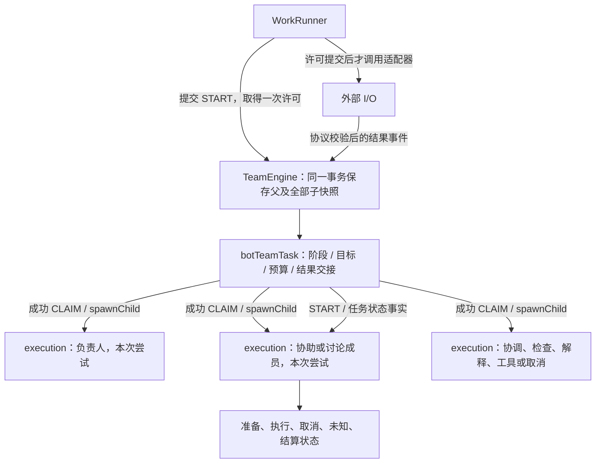
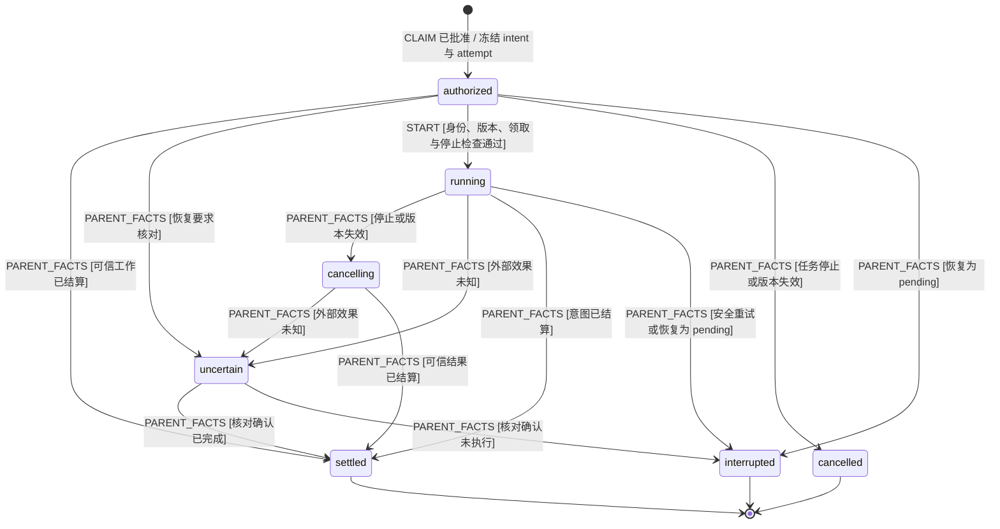

# 任务与执行 actor

> 本页保留当时实跑的命令和数量。2026-10-30 测试治理后的文件对照、当前入口与数量见[测试治理记录](test-governance.md)；历史结果不代表当前用例数量。

## 问题与方案

按独立执行生命周期将单个任务扩展为原生 XState actor 树：`botTeamTask` 管理任务阶段、目标、预算、协助/评审结果消费和持久化意图；每次成功领取的意图创建一个 `taskExecution` 子 actor。负责人、协助、协调、检查、解释、讨论汇总、工具和取消请求使用相同执行协议，actor 身份绑定 intentId 与 attempt。

任务内协助交接和预算仍属于一个状态所有者；将这些事务拆为异步领域 actor 需要额外提交协议，无法仅靠 sendParent 保证原子性。因此本次按实际可独立启动、取消、结算和恢复的执行实体拆分，而非按文件名建立 actor。既有八个任务阶段与业务上下文保留。

依据：[官方 actor 生命周期](https://stately.ai/docs/actors)、[深度持久化与恢复](https://stately.ai/docs/persistence)、[纯转换边界](https://stately.ai/docs/pure-transitions)。仓库维持 XState 5.33.3；原生 spawn/sendTo 的内部消息在确定性模型宿主中处理，不包含文件、网络、进程或适配器 I/O。

## Actor 所有权图

对应 BT_N06–BT_N15；**图型：真实原生 actor 树，父子引用与观察协议已验证。**



## 执行 actor 状态图

源码所有者为 `src/task/execution.machine.ts`，父模型为 `src/task.machine.ts`。对应 BT_N06–N12；**图型：真实子机器。**



执行器发出的结果、失败、结算和额外请求必须携带 attempt；父任务先校验本次工作尝试，再判断其他权限。旧 attempt 消息拒绝后不得释放新尝试的 work 或本地锁，也不得把新解析标记失败或把当前协调推进到等待人工。结果回执身份也包含 attempt；旧 schema 的可信历史事件没有该字段时仍按原版本协议处理。对应 BT_N14。执行器的取消通道和清理也按 intentId + attempt 隔离；旧尝试返回时不能覆盖或删除新尝试的通道，对应 BT_N15。

任务结束或恢复不兼容时也撤销未启动许可；取消请求保留用于清理在途工作的权限。START 只允许 authorized → running 一次，且须由可信执行入口发起。预算在 CLAIM 时由父 actor 扣除，START 不再收费。父任务 STOP 不等于在途外部工作已经结束；取消指令仍经持久意图领取并执行。本地未知写入和物理锁仍由既有核对协议保护。重试使用新的 attempt / 子 actor，不能复活旧终态。

## 事务、恢复与观察

- 每次模型转换创建隔离的原生 actor 系统，恢复父子快照、处理一个命令并同步排空内部消息；获取深度持久化快照后关闭本次宿主。没有 timer、promise 或外部 I/O actor。任务的业务 ended 可继续；单次执行的终态不可继续。
- 成功领取创建 authorized 子 actor，与预算和意图一起保存。启动许可再用一个事务将子 actor 推进 running；提交成功后 WorkRunner 才调用适配器。失败回滚整个快照树，不能把未保存许可当作可执行凭据。
- 结果及父任务事实通过内部消息推进子 actor。结果消费标记、一次负责人续办和公开答复仍在原任务事务内提交；不依赖子 actor 异步回信提交半份业务状态。
- 旧 schema 1 快照允许 children 为空；恢复时不授权重新启动旧 inflight 尝试。RECOVER 沿用安全/非幂等/本地未知效果规则，下一次 CLAIM 创建新 attempt。新快照使用 XState 原生 children 深度序列化，不保存函数或运行时引用。
- 诊断保留既有业务规则身份与八阶段微步，新增执行子 actor 的真实快照和父子关系。Inspector 仅注册观察元数据，不启动业务 actor。BT_N01–N05 的冻结业务内容继续比较；旧快照本来没有的子树作为此次显式新增结构独立验证，冻结基线不更新。

## 验收

先运行真实 actor 树的隔离模型测试，验证各工作类型、同时执行、停止、旧身份、一次许可、JSON 深度恢复、未知写入和旧快照；通过后再接入引擎、执行器与 Inspector。新增场景全部绑定默认 Gherkin；使用 Memory/SQLite 提交故障检查无外部调用，执行既有冻结轨迹和交接形式化检查，最后运行受控 HTTP 与真实网页验收。


## 验证记录（2026-10-30）

实际顺序为 BT_N06–BT_N15 场景 → 本文及 README/细化图 → 原生 XState 模型 → 模型断言通过 → TeamEngine/WorkRunner/Inspector 接线 → 集成验证。接线中发现旧结果缺少 attempt，先回到场景和模型补齐十类结果/请求及清理隔离，再继续接线。

### 模型门槛

固定 XState **5.33.3**。本轮最终受测版本的模型文件 SHA-256 与执行时间保存在 `reports/task-actors/model-gate.json`，原始输出为 `model-gate-final.log`。最终门槛通过后，确认这些模型文件在集成与形式化验证期间未再变化。

```sh
node node_modules/vitest/vitest.mjs run tests/task-actors.test.ts tests/task-model-refactor.test.ts tests/task-inspection.test.ts tests/local-operation-model.test.ts tests/discussion-simulation.test.ts --maxWorkers=1
```

**75 项通过**：34 项新 actor 断言；21 项冻结旧业务契约；4 项同次诊断；15 项本地操作模型；1 项讨论仿真（含 144 种返回顺序）。关键轨迹包括三项工作同时 running、一次 START、不兼容/结束后拒绝、STOP → cancelling → settled、未知本地效果保锁、安全恢复 → interrupted → 新 attempt、十类旧消息拒绝后保持当前阶段/预算/输入状态。

冻结基线 `tests/fixtures/task-model-v1.json` 未更新：八个旧阶段、十二条轨迹共 85 个事件和 97 个帧，原有业务上下文、阶段、规则身份、守卫顺序和自动微步保持。比较旧业务内容时明确排除原来为空、如今新增的 execution children；新增树先检查来源、身份、尝试及生命周期，再单独验收原生深度保存/恢复，不能据此声称旧/新完整持久化字节完全相同。

### 集成、形式化与网页

```sh
npm run check
npm run build
python3 .agents/skills/verify-squad-handoff/scripts/check.py
python3 .agents/skills/verify-squad-handoff/scripts/check.py --verify-evidence reports/verify-squad-handoff/20261030T024506Z-43583
SQUAD_PLAYWRIGHT_MODULE=/Users/haoyu/.cache/codex-runtimes/codex-primary-runtime/dependencies/node/node_modules/playwright/index.mjs node .agents/skills/verify-squad/scripts/verify.mjs --feature all
SQUAD_PLAYWRIGHT_MODULE=/Users/haoyu/.cache/codex-runtimes/codex-primary-runtime/dependencies/node/node_modules/playwright/index.mjs npm run test:debug-browser
```

- `npm run check`：服务端、网页和 BDD 类型检查通过；**558 项回归、591 个 Gherkin 用例 / 12642 个步骤通过**。BT_N06–N15 的 **39 个新用例全部直接执行**，默认进入 Gherkin，无新增排除。仓库总计 314 个定义 / 617 个展开用例，原有 18 个定义 / 26 个待验收用例继续保留；回归关联不等于直接执行。
- 实际引擎/执行器：Memory、SQLite 的许可事务故障都回滚整棵树，故障前无适配器调用；恢复后新 attempt 才执行。真实 WorkRunner 的每次模型调用都读取到已持久化 running actor，覆盖协助瞬态重试、一次结果交接、最终检查和旧任务恢复。
- BT_N15 以受控 Promise 保留旧调用：新尝试已运行后旧结果返回，旧额外请求被拒绝且预算不变；随后 STOP 确实中止新尝试的 AbortSignal，两次尝试分别结算，未发布旧输出。Memory/SQLite 分别通过。
- Inspector 协议检查：真实 root/child 模型身份、parentId 和当前状态正确；观察器未调用 Actor.start/send、不改变业务快照。该观察协议检查未替代官方托管站点的认证/画布验收。
- `npm run build`：通过。zod 两处纯注释标记的 Rollup 提示不影响产物。
- 形式化证据：`reports/verify-squad-handoff/20261030T024506Z-43583/`，status=verified。TLC **146 个状态 / 424 条迁移**，Memory/SQLite 共 **848 条边回放**；六类可达性见证、四类真实源码负对照和还原复跑通过，100 份证据独立核验通过，清理全 true。35 个源码/依赖文件的漂移已完成[对应审查](../.agents/skills/verify-squad-handoff/references/correspondence.md)。原有限抽象不覆盖新启动许可或无限并发，其结论范围未放宽。
- 五组真实网页 rooms/reports/control/assistance/layout：`reports/verify-squad/2026-10-30T02-45-50.574Z-44077/`，全部 completed、status=verified、清理全 true。入口覆盖重启恢复、归档、报告导出、停止继续、协助重试与多成员评审。
- 状态调试网页：`reports/state-debug/2026-10-30T02-46-14.549Z/`，status=verified、清理全 true；自依赖解释、历史分支、STOP 自动微步、八阶段主图及沙箱零业务写入通过。
- 本文两张图经 Mermaid 12.2.0 解析和渲染，原始图与 PNG/SVG 保存在 `reports/task-actors/rendered/`。

网页/HTTP 采用隔离模型服务，未声称真实供应商、Pi Durable、全部工具或全部遗留验收缺口通过；诊断观察没有执行真实业务 I/O。

### 本地服务

确认当前无 pending/inflight/uncertain 请求，先备份 SQLite，再将 4318 服务从 PID 29011 重启为 44556。三个群、十一个任务的消息、产物、目标、预算、输入解析、协助结果、意图、等待原因与任务身份/阶段均逐项哈希核对一致；恢复自身的 trace/时间戳按既有规则更新。首页 HTTP 200，调试继续开启。证据为 `reports/task-actors/service-restart.json`；备份为 `service-backup.sqlite`，均留在忽略的 reports 目录中。
