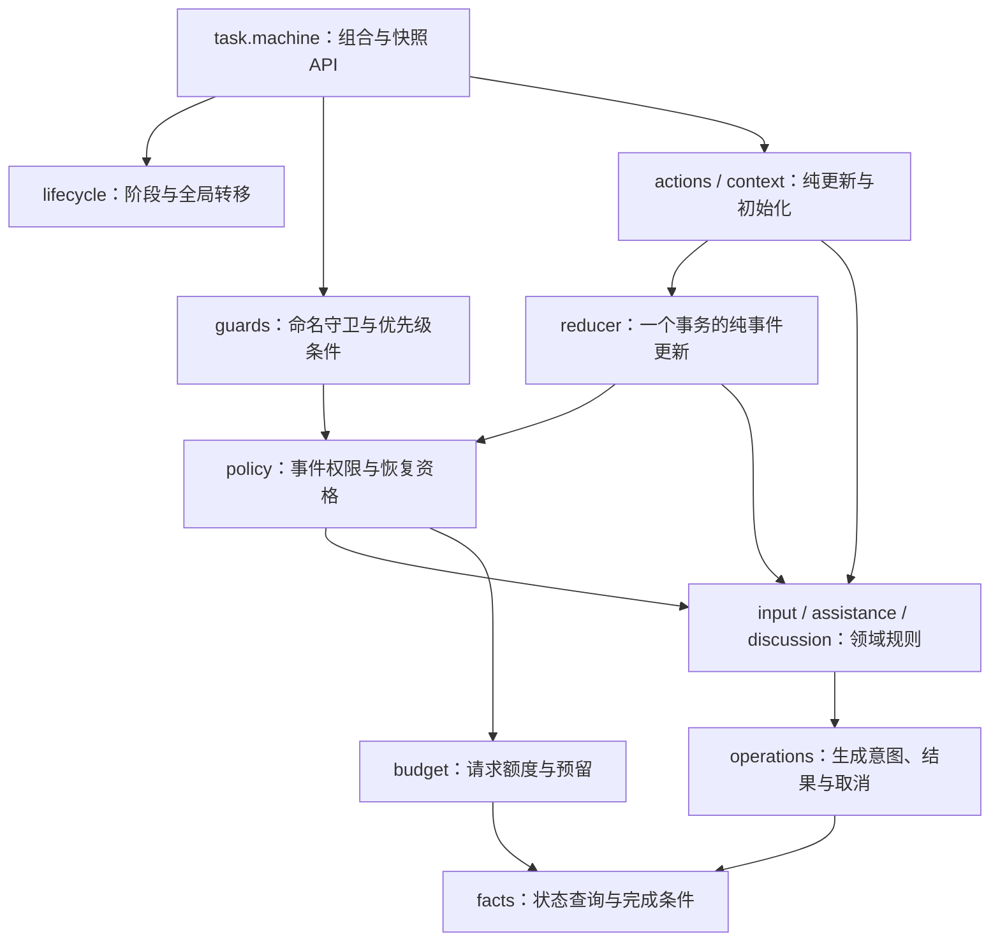

# 任务状态机职责重构

本页记录前一轮同步模块拆分及其当时验证结果；后续原生父子 actor 实现、尝试隔离与最新验收见[任务与执行 actor](task-actors.md)。

## 问题与取舍

当前 `task.machine.ts` 同时承载状态拓扑、守卫、纯更新、输入、协助评审、后台讨论、权限与预算。修改某个域时难以区分规则与调度边界。采用[八条原则](xstate-design.md)，将这些职责拆为有向依赖的纯模型模块，由一个 `taskMachine` 组合。

八个公开阶段、机器 ID、命名守卫/动作、分支顺序、快照 schema 和事务所有权保持一致。输入、协助、讨论与预算需要在一次纯转换内原子更新，因此本次选择同步模块组合；异步子 actor 会引入跨 actor 的交接与预算提交协议，超出本次行为保持重构的必要范围。

## 模型组合图

对应 BT_N01–BT_N05；**图型：模型模块依赖，不是运行中的 actor 系统或新增状态。**



所有模块仅在本次转换的上下文副本内工作，不访问文件、网络、时钟或进程；外部执行仍由已保存意图经 TeamEngine 事务领取后交给 WorkRunner。领域函数不是新的状态所有者。

## 可观察验收

- BT_N01：重构前真实保存的八种阶段快照可恢复，完整持久化内容不变；恢复本身不执行 I/O。
- BT_N02–N03：重放冻结的原模型事件轨迹，逐步核对完整快照摘要、状态、预算、回执和意图，覆盖六类正常流程及五类边界。
- BT_N04：转移规则指纹、规则 ID、守卫评价顺序和微步与冻结基线一致，诊断结果仍等价于纯转换。
- BT_N05：Memory/SQLite 中的旧结果经实际引擎和 WorkRunner 交接一次，重复恢复不生成额外发言或请求。

基线必须在修改实现前从真实当前模型捕获，记录模型 SHA、场景来源和可重复命令；不得在测试中自动刷新基线或用重构后的输出覆盖差异。模型层全部通过后，才验证引擎、存储、执行器、调试网页及形式化交接对应关系。

## 代码导航

| 职责 | 文件 |
| --- | --- |
| 公开 API、XState 组合 | `src/task.machine.ts`，由 1104 行缩为 26 行 |
| 阶段与有序转移、命名守卫、纯动作、初始化 | `src/task/lifecycle.ts`、`guards.ts`、`actions.ts`、`context.ts` |
| 一个转换内的校验与事件更新 | `src/task/policy.ts`、`reducer.ts` |
| 输入、协助和成员评审、后台讨论 | `src/task/input.ts`、`assistance.ts`、`discussion.ts` |
| 意图、消息、报告和取消；额度；公共状态查询 | `src/task/operations.ts`、`budget.ts`、`facts.ts` |

依赖无环；领域函数只接收本次更新拥有的上下文。actions/reducer 保留原复制边界，辅助函数不能保存快照或调用执行器。TeamEngine、WorkRunner 和外部适配器的产品代码无需因本次拆分而修改。

## 本轮验证记录（2026-10-30）

按 BT_N01–BT_N05 → 本文依赖图及 README/细化图入口 → 真实模型拆分 → 模型层通过 → 引擎/存储/执行器/网页集成的顺序完成。

基线：XState **5.33.3**，重构前 `src/task.machine.ts` SHA-256 为 `dd5ec71b41a82a13c831938e5401783214db76aa07d9e0ab80487b03b7dd42f9`。冻结契约为 `tests/fixtures/task-model-v1.json`；包含八个阶段快照、十二条轨迹的 **85 个事件 / 97 个初始及后继帧**，以及真实图结构和诊断。58 个领域声明的函数/变量实现逐项比较一致，仅新增跨模块 export；XState 边界新增显式类型，转移配置与初始化按原内容组合。

模型层可重复命令（实际执行通过后才新增存储恢复测试和 Gherkin 绑定）：

```sh
node node_modules/vitest/vitest.mjs run tests/task-model-refactor.test.ts --maxWorkers=1
```

21 项断言全部通过：BT_N01 八个阶段恢复，BT_N02/N03 正常与异常轨迹逐步比较完整持久化状态摘要、预算、回执和意图；BT_N04 图定义、规则身份、守卫顺序、自动微步及诊断快照一致。每次纯转换均断言无外部 effect，并逐步持久化/恢复；辅助模型与讨论回归共选跑 113 项通过，其中讨论仿真包含 144 种返回顺序。受测模块 SHA、两段命令及原始输出保留于 `reports/task-model-refactor/model-gate.json`、`model-gate.log`。

集成验证：

```sh
node node_modules/vitest/vitest.mjs run tests/task-model-recovery.test.ts --maxWorkers=1
TSX_TSCONFIG_PATH=tests/bdd/tsconfig.json node --import tsx node_modules/@cucumber/cucumber/bin/cucumber.js features/26_task_model_refactor.feature --import 'tests/bdd/*.ts' --format progress
npm run check
npm run build
python3 .agents/skills/verify-squad-handoff/scripts/check.py
python3 .agents/skills/verify-squad-handoff/scripts/check.py --verify-evidence reports/verify-squad-handoff/20261030T020529Z-36372
SQUAD_PLAYWRIGHT_MODULE=/Users/haoyu/.cache/codex-runtimes/codex-primary-runtime/dependencies/node/node_modules/playwright/index.mjs node .agents/skills/verify-squad/scripts/verify.mjs --feature all
SQUAD_PLAYWRIGHT_MODULE=/Users/haoyu/.cache/codex-runtimes/codex-primary-runtime/dependencies/node/node_modules/playwright/index.mjs npm run test:debug-browser
```

- BT_N05：真实 Memory/SQLite 读取冻结旧结果，重建引擎，经真实 WorkRunner 先交接，再领取 owner/check；重复恢复不重复发言或续办，适配器检查已提交领取和额度，共 2 项通过。
- BT_N01–N05：新增 **22 个 Gherkin 用例全部直接执行通过**，默认纳入执行，无新增排除或缺口登记。
- `npm run check`：服务端、网页、BDD 类型检查通过；**517 项回归测试、552 个 Gherkin 用例通过**。仓库总计 304 个定义 / 578 个展开用例，原有 18 个定义 / 26 个用例仍明确待验收；回归关联不冒充直接 Gherkin 执行。
- `npm run build`：通过。依赖 zod 的两处纯注释标记有 Rollup 提示，不影响构建结果。
- 形式化：先审查旧同步版本的代码漂移，再迁移三个负对照入口、扩展至 34 个覆盖文件；原安全性质与活性边界不变。TLC 完整探索 **146 个状态、424 条迁移**；Memory/SQLite 共 **848 条迁移回放**，六类可达性见证、四类真实代码负对照及恢复后复跑均通过，100 份证据独立校验通过。详见[对应审查](../.agents/skills/verify-squad-handoff/references/correspondence.md)。证据：`reports/verify-squad-handoff/20261030T020529Z-36372/`。
- 五组隔离网页流程 rooms/reports/control/assistance/layout 通过，包含旧任务重启、归档、报告复制下载、停止继续、协助重试与四成员评审。证据：`reports/verify-squad/2026-10-30T02-06-43.752Z-37086/`，`status=verified`，清理全部通过。
- 隔离调试网页通过：自依赖拒绝解释、历史分支、STOP 自动微步、固定八阶段图及沙箱无业务写入。证据：`reports/state-debug/2026-10-30T02-07-17.625Z/`，`status=verified`，清理全部通过。本次未重测官方托管 Inspector 的认证与画布服务。
- 本文模块图使用 Mermaid 12.2.0 实际解析和渲染，输出于 `reports/task-model-refactor/rendered/`。

形式化结论仍限定于单任务、已保存的一个协助结果、有限故障与未领取的续办意图；网页使用受控模型 HTTP，未声称真实供应商、真实工具或全部验收缺口通过。用户实例及数据库未参与本次隔离验证。
