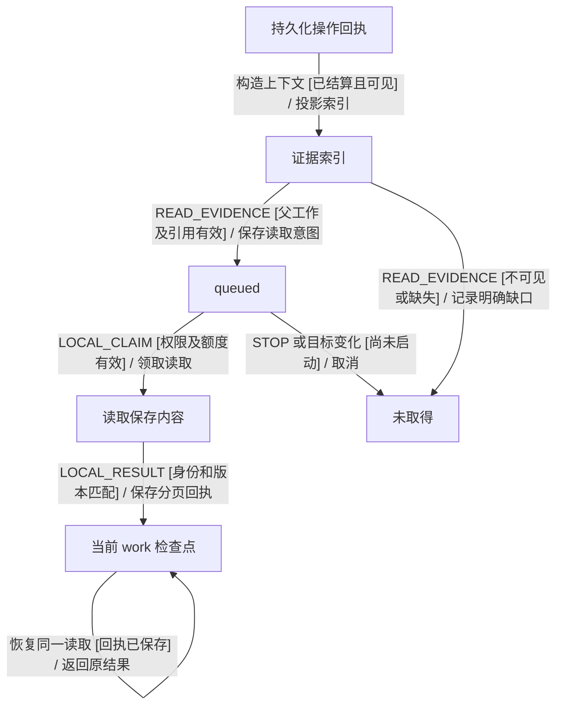
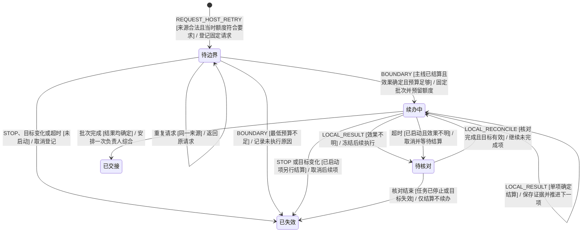
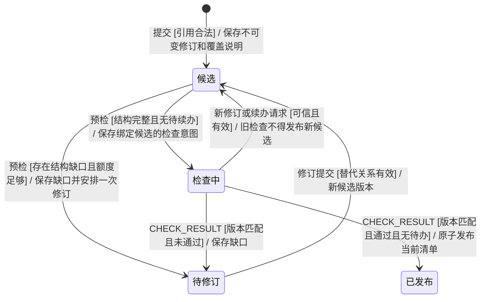

# Squad 工具调用与交付流程优化方案

**状态**　方案草案，覆盖已确认的 O1–O5。场景绑定、实现及模型验证均待开展。本次交付范围为这一份设计文档。

**编写日期**　2026-11-05（Asia/Shanghai）

**源码核对基线**　[`53ace12eb7f892f9d398c8f2672110c5213331b4`](https://github.com/kejun/squad/commit/53ace12eb7f892f9d398c8f2672110c5213331b4)。原运行没有记录构建指纹，源码基线仅用于说明接入点。

## 1. 问题、目标与范围

本方案解决三个用户可观察的问题：同一资料被反复获取，恢复操作打断有效工作，以及交付检查因缺凭证、引用旧版本和遗漏要求反复返工。目标是在保留独立检查、真实授权、版本隔离和可恢复性的前提下，缩短从恢复执行到完成交付的时间。

| 编号 | 能力 | 交付结果 |
| --- | --- | --- |
| O1 | 任务级证据复用与结构化执行凭证 | 后续执行、检查和修订能够查读已有回执，明确其来源、采集时间、范围及完整性 |
| O2 | 宿主重试在安全边界续办 | 连续请求多个失败记录时保留当前有效工作。固定命令分别批准、串行执行，结果统一交接 |
| O3 | 当前交付版本与历史引用分离 | 用户能明确辨认当前交付，历史仍可追溯，旧阻塞说明与成功交付分开 |
| O4 | 完整验收前置与缺口闭环 | 首次候选覆盖全部要求。检查意见定位到验收项、版本和证据，修订只处理真实缺口 |
| O5 | 会话授权复验与耗时观测 | 复用既有授权能力，准确区分等待、执行、模型请求与返工，实测优化收益 |

复用范围限于任务内已采集且可查验的证据。首次采集仍执行实际命令，显式刷新产生新操作。第三方远端资料的最新性须有独立依据。交付继续经过独立检查和既有宿主授权，历史产物以不可变修订保留，续办由现有任务状态机管理。通用 CLI 结果缓存、跨任务自动共享证据、任意命令自动判定只读、跳过独立检查、自动扩大宿主授权、按文件名覆盖历史产物和新的通用任务队列服务均在本期范围之外。

### 1.1 草案记录的样本基线

原始导出路径为 `reports/tool-call-audit-20261105/data.json`，原审计报告路径为 `reports/tool-call-audit-20261105/README.md`。本表保留草案中对原报告的校正口径。指定源码基线及提交本草案时的 `main` 均未收录这两份文件，因此以下计数、时间和哈希比对结论沿用草案记录。

| 指标 | 结果与限制 |
| --- | --- |
| 基线区间 | 2026-11-05 北京时间 11:00:43 至 11:29:33，约 28 分 50 秒，隔夜停顿在区间之外 |
| 工具操作 | 55 次本地操作，另有 1 次网页抓取。CLI 为 45 次宿主成功、8 次沙箱失败 |
| 正文读取 | 33 次宿主成功取得 8 篇正文。逐篇 stdout 哈希相同且均未截断，25 次重读没有正文增量 |
| 原因区分 | 多次手动重试触发新 epoch，E8 内还有一次因缺凭证而整批重读 |
| 命令创建到启动 | 累计约 635 秒，含等待前轮结束、排队、准备及审批。部分区间与模型生成重叠，人工等待须单独计量 |
| 宿主执行 | 合计约 48 秒，占本样本总耗时的一小部分 |
| 恢复阶段检查 | 4 轮共约 400 秒，其中 3 轮未通过。检查发现了事实与口径错误 |
| 请求记录 | 74 个 `requestCount` 含 1 次网页请求。其余 73 个为模型执行入口或后续授权记录，实际 HTTP 发起数须单独测量 |
| 产物 | 6 份，共 80,951 字符。当前任务历史产物进入后续上下文，实际 token 费用未知 |

按单样本估计，核心优化后约 17–20 分钟，完整优化争取 12–16 分钟。实际收益待配对试验测量，质量和权限边界先于耗时目标。

## 2. 总体设计与取舍

继续由 `taskMachine` 拥有任务阶段、预算、待续办集合、候选版本和交付判断。`TeamEngine` 执行可信命令校验与事务提交，`WorkRunner` 只领取已保存的操作意图，适配器完成 I/O 后回传事件。网页只投影已持久化状态，业务排队和结果复用决策由状态机处理。

| 决策 | 采用方案 | 取舍依据 |
| --- | --- | --- |
| 复用对象 | 已保存且可验证的证据与回执 | 相同 argv 可能来自不同业务操作，现有 `requestHash` 的覆盖范围限于请求 |
| 证据保存 | 原 `localOperations/result` 保持事实来源，索引只保存或派生元数据与引用 | 避免多份正文状态不一致，按需读取正文可以缩小每轮模型上下文 |
| 恢复调度 | 任务内持久待续办集合，由根模型在安全边界推进 | 在现有任务内保持预算、结果交接与结束判断的原子性 |
| 版本处理 | 不可变产物加文档身份、替代关系和发布指针 | 同名可能是不同文档，独立保留各修订可维持历史引用 |
| 检查分工 | 宿主核对结构与来源，模型独立核对内容 | 结构只能验证字段及引用，执行事实需查读回执，内容正确性需独立评估 |
| 授权 | 复用 BT_L35–BT_L37 的任务会话授权 | 在重试调度修正后验证已有能力的实际使用效果 |

证据复用遵循“历史观测可引用，当前有效性须另有依据”。[AWS 幂等请求设计](https://aws.amazon.com/builders-library/making-retries-safe-with-idempotent-APIs/)用于区分同一操作重试与新意图，[RFC 9111](https://www.rfc-editor.org/rfc/rfc9111.html)提供新鲜度与验证的参考。CLI 证据仍使用任务内回执存储。

## 3. O1 任务级证据与结构化凭证

### 3.1 证据索引与可信字段

从已结算操作构造轻量索引，默认只列当前任务、当前 `goalVersion`、调用角色获准访问的记录。成功、确定失败和不完整记录分开标识。失败回执可说明阻塞，取得正文须有相应的成功或部分内容记录。旧 epoch 中已经确认的结果可作为历史观测，新 epoch 的执行须有独立授权。

| 字段组 | 内容与语义 |
| --- | --- |
| 身份 | `evidenceId`、`taskId`、`goalVersion`、`sourceWorkId`、`sourceOperationId`、原执行 epoch、来源角色 |
| 运行事实 | 执行环境、固定命令的安全投影、工作区身份与已知修订、结果状态、`exitCode`、`startedAt`、`finishedAt`、`logId` / `sessionId` |
| 内容 | 保存正文的引用、`capturedContentHash`、stdout / stderr 分别的字节数与字符数、完整性、续读游标 |
| 来源与时间 | `obtainedAt`、资源标识、来源报告的版本或更新时间。未知值明确为空 |
| 使用范围 | 当前任务可见性、历史观测标记、是否满足特定验收项要求的新鲜度或工程版本 |

宿主生成的操作身份、时间、退出状态属于执行事实。文档正文、CLI 自报标题和更新时间等均按未受信资料处理。调度、目标修改和宿主执行批准只接受相应的可信入口。

`stdoutBytes` 为脱敏后保存文本的 UTF-8 字节数，`stdoutChars` 为同一文本的 Unicode 码点数。字段名和界面说明保持一致。`capturedContentHash` 只覆盖实际保存的脱敏文本，流被截断时只能证明保存部分的内容身份。`logBytes` 保留“日志文件字节数”的原语义。只有使用明确版本的解析器移除 YMD 等头部后，才另列正文字符数，否则只报告 stdout 长度。

### 3.2 读取路径与额度

新增拟议的 `readEvidence` 动作，引用 `sourceOperationId` 和有界的 stream/cursor，由宿主解析引用。接口只接受受控引用，游标绑定原内容版本与哈希。元数据摘要随上下文投影提供，正文按需读取。后续 work 的模型输入必须包含证据索引及当前候选。

读取沿用 `LOCAL_REQUEST → LOCAL_CLAIM → LOCAL_RESULT`。先持久化读取意图，校验父工作、fence、权限及证据可见集合，领取后读取已保存的内容，再把结果保存到当前检查点。首期读取范围限于已有保存内容，经本地存储完成，无需宿主执行批准。

每个新的正文分页读取沿用本地读取规则，消耗 1 次 ordinary。恢复同一读取操作只返回其回执。后续模型请求仍消耗所在角色的请求额度。索引的纯投影免于 CLI 额度扣除。读取遵守评审和讨论的汇总预留，额度不足时保持“未读取”。

owner、facilitator、check 可见当前任务的获准证据。assistance 只取得宿主随分工传入的证据引用。查读时根据可信授权重新检查权限。截断页提供明确续读或已到保存边界的结果。不存在、不可访问或已清理的内容返回具体缺口，新的外部获取需要独立操作意图。

### 3.3 复用与刷新规则

| 情况 | 行为 |
| --- | --- |
| 修订文字、补执行凭证、核对既有来源 | 优先读取保存证据，注明原采集时间 |
| 当前要求明确指定最新资料或用户要求刷新 | 产生新的外部操作意图，重新走额度、权限、审批和结果验证 |
| 工程检查要求当前修订通过 | 针对当前工程修订验证，沿用 `verifyWorkspace` 等已有约束 |
| 资源版本不明 | 可以引用“采集当时”的观测，是否刷新由目标要求决定 |
| 身份、权限、工作区或目标版本变化 | 在新的边界内重新判断可见性与适用性 |
| uncertain、迟到且未核对的结果 | 先走原操作核对与结算，再判断能否作为可用证据 |
| 相同参数的另一条显式命令 | 保留新的操作身份 |

是否刷新由验收要求决定，无全局固定 TTL。模型自报“只读”属于未受信资料，自动缓存超出本期范围。需要短期任务快照时，由验收项明确接受哪个采集版本。明确刷新后保留新旧证据，当前候选必须指出实际使用的版本。

## 4. O2 宿主重试安全续办

### 4.1 接受请求与结束门槛

新增任务拥有的待续办集合。记录请求身份、源 work/operation/hash、`goalVersion`、受信用户来源、顺序、截止时间、状态及关联操作。来源命令保持不可变。同一来源重复提交返回已有请求，多个不同来源保留独立身份。

允许在普通安全模型工作进行时保存请求，状态显示“已排队，等待当前轮次完成”。接受请求时保留该工作、当前 epoch、candidate 和仍有效的会话授权。原有停止、旧目标、源操作效果不明、原命令成功、宿主命令、伪造参数、权限关闭、其他任务活动和写入清单截断等拒绝条件继续生效。当前存在未结算物理操作或待审批操作时，首期继续返回明确的等待边界原因，用户处理原操作后再请求。

安全边界要求当前主线 work 的结果已经保存并结算，且没有未决物理操作、未完成输入解释、待应用目标变更或需要原子交接的讨论或评审。具体边界由 `taskMachine` 守卫判断。候选先保存，待续办集合处理完毕、证据交接并重新检查后才可进入 `complete` 或发布最终交付。停止、失败或额度耗尽仍可按既有终态结束，但必须结算待办并列明未执行项。

`DELIVER`、`CHECK_RESULT` 和 `COORDINATE` 的完成路径都要检查待续办集合。存在可处理请求时直接进入边界续办，无法处理时给出明确等待或未完成原因。待续办集合须有独立的完成路径守卫，避免 `completeProblem` 将其作为文稿缺陷反复发给 facilitator。启动批次使旧候选暂不具备发布资格，内容仍保留。消费新结果后形成的新候选须重新检查。

在安全边界原子取出当时已接受的请求，形成一个固定顺序的续办批次。只安排一个 owner 续办及首条操作意图。每条命令仍独立准备、批准、领取、执行、结算，沿用用户请求中的固定命令。每次回执经状态机保存后，由状态机生成下一条意图，`WorkRunner` 负责领取已保存的意图。批次就绪后只安排一次 owner 综合。批次执行中新增的请求留待下一安全边界，不能改变已准备或批准的参数。

普通协助结果仍按原交接协议完成，宿主重试保留已有协助。讨论或评审未结束时保留其交接顺序。已正常结束的任务仍允许可信用户显式续办同一目标。仅首次重新激活时执行所需的 epoch 隔离、清除失效授权，并创建续办请求，后续点击并入活动任务。已停止任务继续拒绝此入口，须显式继续才能恢复。

### 4.2 预算、失败与恢复

入队只持久登记请求，不消费或预留额度，也不承诺它必定执行。当前回合继续使用原有预算。入队时仍拒绝当时已经不满足最低执行额度的请求。到达安全边界后，原子重核整个固定批次的预算，至少包含每条 CLI 的 ordinary 执行额度、一次 owner 综合和一次 checks 检查，并保留既有讨论或评审承诺。满足后才预留并生成首条操作。额度不足时，记录各项未执行原因并沿既有 partial 或 failed 路径收尾，避免重复调用模型，并按现有预算接口处理。

预留额度来自现有额度池，单独记录为待消费承诺。实际领取和后续模型请求仍按现有时点计费。取消、失效或确认不再执行时释放预留。批次启动后若需要超出最低承诺的额外请求而额度耗尽，仍保留全部已完成回执并列明未完成项，沿用已结算的预算。模型验证须覆盖“剩余额度仅够批次最低要求，但当前 work 还需继续请求”的轨迹，证明登记请求不会侵占当前工作。

请求截止时间在接受时按现有 `workTimeoutMs` 固定，排队和重启沿用原期限。操作启动和运行期限取请求截止时间与父 work 截止时间中较早者。准备、领取和实际启动前均检查期限。等待审批不消费 CLI 执行额度，也不占工作区租约。已入队但失效的请求保留原因，新的入队须来自明确请求。

| 事件 | 必须保持的行为 |
| --- | --- |
| 单条批准、会话批准 | 只接受可信用户的授权。逐条校验完整计划和 digest |
| 确定失败或拒绝 | 保存该项结果，其余明确请求逐项重核后处理，保留每项实际结论 |
| 任一项效果不明 | 冻结后续外部执行，保持原租约和核对语义。完成核对后再判断能否继续批次或重放写入 |
| 停止或目标变化 | 未启动请求取消或失效，已启动请求按原协议取消和结算。新目标候选只接受匹配目标版本的结果 |
| 服务重启 | 恢复请求顺序及已完成项，重新核对领取或运行项。未消费批准和会话授权失效，已结算项保留原结果 |
| 用户撤销会话授权 | 尚未启动操作恢复按次审批，已领取但未启动时再次检查授权 |
| 超时 | 未启动项到期标记 `expired`、记录未执行原因并释放预留。已启动项走取消和结算，效果不明时继续阻止后续执行及正常完成，并保留其启动事实 |
| 新请求到达检查完成附近 | 由同一事务序列确定先后。先接受的请求使完成守卫失败，已经结束后的请求走显式重新激活 |

网页沿用失败记录入口，显示排队、待批准、执行中、已取得结果和无法续办原因。进入已排队状态后可查看对应请求及结果。重复点击只返回原请求，界面仅增加必要状态和操作。完整键盘操作、刷新恢复、窄屏下批准、拒绝和撤销操作可见均纳入验收。

## 5. O3 文档版本与当前交付

为产物增加稳定文档身份与修订关系。新文档由宿主分配 `documentId`。修订通过已有 `artifactId` 表明替代目标，宿主验证任务、`goalVersion`、作者权限与文档归属后分配新 revision。替代目标必须与事务中的当前候选修订原子比较。陈旧基线、循环替代和一次提交更新同一文档两次均拒绝，冲突时保留已有候选。重命名保留文档身份。宿主只接受已存在且属于当前任务的修订目标，通过文档身份识别替代关系。

区分不可变 artifact 历史、每份文档的最新候选修订和已经通过检查的发布修订。发布指针在最终检查通过后才原子更新到候选所引用的版本集合。

候选使用明确的交付清单，背景参考单列，`artifactIds` 只包含实际交付产物。同一文档在一个清单中只能出现一个修订。已被替代的版本若再次作为当前交付提交，宿主返回可定位缺口。不同文档可以同名，也允许一个任务交付多份互不替代的文档。

候选清单带修订标识或摘要，检查绑定这一候选版本。检查期间出现新修订或待续办请求时，旧检查结果不能发布新候选。界面默认呈现当前发布版，历史可展开查看，并保留原始 ID、内容、来源和替代关系。

owner 与 check 默认获得当前候选全文、验收项、证据索引及必要背景摘要。历史版本通过受控读取按需取得。适用的正文读取沿用 O1 的权限、持久化和额度规则。实现时可复用读取框架，文档引用与操作回执保留独立类型。

## 6. O4 验收前置与修订闭环

从当前有效目标及已验证的 `inputIntents` 构造验收清单，为每项保存稳定 ID、原始要求来源、`goalVersion` 和要求文本。构造清单直接沿用已有解释结果，并保留所有直接用户约束。原输入始终可供 owner 和 check 核对。

owner 提交候选时，附各项的覆盖情况和证据或产物引用。宿主预检引用是否存在、版本是否匹配、执行凭证是否真实可用及必填覆盖是否缺失。待续办请求按 O2 的边界路径处理。结构预检不通过时，由 `taskMachine` 保存具体缺口、结算本次 work，并在预算允许时只生成一个 owner 修订意图。预检通过的候选才进入完整模型检查。额度不足时按既有 partial 或 failed 路径保留未完成项。同一提交事件重复到达时沿用原调度结果。没有实质候选变化的新提交仍受期限、请求额度和重复检测约束。

通过预检后，check 独立评估全部要求及实际内容，明确每项通过、缺口或无法核验的原因。每次检查必须完整覆盖当前有效清单。必需项存在缺口、未知或遗漏时，即使总体 `passed` 为 `true` 也不得发布。每项通过结论都须来自对当前候选的独立检查。检查器须对照来源核验“计划是否写成完成”“月份推断是否当事实”等内容正确性。可计算的结构化汇总可用确定性断言，Markdown 中的事实仍由独立检查核对。

每条缺口关联 `criterionId`、`candidateRevision`、相关 artifact 或 evidence 引用，并标明类型。类型包括缺少已有证据、尚未取得资料、需要刷新、版本冲突、内容错误或要求缺失，用于指导修订。工具调用沿用既有授权。缺凭证优先读取回执，只有未采集或确需更新才计划新的外部操作。

修订记录各缺口的处理状态和新证据，下一次检查确认已修复并复查相关要求。被改动内容须回归检查，仍未满足项继续保留。原有合法 `passed: false` 继续进入质量修订路径。

## 7. O5 会话授权与可观测性

### 7.1 复验现有会话授权

当前代码已支持 BT_L35–BT_L37。保留明确的“允许本次”“允许本次会话”“拒绝”及撤销。会话只覆盖同任务、epoch、`goalVersion`、工作区、命名空间、宿主账号和环境。网页刷新可保留。任务结束、停止、目标或 epoch 变化、服务恢复、权限关闭或撤销仍使授权失效。

O2 在活动任务接受请求时保留原 epoch，减少无意义的授权失效，并沿用原有权限生命周期。执行环境变更仍重新准备、校验和审批，工具仍默认在沙箱执行。复验按次批准、跨 Bot 的匹配会话批准、排队中撤销及重启后重新批准四条实际接线。

### 7.2 事件与指标口径

沿用持久执行日志，补结构化关联字段和阶段事件。可参考 [OpenTelemetry GenAI 属性约定](https://opentelemetry.io/docs/specs/semconv/registry/attributes/gen-ai/)，本期仅使用既有日志作为记录载体，exporter 可留到以后单独评估。业务状态协议由 Squad 定义。

| 观测对象 | 必需记录 | 分开统计的概念 |
| --- | --- | --- |
| 运行身份 | build/commit、dirty 标记、执行与协议版本、配置摘要、模型和供应商标识、数据集版本 | 当前仓库版本与运行中加载的版本 |
| 业务关联 | `taskId`、`goalVersion`、epoch、workId/attempt、`operationId`、retryRequest/batchId、`candidateRevision`、`criterionId` | 一条请求、执行尝试、回执读取、候选修订 |
| 模型 | 预算授权、客户端传输发起、响应或中断或错误、协议校验、状态机采纳或拒绝、供应商 `requestId` 与实际返回的 usage | 预算数、HTTP 发起数、响应数、协议合法数、被采纳数 |
| CLI | 请求保存、准备开始和结束、审批要求、用户决定、领取、进程启动、结束、结果提交 | 排队、准备、人工响应、领取等待、真实执行 |
| 证据 | 索引命中、保存内容读取、分页、缺失、刷新原因、新外部执行 | 旧回执读取与新进程。相同内容及重复原因分别记录 |
| 交付 | 预检拒绝、模型检查开始和结束、缺口分类、修订提交、最终发布 | 内容返工与执行故障 |

墙钟用于跨事件关联，并显示时区。进程内单次持续时间优先用单调时钟，单调时钟的比较限于同一次进程运行。客户端传输开始只表示客户端调用 transport。缺失的 usage、结束事件或批准时刻标记未知。

按 task/work/operation 的因果关系计算关键路径，并发区间取并集或明确归属。创建到启动单列为综合等待。记录取消后晚到结果是否被接收为结算或拒绝为当前成果，并区分 fence 拒绝与供应商故障。

遥测默认只记录标识、耗时、计数、摘要与安全错误码。完整 prompt、正文、凭据和原始供应商错误限于既有受控业务路径。内容哈希按可关联信息处理。业务必须保留的回执沿用现有受控存储。遥测使用调用链明确传递的 operation/request ID。遥测失败时，业务审批和结果提交仍以事务日志为事实来源，沿用已保存的执行状态和成功结论。外部操作及其重试仅按业务状态、结算规则和领取协议推进。

## 8. 拟议状态模型与边界

以下为拟议设计图，任务顶层仍沿用 `running`、`coordinating`、`checking`、`waiting` 等既有生命周期。证据读取与历史查看沿用既有顶层状态。实施时先更新 `README.md` 的「状态模型」入口与 `docs/state-diagrams.md` 对应细图，再修改 XState。

### 8.1 证据读取

这张图描述拟议处理流程。业务由 `taskMachine` 中的 `localOperations` 管理，I/O 由 `WorkRunner` 执行。验收范围包括 O1 的查读、拒绝、完整性、预算和恢复。



### 8.2 待续办集合

这张图描述拟议的上下文生命周期，沿用既有顶层 XState 和 actor。所有者为 `taskMachine`，可信入口为 `TeamEngine`。验收范围包括 O2、O5 的接受、边界、审批、执行、停止与恢复。图中事件名称为拟议契约，实施时在场景确定后定稿。



逐条操作继续使用现有 `queued`、`claimed`、`awaitingApproval`、`running`、`succeeded`、`failed`、`uncertain` 生命周期。批准和启动状态以单条操作为准。正常完成与失败结束均记录每项结果，整体目标另行验收。

### 8.3 候选与发布

这张图描述拟议的上下文生命周期，由 `taskMachine` 的 `candidate`、`artifacts` 和验收清单管理。验收范围包括 O3–O4 的版本唯一性、预检、独立检查与迟到结果。



三图均遵循以下规则。停止优先。按目标版本隔离。每次新 I/O 均从保存并领取的意图发起。重复事件不能重复扣额、执行或发布。重启恢复先核对实际执行效果。额度耗尽时如实保留已完成和未完成范围。遥测仅观察流程。

## 9. 行为验收草案

下表是方案中的验收追踪 ID，处于场景尚未绑定和执行的草案阶段。正式 BT 编号在实施时核对占用情况，沿用受影响的既有编号，为新增要求分配唯一编号并默认纳入 Gherkin。场景以用户可观察结果为验收口径。[Cucumber 行为表达依据](https://cucumber.io/docs/bdd/better-gherkin/)

| 草案 ID | 前提与事件 | 可观察结果 |
| --- | --- | --- |
| E01 | 同一目标已有完整资料，负责人进入修订或检查 | 可读取原证据，补凭证不触发新的外部获取 |
| E02 | 用户明确要求更新已有资料 | 新操作实际获取，旧证据保留，新旧版本分别标识 |
| E03 | 证据截断、缺失或只有失败回执 | 明确已知范围，仅报告实际取得的正文，无新操作意图时保留缺口 |
| E04 | 请求其他任务、旧目标或未授权证据 | 拒绝读取并保护正文，工具结果不能扩大权限 |
| E05 | 读取中停止、额度耗尽或重启 | 未执行部分不继续，已保存读取回执恢复不重复扣费 |
| E06 | 旧 epoch 有已结算证据，当前目标未变 | 可作为带采集时间的历史观测，当前工程和最新资料须另行验证 |
| R01 | 模型正在有效工作，用户请求续办确定失败命令 | 请求可追踪，当前工作继续并保留结果 |
| R02 | 重复点击同一记录，并请求多个不同记录 | 同源只保留一项，不同来源分别展示、固定参数、串行处理 |
| R03 | 当前候选检查完成时还有已接受请求 | 先处理请求，再综合与检查，满足条件后发布最终结果 |
| R04 | 批次中某项被拒绝或确定失败 | 如实显示结果，其他项逐项重核后处理，维持原批准范围 |
| R05 | 批次执行效果不明、停止、目标改变或超时 | 暂停启动后续项，区分已启动到期与未执行，正常完成须先核对未知效果 |
| R06 | 批次部分完成后服务重启 | 保留已完成项结果，未消费授权失效，剩余项按原顺序恢复 |
| R07 | 已完成任务显式续办、已停止任务尝试续办 | 前者受控重新激活，后者须由用户明确继续 |
| R08 | 已有协助、评审或讨论尚需交接 | 保留已有成果，等到安全边界后续办 |
| R09 | 余额仅够批次最低要求但当前 work 还需请求 | 登记不占用当前工作预算，边界重核后才能承诺执行，不足时明确记录未执行并结束相关续办 |
| V01 | 同文档修订后提交交付 | 当前清单只含该文档选定修订，历史仍可访问 |
| V02 | 不同文档同名或一次交付多份文档 | 以文档身份区分同名文件，保留所有合法交付项 |
| V03 | 两次修订基于同一旧版或候选更新后旧检查迟到 | 陈旧基线提交发生冲突，旧检查不能发布新版本或移动发布指针 |
| V04 | 旧数据缺少版本关系 | 旧记录各自保留，后续显式修订建立关系 |
| C01 | 候选缺少必需覆盖、凭证或合法引用 | 返回具体缺口且只安排一次受预算约束的修订，重复事件不重复调度 |
| C02 | 覆盖表齐全但内容错误，或总体通过但必需项仍未知 | 独立检查拦截内容错误，发布守卫要求必需项均已通过 |
| C03 | 修订处理上一轮缺口时遗漏其他要求 | 保留全部有效要求，回归检查发现遗漏，仍未满足的缺口保持可见 |
| A01 | 用户选择按次或本次会话，后续命令范围匹配 | 按对应范围批准，会话内仍逐条领取、校验和结算 |
| A02 | 会话撤销、停止、结束、重启或环境变化 | 后续命令须持有效授权，领取后启动前仍重核 |
| A03 | 关闭提示、刷新、窄屏或键盘操作 | 保留已作决定，由用户明确批准，批准、拒绝和撤销均可操作 |
| T01 | 模型调用被取消、格式不合规或 fence 拒绝 | 分别统计预算授权、传输、协议和采纳结果 |
| T02 | 执行中读取保存回执及发生并发等待 | 读取回执和新进程分别计数，关键路径按实际重叠计算 |
| T03 | 遥测写入失败或供应商不提供 usage | 业务不重放，未知指标明确标识 |

既有场景涉及以下契约。BT_L24、BT_L26–L29 保留批准和恢复边界。BT_L32–L34 更新活动工作续办与不同来源请求的行为。BT_L35–L37 复验会话授权。BT_L17 保留工程验证。BT_M16、BT_M19 保留回执和合法负面检查。交付、预算及多 actor 的相关 BT 场景按实际影响扩展。当前测试仍验证「点击即取消 safe inflight work」。实施时先改场景和图，再改模型断言。

### 9.1 中文场景表达示例

```gherkin
# language: zh-CN
功能: 已取得证据的修订与续办

  场景: 修订交付说明时使用已有完整证据
    假如 当前目标需要的八篇资料已完整取得且执行回执已保存
    而且 检查要求补充读取凭证而没有要求更新资料
    当 负责人修订交付说明
    那么 补充的凭证应能追溯到原执行记录
    而且 不应再次获取这八篇资料

  场景: 多个宿主续办请求保留当前工作结果
    假如 负责人正在整理已有资料且保留两条确定失败的沙箱记录
    当 用户分别请求在宿主续办这两条记录
    那么 当前整理工作应继续且结果应被保留
    而且 两项请求应分别经过有效授权后执行并交回结果
    而且 请求尚未处理完时不得宣称任务已完成

  场景: 新修订不能沿用旧候选的检查结论
    假如 检查员正在检查一个候选版本
    当 负责人提交该文档的新修订后旧检查结果到达
    那么 旧检查结果不得将新修订发布为最终交付
```

以上为设计示例。实现时拆分适当场景并提供完整可执行绑定，覆盖拒绝、停止、额度、隔离和恢复。

## 10. 实施顺序与模块接缝

每个阶段按此顺序通过门槛。先写 Gherkin，更新 `README.md` 状态入口及细图，然后实现 XState 事件、守卫和纯状态更新。模型仿真通过后接入 I/O 和网页，最后执行集成与 Gherkin 验收。

| 阶段 | 范围 | 关键接缝 | 完成门槛 |
| --- | --- | --- | --- |
| P0 | 固定基线与测量口径 | `model-adapter`、`runner`、`web/service` 的观测边界 | 能区分运行身份与各类计数，受控耗时账目不重叠。纯观察部分记录无需新增业务状态的依据 |
| P1 | O1 证据索引、凭证和受控读取 | `local-operation`、`local-runtime`、`runner`、`model-adapter`、`task/operations` | E01–E06 对应的实际 XState 路径通过，验证跨 work 接线，仅复用已核对结果 |
| P2 | O2 续办集合、边界和预算预留 | `host-retry`、`task.machine`、`task/budget`、`task/facts`、`engine`、执行 actor、`HostRetryButton` | R01–R09 通过，多点击与停止、恢复竞态可重复，已完成操作不重放 |
| P3 | O3 当前版本、发布清单和上下文投影 | `types`、`task/operations`、`task/reducer`、`task/facts`、`conversation`、模型协议及产物界面 | V01–V04 通过，历史可追溯，旧检查不能发布新候选 |
| P4 | O4 验收清单、预检和缺口闭环 | `input-intent`、`task/reducer`、`task/facts`、`model-adapter` | C01–C03 通过，实质错误仍被拦截，前置检查不产生无限循环 |
| P5 | O5 会话接线复验及组合验收 | `host-session`、`local-operation`、HTTP/网页、观测输出 | A01–A03、T01–T03 通过，再进行真实模型配对测量 |

复用真实 `taskMachine` 的纯转换、`TeamEngine` 事务、`WorkRunner` 注入适配器、模型 transport 和现有 SQLite、HTTP、进程夹具。新增纯模块按生命周期或数据职责拆分，actor 边界由生命周期决定。

## 11. 验证方案与性能试验

### 11.1 实现前模型门槛

以真实 XState 为被测对象，使用受控时钟、合成回执、显式数据工厂，逐步模拟持久化和恢复。至少覆盖请求与结果先后互换、排队与最终检查竞争、撤销与启动竞争、目标变化与迟到结果、预算临界点、批次中断恢复、版本替代与旧检查交错。

每个轨迹断言公共状态、上下文事实、操作意图、额度，以及禁止产生的外部动作。单元测试使用受控时间，隔离数据库、网络、文件和子进程。轨迹枚举放在独立仿真驱动中，每个样本分别报告。记录模型 commit/hash、随机种子、命令、退出码与关键轨迹。通过模型层验证后才进入接线阶段。

已有回归入口可作为后续基线。确定新增模型测试后，将其加入相应命令。

```bash
node node_modules/vitest/vitest.mjs run tests/local-operation-model.unit.test.ts tests/host-retry-model.unit.test.ts tests/host-approval-model.unit.test.ts tests/host-session-model.unit.test.ts --maxWorkers=1
npm run test:unit
npm run test:bdd
npm run check
```

这些命令本轮未执行。新增 BT 场景默认直接执行，无法验收的具体编号和原因进入 `features/acceptance-gaps.json`，并与标签、覆盖报告一致。环境导致的沙箱失败如实报告，保留相关场景。

### 11.2 接线与界面

模型门槛通过后，以真实 Engine、Store、Runner 和真实 SQLite、HTTP、受控子进程验证原始回执查读、页面状态恢复、按次与会话批准边界、批次逐项结算、元数据真实来源、候选清单发布和崩溃恢复。受控供应商只替换模型传输，仍由状态机调度。

浏览器验证失败记录入口、队列状态、授权提示、撤销、当前版与历史版、键盘焦点、刷新及窄屏操作。图只说明交互结果，尺寸样本放在夹具或视觉检查中。真实操作系统沙箱与真实模型效果需要单独验证和报告，DOM 模拟和合成响应仅作为接线验证证据。

### 11.3 三类证据与测量门槛

| 层次 | 可验证范围 | 验证边界 |
| --- | --- | --- |
| 纯模型仿真 | 守卫、调度、额度、隔离和恢复契约 | 网络、数据库、进程、实际模型行为和真实耗时需另行验证 |
| 真实执行器配合受控模型和资料 | 实际接线、操作次数、故障窗口、给定延迟下的调度 | 新提示词对真实模型调用的影响、供应商时延和自然内容质量需另行验证 |
| 同条件真实模型配对运行 | 本类任务实际耗时、质量、调用数与 token 变化 | 稳定长尾收益和跨任务结论需要进一步测量 |

逐条回放旧模型输出会固定原调用序列。受控回放用于验证状态边界，真实配对运行用于验证模型是否实际选择复用证据和缩小修订范围。

试验固定同一资料快照、目标、验收要求、模型配置、工具环境及资源限制，记录每组的 commit、配置摘要和已安装能力。先做至少 5 对交错基线与优化运行，报告每次耗时、成功或失败、质量结果、中位数与范围。稳定的 P95 需要更大样本。若差异被波动覆盖，结论标记为尚不确定。

分别统计两种计时模式。受控批准延迟用于比较调度与模型行为，真实用户响应时间用于评估实际体验。分别标注按次批准与会话批准。比较代码提速时使用相同的审批条件，避免将逐次人工审批和零延迟自动批准的差异计入代码收益。

主要指标为目标完成且检查通过的端到端耗时。失败、超时和额度耗尽单独报告，保留在试验结果中。辅助指标包括成功采集数、无正文增量重读数及原因、证据读取与分页次数、模型实际发起与采纳数、重复打断数、预检与模型检查轮数、输入输出 token（供应商有返回时）、审批等待、执行时间、返工时间及最终引用正确性。

### 11.4 目标与解释

| 阶段 | 目标区间 | 相对本样本降幅 | 条件 |
| --- | --- | --- | --- |
| P1–P2 核心能力 | 17–20 分钟 | 31%–41% | 保留原有内容检查和修订，减少反复恢复及整批重读 |
| P1–P5 完整方案 | 12–16 分钟 | 45%–58% | 验收前置减少至少一轮返工，残余审批等待进一步减少 |
| 较理想情景 | 9–12 分钟 | 58%–69% | 少两轮返工，初稿质量稳定。该区间仅供估算 |

估计使用互不重叠的区段。首次集齐正文到有效候选约 9 分 25 秒，保留一次约 1–2 分钟的成文。修订时再次取证约 3 分 30 秒，保留实际改稿。前两项预计可省约 10–11 分钟。再少一轮检查、协调和修订可额外减少约 3–4 分钟。创建到启动的 635 秒已部分包含在上述区段中，估计时仅计一次。

性能达标须同时满足验收质量、必需资料、真实授权、失败记录和权限范围要求。若未达到目标，依据新观测区分证据查读成本、模型生成、实际内容返工和人工等待，再决定下一步。

## 12. 兼容、上线与回退

新增字段需要明确的快照和协议版本兼容策略。旧任务的续办请求、预算预留和文档替代关系默认均为空。只有可信用户入口可以创建新的续办请求。已有 `settled` 回执可派生索引，缺失的时间、完整性、正文长度和资源版本统一标记未知，保留原回执。

旧 artifact 默认各自是独立文档，后续修订通过显式关系关联。旧终态交付保持原样。用户明确续办后，才按新协议选择候选与建立替代关系。缺少新覆盖契约的旧候选或旧模型检查须按新协议验收后才能标记通过。

新版本恢复旧活动工作前，核对执行版本、模型协议、未决物理效果和授权边界。无法兼容时使用已有恢复阻塞说明。新协议意图只能由兼容的 runner 消费。数据迁移只处理确定的默认值和可验证引用，须具备幂等性和旧快照夹具。

部署先以新任务和受控任务验证，再接续获准的旧任务。回退前结算或暂停领取新协议操作并保存快照。旧执行器只接收其能识别的快照。关闭新入口时保留证据、版本历史和未决操作的结算约束。

本期须完成全部五项优化，阶段划分用于控制依赖和验证范围。交付记录逐项列出正式 BT 编号、状态图位置、模型版本与验证命令、实际执行的集成、Gherkin 和浏览器范围，以及真实模型性能结果或尚未完成的原因。

## 13. 本方案的验证状态

原草案记录了原日志计数和内容哈希复核、源码接缝核对、既有授权与恢复测试契约阅读，以及方案边界和收益复核。审计报告和原始导出当前未在仓库找到，本文的样本数字沿用原草案，日志计数和哈希本轮未独立复算。

本轮核对了指定源码基线、仓库中现有状态图与模型测试的引用、方案覆盖和文档差异。新增 Gherkin 场景、正式状态图变更、XState 实现、模型仿真、集成测试、浏览器验收及优化后性能测量均待后续实施。
